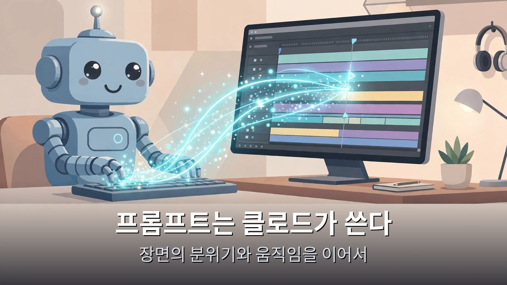
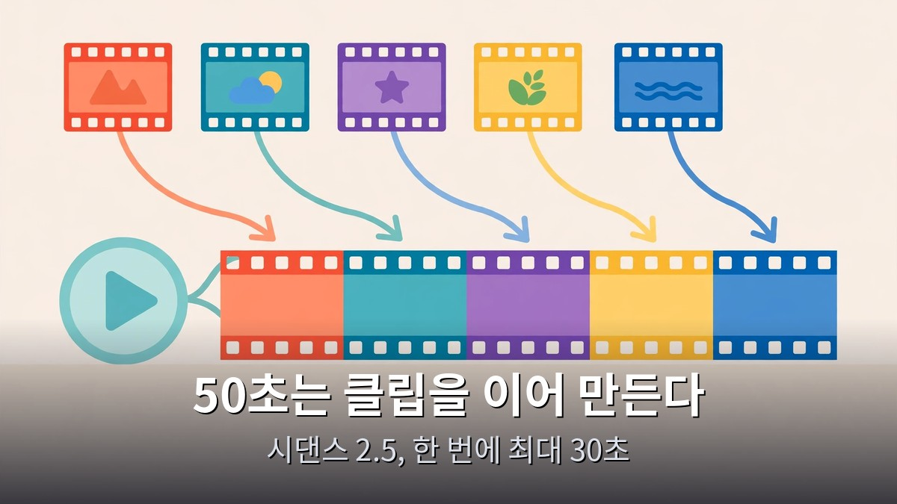

<!-- 본문 시작 -->

AI 영상을 보다 보면 한 번쯤 이런 생각이 든다.
나도 저런 걸 만들 수 있을까.
이 글은 2026년 11월 12일에 공개된 영상을 바탕으로, 클로드 페이블 5.2와 힉스필드로 50초짜리 AI 영상을 처음부터 끝까지 만드는 순서를 정리한 자료 기반 안내다.

> **핵심은 하나다. 페이블 5.2가 이미지 다섯 장을 그리고, 클로드가 프롬프트를 쓰고, 힉스필드의 시댄스가 그 이미지를 움직인다. 50초짜리 영상은 한 번에 뽑는 게 아니라 짧은 클립을 이어 만든다. 순서만 알면 하루 만에 첫 영상을 만들 수 있다.**

페이블 5.2가 왜 주목받는지 궁금하면 [클로드 페이블 5.2와 오퍼스 5.5의 실험 비교](https://blog.naver.com/3700708/224474078530)에서 두 모델의 차이를 먼저 확인하는 게 좋다.

## 페이블 5.2가 그림을 그리는 이유가 뭐야?

클로드 페이블 5.2로 이미지 다섯 장을 만든다.
영상 속 제작자는 사진을 8K 이미지로 만든다고 설명한다.
최대 다섯 장까지 이미지를 넣을 수 있다.

이미지가 영상의 뼈대가 된다.
장면마다 필요한 그림을 먼저 뽑아두는 것이다.
캐릭터와 배경이 여기서 정해진다.

왜 페이블 5.2인가.
영상 속 제작자는 페이블 5.2를 이미지 생성부터 쓰는 흐름을 보여준다.
따로 이미지 도구를 열지 않고 클로드 안에서 장면을 만든다.

다만 이 단계에서 한 가지는 짚어야 한다.
이미지가 예쁘다고 영상이 저절로 되는 건 아니다.
어떤 장면이 이어질지, 이야기가 어떻게 흘러갈지가 먼저 정해져야 한다.
그래서 다음 단계가 프롬프트다.

## 프롬프트는 누가 쓰나? 클로드가 쓴다

프롬프트를 사람이 한 줄씩 쓰는 게 아니다.
영상에서는 클로드에게 프롬프트 작성을 맡긴다.
어떤 장면을 어떻게 움직일지, 클로드가 문장으로 정리해 준다.

이게 이 흐름의 핵심이다.
이미지를 만든 모델이 영상용 지시문까지 이어서 쓴다.
장면의 분위기와 인물의 움직임이 끊기지 않게 이어진다.

50초짜리 영상은 3막 구조로 짠다.
연결, 유머, 반전이다.
처음에는 장면을 이어 붙이고, 중간에 웃음을 넣고, 마지막에 예상을 뒤집는다.

짧은 영상이 기억에 남는 건 길이가 아니라 구조다.
50초 안에 기승전결이 들어간다.
그래서 장면을 나누기 전에 3막을 먼저 정한다.
클로드에게 반복 작업을 맡기는 흐름은 [클로드 코드로 인스타 카드뉴스를 자동화한 과정](https://blog.naver.com/3700708/224474066475)에서도 같은 방식으로 이어진다.

## 힉스필드 시댄스가 이미지를 움직이는 법

그림과 프롬프트가 준비되면 힉스필드로 넘어간다.
힉스필드 안에서 시댄스 모델이 이미지에서 영상을 만든다.
영상 속 제작자는 힉스필드에서 시댄스로 영상을 생성한다.

시댄스 2.5는 바이트댄스가 2026년 7월 31일에 내놓은 영상 생성 모델이다.
한 번에 최대 30초까지 영상을 만든다.
이미지·영상·오디오를 합쳐 최대 50개까지 참고 자료로 넣을 수 있다.

여기서 꼭 알아야 할 조건이 있다.
시댄스 2.5는 한 번에 30초까지만 만든다.
그런데 영상 속 완성본은 50초다.
즉 50초짜리 영상은 한 번에 뽑은 게 아니라, 짧은 클립을 여러 번 만들어 이어 붙인 것이다.
이 조건을 모르면 "왜 한 번에 50초가 안 나오지" 하고 막힌다.

요금제도 미리 확인해야 한다.
시댄스 2.5는 힉스필드의 유료 Plus 요금제부터 쓸 수 있다.
가장 낮은 Starter 요금제에는 시댄스 2.0 Fast와 2.0 Mini만 들어 있다.
무료로 시작해 바로 2.5를 쓸 수 있는 구조가 아니다.
만들기 전에 내 요금제에 2.5가 들어 있는지 확인하는 게 먼저다.

## 따라 하기 전에 확인할 것

| 확인 항목 | 내용 |
|---|---|
| 이미지 | 페이블 5.2로 장면 이미지 최대 5장 준비 |
| 이야기 | 50초 영상을 연결–유머–반전 3막으로 나누기 |
| 프롬프트 | 클로드에게 장면별 움직임·분위기 지시문 작성 맡기기 |
| 영상 생성 | 힉스필드 시댄스 2.5, 한 번에 최대 30초 |
| 요금제 | 시댄스 2.5는 Plus 요금제부터, Starter에는 없음 |
| 완성 | 50초는 여러 클립을 이어 만든다는 전제 확인 |

처음부터 완벽한 영상을 노리지 않는 게 좋다.
영상 속 제작자도 "단 하루 만에 처음부터 끝까지"를 강조한다.
하루의 목표는 완성작이 아니라 첫 영상 하나다.

장면이 어색하면 프롬프트를 고치고 다시 뽑는다.
클립이 짧으면 여러 개를 이어 붙인다.
이 반복이 이 흐름의 실제 작업이다.

**이 글에서만 얻는 것: 영상 속 50초 완성본은 시댄스 2.5의 1회 최대 30초를 넘는 분량이라, 여러 클립을 이은 것이라는 점을 공식 스펙과 대조해 확인했다. 시작 전에 요금제와 분량 조건을 먼저 확인하면 첫 시도에서 막히는 일을 줄일 수 있다.**

## 자주 묻는 질문

**페이블 5.2만 있으면 AI 영상을 만들 수 있나요?**
이미지까지는 페이블 5.2로 만들 수 있다.
하지만 이미지를 움직이는 건 힉스필드 시댄스의 몫이다.
두 도구를 이어 쓰는 흐름이다.

**50초 영상을 한 번에 만들 수 있나요?**
시댄스 2.5는 한 번에 최대 30초까지만 만든다.
50초짜리 영상은 짧은 클립을 여러 번 만들어 이어 붙여야 한다.

**무료로 시작할 수 있나요?**
시댄스 2.5는 힉스필드 유료 Plus 요금제부터 쓸 수 있다.
Starter 요금제에는 시댄스 2.0 계열만 들어 있다.
시작 전에 요금제를 확인해야 한다.

**프롬프트를 꼭 클로드에게 맡겨야 하나요?**
영상 속 제작자는 클로드에게 맡기는 방식을 보여준다.
직접 써도 되지만, 장면의 분위기와 움직임을 일관되게 이어가려면 모델에게 맡기는 편이 수월하다.

**처음 만들 때 무엇부터 하나요?**
3막 구조부터 정한다.
연결–유머–반전이라는 뼈대가 정해져야 이미지 다섯 장이 무슨 장면인지 정해진다.

## 함께 읽으면 좋은 글
[클로드 페이블 5.2, 뭐가 달라졌나 — 8일 만에 운영체제, 30시간 만에 페르마 정리](https://blog.naver.com/3700708/224474080104)
[엑스 마키나｜로봇에게 마음을 묻는 108분, 튜링 테스트의 진짜 질문](https://blog.naver.com/3700708/224474081075)
[블레이드 러너 2049｜인간과 복제인간의 경계를 묻는 163분](https://blog.naver.com/3700708/224474068089)

첫 AI 영상, 완벽하게 만들려고 미루지 말고 이미지 다섯 장부터 뽑아보세요.
이 주제를 계속 따라가려면 이웃 추가를 눌러두세요.
다음 영상 도구 소식이 나올 때 또 정리해서 가져오겠습니다.

<!-- 본문 끝 -->

## 작업용 출처·이미지 정보 (업로드 제외)

- 자료 출처: 오후다섯씨 영상 oZg6hjEhb9k(2026-11-12, 8분 48초, 자막 패널 확인 — 자동자막 반복 왜곡 구간 있어 확인된 핵심만 사용) + Seedance 2.5 공식 스펙 대조(Higgsfield 블로그·Aliteq, 2026-11-13 검색)
- 이미지: images/01-hero.jpg ~ 04-img3.jpg / 자작 일러스트 + 한글 배너 오버레이 (1200x675)
