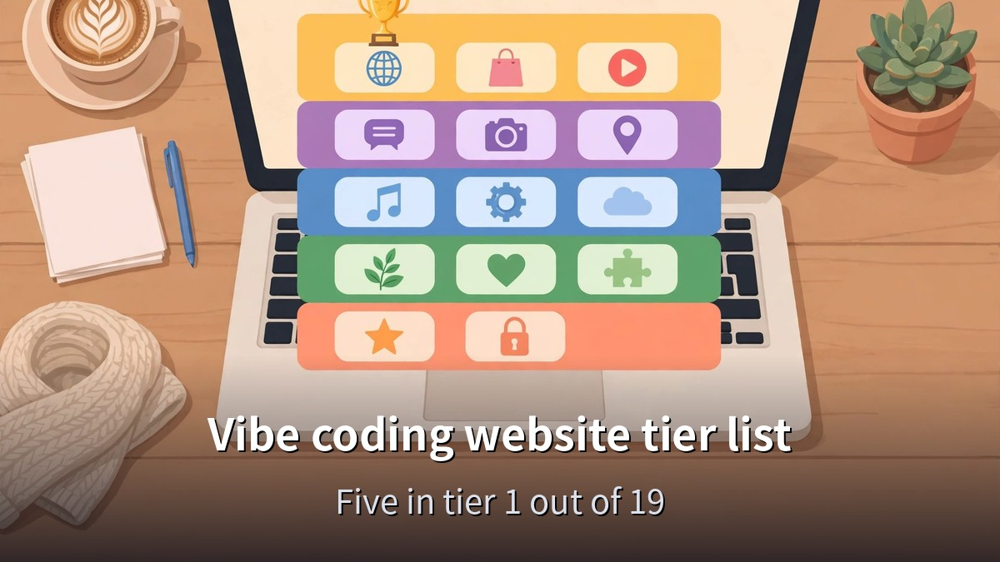
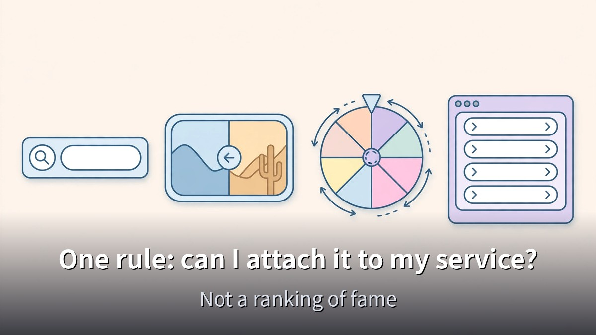
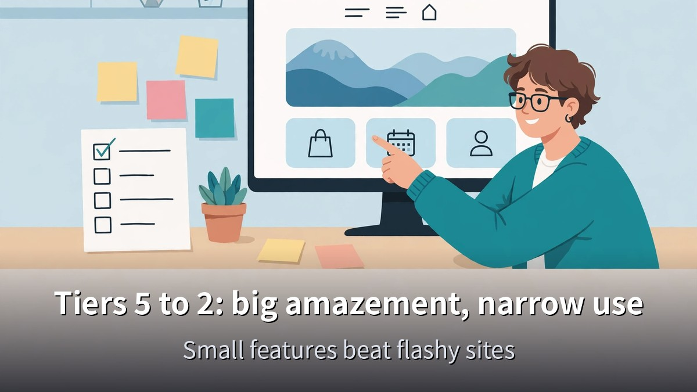
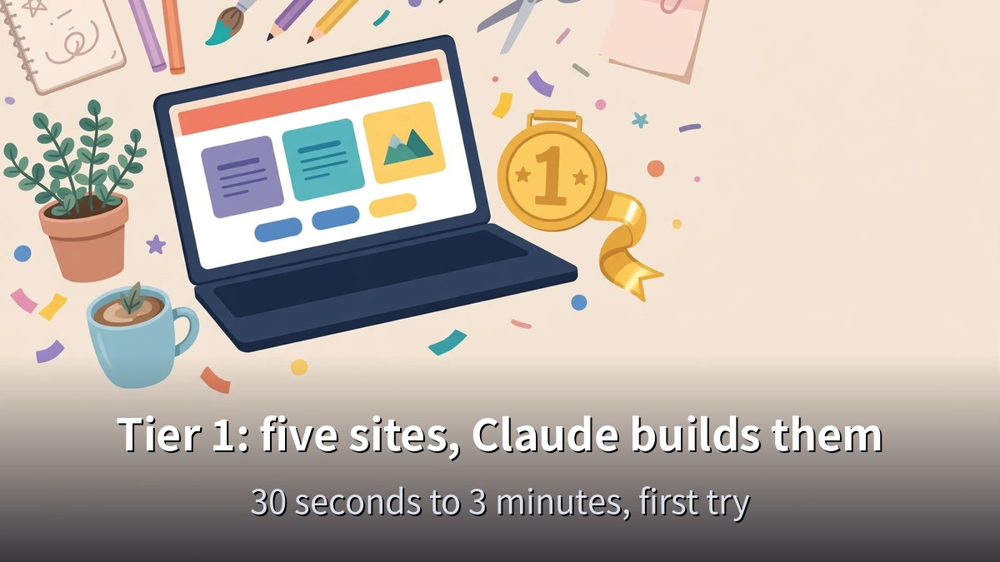

<!-- 본문 시작 -->

Vibe coding means building by telling an AI what to make, without writing code yourself.
But once you start, the first wall is deciding what to build.
This post is based on a video published on November 12, 2026, and ranks 19 websites worth referencing for vibe coding, from tier 1 to tier 5, and shows how the top-tier features can be recreated by asking Claude.

> **The short version: the best references for vibe coding are not flashy sites, but small features that are definitely convenient — one input box, one slider, one window. Of the 19 sites, the five in tier 1 turn into working pages in 30 seconds to 3 minutes when you ask Claude in a single sentence.**

Before asking Claude to build anything, [how to start Claude for free, and the 5 drawbacks to check first](https://aitechnotesen.blogspot.com/2026/11/start-claude-for-free-what-you-get-what.html) shows what the free plan covers.

## The tier list has one rule: can I attach it to my service?

The ranking has exactly one criterion.
How much you want to reference it when vibe coding.
Tier 1 means you want to copy it the moment you see it, and it actually works fast.
Tier 5 means it is amazing to look at but useless for your own service.

It is not a ranking of fame or polish.
It is a ranking of whether you can attach it to your shop or your service.
That is why famous sites like Notion, Wordle, and Perplexity are left out.
Notion's best features sit behind a login, Wordle was replaced by the Korean Kkomantle, and Perplexity's AI answer screen is too familiar now.

One thing to settle first.
Referencing here means ideas and behavior only.
Logos, designs, and the site's own words belong to that company.
Copying them as-is is not allowed.
"Type and the screen changes" or "click and it turns" — take only the behavior, and make the look your own.

## Tiers 5 to 2: big amazement, narrow use

Tier 5 starts with Pointer Pointer.
Wherever you stop the mouse, a photo of a person pointing at exactly that spot appears.
The secret is not code but photos.
So many photos of pointing at different spots were collected that the photos are the product — to copy it, you would have to gather the photos first.

The second tier 5 site is Bruno Simon's portfolio.
You drive a toy car around to look at his work.
The amazement is the best on the whole list, but it took long work on 3D models and physics, and it is one person's portfolio — enough to admire.

Tier 4 holds sites that are amazing and buildable, but awkward to put into your own service.
The Password Game is a password-making game where the rules keep growing.
Easy to imitate, but put it on a real signup screen and customers will laugh and leave.
The Deep Sea shows a depth number dropping as you scroll down, with the creatures that live at each depth appearing one by one.
A Korean version exists.
The scroll-and-number device is quick to copy, but filling each depth with pictures and facts is the real work.
Excalidraw is a hand-drawn-style whiteboard with more than 130,000 GitHub stars.
Rebuilding it would take far more than a few days, but it is open source, so you can take the whole thing and attach it.
The lesson for tier 4: when something is too big, do not rebuild it — take it and use it.

Tier 3 holds sites with a clear use that depends on the situation.
Spend Bill Gates' Money starts you with Bill Gates' fortune and subtracts the price of each item in real time.
Easy to build, but its use is limited to an event page, so it is tier 3.
Quick Draw is Google's site where the AI guesses your doodle in real time.
Copying it means attaching a separate drawing-recognition AI, so it is tier 3.
Kkomantle is a Korean site that scores how close your word is to the word of the day.
It needs a separate AI that turns words into numbers, so it is tier 3.
Pixel Thoughts lets you write a worry into a star, and the star shrinks away into space over 60 seconds.
A Korean version exists now.
Its maker says it was built over a weekend at a 2015 hackathon.
Easy to make and moving to use, but its place is limited to an event page.

Tier 2 holds sites you really want to reference, with a little more work than tier 1.
Infinite Craft lets you drag two words together and the AI makes a new word.
It went viral in January 2024, so hot the servers struggled.
Each combination calls the AI, so it costs money per use — that is why it is not tier 1.
Stripe is a payment company's homepage, with paint-like colors flowing in the background and a live number showing what share of world GDP runs through Stripe, rising to 8 decimal places in real time.
Take only two ideas: the flowing background and the living number.
And only when your number is real.
Making a baseless number rise is not staging — it is lying.
Undraw is a free illustration site where picking one color changes the accent color of every illustration on the page at once.
One illustrator started it in 2017.
If you build one changeable accent color into your image files, your whole site's pictures take on your brand color.
When2meet is a scheduling site that asks for no signup, no contact details, no payment info.
Drag across dates and you are done, and overlapping times show darker.
To collect many people's answers you need a separate place to store them, so it is tier 2.
KTest is a Korean site where answering a few questions gives you a type result with its own shareable address.
In a 2023 interview, its CEO said the best-performing tests each drew more than 10 million visits.
Writing the questions and result texts takes real time, so it is tier 2.

A few bonus sites were not tiered but are worth a look.
Today's House puts small dots on furniture in a home photo — tap a dot and you jump to that product.
The photo is the buy button.
Duolingo's growth lead said that moving the signup screen later raised email signups by about 20%.
TossPayments lets you attach payment methods, terms, and a pay button as one widget, and its company blog has a guide to building a payment page in 30 minutes.
The AirPods Pro page is famous for its scroll-driven cinematic effect, but its core is Apple's own video and photos — you cannot copy it without your own product shots.

## Tier 1: five sites, and Claude builds them right away

Tier 1 holds sites you want to copy the moment you see them, and that actually work fast.
From here on, the video does not just show the sites — it shows what happened when Claude was asked to build the same feature.

The first tier 1 site is Noonnu, a Korean site collecting free Korean fonts.
Type a shop name in the box above the free-font menu and every font in the list below changes to that text.
Claude was asked: "Make a web page where typing our shop name changes five free Korean font cards below to that name right away. Use only fonts that are free for commercial use. Make it a single HTML file."
The answer came in about 30 seconds.
Five cards changed at once, each with a note that the font is free for commercial use.
Attach this to a product page and customers see their own name in the result before buying.

The second is Squoosh, an image compressor made by Google's Chrome team.
Drag the bar in the middle and the left side shows the image before compression, the right side after, on one screen.
Photos are compressed on your own computer, not sent to a server.
Attach this one bar to before-and-after photos — cleaning, remodeling, retouching — and the difference is obvious at a glance.
One bar is why it is tier 1.

The third is Realtime Colors.
Pick five colors and a realistic homepage preview is painted with them on the spot.
Press the spacebar and a new palette appears, saved in the address so the link can be shared.
Its maker says it was built over a weekend.
Claude was asked to attach a color-change toolbar to a sample cafe homepage, and the answer took about 3 minutes.
Pressing the spacebar changed the background, text, and accent colors together, and the color codes in the address changed too, so reopening the link showed the same colors.
It even filtered out color combinations where the text would be unreadable.

The fourth is Wheel of Names.
List names line by line, spin the wheel, and it slows down until one winner appears with confetti.
The winner can be removed from the list with one button and the wheel spun again.
For a one-person business, it is an event drawing tool in itself.
Claude was asked to build an Instagram comment event picker, and the answer took about 2 minutes.
Eight names went in, the wheel slowed to one winner with confetti, and removing the winner and spinning again used the remaining seven.
It even added an option to count a person who commented several times only once.

The top of tier 1, the number one of the whole list, is Linear.
It is a task-management service for development teams, and pressing Command-K on its homepage opens a single search window in the middle.
Type a few letters of "pricing" and only the menu leading to the pricing page remains, with a shortcut key shown next to each menu.
No need to hunt through menus — one window calls every feature.
It is number one because it fits any service.
A shop can search products, a blog can search posts, and any site with more than ten menus can call them all from this window.
Claude was asked to add a command window to a sample site with about ten menus, and the answer took about a minute and a half.
Pressing Command-K opened the window, typing a letter or two narrowed the menu to one, and pressing Enter went straight to the settings page.
All four recreations worked on the first answer, with no fixes needed.

Choosing the right model matters here too — [this comparison of Fable 5.2 and Opus 5.5 across four experiments](https://aitechnotesen.blogspot.com/2026/11/fable-52-vs-opus-55-4-experiments-that.html) shows when the expensive model is worth picking.

## Today's one job: pick one tier 1 feature and ask Claude

| Tier | Sites | Claude recreation time |
|---|---|---|
| Tier 1 | Noonnu, Squoosh, Realtime Colors, Wheel of Names, Linear | Noonnu 30 sec, Realtime Colors 3 min, Wheel of Names 2 min, Linear 1 min 30 sec |
| Tier 2 | Infinite Craft, Stripe, Undraw, When2meet, KTest | — |
| Tier 3 | Spend Bill Gates' Money, Quick Draw, Kkomantle, Pixel Thoughts | — |
| Tier 4 | The Password Game, The Deep Sea, Excalidraw | — |
| Tier 5 | Pointer Pointer, Bruno Simon | — |

One funny thing about the list.
Tiers 5 and 4 hold the sites that make you gasp, and tier 1 holds small features — one input box, one bar, one window.
For vibe coding, the good references are not the flashy sites but the small features that are definitely convenient.

Realtime Colors in tier 1 and Pixel Thoughts in tier 3 were both built over a weekend, their makers say.
You do not need a big company — one solid feature can make a site people all over the world come to use.

Today's job is one thing.
Pick one of the five tier 1 features that fits your shop or your service, and ask Claude to build it in a single sentence.
Leave the logos and design words out, and take only the behavior.
The four prompts used in the video are written in the video description, so you can copy them and use them right away.

**What you only get here: the Claude recreation times for the four tier 1 features, checked against the video transcript and laid out in a table. Noonnu 30 seconds, Realtime Colors 3 minutes, Wheel of Names 2 minutes, Linear 1 minute 30 seconds — all four worked on the first answer, which is the evidence for "start with a small feature."**

## Frequently asked questions

**What is vibe coding?**
Building by telling an AI what to make, without writing code yourself.
This post's list is the websites worth referencing when you do that.

**Can I copy a tier 1 feature as-is?**
No.
Referencing means ideas and behavior only.
Logos, designs, and a site's own words belong to that company.

**Where are the prompts Claude was given?**
All four prompts are written in the video description.
You can copy them and use them right away.

**Can I start for free?**
Sites like Noonnu, Squoosh, Realtime Colors, Wheel of Names, and Excalidraw can be referenced for free.
Recreating them with Claude depends on Claude's own terms.

**I don't know what to build first.**
Start by picking one of the five tier 1 features that fits your service.
A small feature that is definitely convenient comes before a flashy one.

## Good reads
[Claude Fable 5.2: What Actually Changed — An OS in 8 Days, Fermat in 30 Hours](https://aitechnotesen.blogspot.com/2026/11/claude-fable-52-what-actually-changed.html)
[Start Claude for Free: What You Get, What You Don't, and 5 Drawbacks to Check First](https://aitechnotesen.blogspot.com/2026/11/start-claude-for-free-what-you-get-what.html)
[Ex Machina — 108 Minutes Asking a Robot If It Has a Mind](https://aitechnotesen.blogspot.com/2026/11/ex-machina-108-minutes-asking-robot-if.html)

Pick just one of the five tier 1 features and ask Claude to build it in one sentence.
To keep following this topic, subscribe and stay tuned — I will cover the next AI tool news the same way.

<!-- 본문 끝 -->

## 작업용 출처·이미지 정보 (업로드 제외)

- Source: 혼잡스 영상 p3C1mUFLLtg(2026-11-12, 12분 52초, 자막 0:00~12:52 전체 확인)
- Images: images/01-hero-en.jpg ~ 04-img3-en.jpg / original illustration + English banner overlay (1200x675)
