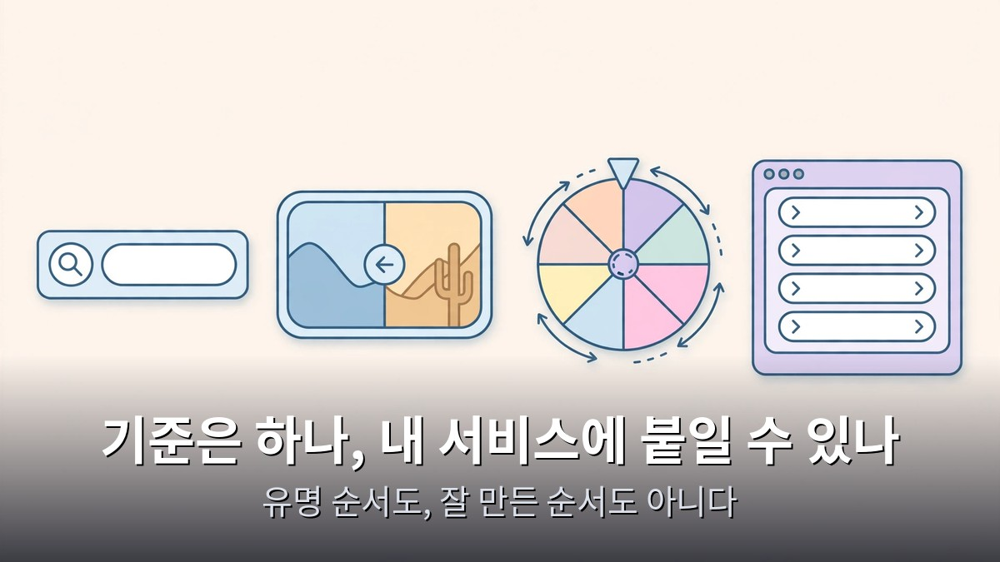

<!-- 본문 시작 -->

코딩을 직접 짜지 않고 AI에게 말로 시켜서 만드는 걸 바이브코딩이라고 한다.
그런데 막상 만들려면 무엇을 만들어야 할지부터 막힌다.
이 글은 2026년 11월 12일에 공개된 영상을 바탕으로, 바이브코딩할 때 참고할 만한 웹사이트 19곳을 1티어부터 5티어까지 정리하고, 1티어 기능을 클로드에게 시켜 따라 만드는 법을 정리한 자료 기반 안내다.

> **핵심은 하나다. 바이브코딩에 참고하기 좋은 건 화려한 사이트가 아니라 입력창 하나, 막대 하나, 창 하나처럼 작고 확실하게 편한 기능이다. 19곳 중 1티어 다섯 곳은 클로드에게 한 문장으로 시키면 30초에서 3분 만에 동작하는 페이지가 나온다.**

클로드에게 시키기 전에 무료로 어디까지 되는지 알고 싶으면 [클로드 무료로 시작하는 법과 시작 전 확인할 5가지 단점](https://blog.naver.com/3700708/224474079288)을 먼저 보는 게 좋다.

## 티어표의 기준은 하나, 내 서비스에 붙일 수 있나

이 표의 기준은 딱 하나다.
바이브코딩할 때 참고하고 싶은 정도다.
1티어는 보자마자 따라 만들고 싶고 실제로 금방 되는 사이트다.
5티어는 보면 신기한데 내 서비스에는 못 쓰는 사이트다.

유명한 순서도, 잘 만든 순서도 아니다.
내 가게, 내 서비스에 가져다 붙일 수 있느냐의 순서다.
그래서 노션, 워들, 퍼플렉시티 같은 유명한 사이트는 표에서 빠졌다.
노션은 심박한 기능이 로그인 뒤에 있고, 워들은 한국판 꼬맨틀로 대신했고, 퍼플렉시티는 AI 답변 화면이 이제 너무 익숙해졌기 때문이다.

먼저 짚을 게 있다.
여기서 참고한다는 건 아이디어와 동작만이다.
로고나 디자인, 사이트에 적힌 문구는 그 회사의 것이다.
그대로 가져오면 안 된다.
입력하면 화면이 바뀐다, 누르면 돌아간다 — 이런 동작만 가져와서 겉모습은 내 것으로 새로 만드는 것이다.

## 5티어부터 2티어, 감탄은 크고 쓸 곳은 좁다

5티어 첫 번째는 포인터 포인터다.
마우스를 아무데나 멈추면 딱 그 자리를 손가락으로 가리키는 사람 사진이 뜬다.
비밀은 코드가 아니라 사진이다.
화면 곳곳을 가리키는 사진을 아주 많이 모아둔 게 본체라서, 따라 만들려면 사진부터 모아야 한다.

5티어 두 번째는 브루노 사이먼의 포트폴리오다.
장난감 자동차를 몰고 다니면서 작품을 둘러보게 만들었다.
보는 순간의 감탄은 표에서 최고지만, 3D 모델과 물리 효과를 오래 다듬어야 나오는 결과물이고 한 사람의 개인 작품이라 보는 걸로 충분하다.

4티어는 신기하고 만들 수도 있는데 내 서비스에 넣기 애매한 사이트들이다.
더 패스워드 게임은 규칙이 하나씩 늘어나는 비밀번호 만들기 게임이다.
흉내 내기는 쉽지만 진짜 회원 가입 화면에 넣으면 손님은 웃다가 떠난다.
더 딥 시는 화면을 아래로 내릴수록 수심 숫자가 내려가고 그 깊이에 사는 생물이 나타난다.
스크롤하면 숫자가 바뀌는 장치는 금방 따라 하지만, 깊이마다 들어간 그림과 자료를 채우는 게 진짜 일이다.
엑스칼리드로는 손으로 그린 듯한 화이트보드로, 깃허브 별이 13만 개가 넘는다.
똑같이 만들려면 며칠로는 어림없지만 오픈소스라 통째로 가져다 쓰면 된다.
너무 크면 따라 만들지 말고 가져다 쓰라는 교훈으로 4티어에 뒀다.

3티어는 쓸 때는 분명히 있는데 상황을 타는 사이트들이다.
스펜드 빌 게이츠 머니는 빌 게이츠의 재산만큼 돈을 들고 물건을 사면 남은 돈이 실시간으로 줄어든다.
만들기는 쉽지만 쓸 자리가 이벤트 정도라 3티어다.
퀵드로우는 구글이 만든 사이트로, 낙서를 그리는 동안 AI가 실시간으로 맞힌다.
똑같이 만들려면 그림을 알아보는 AI를 따로 붙여야 해서 3티어다.
꼬맨틀은 단어를 넣으면 오늘의 정답 단어와 뜻이 얼마나 가까운지 점수로 알려주는 한국 사이트다.
단어를 숫자로 바꿔 주는 AI를 따로 연결해야 해서 3티어다.
픽셀 쏘츠는 별 안에 걱정을 적으면 60초 동안 별이 우주 저편으로 작아지면서 사라진다.
만든 사람이 2015년 해커톤에서 주말 동안 만들었다고 밝힌 사이트로, 만들기는 쉽고 감동도 크지만 쓸 자리가 이벤트 페이지 정도로 좁다.

2티어는 꼭 참고하고 싶은데 1티어보다 손이 조금 더 가는 사이트들이다.
인피니트 크래프트는 단어 두 개를 끌어다 겹치면 AI가 새 단어를 만들어 낸다.
2024년 1월에 나오자마자 서버가 버거울 만큼 화제가 됐다.
합칠 때마다 AI를 부르니 쓰는 만큼 비용이 들어 1티어가 아니다.
스트라이프는 결제 회사 홈페이지로, 배경의 물감 같은 색이 계속 흐르고 전 세계 GDP 중 몇 퍼센트가 스트라이프로 돌아간다는 숫자가 소수점 8자리까지 실시간으로 오른다.
참고할 건 흐르는 배경과 살아 움직이는 숫자, 이 두 가지뿐이다.
단, 내 숫자가 진짜일 때만 써야 한다.
근거 없는 숫자를 올라가게 만들면 연출이 아니라 거짓말이 된다.
언드로는 무료 일러스트 사이트로, 색 하나만 고르면 화면의 일러스트 전부의 강조색이 한꺼번에 바뀐다.
2017년에 일러스트레이터 한 사람이 시작했다.
내 그림 파일 안에 강조색 하나를 바꿀 수 있게 만들어 두면 사이트 전체 그림이 내 브랜드 색으로 통일된다.
웬투밋은 여러 사람의 약속 시간을 잡는 사이트로, 가입도 연락처도 묻지 않는다.
날짜를 마우스로 끌어서 칠하면 끝이고, 겹치는 시간이 더 진하게 보인다.
여러 사람의 답을 모으려면 저장하는 곳이 따로 있어야 해서 2티어다.
케이테스트는 질문 몇 개에 답하면 유형 결과 그림이 나오고 결과마다 주소가 따로 생기는 한국 사이트다.
2023년 인터뷰에서 대표는 반응이 가장 좋았던 테스트들이 모두 천만 명 넘게 방문했다고 밝혔다.
질문과 결과 글을 쓰는 데 시간이 꽤 들어 2티어다.

번외로 표에는 넣지 않았지만 참고할 만한 사이트도 있다.
오늘의집은 집 사진 속 가구 위에 작은 점을 누르면 그 상품으로 바로 넘어간다.
사진이 곧 구매 버튼인 셈이다.
듀오링고는 가입 화면을 뒤로 밀었더니 메일을 쓰는 사람이 약 20% 늘었다고 성장 담당 책임자가 밝혔다.
토스페이먼츠는 결제 수단과 약관, 결제 버튼을 위젯 하나로 붙이게 해 주고, 30분 안에 결제 페이지를 만드는 글까지 회사 블로그에 있다.
에어팟 프로 페이지는 화면을 내릴 때마다 제품이 돌고 갈라지는 연출로 유명하지만, 본체는 애플이 찍은 영상과 사진이라 내 제품 사진 없이는 따라할 수 없다.

표에는 넣지 않았지만 [1인 사업가의 AI 비서·고문 시스템을 따라 만드는 법](https://blog.naver.com/3700708/224474063959)도 같은 맥락이다. 도구가 아니라 "무엇을 만들지"를 정하는 게 먼저다.

## 1티어 5곳, 클로드에게 시키면 바로 동작한다

1티어는 보자마자 따라 만들고 싶고 실제로 금방 되는 사이트들이다.
여기서부터는 사이트만 보여주지 않고, 클로드에게 똑같은 기능을 만들어 달라고 시킨 결과까지 같이 보여준다.

1티어 첫 번째는 눈누다.
무료 한글 폰트를 모아둔 한국 사이트로, 무료 폰트 메뉴 위쪽 칸에 가게 이름을 치면 아래 폰트 목록이 전부 그 글자로 바뀌어 보인다.
클로드에게 "우리 가게 이름을 치면 아래 무료 한글 폰트 다섯 개 카드에 그 이름이 바로 바뀌어 보이는 웹페이지를 만들어 줘. 폰트는 상업적으로 무료인 것만 써줘. HTML 파일 하나로 만들어 줘"라고 시켰다.
답은 30초쯤 만에 나왔다.
다섯 카드가 한 번에 바뀌었고, 폰트마다 상업적으로 무료로 쓸 수 있다는 라이선스 설명까지 붙었다.
이 동작을 상품 페이지에 붙이면 손님이 사기 전에 자기 이름이 들어간 결과를 먼저 본다.

두 번째는 스퀴시다.
구글 크롬 팀이 만든 이미지 줄이기 사이트로, 가운데 막대를 좌우로 밀면 왼쪽은 줄이기 전, 오른쪽은 줄인 뒤 사진이 한 화면에 갈라져 보인다.
사진은 서버로 보내지 않고 내 컴퓨터 안에서 줄인다.
보정 전후, 청소 전후, 리모델링 전후 사진에 이 막대 하나만 붙이면 차이가 한눈에 보인다.
막대 하나라서 만들기도 쉬운 편이라 1티어다.

세 번째는 리얼타임 컬러스다.
색 다섯 개를 고르면 진짜 홈페이지처럼 생긴 화면 전체에 그 색이 바로 칠해진다.
스페이스바를 누를 때마다 새 색 조합이 나오고, 그 조합이 주소에 저장돼 링크로 보낼 수도 있다.
만든 사람이 주말 동안 만들었다고 밝힌 사이트다.
클로드에게 예시 카페 홈페이지에 색 바꿔보기 툴바를 붙여 달라고 시키니 답은 3분쯤 걸렸다.
스페이스바를 누를 때마다 배경색, 글자색, 강조색이 한꺼번에 바뀌었고, 주소 끝에 색 코드도 같이 바뀌어서 그 주소를 다시 열어도 같은 색으로 열렸다.
글자가 안 읽히는 색 조합은 알아서 걸러내는 장치까지 들어 있었다.

네 번째는 휠 오브 네임즈다.
이름을 줄마다 놓고 돌림판을 누르면 빙글빙글 돌다가 천천히 멈추면서 당첨자가 뜬다.
당첨자는 버튼 하나로 목록에서 빼고 바로 다시 돌릴 수 있다.
1인 사업자에게는 이벤트 추첨 도구 그 자체다.
클로드에게 인스타 댓글 이벤트 추첨기를 만들어 달라고 시키니 답은 2분쯤 걸렸다.
여덟 명을 넣고 돌리니 점점 느려지다가 한 명에서 멈추고 꽃가루와 함께 당첨이 떴고, 당첨자를 빼고 다시 돌리니 남은 일곱 명으로 다시 돌았다.
같은 사람이 댓글을 여러 번 달아도 한 번만 넣는 옵션도 알아서 붙여 줬다.

1티어 맨 위, 이번 표의 1등은 리니어다.
개발팀이 할 일을 관리하는 서비스인데, 홈페이지에서 커맨드 K를 누르면 가운데 검색창 하나가 뜬다.
가격이라는 단어 앞글자 몇 개만 쳐도 가격 페이지로 가는 메뉴만 남고, 메뉴마다 옆에 단축키까지 적혀 있다.
메뉴를 하나하나 찾아다닐 필요 없이 창으로 모든 기능을 부르는 것이다.
이게 1등인 이유는 어떤 서비스에도 붙기 때문이다.
쇼핑몰이면 상품 찾기, 블로그면 글 찾기, 메뉴가 열 개를 넘는 사이트라면 이 창으로 다 부를 수 있다.
클로드에게 메뉴가 열 개쯤 있는 예시 사이트에 명령창을 만들어 달라고 시키니 답은 1분 반쯤 걸렸다.
커맨드 K를 누르니 가운데 창이 떴고, 글자 한두 개만 쳐도 메뉴가 좁혀졌고, 엔터를 누르니 설정 페이지로 바로 넘어갔다.
네 개 모두 다시 고쳐 달라고 할 필요 없이 첫 답에서 바로 동작했다.

## 오늘 할 일은 하나, 1티어에서 하나만 골라 시켜보기

| 티어 | 사이트 | 클로드 재현 소요 시간 |
|---|---|---|
| 1티어 | 눈누, 스퀴시, 리얼타임 컬러스, 휠 오브 네임즈, 리니어 | 눈누 30초, 리얼타임 컬러스 3분, 휠 오브 네임즈 2분, 리니어 1분 30초 |
| 2티어 | 인피니트 크래프트, 스트라이프, 언드로, 웬투밋, 케이테스트 | — |
| 3티어 | 스펜드 빌 게이츠 머니, 퀵드로우, 꼬맨틀, 픽셀 쏘츠 | — |
| 4티어 | 더 패스워드 게임, 더 딥 시, 엑스칼리드로 | — |
| 5티어 | 포인터 포인터, 브루노 사이먼 | — |

표에서 재밌는 게 하나 있다.
5티어와 4티어에는 보는 순간 감탄이 나오는 사이트들이 있고, 1티어에는 입력창 하나, 막대 하나, 창처럼 작은 기능들이 있다.
바이브코딩으로 참고하기 좋은 건 화려한 사이트가 아니라 작게 확실하게 편한 기능이었다.

1티어 리얼타임 컬러스와 3티어 픽셀 쏘츠는 둘 다 만든 사람이 주말 동안 만들었다고 밝힌 사이트다.
큰 회사가 아니어도 기능 하나만 확실하면 전 세계 사람들이 찾아 쓰는 사이트가 될 수 있다는 뜻이다.

오늘 할 일은 하나다.
1티어 다섯 개 가운데 내 가게, 내 서비스에 붙일 기능 하나만 고르고, 그 기능을 클로드에게 한 문장으로 시켜 보는 것이다.
로고와 디자인 문구는 빼고 동작만 가져오는 것이다.
영상에서 클로드에게 시킨 요청문 네 개는 영상 설명란에 그대로 적혀 있으니 복사해서 바로 써 볼 수 있다.

**이 글에서만 얻는 것: 1티어 네 곳의 클로드 재현 시간을 영상 자막과 대조해 표로 정리했다. 눈누 30초, 리얼타임 컬러스 3분, 휠 오브 네임즈 2분, 리니어 1분 30초 — 네 곳 모두 첫 답에서 바로 동작했다는 점이 "작은 기능부터"라는 선택 기준의 근거다.**

## 자주 묻는 질문

**바이브코딩이 뭔가요?**
코드를 직접 짜지 않고 AI에게 말로 시켜서 만드는 것이다.
이 글의 표는 그때 참고할 웹사이트를 고른 것이다.

**1티어 기능을 그대로 베껴도 되나요?**
안 된다.
참고한다는 건 아이디어와 동작만이다.
로고나 디자인, 사이트에 적힌 문구는 그 회사의 것이라 그대로 가져오면 안 된다.

**클로드에게 시킨 요청문은 어디에 있나요?**
영상 설명란에 요청문 네 개가 그대로 적혀 있다.
복사해서 바로 써 볼 수 있다.

**무료로 시작할 수 있나요?**
눈누, 스퀴시, 리얼타임 컬러스, 휠 오브 네임즈, 엑스칼리드로 같은 사이트는 무료로 참고할 수 있다.
클로드 재현은 클로드 이용 조건에 따라 달라진다.

**무엇부터 만들어야 할지 모르겠어요.**
1티어 다섯 개 가운데 내 서비스에 붙일 기능 하나만 고르는 것부터 시작한다.
화려한 것보다 작고 확실하게 편한 기능이 먼저다.

## 함께 읽으면 좋은 글
[제미나이 4 카본 정식 출시 — 누가 쓸 수 있고 가격은 얼마인가](https://blog.naver.com/3700708/224474053353)
[클로드 코드로 인스타 카드뉴스 자동화 — 레퍼런스 수집부터 제작까지](https://blog.naver.com/3700708/224474066475)
[엑스 마키나｜로봇에게 마음을 묻는 108분, 튜링 테스트의 진짜 질문](https://blog.naver.com/3700708/224474081075)

1티어 다섯 개 중 하나만 골라 클로드에게 한 문장으로 시켜보세요.
여러분이 가장 참고하고 싶은 사이트가 어디였는지 댓글로 알려주세요.
이 주제를 계속 따라가려면 이웃 추가를 눌러두세요.

<!-- 본문 끝 -->

## 작업용 출처·이미지 정보 (업로드 제외)

- 자료 출처: 혼잡스 영상 p3C1mUFLLtg(2026-11-12, 12분 52초, 자막 0:00~12:52 전체 확인)
- 이미지: images/01-hero.jpg ~ 04-img3.jpg / 자작 일러스트 + 한글 배너 오버레이 (1200x675)
