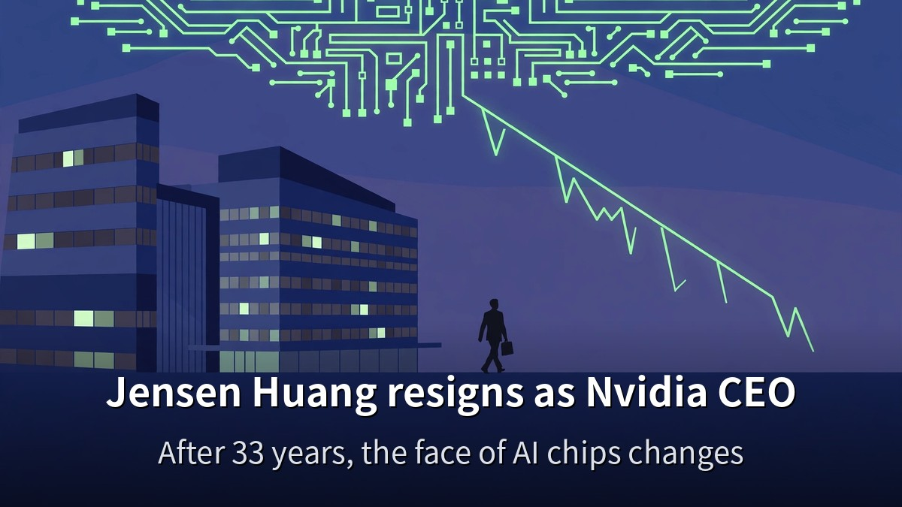
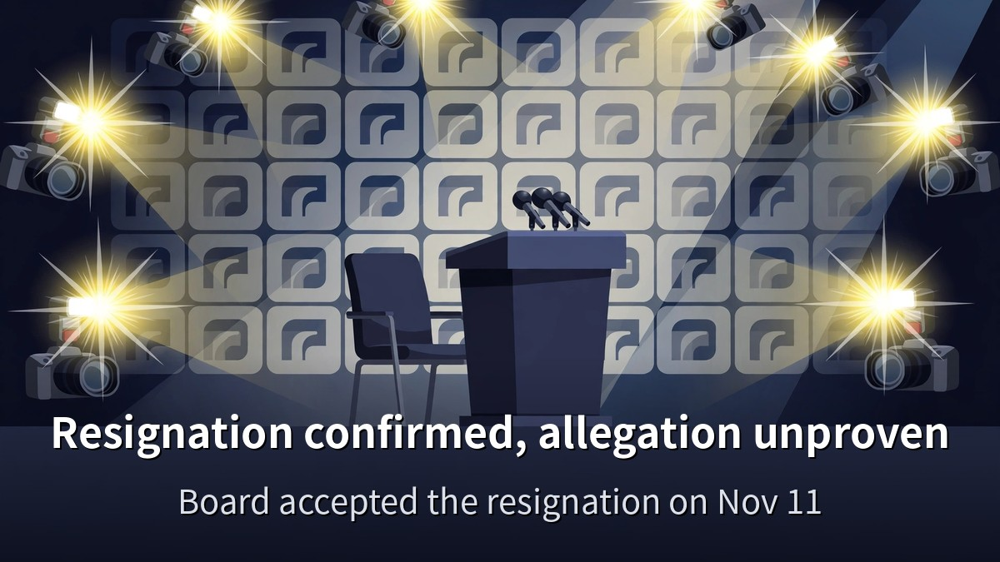
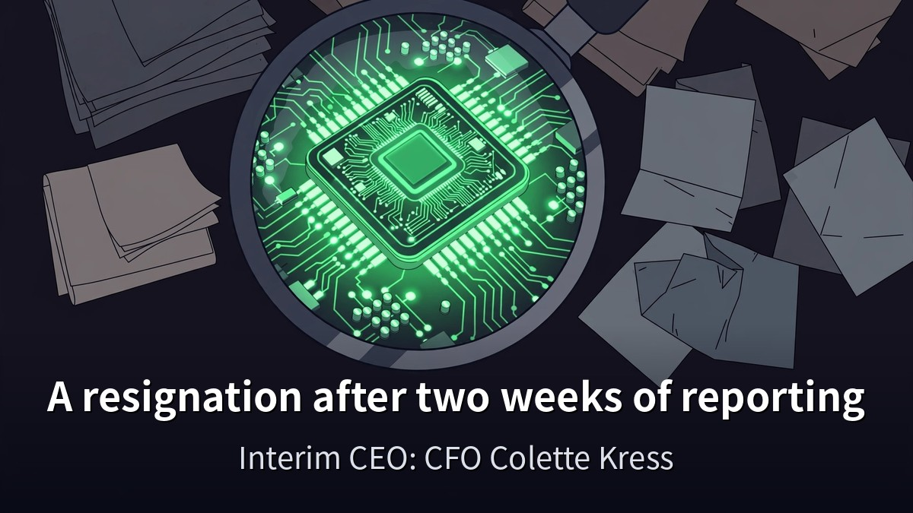
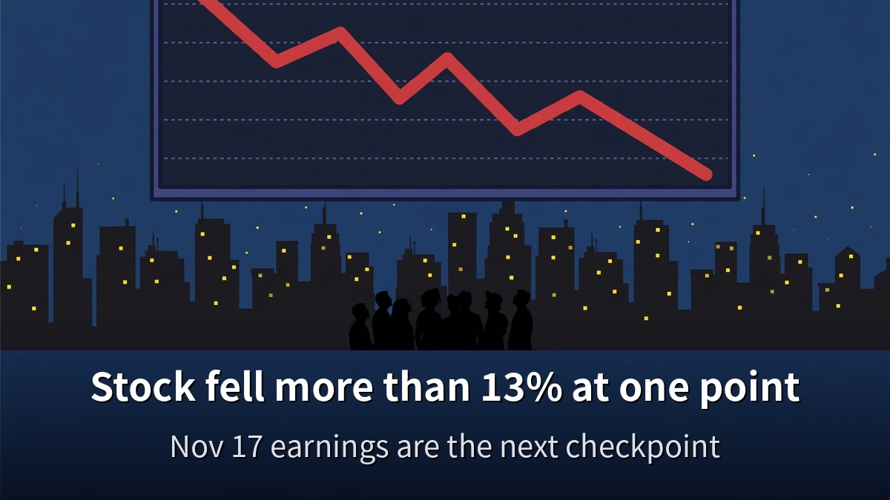

<!-- 본문 시작 -->

The biggest story in AI right now has broken.
Jensen Huang, who led Nvidia for 33 years, has stepped down as CEO.
This post is based on a video published on November 12, 2026, checked against same-day reporting from several outlets, and separates what is confirmed from what is still an unproven allegation.

> **The short version: on November 12, Jensen Huang resigned as Nvidia CEO and left the board, effective immediately, and CFO Colette Kress became interim CEO. The resignation is a confirmed fact. The spy allegation raised as background is not proven. The stock fell more than 13% at one point.**

For more on how the AI landscape is shifting the same week, [what actually changed in Claude Fable 5.2](https://aitechnotesen.blogspot.com/2026/11/claude-fable-52-what-actually-changed.html) is worth reading alongside this post.

## What is confirmed about the resignation

On November 12, 2026, Nvidia announced that Jensen Huang had resigned as president, chief executive officer, and a member of the board, effective immediately.
The board accepted his resignation the day before, on November 11.
The same was disclosed in a filing with the US Securities and Exchange Commission.

The interim CEO is CFO Colette Kress.
She has served as executive vice president and CFO since September 2013, and she keeps the CFO role while serving as interim CEO.
The board has begun a search for a permanent successor, looking at internal and external candidates.

A board chair was also named.
Harvey C. Jones was appointed as Nvidia's first-ever board chairman.
Huang gave up his board seat as well as the CEO post.
Under the company's bylaws he could have kept the board seat after leaving the CEO role, but he stepped down from both.

The stock swung sharply.
On the morning of November 12, after the news broke, it fell more than 13% at one point.
Huang owns about 3.6% of Nvidia's stock and is 63 years old.
He co-founded Nvidia in 1993 with two engineers and had been its only CEO for 33 years.
It is the first CEO change in the company's history.

Earnings will go ahead as scheduled.
Nvidia will report third-quarter results for fiscal 2027 on November 17.
The management change does not alter the earnings schedule.

## The reporting that led up to the resignation

The resignation did not come out of nowhere.
Two weeks of reporting led up to it.

About a year ago, the US and Singapore confirmed they were investigating a company called Mega Speed over whether Nvidia chips were getting around the export ban and into China.
One of its executives was a woman named Alice Hang, who is not related to Jensen Huang.

On October 29, the New York Times reported that the two had a close relationship.
Nvidia said it was all just part of being a CEO.
A week later, the chairman of a House Committee asked Huang for a closed-door briefing.
The Times reported on a secret government memo calling her a spy for China's Ministry of State Security.

This past Sunday, Jensen Huang sent a letter to the whole company admitting he was unfaithful to his wife.
He did not name anybody.
The same letter said the board had opened an independent investigation into the national security concerns.
The independent investigation was announced on November 8.

The Information reported that companies tied to her and her family helped move at least $7.5 billion worth of Nvidia chips to Chinese companies.
The Times also reported on Nvidia employees who reported directly to Jensen Huang.
Nobody involved has confirmed that report.
The Wall Street Journal reported on November 11 that the board was getting ready to push him out.

This is where the line has to be drawn clearly.
The resignation, the interim CEO appointment, and the stock drop are confirmed facts.
The affair allegation and the spy allegation are reported allegations, not proven facts.
The source video itself states that the spy allegation has "not been proven yet."
China calls it a smear, and Nvidia's board said it has no reason to believe any secrets got out.
A request for a closed-door briefing, and the possibility of a congressional subpoena, have also been reported.

Names for a successor are already being mentioned.
Apple hardware chief Johny Srouji and Nvidia CTO Michael Kagan are among those named.
There are also reports that President Trump mentioned Tim Cook.
All of these are "being mentioned" at this stage — no appointment is confirmed.
Meanwhile, on the model side, [what actually changed in Claude Fable 5.2](https://aitechnotesen.blogspot.com/2026/11/claude-fable-52-what-actually-changed.html) is a separate story drawing attention. Chips and models are both shaking at once.

## What it means for the AI industry

Nvidia sits at the center of the AI race.
It makes the chips most AI runs on, and pretty much every company doing anything in AI is tied to Nvidia in some way.
So this is not one company's personnel news — it is news for the whole AI industry.

Matt Wolfe, the host of the source video, called it shocking and disappointing.
Because so much of where AI is headed had this one person at the center of it, he said, this feels like history in the making, and the AI timeline feels a lot less certain than it did a month ago.
He gave no advice to buy or sell the stock.

Three things are worth watching now.
First, whether product and launch schedules change under an interim CEO.
The company says there is no change to GeForce products or launch plans for now, but it is still an interim setup.
Second, what management says at the November 17 earnings release.
Third, who is named as the permanent successor.
Until those three are settled, there is no answer to "what happens to Nvidia now."

Whether the resignation affects AI chip supply or prices right away is also unconfirmed.
The stock fell, but products and earnings are unchanged so far.
So the job now is not to treat allegations as facts, but to watch the next news against three confirmed facts — the resignation, the interim CEO, and the November 17 earnings date.

**What you only get here: the name in the video transcript, "Colette Crest," is a mishearing. Checked against TechCrunch, USA Today, and other outlets, the actual interim CEO is CFO Colette Kress. The resignation, the interim CEO, and the stock drop are confirmed; the spy allegation is unproven — laid out with the sources for each.**

## Frequently asked questions

**Did Jensen Huang really resign?**
Yes.
On November 12, 2026, Nvidia announced that Huang had resigned as president, CEO, and a member of the board, effective immediately.
The board accepted the resignation on November 11.

**Who is the interim CEO?**
CFO Colette Kress.
She has been CFO since 2013 and keeps that role while serving as interim CEO.

**Is the spy allegation true?**
It has not been proven.
There are reports of a secret government memo and of companies tied to her moving chips, but the allegation itself is unconfirmed.
China calls it a smear.

**What happened to the stock?**
On the morning of November 12, after the news broke, it fell more than 13% at one point.

**What about Nvidia products and earnings?**
The company says there is no immediate change to products or launch plans.
Third-quarter earnings will be reported on November 17 as scheduled.

## Good reads
[Claude Fable 5.2: What Actually Changed — An OS in 8 Days, Fermat in 30 Hours](https://aitechnotesen.blogspot.com/2026/11/claude-fable-52-what-actually-changed.html)
[Start Claude for Free: What You Get, What You Don't, and 5 Drawbacks to Check First](https://aitechnotesen.blogspot.com/2026/11/start-claude-for-free-what-you-get-what.html)
[Ex Machina — 108 Minutes Asking a Robot If It Has a Mind](https://aitechnotesen.blogspot.com/2026/11/ex-machina-108-minutes-asking-robot-if.html)

Big AI news does not settle in a day.
Watch the next news against the three confirmed facts.
To keep following this topic, subscribe and stay tuned — I will cover the next AI news the same way.

<!-- 본문 끝 -->

## 작업용 출처·이미지 정보 (업로드 제외)

- Source: Matt Wolfe 영상 iTe0IB5Ugf8(2026-11-12, 2분 28초, 자막 전체 확인) + TechCrunch·USA Today·Haaretz·Business Standard 등 복수 매체 대조(2026-11-13 검색)
- Images: images/01-hero-en.jpg ~ 04-img3-en.jpg / original illustration + English banner overlay (1200x675)
