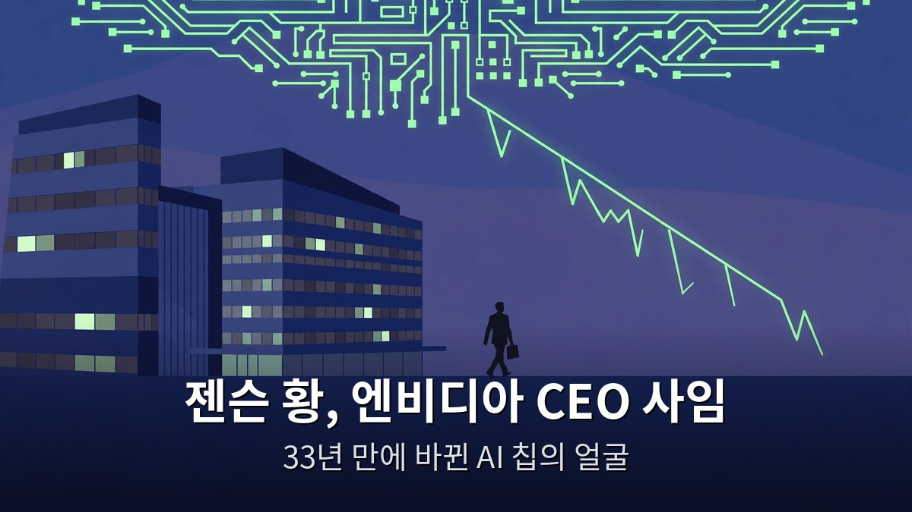
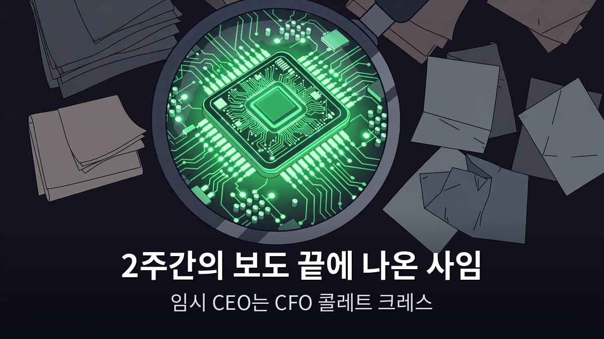
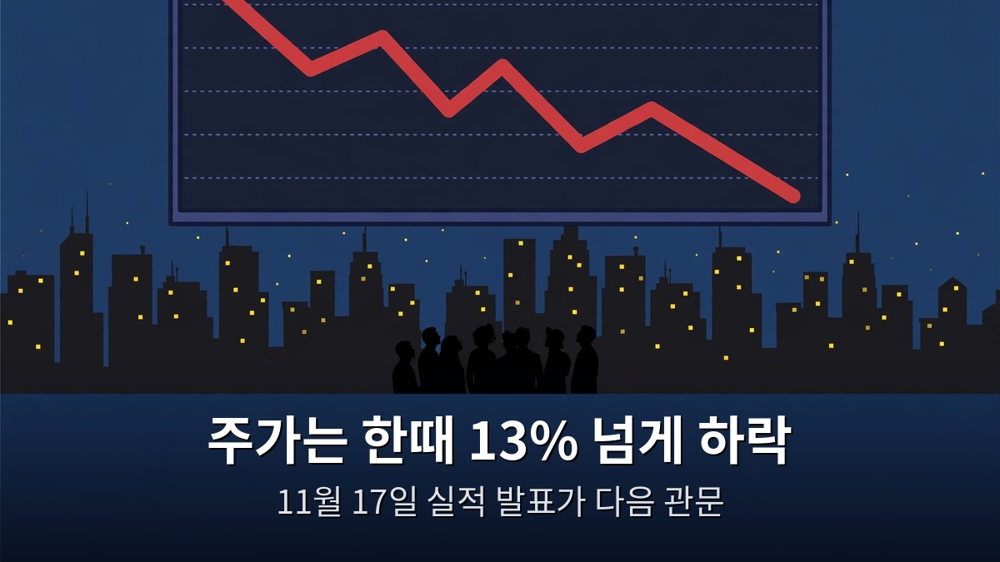

<!-- 본문 시작 -->

AI 업계의 가장 큰 뉴스가 터졌다.
엔비디아를 33년간 이끈 젠슨 황이 CEO 자리에서 물러났다.
이 글은 2026년 11월 12일에 공개된 영상과 당일 복수 매체 보도를 대조해, 확정된 사실과 아직 입증되지 않은 의혹을 나눠 정리한 자료 기반 안내다.

> **핵심은 하나다. 젠슨 황은 11월 12일 엔비디아 CEO와 이사회에서 즉시 물러났고, CFO 콜레트 크레스가 임시 CEO를 맡는다. 사임은 확정된 사실이지만, 그 배경으로 거론되는 스파이 의혹은 아직 입증되지 않았다. 주가는 한때 13% 넘게 떨어졌다.**

사임 발표 당일 나온 보도를 더 보려면 [제미나이 4 카본 정식 출시와 AI 모델 지형 변화](https://blog.naver.com/3700708/224474053353)도 함께 보면, AI 업계의 큰 그림이 어떻게 움직이는지 알 수 있다.

## 사임, 확정된 사실은 무엇인가

2026년 11월 12일, 엔비디아는 젠슨 황이 사장, 최고경영자, 이사회 멤버직에서 즉시 물러났다고 발표했다.
이사회는 전날인 11월 11일 사임을 수락했다.
미국 증권거래위원회에 제출된 공시에도 같은 내용이 담겼다.

임시 CEO는 CFO 콜레트 크레스다.
2013년 9월부터 부사장 겸 CFO를 맡아온 인물로, 임시 CEO를 맡는 동안에도 CFO직을 그대로 유지한다.
이사회는 정식 후임자를 찾기 시작했고, 내부와 외부 후보를 모두 살펴본다고 밝혔다.

이사회 의장도 새로 정해졌다.
하비 C. 존스가 엔비디아의 첫 이사회 의장으로 임명됐다.
황은 CEO 자리뿐 아니라 이사회 의석도 내려놨다.
회사 정관상 CEO를 그만둬도 이사회 의석은 유지할 수 있었지만, 함께 내려놓은 것이다.

주가는 크게 흔들렸다.
사임 소식이 전해진 11월 12일 아침, 주가는 한때 13% 넘게 떨어졌다.
황은 엔비디아 지분 약 3.6%를 보유하고 있으며, 나이는 63세다.
1993년 두 명의 엔지니어와 함께 엔비디아를 공동 창업했고, 그 뒤 33년간 유일한 CEO였다.
회사 역사상 첫 CEO 교체다.

실적 발표는 예정대로 진행된다.
엔비디아는 2026 회계연도 3분기 실적을 11월 17일에 발표한다.
경영진 교체가 실적 발표 일정을 바꾸지는 않았다.

## 사임까지, 어떤 보도들이 이어졌나

사임은 하루아침에 나온 일이 아니다.
2주간의 보도가 이어진 끝에 나왔다.

약 1년 전, 미국과 싱가포르 당국은 메가 스피드라는 회사를 조사한다고 확인했다.
엔비디아 칩이 수출 금지를 우회해 중국으로 흘러갔는지 따지는 조사였다.
그 회사의 임원 중 한 명이 앨리스 항이라는 여성으로, 젠슨 황과는 혈연관계가 아니다.

10월 29일, 뉴욕타임스는 두 사람이 가까운 관계였다고 보도했다.
엔비디아는 "CEO로서의 일의 일부"라고 해명했다.
일주일 뒤 하원 위원회 위원장이 비공개 브리핑을 요구했다.
타임스는 그녀를 중국 국가안전부의 스파이라고 부른 비밀 정부 메모가 있다고 보도했다.

지난 일요일, 젠슨 황은 전 직원에게 보낸 편지에서 아내에게 불충실했음을 인정했다.
이름을 밝히지는 않았다.
같은 편지에서 이사회가 국가안보 우려에 대한 독립 조사를 시작했다고 밝혔다.
독립 조사는 11월 8일에 발표됐다.

더 인포메이션은 그녀와 그녀의 가족과 연계된 회사들이 최소 75억 달러어치의 엔비디아 칩을 중국 기업으로 옮기는 것을 도왔다고 보도했다.
타임스는 젠슨 황에게 직접 보고하던 엔비디아 직원들에 관한 내용도 보도했다.
다만 당사자들은 확인하지 않았다.
월스트리트저널은 11월 11일, 이사회가 그를 몰아낼 준비를 하고 있었다고 보도했다.

이 대목에서 꼭 구분해야 한다.
사임과 임시 CEO 임명, 주가 하락은 확정된 사실이다.
반면 불륜 의혹과 스파이 혐의는 보도된 의혹이지, 입증된 사실이 아니다.
영상 안에서도 스파이 혐의는 "아직 입증되지 않았다"고 명시돼 있다.
중국은 이를 중상모략이라고 부르고, 엔비디아 이사회는 비밀이 유출됐다고 믿을 이유가 없다고 밝혔다.
의회에 출석해 비공개 브리핑을 하라는 요구와 소환 가능성도 보도된 상태다.

후임자 이름도 거론되기 시작했다.
애플의 하드웨어 책임자 조니 스루지와 엔비디아 CTO 마이클 케이건이 후보로 언급된다.
트럼프 대통령이 팀 쿡을 거론했다는 보도도 있다.
다만 모두 "거론된다"는 수준의 보도이며, 확정된 인선은 아니다.
한편 AI 모델 경쟁 쪽에서는 [클로드 페이블 5.2의 달라진 점](https://blog.naver.com/3700708/224474080104)이 따로 화제다. 칩과 모델, 두 축이 동시에 흔들리고 있다.

## AI 업계에는 무슨 의미인가

엔비디아는 AI 경쟁의 중심에 있다.
대부분의 AI가 돌아가는 칩을 만들고, AI를 하는 거의 모든 회사가 어떤 식으로든 엔비디아와 연결돼 있다.
그래서 이 사임은 한 회사의 인사 뉴스가 아니라 AI 업계 전체의 뉴스다.

영상 진행자 맷 울프도 "충격적이고 실망스럽다"고 했다.
AI의 향방이 한 사람에게 집중돼 있었기 때문에, 지금은 역사의 한복판 같은 순간이며, AI 타임라인이 한 달 전보다 훨씬 불확실해졌다고 평가했다.
주식 매도·매수 조언은 하지 않았다.

독자가 지금 확인해야 할 건 세 가지다.
첫째, 임시 CEO 체제에서 엔비디아의 제품·출시 일정이 바뀌는지 여부다.
회사는 당장 GeForce 제품이나 출시 계획에 변화가 없다고 밝혔지만, 임시 체제라는 점은 그대로다.
둘째, 11월 17일 실적 발표에서 경영진이 무슨 말을 하는지다.
셋째, 정식 후임자 인선이다.
이 세 가지가 정해지기 전까지는 "엔비디아는 어떻게 되는가"라는 질문에 답이 없다.

이 사임이 AI 칩 공급이나 가격에 당장 영향을 주는지도 아직 확인된 바가 없다.
주가는 떨어졌지만, 제품과 실적은 아직 그대로다.
그래서 지금 할 일은 의혹을 사실로 받아들이는 게 아니라, 확정된 사실 세 가지 — 사임, 임시 CEO, 11월 17일 실적 발표 — 를 기준으로 다음 소식을 지켜보는 것이다.

**이 글에서만 얻는 것: 자막에 '콜레트 크레스트'로 적힌 임시 CEO 이름은 오인식이다. TechCrunch·USA Today 등 복수 매체 대조 결과, 실제 임시 CEO는 CFO 콜레트 크레스다. 사임·임시 CEO·주가 하락은 확정, 스파이 의혹은 미입증이라는 구분을 보도 출처와 함께 정리했다.**

## 자주 묻는 질문

**젠슨 황은 정말 사임했나요?**
그렇다.
엔비디아는 2026년 11월 12일, 황이 사장과 CEO, 이사회 멤버직에서 즉시 물러났다고 발표했다.
이사회는 11월 11일 사임을 수락했다.

**임시 CEO는 누구인가요?**
CFO 콜레트 크레스다.
2013년부터 CFO를 맡아왔고, 임시 CEO를 맡는 동안에도 CFO직을 유지한다.

**스파이 혐의는 사실인가요?**
아직 입증되지 않았다.
비밀 정부 메모가 있다는 보도와, 그녀와 연계된 회사들이 칩을 옮겼다는 보도가 있으나, 혐의 자체는 확인되지 않았다.
중국은 중상모략이라고 부른다.

**주가는 어떻게 됐나요?**
사임 소식이 전해진 11월 12일 아침 한때 13% 넘게 떨어졌다.

**엔비디아 제품이나 실적 발표는 어떻게 되나요?**
제품·출시 계획에 당장 변화는 없다고 회사는 밝혔다.
3분기 실적 발표는 11월 17일 예정대로 진행된다.

## 함께 읽으면 좋은 글
[제미나이 4 카본 정식 출시 — 누가 쓸 수 있고 가격은 얼마인가](https://blog.naver.com/3700708/224474053353)
[클로드 페이블 5.2, 뭐가 달라졌나 — 8일 만에 운영체제, 30시간 만에 페르마 정리](https://blog.naver.com/3700708/224474080104)
[블레이드 러너 2049｜인간과 복제인간의 경계를 묻는 163분](https://blog.naver.com/3700708/224474068089)

AI 업계의 큰 뉴스는 하루 만에 결론이 나지 않습니다.
확정된 사실 세 가지를 기준으로 다음 소식을 지켜보세요.
이 주제를 계속 따라가려면 이웃 추가를 눌러두세요.

<!-- 본문 끝 -->

## 작업용 출처·이미지 정보 (업로드 제외)

- 자료 출처: Matt Wolfe 영상 iTe0IB5Ugf8(2026-11-12, 2분 28초, 자막 전체 확인) + TechCrunch·USA Today·Haaretz·Business Standard 등 복수 매체 대조(2026-11-13 검색)
- 이미지: images/01-hero.jpg ~ 04-img3.jpg / 자작 일러스트 + 한글 배너 오버레이 (1200x675)
