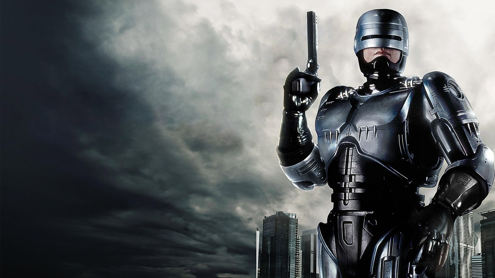
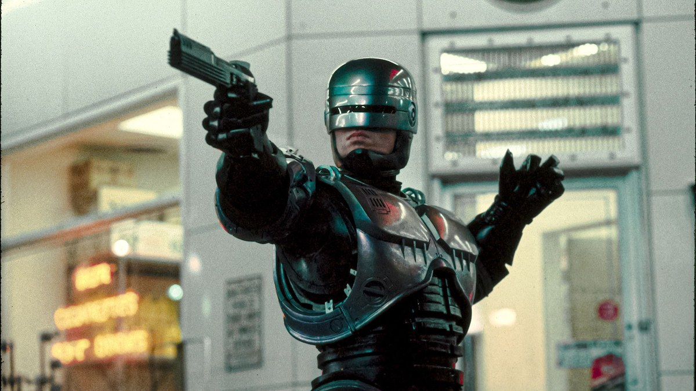
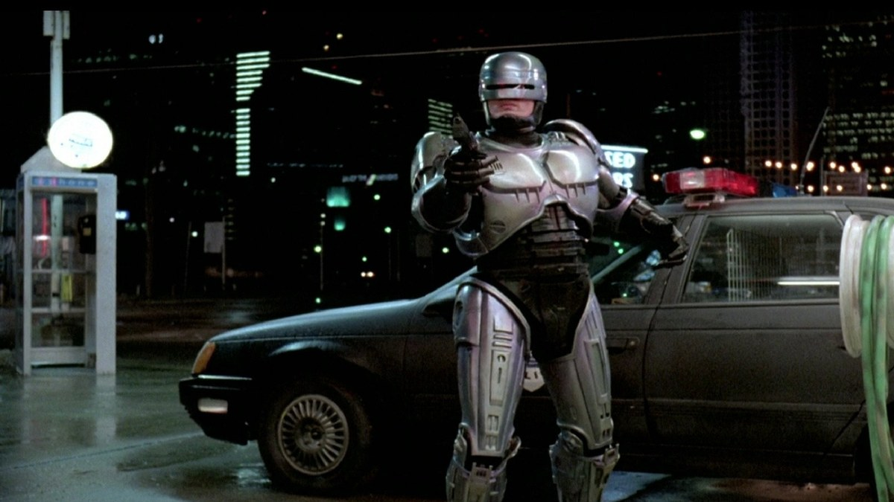
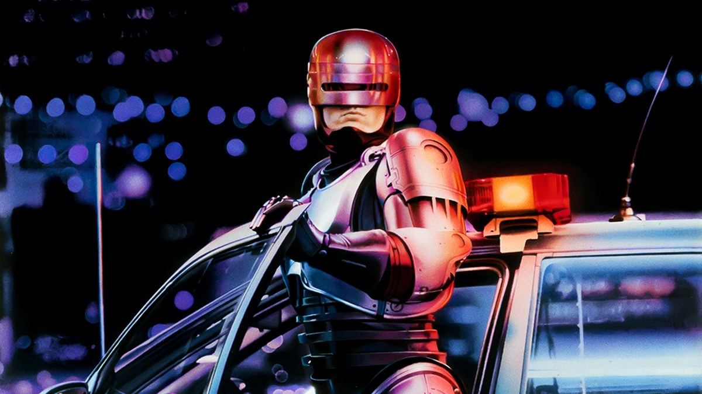
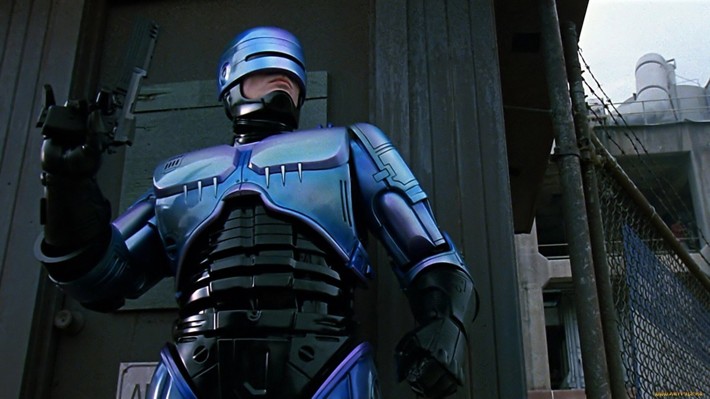
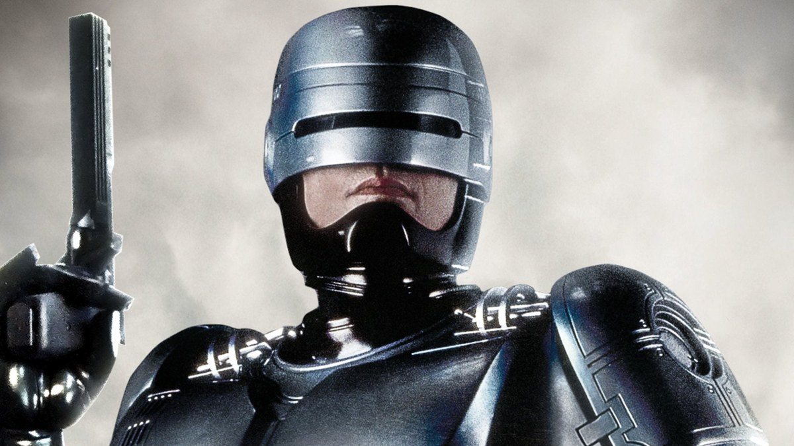
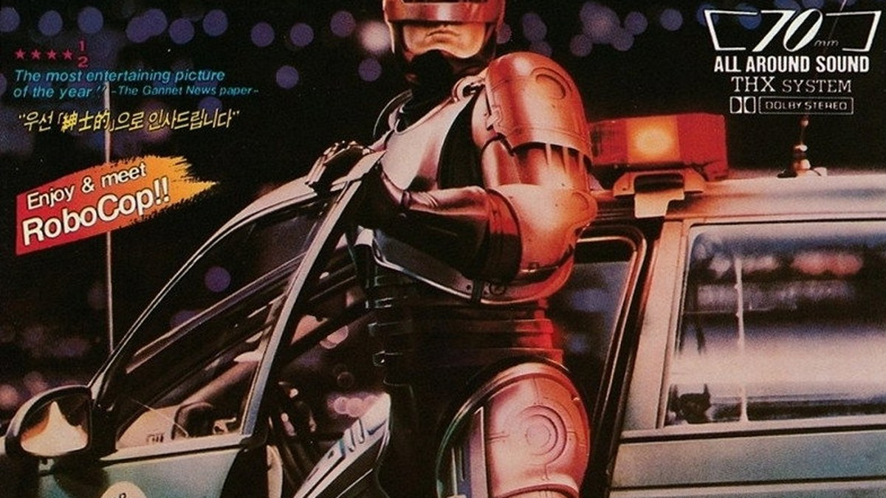

<!-- 본문 시작 -->

Detroit, 1987.
In a near future where crime has swallowed the city, a dead police officer named Alex Murphy is reborn as the cyborg officer RoboCop.
This post introduces Paul Verhoeven's science-fiction film RoboCop (1987), without spoilers.

> **Here is the core of it. RoboCop wears the face of an action film, but the question it asks is about being human. When most of a person's body has been replaced by machine, whose are the memories and feelings that remain? Its 102 minutes push that question to the end, between gunfights and satire.**

If you want another film that asks where humans end and machines begin, start with [Ex Machina's question about a robot's mind](https://aitechnotesen.blogspot.com/2026/11/ex-machina-108-minutes-asking-robot-if.html).

| Item | Detail |
| --- | --- |
| Title | RoboCop |
| Release | 1987 (US 1987-07-17 · Korean theatrical release 1987-12-25) |
| Director | Paul Verhoeven |
| Writers | Edward Neumeier, Michael Miner |
| Main cast | Peter Weller, Nancy Allen, Dan O'Herlihy, Ronny Cox, Kurtwood Smith, Miguel Ferrer |
| Runtime | 1 hour 42 minutes (102 min) |
| Rating | Ages 15 and up (Korea) |
| Scores | TMDB 7.4/10 (6,081 ratings, checked 2026-11-13) · IMDb 7.6 · Rotten Tomatoes 84% (as shown on JustWatch) |
| Where to watch | No legal streaming, rental, or purchase provider in Korea (as of 2026-11-13, checked on JustWatch and KinoLights) |

## Spoiler-free plot
Detroit, in the near future.
Crime has swallowed the city, and the police force is now run by a giant corporation, OCP (Omni Consumer Products).
OCP offers a robot to replace the police.
Its giant enforcement droid ED-209 is demonstrated before the board — and the first demonstration goes badly out of control.

Around the same time, an officer is transferred to the Metro West precinct.
Alex Murphy. His partner is Anne Lewis.
On his first patrol, Murphy walks into an ambush by the gang of crime boss Clarence Boddicker, and is killed.

OCP takes Murphy's body.
What is left of his brain and part of his face is fitted into a machine body, and the cyborg officer RoboCop is born.
Three prime directives are programmed into him.
Serve the public trust, protect the innocent, uphold the law.

Back on the streets, RoboCop is perfect.
He never misses a shot, and a scan of a criminal's face pulls up a record at once.
But inside the perfect machine, unfamiliar memories keep surfacing.
A house, a family, a name.
Lewis recognizes that face.
The partner she thought was dead has returned as a machine.

That is where the film begins.
What comes after is better seen directly.

The film is from 1987, but it does not feel strange today.
A world where a corporation runs policing and machines take over enforcement no longer reads like fantasy.

## The film in scenes 1 — First patrol, perfect aim

RoboCop aims his gun inside a store — his shots never miss.

RoboCop's first patrol becomes a legend at once.
He faces an armed robber without hesitation, and when he draws his gun, he hits exactly what he aims at.
His famous line comes from here.
"Dead or alive, you're coming with me."

RoboCop stands beside a patrol car at a gas station at night.

What makes these scenes fun is the perfection itself.
Watching crime stopped with a speed and accuracy no human officer could manage is satisfying.
But it is also uncomfortable somewhere.
That perfection is not human judgment — it is the result of programmed directives.
The film deliberately lets that discomfort linger.

## The film in scenes 2 — OCP, a corporation running the police

RoboCop leans on a patrol car at night, with the lights of Detroit behind him.

OCP, which built RoboCop, is a company that runs the police.
From the start, the film blurs the line between whether the police's job is the safety of citizens or the profit of the company.
Vice president Dick Jones backs ED-209, while young executive Bob Morton pushes RoboCop.
The contest between the two projects is a power struggle inside the company.

RoboCop seen from a low angle in an industrial district.

The boardroom demonstration is one of the film's most famous scenes.
A brand-new robot malfunctions and turns the meeting room into chaos — funny, and chilling at the same time.
The film shows, as if it were a joke, what happens when judgment is handed to a machine.
Once that scene passes, RoboCop's perfection looks different too.
A perfect machine and a broken machine both came out of human hands.

## The film in scenes 3 — Memories return

Lewis's face reflected on RoboCop's vision display.

The world looks different through RoboCop's eyes.
Crosshairs and data overlap on his display — that is how he sees.
But between the data, something that is not data slips in.
The shape of a house, a person's face.
Memories believed to be erased push through the machine's vision.

A close-up of RoboCop holding his gun, a human face still under the helmet.

The scene where Lewis recognizes RoboCop is the center of the film.
To recognize a colleague as a machine is to say that memory belongs to the person, not the body.
As Murphy's memories return, RoboCop stops being a machine that only follows directives.
The moment he starts asking who he was, the story changes from action into a story about a human being.

## The AI questions this film raises
First, do memories make me who I am?
Most of Murphy's body has been replaced by machine, but his memories remain.
If the memories remain, is that being Murphy, or a different being that carries Murphy's memories?
The film looks for the self in memory, not in the body.

Second, can conscience be asked of a being that runs on directives?
Three prime directives are programmed into RoboCop.
The directives are clear, but reality is not.
When acting by the directive and acting rightly point in different directions, what should a machine follow?
It is the same question we now ask about how AI should make judgments.

Third, what changes when a corporation runs policing?
OCP treats policing as a business, with efficiency and profit as its goals.
When that happens, where do the people who need protection go?
Now that robot police and automated enforcement are real, this satire is no longer a story about a distant future.

Fourth, how much of the body can be replaced before the person is someone else?
Arms and legs, even the torso, replaced by machine — yet Murphy remains Murphy.
So what is it that makes a person a person?
The film's answer is not the body, but memory and relationships.
That answer is confirmed the moment Lewis recognizes him.

## Where to watch
As of November 13, 2026.
On both JustWatch Korea and KinoLights, no streaming, rental, or purchase provider was found in Korea.
Zero subscription services, zero rentals, zero purchases.
In the United States it is available on services such as MGM+, but not on a Korean account.
Availability changes often, so check JustWatch or KinoLights directly before watching.

The Korean poster from the December 25, 1987 theatrical release at Daehan Theater.

In Korea, the film opened on December 25, 1987, at Daehan Theater.
The "December 25" line on the poster is that record.
For longtime Korean film fans, it is also remembered as a year-end release.

A checklist before watching.
At 1 hour 42 minutes, it fits in a single sitting.
The rating is ages 15 and up.
It is a 1987 film, and its violence is direct, so take care when watching with younger viewers.
To avoid spoilers, do not look beyond the trailer.
Especially avoid anything about the ending.

## Closing
It is a film from 1987, and its questions have not aged.
What lingers longer than the gunfights is the scene where a body turned into a machine reaches for an old memory.
That scene is what makes this a film about being human, not just an action film.
Now that AI and robots are part of everyday life, why not take out the question this film asked 38 years ago and look at it again?

## Frequently asked questions
**Is the 1987 original enough on its own?**
This post covers only the 1987 original.
There are sequels (1990 and 1993) and a 2014 remake.

**Where can I watch it?**
As of November 13, 2026, no streaming, rental, or purchase provider was found in Korea.
Both JustWatch Korea and KinoLights show no provider.
Check both directly before watching.

**What is the age rating?**
Ages 15 and up in Korea.
Its violence is direct, so younger viewers need care.

**What are RoboCop's three prime directives?**
Serve the public trust, protect the innocent, and uphold the law.
These three directives define how RoboCop acts.

**Why watch it again now?**
Because corporate involvement in policing and robot enforcement have become real debates, the questions this 1987 film raised still continue.
Its questions about memory and identity also feel closer now, in the age of AI.

## Good reads
[Ex Machina — 108 Minutes Asking a Robot If It Has a Mind](https://aitechnotesen.blogspot.com/2026/11/ex-machina-108-minutes-asking-robot-if.html)
[Claude Fable 5.2: What Actually Changed — An OS in 8 Days, Fermat in 30 Hours](https://aitechnotesen.blogspot.com/2026/11/claude-fable-52-what-actually-changed.html)
[Fable 5.2 vs Opus 5.5 — 4 Experiments That Show the Difference and What It Costs](https://aitechnotesen.blogspot.com/2026/11/fable-52-vs-opus-55-4-experiments-that.html)

If you like AI films, subscribe and stay tuned.

<!-- 본문 끝 -->

## 작업용 출처·이미지 정보 (업로드 제외)

TMDB(2026-11-13 확인): 감독 폴 버호벤, 각본 에드워드 노이마이어·마이클 마이너, 미국 개봉 1987-07-17, 러닝타임 102분, TMDB 7.4/10(6,081개 평가), 출연 피터 웰러·낸시 앨런·댄 오헐리히·로니 콕스·커트우드 스미스·미겔 페레, 국내 개봉 1987-12-25(극장)·등급 15; JustWatch 한국·키노라이츠(2026-11-13): 국내 스트리밍·대여·구매 제공처 없음 — 화제작 예외로 '국내 미제공' 명시; 이미지: TMDB 공식 포스터·백드롭 8장(1200x675 크롭, 출처 TMDB) — s03/s04 동일 샷 중복이라 s04 제외, s07 하단 모서리 워터마크 있음
