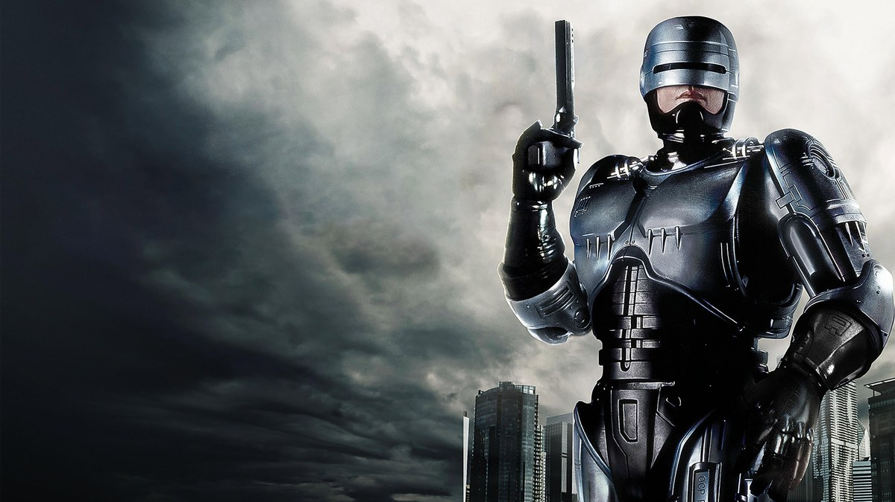
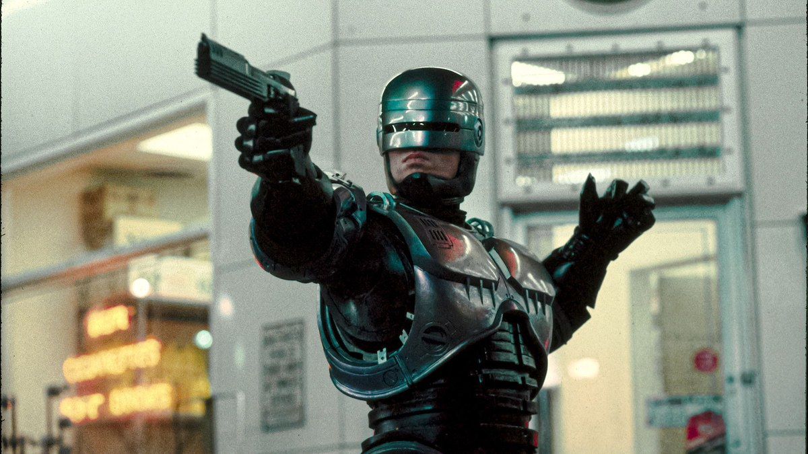
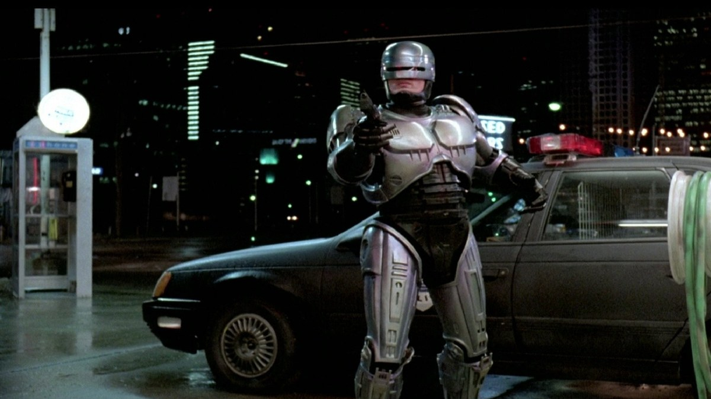
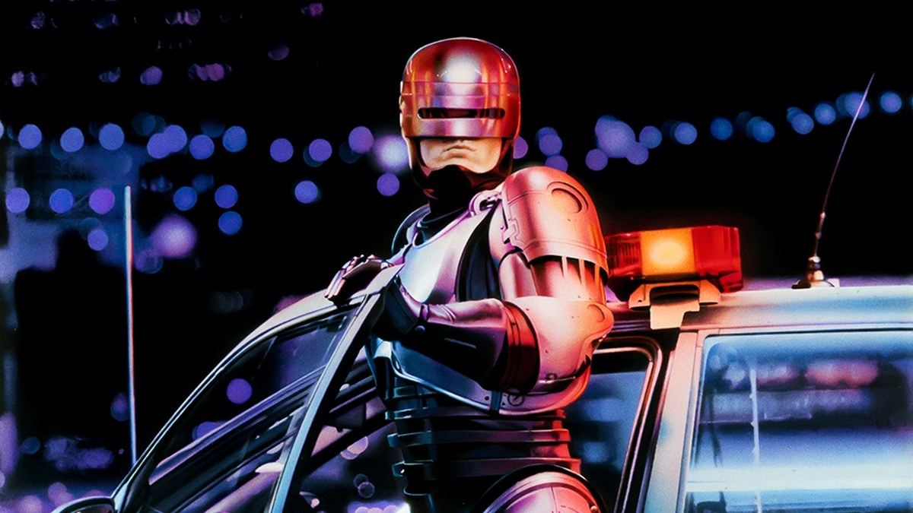
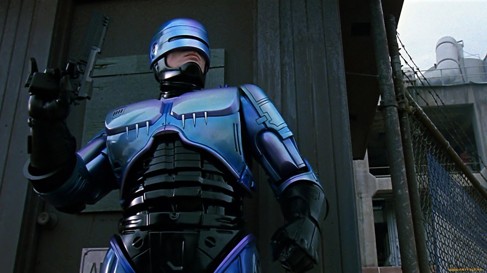
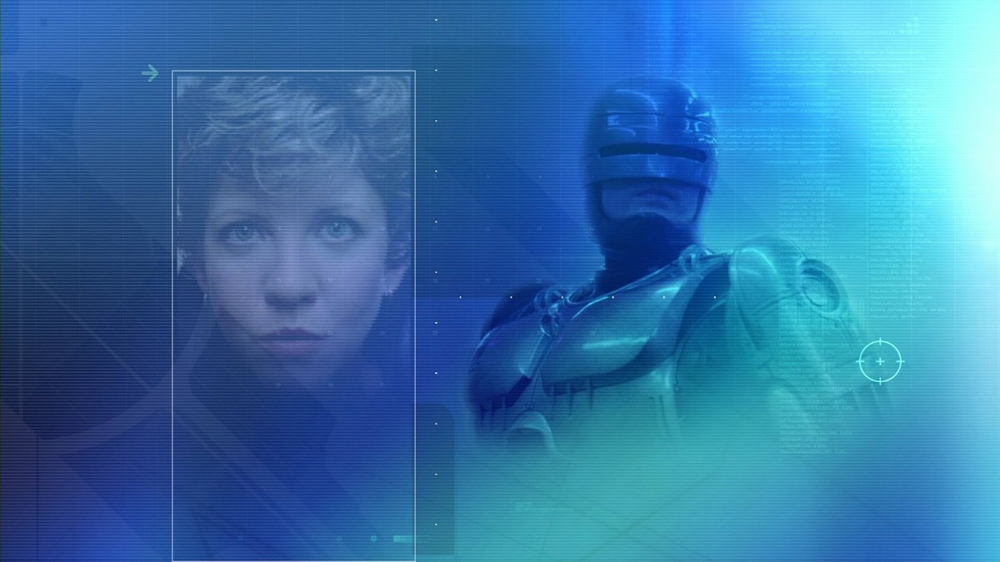
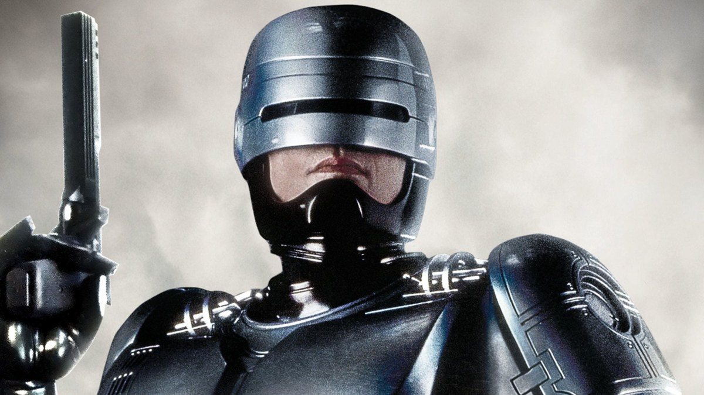
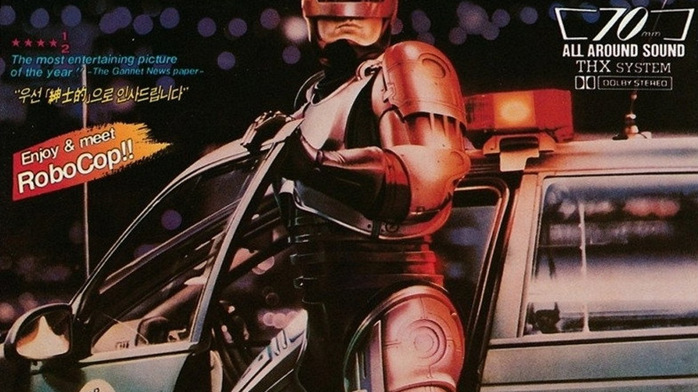

<!-- 본문 시작 -->

1987년, 디트로이트.
범죄가 도시를 집어삼킨 근미래, 죽은 경찰관 알렉스 머피가 사이보그 경찰 로보캅으로 다시 태어난다.
이 글은 폴 버호벤 감독의 SF 영화 《로보캅》(1987)을 스포일러 없이 소개하는 정리다.

> **핵심은 하나다. 로보캅은 액션 영화의 얼굴을 하고 있지만, 던지는 질문은 인간에 대한 것이다. 몸의 대부분을 기계로 바꾼 사람에게 남은 기억과 감정은 누구의 것인가. 102분은 그 질문을 총격전과 풍자 사이에서 끝까지 밀어붙이는 시간이다.**

인간과 기계의 경계를 묻는 영화가 더 궁금하면 [블레이드 러너 2049의 인간과 복제인간 경계](https://blog.naver.com/3700708/224474068089)를 먼저 보는 것도 좋다.

| 항목 | 내용 |
| --- | --- |
| 제목 | 로보캅 (RoboCop) |
| 개봉 | 1987년 (미국 1987-07-17 · 한국 극장 개봉 1987-12-25) |
| 감독 | 폴 버호벤 |
| 각본 | 에드워드 노이마이어, 마이클 마이너 |
| 주요 출연 | 피터 웰러, 낸시 앨런, 댄 오헐리히, 로니 콕스, 커트우드 스미스, 미겔 페레 |
| 러닝타임 | 1시간 42분 (102분) |
| 등급 | 15세 관람가 |
| 평점 | TMDB 7.4/10 (6,081개 평가, 2026-11-13 확인) · IMDb 7.6 · 로튼토마토 84% (JustWatch 표시) |
| 시청처 | 국내 합법 시청처 없음 (2026-11-13 기준, JustWatch·키노라이츠 확인) |

## 스포일러 없는 줄거리
가까운 미래의 디트로이트.
범죄가 도시를 집어삼켰고, 경찰 운영권은 거대 기업 OCP(옴니 컨슈머 프로덕트) 손에 넘어갔다.
OCP는 경찰을 대신할 로봇을 내놓는다.
이사회 앞에서 시연된 거대 로봇 ED-209는, 첫 무대에서부터 걷잡을 수 없는 사고를 낸다.

그 무렵 디트로이트 경찰서로 전근 온 형사가 있다.
알렉스 머피, 파트너는 앤 루이스다.
첫 순찰에 나선 머피는 범죄 조직 두목 클래런스 보디커 일당의 매복에 걸려 목숨을 잃는다.

OCP는 머피의 시신을 가져간다.
살아남은 뇌와 얼굴 일부를 기계 몸체에 얹어, 사이보그 경찰 로보캅을 만든다.
로보캅에게 심어진 것은 세 가지 지침이다.
공익에 봉사할 것, 무고한 사람을 보호할 것, 법을 수호할 것.

거리로 돌아온 로보캅은 완벽하다.
총을 쏘면 빗나가지 않고, 범죄자 얼굴을 스캔하면 전과가 바로 뜬다.
그런데 완벽한 기계 안에서, 낯선 기억이 자꾸 떠오른다.
한 집, 한 가족, 한 이름.
루이스는 그 얼굴을 알아본다.
죽은 줄 알았던 파트너가, 기계가 되어 돌아왔다는 것을.

여기까지가 영화의 출발점이다.
그 뒤에 무엇이 있는지는, 직접 보는 것이 좋다.

이 영화는 1987년 작품이지만, 지금 봐도 낯설지 않다.
기업이 치안을 맡고, 기계가 단속을 대신하는 풍경이 더 이상 공상처럼 느껴지지 않기 때문이다.

## 장면으로 보는 작품 1 — 첫 순찰, 완벽한 사격

상점 안에서 총을 겨누는 로보캅, 사격은 한 번도 빗나가지 않는다.

로보캅의 첫 순찰은 곧바로 전설이 된다.
무장 강도를 마주하면 망설이지 않고, 총을 뽑으면 정확히 맞춘다.
유명해진 대사도 여기서 나온다.
"죽어서든 살아서든, 넌 따라와야 해."

밤의 주유소 앞, 순찰차 곁에 선 로보캅.

이 장면들이 재밌는 건 완벽함 때문이다.
인간 경찰이 할 수 없는 속도와 정확도로 범죄를 제압하는 모습은, 보는 사람을 시원하게 만든다.
하지만 동시에 어딘가 불편하다.
저 완벽함이 인간의 판단이 아니라, 입력된 지침의 결과라는 걸 알기 때문이다.
영화는 그 불편함을 일부러 오래 보여준다.

## 장면으로 보는 작품 2 — OCP, 기업이 경찰을 운영하다

밤의 순찰차에 기대선 로보캅, 뒤에는 디트로이트의 불빛.

로보캅을 만든 OCP는 경찰서를 운영하는 회사다.
경찰의 임무가 시민의 안전인지, 회사의 이익인지, 영화는 처음부터 그 경계를 흐린다.
부사장 딕 존스가 미는 ED-209와, 젊은 간부 밥 모튼이 추진한 로보캅.
두 프로젝트의 대결이 곧 회사 안의 권력 싸움이다.

공장 지대의 낮은 각도에서 올려다본 로보캅.

이사회 시연 장면은 영화에서 가장 유명한 장면 중 하나다.
최신형 로봇이 오작동해 회의실을 아수라장으로 만드는 장면은, 웃기면서도 섬뜩하다.
기계에게 판단을 맡겼을 때 벌어질 일을, 영화는 농담처럼 보여주고 지나간다.
그 장면이 지나고 나면, 로보캅의 완벽함도 다르게 보인다.
완벽한 기계와 고장 난 기계, 둘 다 인간의 손에서 나왔기 때문이다.

## 장면으로 보는 작품 3 — 돌아오는 기억
기계에게 마음을 묻는 질문은 [엑스 마키나의 튜링 테스트](https://blog.naver.com/3700708/224474081075)에서도 이어진다.

로보캅의 시야 화면에 비친 루이스의 얼굴.

로보캅의 눈에는 세상이 다르게 보인다.
조준선과 데이터가 겹쳐 뜨는 화면, 그게 로보캅의 시야다.
그런데 그 화면 사이로, 데이터가 아닌 것이 끼어든다.
한 집의 모습, 한 사람의 얼굴.
지워졌다고 믿었던 기억이, 기계의 시야를 뚫고 올라온다.

총을 든 로보캅의 클로즈업, 헬멧 아래 남은 인간의 얼굴.

루이스가 로보캅을 알아보는 장면은 영화의 중심이다.
동료였던 사람을 기계로 알아본다는 것, 그건 기억이 몸이 아니라 사람에게 속한다는 말이다.
머피의 기억이 돌아올수록, 로보캅은 지침대로만 움직이는 기계가 아니게 된다.
자기가 누구였는지 묻기 시작하는 순간, 이야기는 액션에서 인간의 이야기로 바뀐다.

## 이 작품이 던지는 AI 질문
첫째, 기억이 나를 만드는가.
머피의 몸은 대부분 기계로 바뀌었지만, 기억은 남았다.
기억이 남아 있다면 그 존재는 머피인가, 아니면 머피의 기억을 가진 다른 존재인가.
영화는 "나"를 몸이 아니라 기억에서 찾는다.

둘째, 지침으로 움직이는 존재에게 양심을 물을 수 있는가.
로보캅에게는 세 가지 지침이 심어져 있다.
지침은 명확하지만, 현실은 그렇지 않다.
지침대로 움직이는 것과 옳은 대로 움직이는 것이 다를 때, 기계는 무엇을 따라야 하는가.
이 질문은 오늘날 AI의 판단 기준을 묻는 질문과 같다.

셋째, 기업이 치안을 운영하면 무엇이 달라지나.
OCP는 경찰을 운영하면서, 치안을 사업으로 본다.
효율과 이익이 목표가 되면, 보호받아야 할 사람은 어디로 가는가.
로봇 경찰과 자동 단속이 현실이 된 지금, 이 풍자는 더 이상 먼 미래의 이야기가 아니다.

넷째, 몸을 어디까지 바꿔도 같은 사람인가.
팔과 다리, 몸통까지 기계로 바꿨는데도 머피는 머피로 남는다.
그렇다면 사람을 사람으로 만드는 건 무엇인가.
영화의 답은 몸이 아니라 기억과 관계에 있다.
루이스가 그를 알아보는 순간, 그 답이 확인된다.

## 어디서 보는지
2026년 11월 13일 기준으로 정리한다.
JustWatch 한국과 키노라이츠 모두에서, 국내 스트리밍·대여·구매 제공처가 확인되지 않았다.
정액제 0곳, 대여 0곳, 구매 0곳이다.
미국에서는 MGM+ 등에서 제공되지만, 한국 계정으로는 볼 수 없다.
시청처는 수시로 바뀌니, 보기 전에 JustWatch나 키노라이츠에서 직접 한 번 더 확인하는 것이 좋다.

1987년 12월 25일 대한극장 개봉 당시의 한국 포스터.

한국에서는 1987년 12월 25일 대한극장에서 개봉했다.
포스터에 적힌 "12월 25일" 문구가 그 기록이다.
국내 개봉일이 크리스마스였던 만큼, 오래된 영화 팬들에게는 연말 개봉작으로 기억되는 작품이기도 하다.

시청 전 체크리스트도 있다.
러닝타임 1시간 42분이라 한 번에 볼 시간을 잡으면 된다.
등급은 15세 관람가다.
1987년 영화라 폭력 묘사가 직접적이니, 어린 시청자와 함께 볼 때는 주의가 필요하다.
스포일러를 피하려면 예고편 이상은 찾아보지 않는 게 좋다.
특히 결말에 대한 글은 피한다.

## 마무리
1987년 영화인데, 던지는 질문이 낡지 않았다는 게 먼저 떠오른다.
총격전보다 오래 남는 건 기계가 된 몸으로 옛 기억을 더듬는 장면이다.
그 장면이 이 영화를 액션 영화가 아니라 인간에 대한 영화로 만든다.
AI와 로봇이 일상이 된 지금, 38년 전 이 영화가 먼저 물었던 질문을 다시 꺼내 보는 건 어떨까.

## 자주 묻는 질문
**1987년 1편만 보면 되나요?**
이 글은 1987년 1편만 다룬다.
속편(1990년·1993년)과 2014년 리메이크가 따로 있다.

**어디서 볼 수 있나요?**
2026년 11월 13일 기준으로 국내 스트리밍·대여·구매 제공처가 확인되지 않았다.
JustWatch 한국과 키노라이츠에서 모두 제공처 없음으로 표시된다.
보기 전에 두 곳에서 직접 다시 확인하는 것이 좋다.

**등급은 어떻게 되나요?**
15세 관람가다.
폭력 묘사가 직접적이라 어린 시청자는 주의가 필요하다.

**로보캅의 세 가지 지침은 무엇인가요?**
공익에 봉사할 것, 무고한 사람을 보호할 것, 법을 수호할 것이다.
이 세 가지 지침이 로보캅의 행동을 규정한다.

**왜 지금 다시 보는 영화인가요?**
기업의 치안 개입과 로봇 단속이 현실의 논쟁이 된 지금, 1987년 영화가 던진 질문이 그대로 이어지기 때문이다.
기억과 정체성에 대한 질문도, AI 시대를 사는 지금 더 가깝게 느껴진다.

## 함께 읽으면 좋은 글
[블레이드 러너 2049｜인간과 복제인간의 경계를 묻는 163분](https://blog.naver.com/3700708/224474068089)
[엑스 마키나｜로봇에게 마음을 묻는 108분, 튜링 테스트의 진짜 질문](https://blog.naver.com/3700708/224474081075)
[제미나이 4 카본 정식 출시 — 누가 쓸 수 있고 가격은 얼마인가](https://blog.naver.com/3700708/224474053353)

AI 영화에 관심 있다면 이웃 추가를 눌러두세요.

<!-- 본문 끝 -->

## 작업용 출처·이미지 정보 (업로드 제외)

TMDB(2026-11-13 확인): 감독 폴 버호벤, 각본 에드워드 노이마이어·마이클 마이너, 미국 개봉 1987-07-17, 러닝타임 102분, TMDB 7.4/10(6,081개 평가), 출연 피터 웰러·낸시 앨런·댄 오헐리히·로니 콕스·커트우드 스미스·미겔 페레, 국내 개봉 1987-12-25(극장)·등급 15; JustWatch 한국·키노라이츠(2026-11-13): 국내 스트리밍·대여·구매 제공처 없음 — 화제작 예외로 '국내 미제공' 명시; 이미지: TMDB 공식 포스터·백드롭 8장(1200x675 크롭, 출처 TMDB) — s03/s04 동일 샷 중복이라 s04 제외, s07 하단 모서리 워터마크 있음
