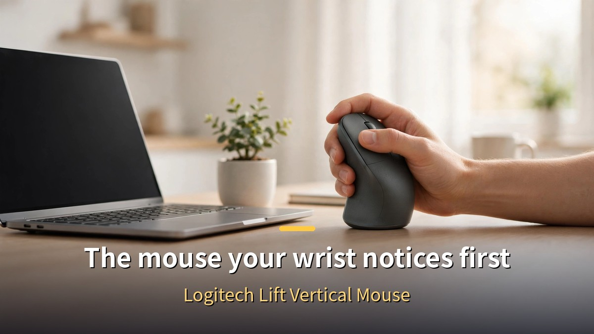
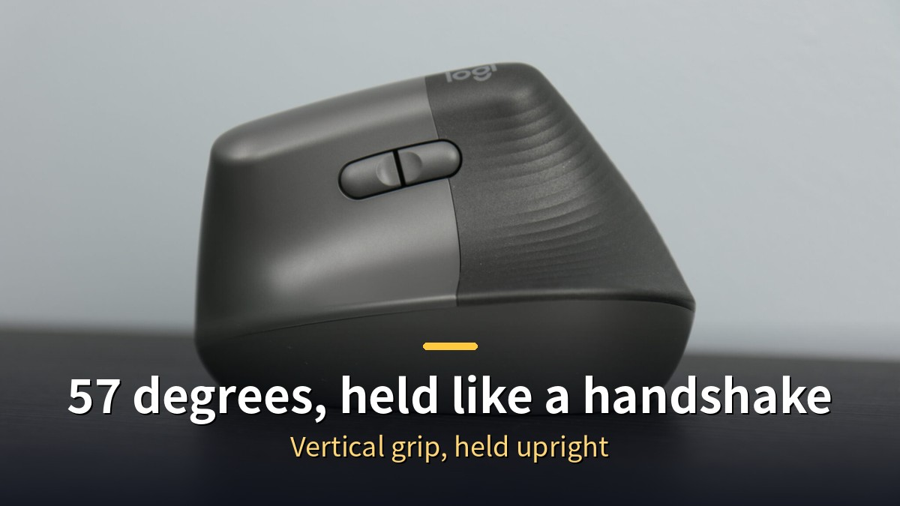
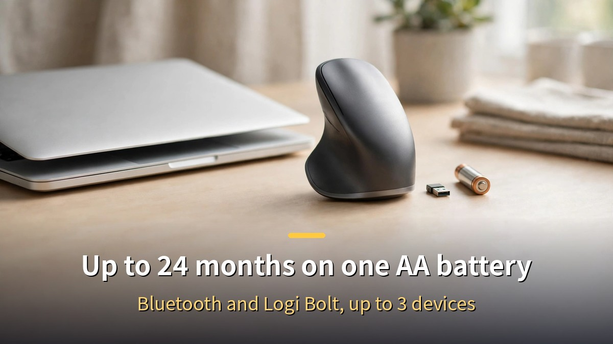
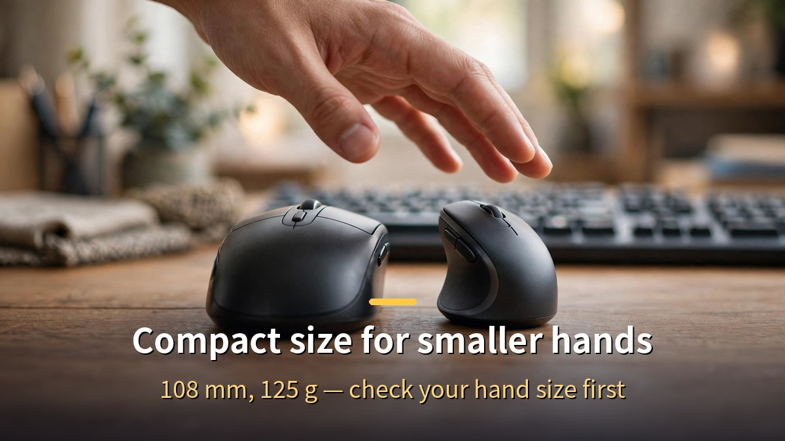

<!-- 본문 시작 -->

As part of the Coupang Partners program, I may earn a commission from purchases made through links in this post.

For anyone who holds a mouse all day, wrist pain is a familiar story.
The Logitech Lift is a vertical mouse — you hold it upright instead of flat.
Its 57-degree angle lets you grip it like a handshake, a single AA battery lasts up to 24 months, and its compact size fits small and medium hands.
This post is a fact-based guide drawn from Logitech's official specifications and the Coupang product page.
I have not used this mouse myself, and the assessment below is written independently of the affiliate link.

> **Key takeaway**
>
> The Logitech Lift is a **vertical mouse tilted at 57 degrees**.
> You hold it like a handshake, so your wrist stays close to neutral — the whole point is to ease the strain of holding a mouse all day.
> **One AA battery lasts up to 24 months**, it connects over Bluetooth and Logi Bolt to up to 3 devices, and DPI adjusts from 400 to 4,000.
> At 108 × 70 × 71 mm and 125 g, it is a **compact design made for small and medium hands**.
> On Coupang it sells as a genuine Logitech Korea product with Rocket delivery, over 8,500 reviews, and a 4.8 rating.

---

## Why hold a mouse upright?

A regular mouse turns your palm down.
Keep your wrist twisted inward for eight hours a day, and the first signal is usually a dull ache.
The Lift tilts the mouse 57 degrees to change that posture.
Held like a handshake, your wrist sits closer to neutral and your forearm relaxes.

That angle is the reason this mouse exists.
It has 6 buttons and a SmartWheel that adjusts its own scroll speed.
The clicks are whisper-quiet, which matters in a shared office.
The palm rest uses a soft rubber grip so your hand does not slip.

If you set up [an AI assistant and advisor system for a one-person business](https://blog.naver.com/3700708/224474063959) on your desk, choose your mouse by the same standard.
What sits on your desk decides how tired you feel at the end of the day.
You can swap the keyboard and the monitor, but if the mouse stays the same, your wrist keeps the same posture.

| Feature | Logitech Lift | Ordinary flat mouse |
| --- | --- | --- |
| Grip angle | 57 degrees, handshake posture | Flat, palm down |
| Battery | One AA battery, up to 24 months | Rechargeable or frequent swaps |
| DPI | Adjustable 400–4,000 | Fixed or limited adjustment |
| Weight | 125 g | Varies by product |
| Connection | Bluetooth and Logi Bolt, 3 devices | Often one device only |

---

## Two years on one battery — how does the connection work?

The Lift is not rechargeable — it runs on a single AA battery.
Logitech rates battery life at up to 24 months, based on eight hours of office use a day.
There is no charging cable to plug in, and one battery swap is all the maintenance it needs.
It never stops mid-work because you forgot to charge it.

It connects two ways: Bluetooth Low Energy and the Logi Bolt USB receiver.
You can pair up to three devices — a laptop, a tablet, a desktop — and switch between them with a button.
Wireless range reaches up to 10 meters.
It supports Windows, macOS, iPadOS, and ChromeOS.

DPI adjusts from 400 to 4,000 in 100-DPI steps, with a default of 1,000 DPI.
The Logi Options+ app lets you remap buttons and tune DPI.
Lower for document work, higher for sweeping across a wide screen — set it to the job at hand.

---

## What to check before you buy

First, check your hand size.
The Lift is built compact for small and medium hands.
It measures 108 mm high, 70 mm wide, 71 mm deep, and weighs 125 g.
If your hands are large, your fingers may feel like they overhang.
In that case, compare it with a larger vertical mouse before deciding.

Second, this model is for right-handed users.
The model covered here is the right-handed graphite version.
A left-handed model is sold separately, so confirm left or right before ordering.

Third, the use case.
The Lift is an office, document, and everyday-work mouse.
If you need fast reactions for gaming or fine precision for graphics work, weigh the DPI and weight separately.
For someone moving between documents and a browser all day, it fits.

**Purchase information (checked on the Coupang product page, 2026-11-13)**
- Seller: genuine Logitech Korea product, Rocket delivery, free shipping
- Reviews: over 8,500, rating 4.8
- Over 3,000 buyers in the past month
- Model: LIFT VERTICAL MR0094, graphite

**Editor's judgment**
For anyone who wants less wrist strain and holds a mouse all day, the Lift points in the right direction.
The 57-degree angle, the long battery life, and the three-device switching are things you feel every day at your desk.
It may not suit large hands or gaming use.
This assessment is independent of the link and based only on official specifications and the product page.

**▶ [Check today's price on Coupang](https://link.coupang.com/a/iCGwnhPQnQ)**
See today's price, discounts, and reviews right now.

## Closing
Swapping a mouse looks like a small decision.
But it is something you hold for eight hours a day, so your wrist notices the change first.
I am the type who memorizes keyboard shortcuts, yet preparing this post made me look at mouse angles again.
If stiff wrists are a regular thing, try standing your mouse upright first.
Like [automating Instagram card news with Claude Code](https://blog.naver.com/3700708/224474066475), changing one desk tool at a time eventually changes how you work.

## FAQ
**Is there a left-handed version?**
The standard model is right-handed, and a left-handed model is sold separately.
Confirm left or right before ordering.

**Does it work with a MacBook or iPad?**
It supports Windows, macOS, iPadOS, and ChromeOS.
Connect over Bluetooth, or use the Logi Bolt receiver.

**How long does the battery last?**
One AA battery lasts up to 24 months.
That is Logitech's official figure, based on eight hours of office use a day.

**Does it fit large hands?**
It is a compact size made for small and medium hands.
If your hands are large, compare it with a larger vertical mouse.

**Does it need a charging cable?**
No.
It is not rechargeable — it runs on a single AA battery.

## Recommended reads
[AI assistant and advisor system for a one-person business](https://blog.naver.com/3700708/224474063959)
[Automating Instagram card news with Claude Code](https://blog.naver.com/3700708/224474066475)
[Making a video in 35 seconds](https://blog.naver.com/3700708/224438205520)

If stiff wrists are a regular thing, try standing your mouse upright.

<!-- 본문 끝 -->

## Working notes (not for upload)

- Sources: Logitech Lift official specs (57 degrees, one AA battery up to 24 months, DPI 400–4,000, 108×70×71 mm, 125 g, Bluetooth LE and Logi Bolt, up to 3 devices, 10 m range, 6 buttons, Logi Options+, Windows/macOS/iPadOS/ChromeOS) + Coupang product page vp/7295558262 (crawled 2026-10-27: 8,530 reviews, 4.8 rating, over 3,000 buyers in a month, genuine Logitech Korea, free shipping) + affiliate series plan (group A, no price shown)
- Images: images/01-hero-en.jpg is the real Coupang product photo + English banner overlay, 02-img1-en.jpg ~ 04-img3-en.jpg are original illustrations + English banner overlay (1200x675)
- Price not shown (group A): no price figure in the manuscript — link text only, "Check the price on Coupang"
