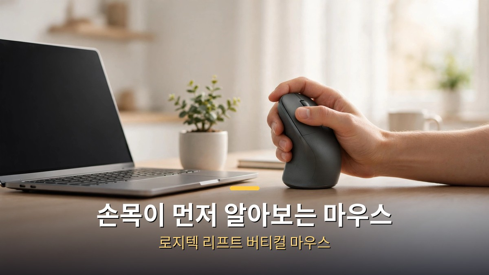
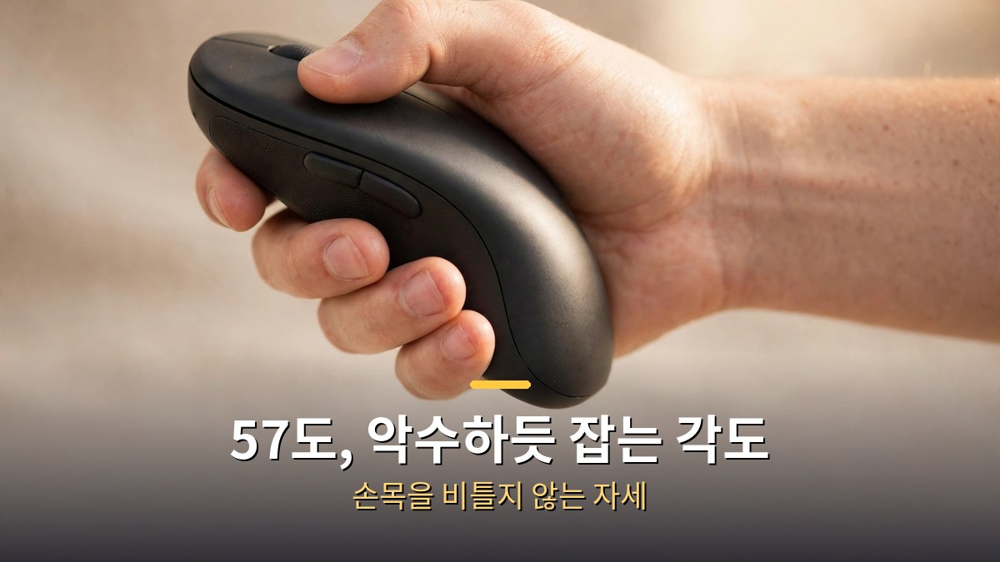
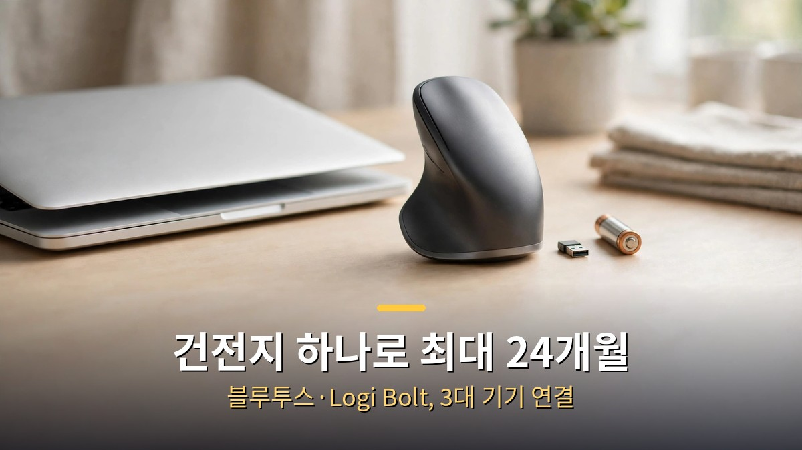
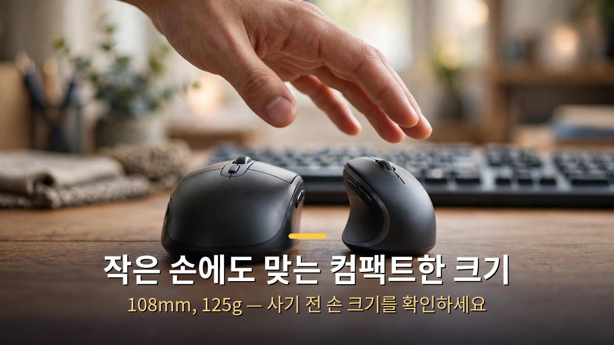

<!-- 본문 시작 -->

이 포스팅은 쿠팡 파트너스 활동의 일환으로, 이에 따른 일정액의 수수료를 제공받습니다.

하루 종일 마우스를 잡고 일하는 사람에게 손목 통증은 낯선 얘기가 아니다.
로지텍 리프트는 마우스를 세로로 잡는 버티컬 마우스다.
손목을 비틀지 않고 악수하듯 잡는 57도 각도, AA 건전지 하나로 최대 24개월을 쓰는 긴 배터리, 작은 손과 중간 손에 맞는 컴팩트한 크기가 이 마우스의 핵심이다.
이 글은 로지텍 공식 자료와 쿠팡 판매 페이지를 바탕으로, 사기 전에 확인할 조건을 정리한 자료 기반 안내다.
직접 사용해 보지 않았고, 평가는 제휴 링크 유무와 무관하게 적었다.

> **핵심 정리**
>
> 로지텍 리프트는 **57도 기울어진 버티컬 마우스**다.
> 손목을 돌리지 않고 악수 자세로 잡기 때문에, 하루 종일 마우스를 잡는 사람의 손목 부담을 줄이는 데 초점이 맞춰져 있다.
> **AA 건전지 하나로 최대 24개월**, 블루투스와 Logi Bolt로 최대 3대 기기를 오가며, DPI는 400부터 4,000까지 조절된다.
> 크기는 108×70×71mm, 무게 125g으로 **작은 손·중간 손에 맞는 컴팩트한 설계**다.
> 쿠팡에서는 로지텍 코리아 정품으로 로켓배송 중이며, 리뷰 8,500개 이상에 평점 4.8점을 받고 있다.

---

## 왜 마우스를 세로로 잡아야 할까?

일반 마우스는 손등이 위를 향한다.
손목을 안쪽으로 돌린 채로 하루 8시간을 보내면, 손목이 보내는 신호는 대개 뻐근함부터 시작한다.
리프트는 마우스를 57도 세워서 이 자세를 바꾼다.
손을 악수하듯 세우면 손목이 중립에 가까워지고, 팔뚝의 긴장이 줄어든다.

이 각도가 리프트의 존재 이유다.
버튼은 6개, 휠은 스크롤 속도를 스스로 조절하는 스마트휠이다.
클릭 소리는 조용하게 설계돼 사무실이나 공유 공간에서도 부담이 적다.
손바닥이 닿는 부분은 부드러운 고무 재질이라 미끄러지지 않는다.

[1인 사업가 AI 비서·고문 시스템](https://blog.naver.com/3700708/224474063959)을 책상 위에 올려두는 사람이라면, 마우스도 같은 기준으로 고르면 된다.
책상 위 물건은 결국 하루의 피로도를 정한다.
키보드와 모니터를 아무리 바꿔도 마우스가 그대로면 손목은 같은 자세로 남는다.

| 항목 | 로지텍 리프트 | 일반 평면 마우스 |
| --- | --- | --- |
| 잡는 각도 | 57도, 악수 자세 | 평평하게, 손등 위 |
| 배터리 | AA 1개로 최대 24개월 | 충전식 또는 수시 교체 |
| DPI | 400–4,000 조절 가능 | 고정 또는 제한적 조절 |
| 무게 | 125g | 제품마다 다름 |
| 연결 | 블루투스·Logi Bolt, 3대 기기 | 1대 기기인 경우 많음 |

---

## 건전지 하나로 2년, 연결은 어떻게 되나?

리프트는 충전식이 아니라 AA 건전지 1개로 움직인다.
로지텍 공식 기준 배터리 수명은 최대 24개월, 하루 8시간 사무실 사용을 전제로 한 수치다.
충전 케이블을 꽂을 일이 없고, 건전지 하나만 갈면 된다.
충전을 깜빡해서 마우스가 멈추는 일이 없는 구조다.

연결은 두 가지다.
블루투스 LE와 Logi Bolt USB 수신기, 둘 다 지원한다.
노트북·태블릿·데스크톱까지 최대 3대 기기를 등록해 두고 버튼 하나로 오갈 수 있다.
무선 범위는 최대 10m다.
운영체제는 Windows와 macOS, iPadOS, ChromeOS를 지원한다.

DPI는 400부터 4,000까지 100 단위로 조절된다.
기본값은 1,000 DPI다.
Logi Options+ 앱에서 버튼 기능을 바꾸고 DPI를 맞출 수 있다.
문서 작업에는 낮게, 넓은 화면을 오갈 때는 높게, 용도에 맞게 바꾸는 방식이다.

---

## 사기 전에 확인할 조건

가장 먼저 확인할 건 손 크기다.
리프트는 작은 손과 중간 손에 맞는 컴팩트한 크기로 설계됐다.
높이 108mm, 너비 70mm, 깊이 71mm, 무게 125g.
손이 큰 사람은 잡았을 때 손가락이 남는 느낌이 들 수 있다.
손이 크다면 더 큰 버티컬 마우스와 함께 비교해 보는 게 좋다.

둘째, 오른손잡이용이라는 점이다.
이 글에서 다루는 모델은 오른손잡이용 그래파이트다.
왼손잡이 모델도 별도로 나와 있으니, 주문 전에 왼손·오른손 모델을 꼭 확인해야 한다.

셋째, 용도다.
리프트는 사무·문서·일반 작업용 마우스다.
빠른 반응이 필요한 게임용이나 정밀한 그래픽 작업용으로는 DPI와 무게를 따로 따져보는 게 맞다.
하루 종일 문서와 브라우저를 오가는 사람에게는 맞는 선택이다.

**구매 정보 (2026-11-13 쿠팡 판매 페이지 확인 기준)**
- 판매: 로지텍 코리아 정품, 로켓배송, 무료배송
- 리뷰: 8,500개 이상, 평점 4.8점
- 한 달간 3,000명 이상 구매
- 모델: LIFT VERTICAL MR0094, 그래파이트

**에디터의 판단**
손목 부담을 줄이고 싶은 사람, 하루 종일 마우스를 잡고 일하는 사람에게 리프트는 방향이 맞는 제품이다.
57도 각도와 긴 배터리, 3대 기기 연결은 책상 위에서 매일 체감되는 부분이다.
다만 손이 크거나 게임용을 찾는 사람에게는 맞지 않을 수 있다.
이 평가는 링크 유무와 무관하게, 공식 자료와 판매 페이지에 나온 사실만을 기준으로 적었다.

**▶ [쿠팡에서 가격 확인하기](https://link.coupang.com/a/iCGwnhPQnQ)**
오늘 가격·할인·리뷰를 바로 확인할 수 있어요.

## 마무리
마우스를 바꾸는 건 작은 결정처럼 보인다.
그런데 하루 8시간 손에 쥐는 물건이라, 바꾸고 나면 손목이 먼저 안다.
나는 키보드 단축키를 외우는 쪽이었는데, 이 글을 준비하면서 마우스 각도부터 다시 보게 됐다.
손목이 뻐근한 날이 잦다면, 마우스부터 세로로 세워보는 것도 방법이다.
[클로드 코드 인스타 카드뉴스 자동화](https://blog.naver.com/3700708/224474066475)처럼, 책상 위 도구를 하나씩 바꾸는 일이 쌓이면 일하는 방식 자체가 달라진다.

## 자주 묻는 질문
**왼손잡이용도 있나요?**
오른손잡이용이 기본이고, 왼손잡이 모델도 별도로 나와 있다.
주문 전에 왼손·오른손 모델을 꼭 확인해야 한다.

**맥북이나 아이패드에서도 쓸 수 있나요?**
Windows와 macOS, iPadOS, ChromeOS를 지원한다.
블루투스로 연결하면 되고, Logi Bolt 수신기로 연결할 수도 있다.

**건전지는 얼마나 가나요?**
AA 건전지 1개로 최대 24개월이다.
로지텍 공식 기준으로, 하루 8시간 사무실 사용을 전제로 한 수치다.

**손이 큰 사람에게도 맞나요?**
작은 손과 중간 손에 맞는 컴팩트한 크기다.
손이 크다면 더 큰 버티컬 마우스와 함께 비교해 보는 게 좋다.

**충전 케이블이 필요한가요?**
필요 없다.
충전식이 아니라 AA 건전지 1개로 움직인다.

## 함께 읽으면 좋은 글
[1인 사업가 AI 비서·고문 시스템](https://blog.naver.com/3700708/224474063959)
[클로드 코드 인스타 카드뉴스 자동화](https://blog.naver.com/3700708/224474066475)
[35초 영상 만들기](https://blog.naver.com/3700708/224438205520)

손목이 뻐근한 날이 잦다면, 마우스부터 세로로 세워보세요.
이 시리즈를 계속 따라가려면 이웃 추가를 눌러두세요.

<!-- 본문 끝 -->

## 작업용 출처·이미지 정보 (업로드 제외)

- 자료 출처: 로지텍 리프트 공식 스펙(57도, AA 1개 최대 24개월, DPI 400–4,000, 108×70×71mm, 125g, 블루투스 LE·Logi Bolt, 3대 기기, 10m, 6버튼, Logi Options+, Windows·macOS·iPadOS·ChromeOS) + 쿠팡 판매 페이지 vp/7295558262 (2026-10-27 크롤 기준: 리뷰 8,530개, 평점 4.8, 한 달간 3,000명 이상 구매, 로지텍 코리아 정품, 무료배송) + 제휴 시리즈 기획안 affiliate-series-plan.md (A군 가격 비공개)
- 이미지: images/01-hero.jpg는 쿠팡 제품 사진(실물) + 한글 배너 오버레이, 02-img1.jpg ~ 04-img3.jpg는 자작 일러스트 + 한글 배너 오버레이 (1200x675)
- 가격 비공개(A군): 원고에 가격 수치 없음 — 링크 문구만 "쿠팡에서 가격 확인하기"
