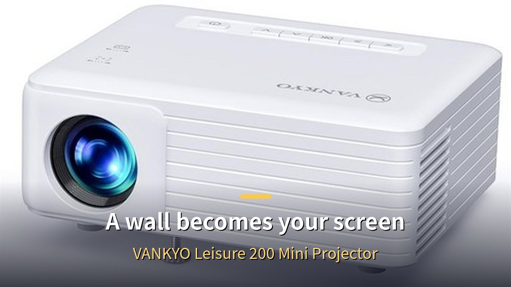
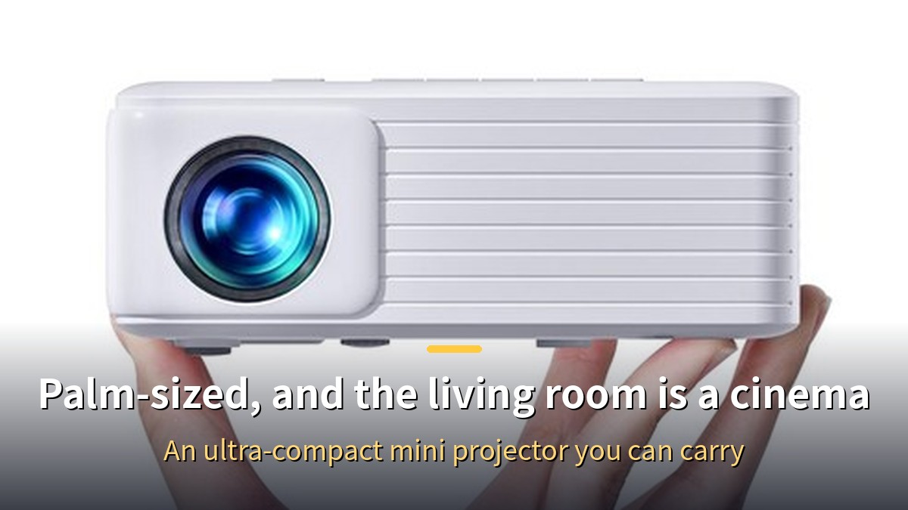
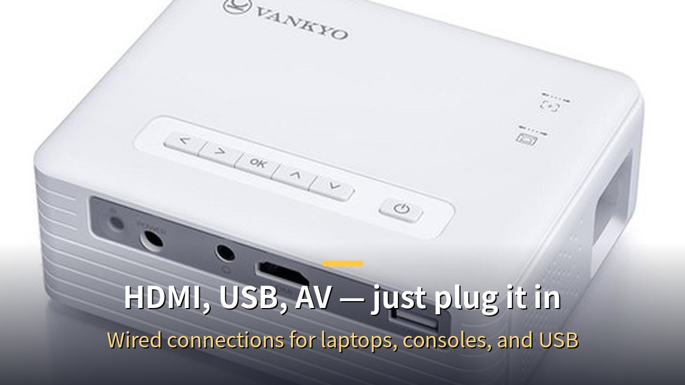
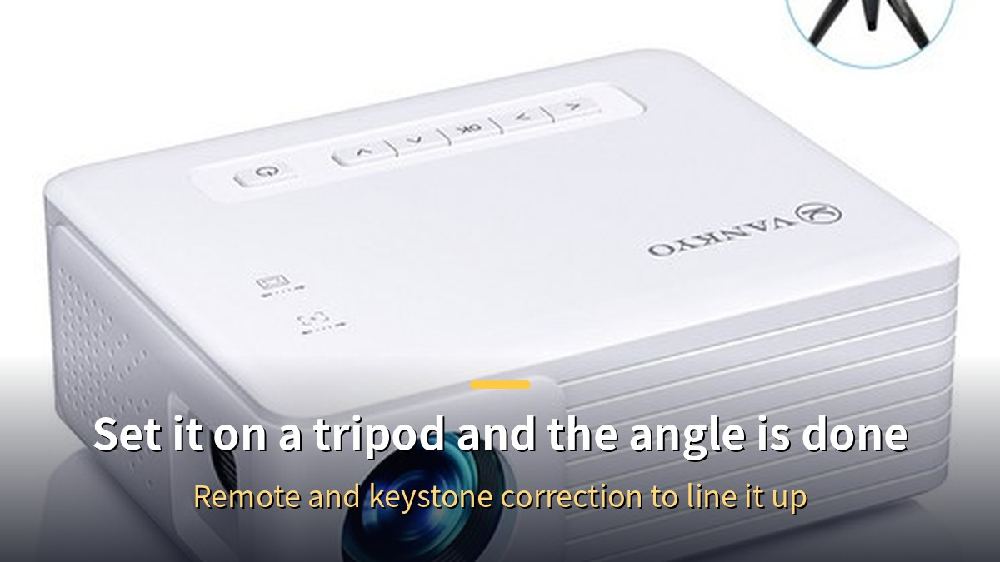

<!-- 본문 시작 -->

This post is part of the Coupang Partners program, and I may receive a commission from purchases made through the links in it.

Can a single wall turn into a cinema without buying a TV?
The VANKYO Leisure 200 is an ultra-compact mini projector, barely bigger than a palm.
It supports 1080P (FHD) input and connects to a laptop or game console through HDMI, USB, or AV.
This is a fact-based guide put together from VANKYO's official materials and the Coupang product page, laying out what to check before buying.
I have not used this product myself, and the review below is written independently of the affiliate link.

> **Key takeaway**
>
> The VANKYO Leisure 200 is an **ultra-compact mini projector that supports 1080P (FHD) input**.
> Because it throws its picture onto a wall, it can make a bigger screen than a TV, and its small size means it can move between the living room, a bedroom, or a friend's place.
> Connections are **wired HDMI, USB, and AV**, and **wireless screen mirroring is not supported**.
> On Coupang, the seller VANKYO sells it with free shipping and next-day delivery, and it has **1,458 reviews with a 4.6-star rating**.
> The price is in the **70,000-won range** — check the link for the latest price.

If you want to watch a long film like [Blade Runner 2049](https://blog.naver.com/3700708/224474068089) big at home, this mini projector could be your first step.
One limit to keep in mind: brightness is modest, so it works best at night with the lights off.

---

## Can one wall really become a cinema?

Barely bigger than a palm, so it is easy to carry around.

The appeal of a mini projector is screen size.
A TV's size is fixed the day you buy it, but a projector's screen is set by how far it sits from the wall.
The Leisure 200 supports 1080P (FHD) input, and many reviews say movies and dramas look sharp on it.

But brightness has limits at this price.
Reviews repeat the same advice: use it in a dark room.
Watching a film at night with the lights off feels immersive, while daytime viewing needs the curtains drawn.
A brightness control helps it stay watchable in dim light.

Noise is surprisingly quiet, according to user reviews.
It warms up slightly after hours of continuous use, but not enough to worry about.
Watching one full-length film in a sitting is no problem.

| Feature | VANKYO Leisure 200 | Regular TV |
| --- | --- | --- |
| Screen size | Set by distance to the wall | Fixed at purchase |
| Setup | Place it and project | Needs a wall mount or stand |
| Portability | Palm-sized, easy to carry | Hard to move |
| Brightness | Best in a dark room | Sharp even in daylight |

---

## How do you connect it?

HDMI, USB, and AV ports sit together at the back.

Connections are wired.
The back has HDMI, USB, and AV ports, plus an audio jack for earphones or an external speaker.
Plug in a laptop, game console, or USB drive and the picture appears right away.
Setup is simple enough for anyone who is not comfortable with technology.

One thing to check before buying: **this model does not support wireless mirroring**.
It is not a cast-your-phone-screen-wirelessly projector — you connect with a cable.
To watch from a phone, you will need a wired HDMI adapter.
If wireless use matters to you, compare it with a higher model that supports mirroring.

A remote control is included, so you can operate it without getting up.
Keystone correction straightens a tilted picture, and the focus ring sharpens it.

If you keep a [one-person business AI assistant and advisor system](https://blog.naver.com/3700708/224474063959) on your desk, choose a mini projector by the same standard.
What sits on your desk decides how tired you feel at the end of the day.
Before replacing a monitor, try turning a wall into a screen.

---

## What to check before buying

A tripod mount makes it easy to set the angle.

First, check where you will use it.
This mini projector performs best in a dark room.
If you plan to use it in a bright living room in daylight, do not expect a bright picture.
It fits nighttime movie watching, playing videos in a child's room, or outdoor use at night while camping.

Second, check how you will connect.
HDMI, USB, and AV wired connections are all it has.
Wireless mirroring is not available, so phone users need an adapter.
For laptop or console users, that is not a problem.

Third, set your picture-quality expectations.
The product is listed as supporting FHD (1080p).
But the real picture of a mini projector at this price is different from a large TV or an expensive projector.
It is a good choice for a first mini projector on a budget, but not for someone who wants a sharp picture in daylight.

**Purchase info (Coupang product page, October 25, 2026 crawl — direct access blocked on Nov 13, not re-verified)**
- Seller: VANKYO, free shipping, next-day delivery guaranteed
- Rocket delivery label: not directly confirmed in this check (unconfirmed)
- Reviews: 1,458, rating 4.6 stars (based on a 2026-10-25 crawl)
- More than 200 people bought it in the past month (based on a 2026-10-25 crawl)
- Warranty: 1 year
- Genuine vs. parallel import: unconfirmed from the page listing (only the seller name VANKYO was confirmed)
- Model: Leisure200, FHD (1080p) supported

**Editor's verdict**
For anyone who wants to watch films big on a wall at night, or start with a first mini projector in the 70,000-won range, the Leisure 200 points in the right direction.
Its ultra-compact size, simple wired connections, and one-year warranty are things you feel every day at this price.
But it may not suit someone who wants to use it in a bright room during the day or expects wireless mirroring from a phone.
This verdict is based only on facts from official materials and the sales page, regardless of the link.

**▶ [Buy on Coupang ▶](https://link.coupang.com/a/iCGH69bSFg)**
In the 70,000-won range — check the link for the latest price.

## Closing thoughts
Buying a mini projector is a different decision from buying a TV.
It is closer to buying the experience of a wall becoming a screen and a room becoming a cinema.
I tend to judge films by how absorbed I feel rather than by screen size, and preparing this piece made me look again at the charm of a picture thrown on a wall.
If you want to turn off the lights at night and put a film on the wall, this little box is a good place to start.

## Frequently asked questions
**Can I mirror my phone screen wirelessly?**
No, wireless mirroring is not supported.
It is a wired product — connect through HDMI or another cable.

**Can I watch during the day?**
It performs best in a dark room.
In daylight, you need to draw the curtains for the picture to show properly.

**Which devices can I connect?**
It has HDMI, USB, and AV ports.
You can connect a laptop, a game console, or a USB drive.

**Does it come with a remote?**
Yes, a remote control is included.
You can operate it without getting up.

**What about the warranty?**
It comes with a one-year warranty.
That is stated in the Coupang product name.

## Good reads
[Ex Machina — 108 Minutes Asking a Robot If It Has a Mind](https://aitechnotesen.blogspot.com/2026/11/ex-machina-108-minutes-asking-robot-if.html)
[Claude Fable 5.2: What Actually Changed — An OS in 8 Days, Fermat in 30 Hours](https://aitechnotesen.blogspot.com/2026/11/claude-fable-52-what-actually-changed.html)
[Start Claude for Free: What You Get, What You Don't, and 5 Drawbacks to Check First](https://aitechnotesen.blogspot.com/2026/11/start-claude-for-free-what-you-get-what.html)

If you want to turn off the lights at night and put a film on the wall, start with this little box.
To keep following this series, tap to add us as a neighbor.

<!-- 본문 끝 -->

## 작업용 출처·이미지 정보 (업로드 제외)

- Source: 쿠팡 판매 페이지 vp/6263564098 (browser.open 크롤 2026-10-25 기준: 판매자 반쿄, 무료배송·내일 도착 보장, 리뷰 1,458개·평점 4.6, 한 달간 200명 이상 구매, FHD(1080p) 지원, 품질보증 1년; 11-13 직접 접속은 403 차단돼 재확인 불가) + 사용자 후기 블로그(리모컨·키스톤 보정·밝기 조절·어두운 환경 권장·무선 미러링 미지원) + 제휴 링크 https://link.coupang.com/a/iCGH69bSFg (B군: 가격대만 '7만 원대', 정확한 가격 수치 없음)
- Images: images/01-hero-en.jpg ~ 04-img3-en.jpg / real product photos from Coupang CDN + English banner overlay (1200x675)
