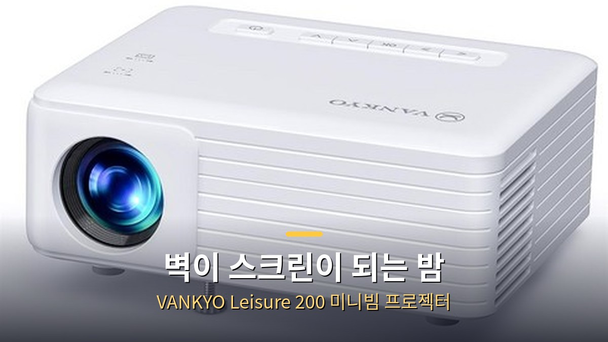
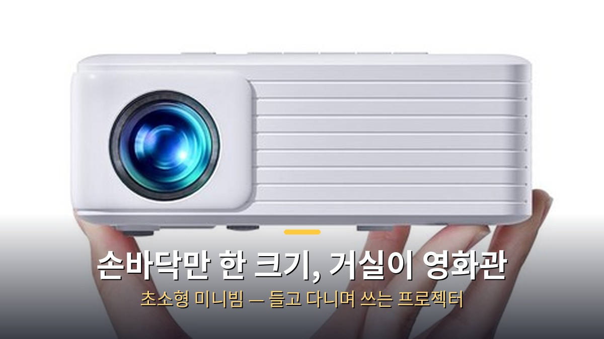
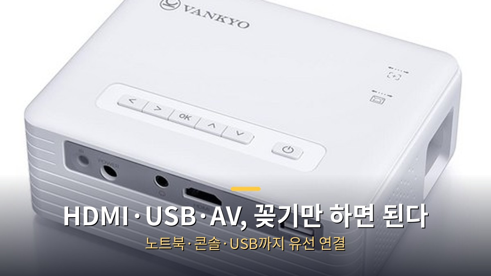
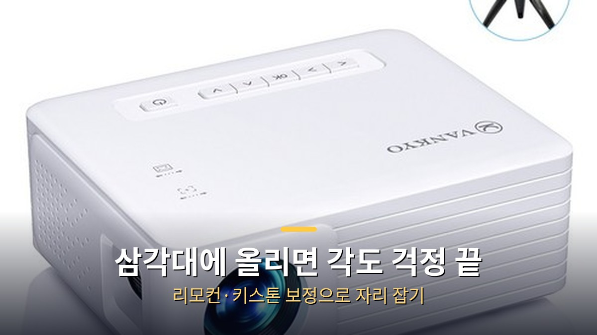

<!-- 본문 시작 -->

이 포스팅은 쿠팡 파트너스 활동의 일환으로, 이에 따른 일정액의 수수료를 제공받습니다.

TV를 사지 않고 벽 하나로 영화관을 만들 수 있을까.
VANKYO Leisure 200은 손바닥만 한 초소형 미니빔 프로젝터다.
1080P(FHD) 입력을 지원하고, HDMI·USB·AV 단자로 노트북이나 콘솔을 바로 연결한다.
이 글은 VANKYO 공식 자료와 쿠팡 판매 페이지를 바탕으로, 사기 전에 확인할 조건을 정리한 자료 기반 안내다.
직접 사용해 보지 않았고, 평가는 제휴 링크 유무와 무관하게 적었다.

> **핵심 정리**
>
> VANKYO Leisure 200은 **1080P(FHD) 입력을 지원하는 초소형 미니빔**이다.
> 벽에 쏘는 방식이라 TV보다 큰 화면을 만들 수 있고, 크기가 작아 거실·방·친구 집을 오가며 쓸 수 있다.
> 연결은 **HDMI·USB·AV 유선**이 중심이고, **무선 미러링은 지원하지 않는다**.
> 쿠팡에서는 판매자 반쿄가 무료배송·내일 도착 보장으로 팔고 있으며, **리뷰 1,458개에 평점 4.6점**을 받고 있다.
> 가격은 **7만 원대**이며, 최신 가격은 링크에서 확인하는 방식이다.

[블레이드 러너 2049](https://blog.naver.com/3700708/224474068089)처럼 긴 영화를 집에서 크게 보고 싶은 사람이라면, 이 미니빔이 그 첫 번째 선택지가 될 수 있다.
다만 밝기에는 한계가 있어, 낮보다는 밤에 불을 끄고 보는 용도에 가깝다.

---

## 벽 하나면 영화관이 될까?

손바닥보다 조금 큰 크기라 이동도 정말 편리하다.

미니빔의 매력은 화면 크기다.
TV는 사는 순간 크기가 정해지지만, 프로젝터는 벽과의 거리가 화면 크기를 정한다.
Leisure 200은 1080P(FHD) 입력을 지원해, 영화나 드라마를 볼 때 해상도가 선명하게 느껴진다는 평가가 많다.

다만 이 가격대의 미니빔에서 기대할 수 있는 밝기에는 한계가 있다.
실제 사용 후기에서도 어두운 환경에서 쓰는 게 좋다는 얘기가 반복된다.
밤에 불을 끄고 친구들과 영화를 볼 때 몰입감이 크고, 낮에는 커튼을 쳐야 화면이 제대로 보인다.
밝기 조절 기능이 있어 어느 정도의 밝기에서는 적당히 쓸 수 있다.

소음은 의외로 조용한 편이라는 후기가 많다.
몇 시간 연속으로 쓰면 약간의 열이 나지만, 걱정할 만큼 뜨거워지지는 않는다는 얘기다.
긴 영화를 한 편 보는 동안 무리가 없는 수준이다.

| 항목 | VANKYO Leisure 200 | 일반 TV |
| --- | --- | --- |
| 화면 크기 | 벽과의 거리로 조절 | 사는 순간 고정 |
| 설치 | 올려놓고 쏘면 끝 | 벽걸이·거치대 필요 |
| 이동 | 손바닥만 한 크기, 들고 다님 | 옮기기 어려움 |
| 밝기 | 어두운 환경에서 제 성능 | 낮에도 선명 |

---

## 연결은 어떻게 하나요?

HDMI·USB·AV 단자가 뒤쪽에 모여 있다.

연결은 유선이 중심이다.
뒤쪽에 HDMI·USB·AV 단자가 있고, 오디오 단자도 있어 이어폰이나 외장 스피커를 꽂을 수 있다.
노트북·게임 콘솔·USB 저장장치를 케이블 하나로 연결하면 바로 화면이 뜬다.
설정 과정이 복잡하지 않아, 기술을 잘 모르는 사람도 부담 없이 쓸 수 있다.

한 가지 꼭 확인할 점이 있다.
**이 모델은 무선 미러링을 지원하지 않는다.**
스마트폰 화면을 무선으로 띄우는 방식이 아니라, 케이블로 연결해서 쓰는 제품이다.
폰으로 영상을 보려면 HDMI 변환 어댑터 같은 유선 연결 수단을 따로 준비해야 한다.
무선으로 쓰고 싶다면, 미러링을 지원하는 상위 모델을 함께 비교해 보는 게 맞다.

리모컨이 함께 제공돼 자리에서 일어나지 않고 조작할 수 있다.
화면이 기울어지면 키스톤 보정으로 각도를 맞추고, 초점을 돌려 화면을 선명하게 만든다.

[1인 사업가 AI 비서·고문 시스템](https://blog.naver.com/3700708/224474063959)을 책상 위에 올려두는 사람이라면, 미니빔도 같은 기준으로 고르면 된다.
책상 위 물건은 결국 하루의 피로도를 정한다.
큰 화면으로 일하고 싶다면, 모니터를 바꾸기 전에 벽을 스크린으로 쓰는 방법도 있다.

---

## 사기 전에 확인할 조건

삼각대 마운트가 있어 각도를 맞추기 쉽다.

가장 먼저 확인할 건 쓰는 장소다.
이 미니빔은 어두운 방에서 제 성능을 낸다.
낮에 커튼 없이 환한 거실에서 쓸 생각이라면, 밝은 화면을 기대하기 어렵다.
밤에 영화를 보는 용도, 아이 방에서 동영상을 틀어주는 용도, 캠핑장에서 밤에 쓰는 용도에 맞는다.

둘째, 연결 방식이다.
HDMI·USB·AV 유선 연결이 전부다.
무선 미러링이 안 되니, 스마트폰을 주로 연결할 사람은 어댑터를 따로 사야 한다.
노트북이나 콘솔을 연결하는 사람에게는 문제가 되지 않는다.

셋째, 화질 기대치다.
제품 표기상 해상도는 FHD(1080p) 지원이다.
다만 이 가격대 미니빔의 실제 화질은 대형 TV나 고가 프로젝터와 다르다.
가성비 좋은 첫 미니빔을 찾는 사람에게는 맞는 선택이지만, 선명한 낮 화면을 원하는 사람에게는 맞지 않는다.

**구매 정보 (쿠팡 판매 페이지 2026-10-25 크롤 기준 — 11-13 직접 접속은 차단돼 재확인 불가)**
- 판매: 판매자 반쿄, 무료배송, 내일 도착 보장
- 로켓배송 표기: 이번 확인에서 직접 확인되지 않음 (미확인)
- 리뷰: 1,458개, 평점 4.6점 (2026-10-25 크롤 기준)
- 한 달간 200명 이상 구매 (2026-10-25 크롤 기준)
- 품질보증: 1년
- 정품/병행수입 구분: 페이지 표기상 미확인 (판매자명 반쿄만 확인)
- 모델: Leisure200, FHD(1080p) 지원

**에디터의 판단**
밤에 벽에 크게 영화를 보고 싶은 사람, 첫 미니빔을 7만 원대로 시작해 보고 싶은 사람에게 Leisure 200은 방향이 맞는 제품이다.
초소형 크기와 유선 연결의 단순함, 1년 품질보증은 이 가격대에서 매일 체감되는 부분이다.
다만 낮에 환한 곳에서 쓰거나, 스마트폰 무선 미러링을 기대하는 사람에게는 맞지 않을 수 있다.
이 평가는 링크 유무와 무관하게, 공식 자료와 판매 페이지에 나온 사실만을 기준으로 적었다.

**▶ [구매하러 가기 ▶](https://link.coupang.com/a/iCGH69bSFg)**
7만 원대, 최신 가격은 링크에서 확인하세요.

## 마무리
미니빔을 산다는 건 TV를 사는 것과 다른 결정이다.
벽이 스크린이 되고, 방이 영화관이 되는 경험을 사는 쪽에 가깝다.
나는 영화를 볼 때 화면 크기보다 몰입감을 먼저 따지는 쪽이었는데, 이 글을 준비하면서 벽에 쏘는 화면의 매력을 다시 보게 됐다.
밤에 불을 끄고 벽에 영화를 띄워보고 싶다면, 이 작은 상자부터 시작해 보는 것도 방법이다.

## 자주 묻는 질문
**스마트폰 화면을 무선으로 띄울 수 있나요?**
무선 미러링은 지원하지 않는다.
HDMI 등 유선으로 연결해서 쓰는 제품이다.

**낮에도 볼 수 있나요?**
어두운 환경에서 제 성능을 낸다.
낮에는 커튼을 쳐야 화면이 제대로 보인다.

**어떤 기기와 연결되나요?**
HDMI·USB·AV 단자가 있다.
노트북·게임 콘솔·USB 저장장치를 연결할 수 있다.

**리모컨이 있나요?**
함께 제공된다.
자리에서 일어나지 않고 조작할 수 있다.

**품질보증은 어떻게 되나요?**
1년 품질보증이다.
쿠팡 상품명에 명시돼 있다.

## 함께 읽으면 좋은 글
[블레이드 러너 2049 — 163분짜리 SF 명작, 집에서 다시 보는 방법과 시청처 정리](https://blog.naver.com/3700708/224474068089)
[1인 사업가 AI 비서·고문 시스템 — 하루 두 번 비서 보고로 사업 전체를 운영하는 구조](https://blog.naver.com/3700708/224474063959)
[35초 영상 만들기 — 짧은 영상을 직접 만드는 방법](https://blog.naver.com/3700708/224438205520)

밤에 불을 끄고 벽에 영화를 띄워보고 싶다면, 이 작은 상자부터 시작해 보세요.
이 시리즈를 계속 따라가려면 이웃 추가를 눌러두세요.

<!-- 본문 끝 -->

## 작업용 출처·이미지 정보 (업로드 제외)

- 자료 출처: 쿠팡 판매 페이지 vp/6263564098 (browser.open 크롤 2026-10-25 기준: 판매자 반쿄, 무료배송·내일 도착 보장, 리뷰 1,458개·평점 4.6, 한 달간 200명 이상 구매, FHD(1080p) 지원, 품질보증 1년; 11-13 직접 접속은 403 차단돼 재확인 불가) + 사용자 후기 블로그(리모컨·키스톤 보정·밝기 조절·어두운 환경 권장·무선 미러링 미지원) + 제휴 링크 https://link.coupang.com/a/iCGH69bSFg (B군: 가격대만 '7만 원대', 정확한 가격 수치 없음)
- 이미지: images/01-hero.jpg ~ 04-img3.jpg / 쿠팡 CDN 실물 사진 + 한글 배너 오버레이 (1200x675)
