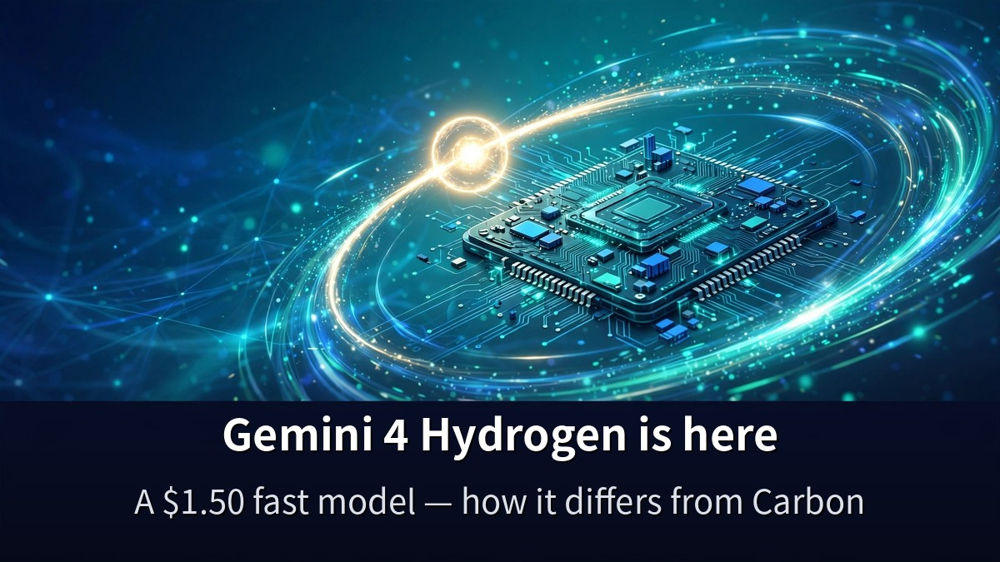
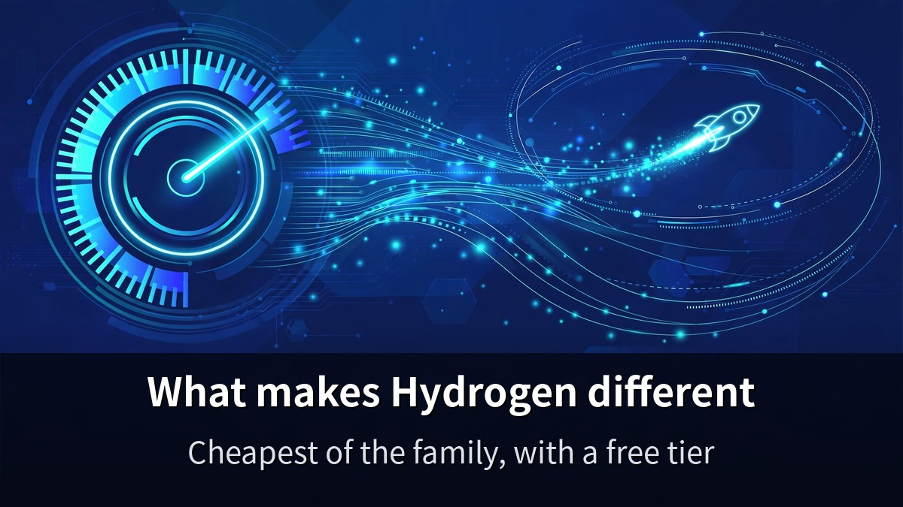
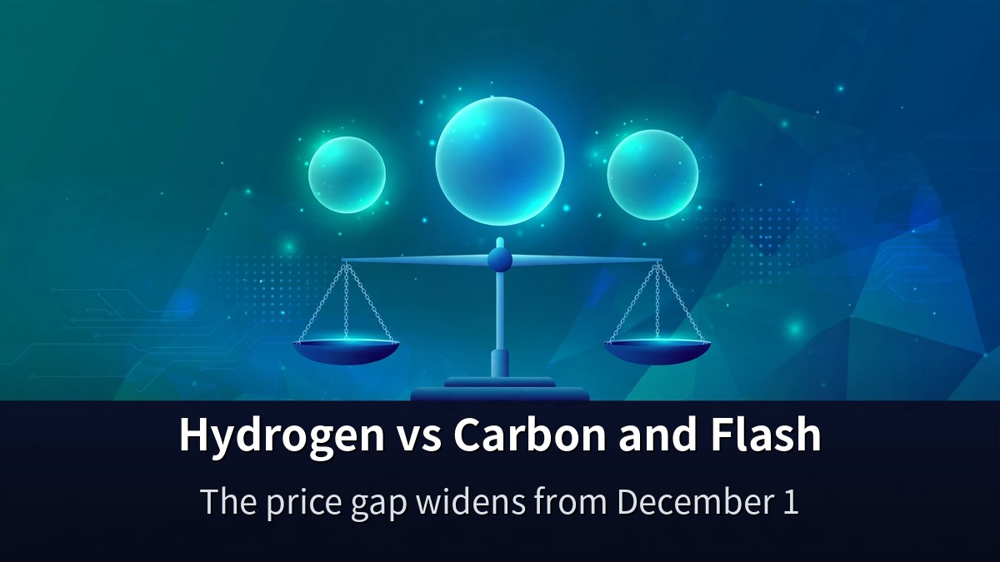
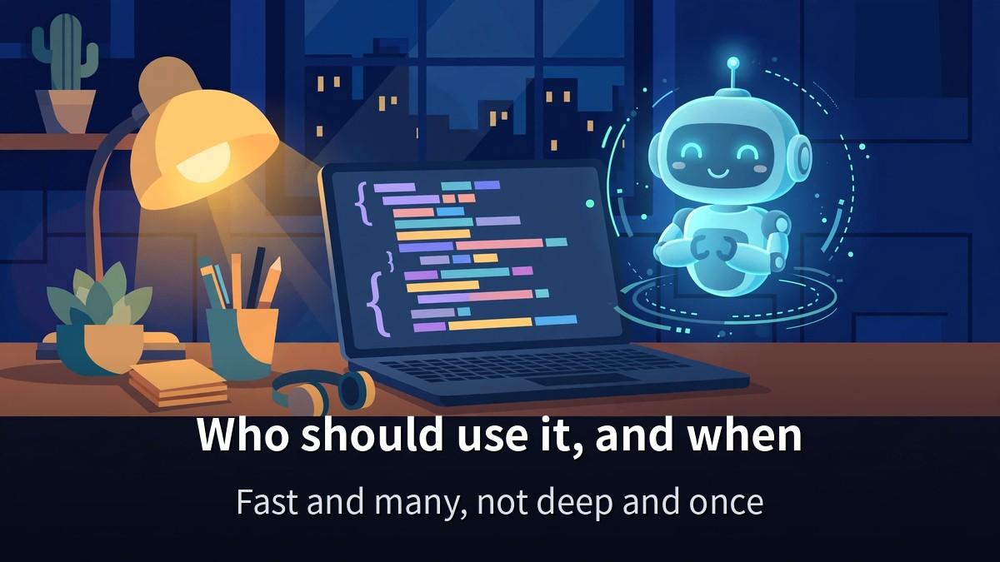

<!-- 본문 시작 -->

Google released Gemini 4 Hydrogen on November 12, 2026.
It costs $1.50 per million input tokens and $7.50 per million output tokens — the cheapest in the Gemini 4 family.
This post is based on Google's official announcement and a Matt Wolfe video (November 13, 2026, 27 minutes 10 seconds, transcript checked 0:00–27:07), and explains what Hydrogen is and how it differs from Carbon and Flash.

> **The point is simple. Hydrogen is not the smartest model — it is the model for everyday coding and agent work, done fast and cheap. It costs about three-quarters of Carbon's price, and it even has a free tier. Leave the heavy reasoning to Carbon, and hand the work you repeat every day to Hydrogen. That is where this model belongs.**

If you want to know how far Gemini 4 Carbon's full release goes, [what actually changed in Claude Fable 5.2](https://aitechnotesen.blogspot.com/2026/11/claude-fable-52-what-actually-changed.html) is worth reading alongside this post — it shows how the other flagship model of the same week is judged.

## What makes Hydrogen different?

Hydrogen sits in the lightest, fastest seat in Google's Gemini 4 family of large reasoning models.
Google's official blog (November 12, 2026) introduces it as a model built for "speed and efficiency for everyday coding and agentic workflows."
It is not the smartest model. It is the model that gets daily work done fast and cheap.

Start with the price.
$1.50 per million input tokens, $7.50 per million output tokens.
The rate is flat across the whole 1-million-token context window.
Feeding it a long document does not raise the unit price.

There is a free tier, too.
Hydrogen is free of charge on Google's API free tier.
Argon and Carbon are paid-only.
You can try it first and decide later.

The scores check out.
On the Artificial Analysis Intelligence Index it scores 51 at its default high thinking setting, and 54 at its highest xhigh setting.
That is above Argon (50) and below Carbon (60).
Mid-pack on intelligence, bottom on price.

On Terminal-Bench 4.0, it reached near-Carbon task success rates while consuming 24% less quota and finishing 19% faster.
Those are Google's own numbers.
"Not as smart as Carbon, but cheaper and faster on most everyday work" — that is the model's claim.

## Where does it stand against Carbon and Flash?

Put the three side by side and Hydrogen's seat becomes clear.
The most expensive model is not always the best model.
What you hand it is the measure.

| Model | Input / Output (per 1M tokens) | Intelligence Index | Free tier |
|---|---|---|---|
| Hydrogen | $1.50 / $7.50 | 51–54 | Yes |
| Carbon | $2 / $10 (until Nov 30, then $4 / $20) | 60 | No |
| Argon | $2 / $10 (until Nov 30, then $4 / $20) | 50 | No |
| 3.8 Flash | Adjusts to $1.50 / $7.50 from Jan 1, 2027 | Not verified | Not verified |

Carbon and Argon cost $2 and $10 only until November 30.
From December 1 they double to $4 and $20.
Pick Carbon without knowing that date, and next month's bill will surprise you.

Hydrogen's rate is fixed, with no dated increase.
After November 30, the price gap with Carbon widens further.
If you are choosing a model to use for months, that gap matters.

Choosing the right model matters here too — [this comparison of Fable 5.2 and Opus 5.5 across four experiments](https://aitechnotesen.blogspot.com/2026/11/fable-52-vs-opus-55-4-experiments-that.html) shows when the expensive model is worth picking.

## Who should use it, and when?

Hydrogen is the model for when an orchestrator "wants a task finished rather than reasoned about."
Google's Antigravity Orchestrator is the clearest example.
In multi-model work, it takes the fast execution seat.

It fits these people.
Developers who use coding help every day, solo founders running repeated agent jobs, teams that watch API costs first.
With a free tier, the fastest test is to get one API key and try it for a day.

The opposite jobs belong to Carbon.
Research analysis that needs long reasoning, decision material where one mistake is expensive, work where top performance is the point.
Hydrogen is a "fast and many" model, not a "deepest once" model.

It is rolling out globally across developer, enterprise, and consumer surfaces.
You can use it in AI Studio, the Gemini API, and Antigravity.

**What only this post gives you: Carbon and Argon's $2 and $10 is an introductory rate that ends on November 30, so from December 1 the gap with Hydrogen more than doubles — a fact checked against Google's rate card. When you pick a model, price it by next month's rate, not today's.**

## Frequently asked questions

**Can I use Hydrogen for free?**
Yes, on the API free tier.
Argon and Carbon are paid-only.
The free tier still has usage limits, so check the plan before heavy use.

**Is it much weaker than Carbon because it is cheaper?**
The Intelligence Index is 60 for Carbon and 51–54 for Hydrogen.
The gap exists, but on Terminal-Bench 4.0 Hydrogen came close to Carbon's success rate.
For everyday work rather than deep reasoning, the difference may be hard to feel.

**What happens after November 30?**
Carbon and Argon rise to $4 and $20 from December 1.
Hydrogen's fixed rate stays the same.
For long-term use, Hydrogen's price advantage grows.

**Where can I use it?**
AI Studio, the Gemini API, Antigravity, and other developer, enterprise, and consumer surfaces, in a global rollout.
It is available through the API in Korea as well.

**Hydrogen or Flash — which one?**
If you are starting now, try Hydrogen first.
Google is putting the everyday coding and agent seat on Hydrogen.

## Good reads
[Claude Fable 5.2: What Actually Changed — An OS in 8 Days, Fermat in 30 Hours](https://aitechnotesen.blogspot.com/2026/11/claude-fable-52-what-actually-changed.html)
[Ex Machina — 108 Minutes Asking a Robot If It Has a Mind](https://aitechnotesen.blogspot.com/2026/11/ex-machina-108-minutes-asking-robot-if.html)
[Minority Report — In a Nation That Arrests Crimes Before They Happen, Can a Prediction Be Wrong](https://aitechnotesen.blogspot.com/2026/11/minority-report-in-nation-that-arrests.html)

As model names multiply, choosing gets harder — but the measure stays one.
Is my work "deep, once" or "fast, many times"?
Hydrogen stands on the second side.

<!-- 본문 끝 -->

## 작업용 출처·이미지 정보 (업로드 제외)

Matt Wolfe 영상 G_Jrexy_5Bg(2026-11-13, 27분 10초, 자막 0:00~27:07 전체 확인) + 구글 공식 블로그 'Introducing Gemini 4 Hydrogen'(2026-11-12) 대조 — 가격 $1.50/$7.50·AA 지수 51~54·터미널벤치 4.0·카본/아르곤 11-30까지 $2/$10 이후 $4/$20·무료 티어
