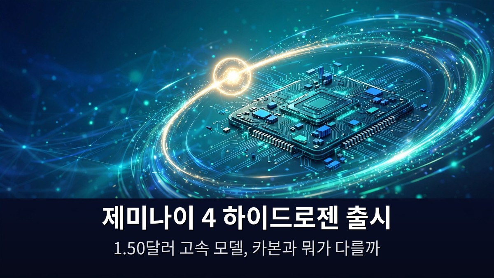
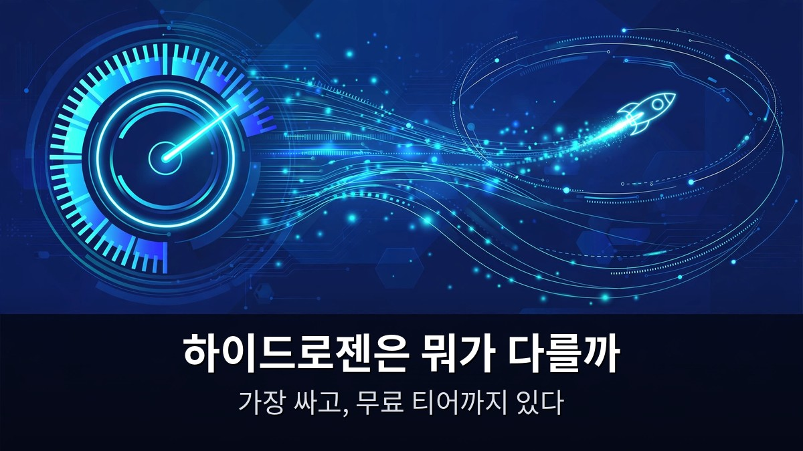
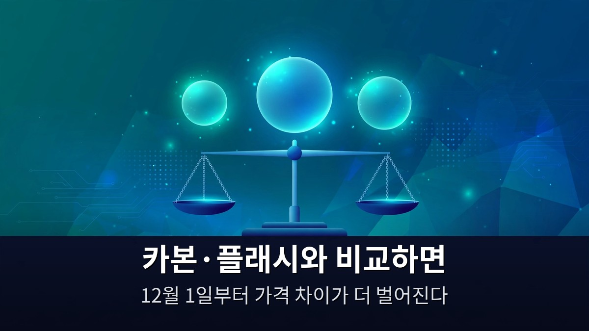

<!-- 본문 시작 -->

구글이 2026년 11월 12일에 제미나이 4 하이드로젠을 내놨다.
값은 입력 100만 토큰당 1.50달러, 출력 7.50달러로 제미나이 4 계열에서 가장 싸다.
이 글은 구글 공식 발표와 Matt Wolfe 영상(2026-11-13, 27분 10초, 자막 0:00~27:07 확인)을 바탕으로, 하이드로젠이 어떤 모델이고 카본·플래시와 무엇이 다른지 정리한 자료 기반 안내다.

> **핵심은 하나다. 하이드로젠은 가장 똑똑한 모델이 아니라, 일상 코딩과 에이전트 작업을 빠르고 싸게 처리하는 모델이다. 가격은 카본의 4분의 3 수준이고, 무료 티어까지 있다. 무거운 추론은 카본에 맡기고, 매일 반복되는 작업은 하이드로젠에 맡기는 게 이 모델의 자리다.**

제미나이 4 카본이 정식 출시로 어디까지 쓸 수 있게 됐는지 궁금하면 [제미나이 4 카본 정식 출시](https://blog.naver.com/3700708/224474053353)에서 가격과 쓸 수 있는 사람을 먼저 확인하는 게 좋다.

## 하이드로젠은 뭐가 다를까?

하이드로젠은 구글의 대형 추론 모델 제미나이 4 계열에서 가장 가볍고 빠른 자리다.
구글 공식 블로그(2026-11-12)는 이 모델을 "일상 코딩과 에이전트 워크플로우를 위한 속도·효율" 모델로 소개한다.
가장 똑똑한 모델이 아니라, 매일 쓰는 작업을 빠르고 싸게 해내는 모델이다.

가격부터 보자.
입력 100만 토큰당 1.50달러, 출력 7.50달러다.
100만 토큰짜리 컨텍스트 창 전 구간에서 요금이 똑같다.
긴 문서를 넣는다고 단가가 오르지 않는다.

무료 티어도 있다.
구글 API 무료 티어에서 하이드로젠은 무료로 쓸 수 있다.
아르곤과 카본은 유료 전용인 것과 대비된다.
일단 써보고 판단할 수 있다는 뜻이다.

지표도 확인됐다.
Artificial Analysis 지능 지수는 기본 설정에서 51, 가장 높은 설정에서는 54다.
아르곤(50)보다 높고, 카본(60)보다는 낮다.
순위로 치면 계열의 중간쯤, 가격으로 치면 가장 아래다.

터미널벤치 4.0에서는 카본에 근접한 작업 성공률을 보이면서 할당량은 24% 덜 쓰고 19% 더 빨리 끝냈다.
구글이 직접 밝힌 수치다.
"카본만큼 똑똑하지는 않지만, 웬만한 작업은 더 싸고 빠르게 해낸다"는 게 이 모델의 주장이다.

## 카본·플래시와 비교하면 어디에 서나?

세 모델을 나란히 두면 하이드로젠의 자리가 보인다.
가장 비싼 모델이 가장 좋은 모델은 아니다.
무엇을 맡기느냐가 기준이다.

| 모델 | 입력 / 출력 (100만 토큰당) | 지능 지수 | 무료 티어 |
|---|---|---|---|
| 하이드로젠 | 1.50달러 / 7.50달러 | 51~54 | 있음 |
| 카본 | 2달러 / 10달러 (11월 30일까지, 이후 4달러 / 20달러) | 60 | 없음 |
| 아르곤 | 2달러 / 10달러 (11월 30일까지, 이후 4달러 / 20달러) | 50 | 없음 |
| 3.8 플래시 | 2027년 1월 1일부터 1.50달러 / 7.50달러로 조정 예정 | 미확인 | 미확인 |

카본과 아르곤은 11월 30일까지만 2달러·10달러다.
12월 1일부터는 4달러·20달러로 두 배가 된다.
이 날짜를 모르고 카본을 고르면 다음 달 청구서에서 놀란다.

하이드로젠은 날짜 제한이 없는 고정 요금이다.
11월 30일 이후에는 카본과의 가격 차이가 더 벌어진다.
장기적으로 쓸 모델을 고른다면 이 차이가 크다.

3.8 플래시는 2027년 1월 1일부터 1.50달러·7.50달러로 조정될 예정이다.
그전까지는 기존 요금이 유지된다.
다만 구글은 플래시를 "빠르지만 가벼운" 자리에서 하이드로젠 쪽으로 무게를 옮기고 있다.
새로 시작한다면 하이드로젠을 먼저 써보는 쪽이 흐름에 맞다.

모델 고르는 기준이 궁금하면 [클로드 페이블 5.2와 오퍼스 5.5의 실험 비교](https://blog.naver.com/3700708/224474078530)에서 비싼 모델과 싼 모델을 가르는 방식을 참고할 수 있다.

## 누가, 언제 쓰면 좋을까?

하이드로젠은 "에이전트 오케스트레이터가 작업을 끝내기보다 추론하기를 원할 때" 쓰는 모델이다.
구글의 안티그래비티 오케스트레이터가 대표적이다.
여러 모델을 함께 쓰는 작업에서 빠른 실행을 맡는 자리다.

이런 사람에게 맞는다.
매일 코딩 보조를 쓰는 개발자, 반복되는 에이전트 작업을 돌리는 1인 사업자, API 비용을 먼저 따지는 팀이다.
무료 티어가 있으니, 일단 API 키 하나 발급받아 하루 써보는 게 가장 빠르다.

반대로 이런 작업은 카본이 맞다.
긴 추론이 필요한 연구용 분석, 한 번 틀리면 비용이 큰 의사결정 자료, 최고 성능이 필요한 벤치마크성 작업이다.
하이드로젠은 "빠르게 많이" 하는 모델이지, "가장 깊게" 하는 모델이 아니다.

출시 범위는 개발자·기업·소비자 전면에 걸쳐 글로벌 순차 출시다.
AI 스튜디오와 제미나이 API, 안티그래비티에서 쓸 수 있다.
한국에서도 API를 통해 바로 쓸 수 있다.

**이 글에서만 얻는 것: 카본·아르곤의 2달러·10달러는 11월 30일까지만 적용되는 도입 가격이라, 12월 1일 이후에는 하이드로젠과 두 배 이상 벌어진다는 점을 구글 요금표와 대조해 확인했다. 모델을 고를 때는 오늘 가격이 아니라 다음 달 가격으로 따지는 게 먼저다.**

## 자주 묻는 질문

**하이드로젠은 무료로 쓸 수 있나요?**
API 무료 티어에서는 무료로 쓸 수 있다.
아르곤과 카본은 유료 전용이다.
다만 무료 티어에도 사용량 한도가 있으니, 본격적으로 쓰려면 요금제를 확인해야 한다.

**카본보다 싸면 성능이 많이 떨어지나요?**
지능 지수는 카본 60, 하이드로젠 51~54다.
차이는 있지만, 터미널벤치 4.0에서는 카본에 근접한 성공률을 보였다.
깊은 추론이 아닌 일상 작업에서는 체감 차이가 작을 수 있다.

**11월 30일이 지나면 어떻게 되나요?**
카본과 아르곤은 12월 1일부터 4달러·20달러로 오른다.
하이드로젠은 고정 요금이라 그대로다.
그래서 장기 사용을 전제로 하면 하이드로젠의 가격 이점이 더 커진다.

**어디서 쓸 수 있나요?**
AI 스튜디오, 제미나이 API, 안티그래비티 등 개발자·기업·소비자 전면에 순차 출시 중이다.
한국에서도 API로 바로 쓸 수 있다.

**플래시와 하이드로젠 중 뭘 고르나요?**
새로 시작한다면 하이드로젠을 먼저 써보는 게 흐름에 맞다.
구글이 일상 코딩·에이전트용 고속 모델 자리를 하이드로젠에 주고 있기 때문이다.

## 함께 읽으면 좋은 글
[제미나이 4 카본 정식 출시｜구글 최강 모델, 어디서 어떻게 쓰나](https://blog.naver.com/3700708/224474053353)
[엑스 마키나｜로봇에게 마음을 묻는 108분, 튜링 테스트의 진짜 질문](https://blog.naver.com/3700708/224474081075)
[블레이드 러너 2049｜인간과 복제인간의 경계를 묻는 163분](https://blog.naver.com/3700708/224474068089)

모델 이름이 늘면 고르기가 어려워지는데, 결국 기준은 하나다.
내 작업이 "깊게 한 번"인지 "빠르게 여러 번"인지.
하이드로젠은 뒤쪽에 선 모델이다.

<!-- 본문 끝 -->

## 작업용 출처·이미지 정보 (업로드 제외)

Matt Wolfe 영상 G_Jrexy_5Bg(2026-11-13, 27분 10초, 자막 0:00~27:07 전체 확인) + 구글 공식 블로그 'Introducing Gemini 4 Hydrogen'(2026-11-12) 대조 — 가격 $1.50/$7.50·AA 지수 51~54·터미널벤치 4.0·카본/아르곤 11-30까지 $2/$10 이후 $4/$20·무료 티어
