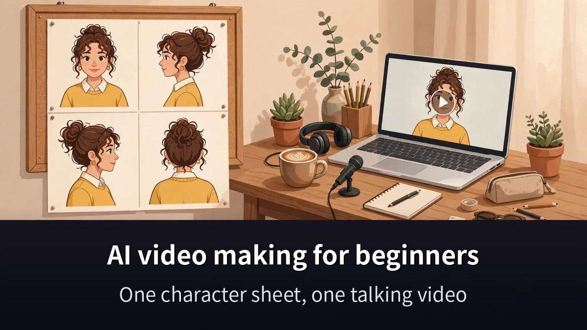
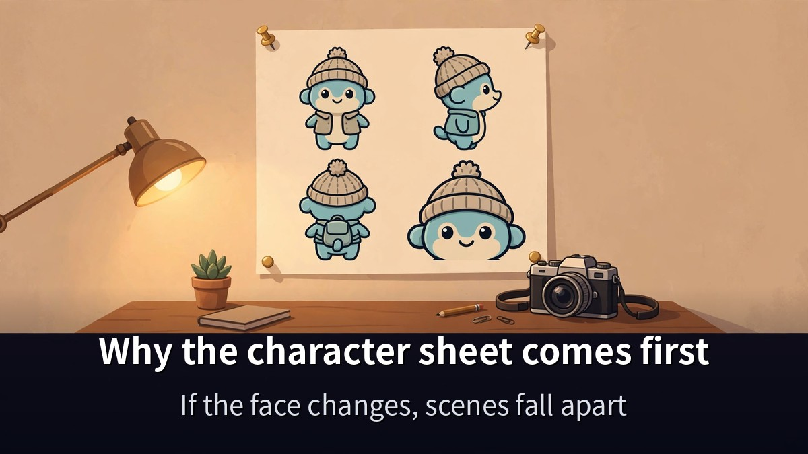
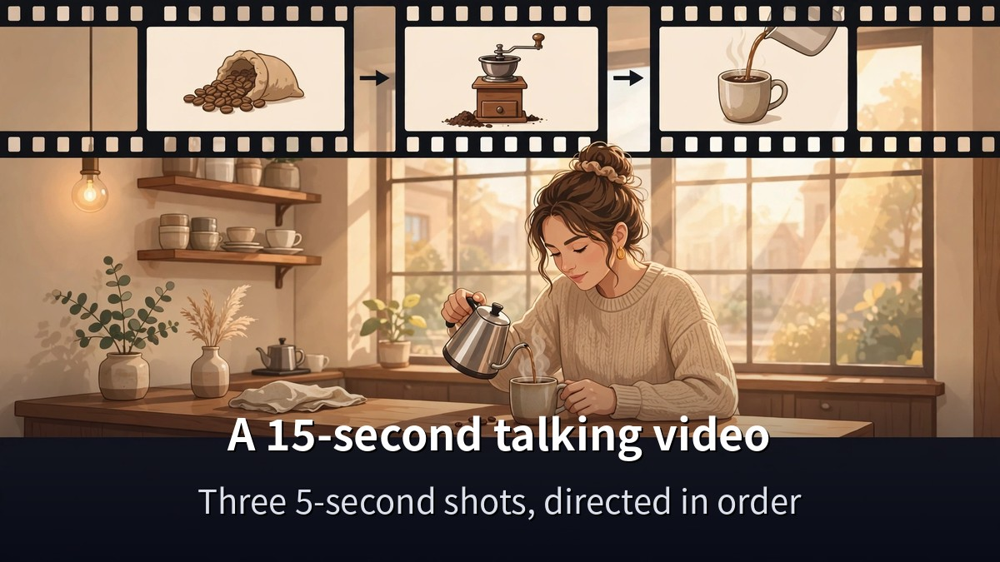
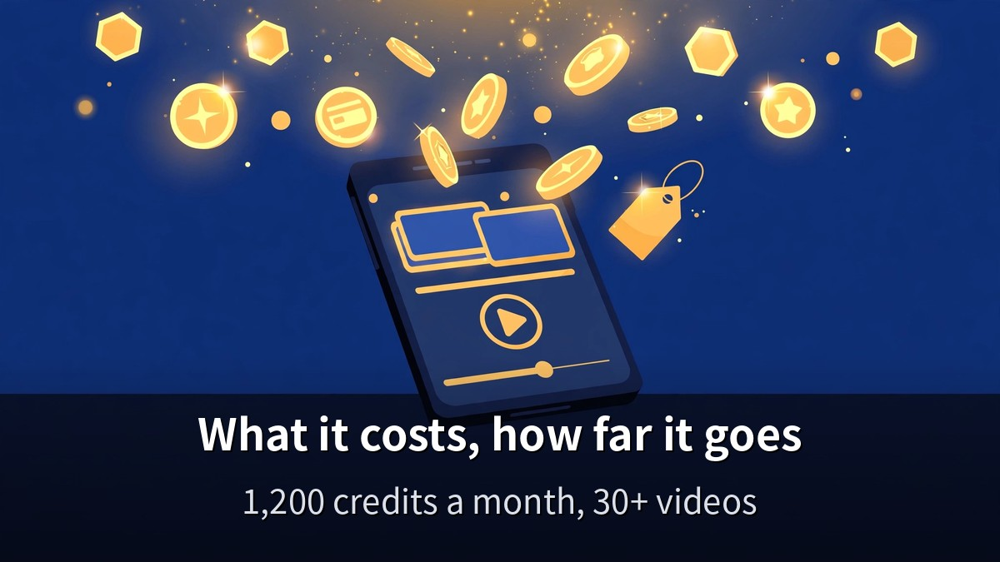

<!-- 본문 시작 -->

You want to make AI videos, but what if the face changes in every scene?
The answer is a character sheet.
This post is based on a video published on November 12, 2026 (10 minutes 36 seconds, transcript checked 0:00–10:32), and walks through how one character sheet keeps the same person talking through a 15-second AI video.

> **The point is simple. Turn one character photo into a four-shot sheet, and the same face holds in every scene after that. Without a sheet, every scene shows a different person. With a sheet, the same character carries a drama, an ad, or a webtoon. It all starts with one image.**

If you want the full flow of making AI videos with Higgsfield, [Claude Fable 5.2: What Actually Changed](https://aitechnotesen.blogspot.com/2026/11/claude-fable-52-what-actually-changed.html) shows why the model behind this workflow is getting attention.

## What is a character sheet, and why make it first?

The first thing that breaks in AI video is character consistency.
Ask for "a woman pouring coffee" ten times, and you get ten different women.
That is why scenes do not connect.

A character sheet fixes this with a single picture.
It holds the same person's face close-up, front, side, and back views side by side on one sheet.
In the video, the creator turns one character photo into a 16:9 sheet with GPT Image 2.5's Sunburst model.

The steps are simple.
First, make one character photo.
Then feed it into a sheet prompt to get a four-shot sheet.
That one sheet becomes the reference for every scene after it.

In the video prompt, the sheet is referenced as @Image1.
Instead of describing the person in words, you point at the sheet image.
So the face stays the same even when the scene changes.

What happens if you start without a sheet?
It may look fine at first, but the second scene shows a different person.
Fixing it takes longer than making the sheet in the first place.
That is why this video puts the sheet first, as step one for beginners.

## A 15-second talking video — what is the order?

With the sheet ready, it is time to make the video.
The creator in the video makes a 15-second "talking video."
A woman pours coffee in a café and says, "Welcome. Have a cup of coffee."

The prompt is split into three shots.
0–5 seconds: pouring the coffee. 5–10 seconds: a close-up of the mug. 10–15 seconds: the line, spoken by the character.
Instead of directing 15 seconds in one go, the video is built in 5-second pieces.

Audio is directed together with the picture.
Café music, the sound of pouring, and the spoken line all go into the prompt.
Video and sound are made at once, not separately.

The tool is Higgsfield's Seedance 2.5.
It generates the 15-second video at 16:9, 720p.
Seedance 2.5 makes 4–30 seconds per generation and takes up to 50 reference items across image, video, and audio.

If it does not come out right the first time, change one thing only.
The creator's advice is to change one thing at a time.
The expression, the background, or the line — one at a time, so you know what changed.
Change several at once, and you cannot find the cause.

If you are new to Claude, [how to start Claude for free, and the 5 drawbacks to check first](https://aitechnotesen.blogspot.com/2026/11/start-claude-for-free-what-you-get-what.html) shows which plan you can start on.

## What does it cost, and how far can it go?

Check the price first.
Seedance 2.5 is available on Higgsfield's paid Plus plan and above.
Plus is $59 a month, or about $47 a month on annual billing, with 1,200 credits a month.

Credits work like this.
A 5-second Seedance 2.5 clip costs 35 credits at 720p — about $1.72.
At 480p it is 15 credits, at 1080p it is 80.
The free plan has zero credits, so you cannot even try it there.

Three takes of a 15-second video at 720p cost 105 credits.
With 1,200 credits a month, that is more than 30 fifteen-second videos.
Failed takes cost credits too, so test at 480p first and render at 720p when it looks right.

| What to check | Details |
|---|---|
| Character sheet | GPT Image 2.5 Sunburst, 4 shots (close-up, front, side, back) on one sheet |
| Video length | 15 seconds, directed in 3 shots (0–5s, 5–10s, 10–15s) |
| Generation tool | Higgsfield Seedance 2.5, 16:9, 720p |
| Plan | Plus from $59/month, 1,200 credits a month |
| Clip cost | 5 seconds at 720p: 35 credits (about $1.72) |
| Fixing rule | Change one thing at a time |
| Where it goes | Blend your character into trending videos (Genjutsu) |

It does not stop there.
The creator says the same character can carry a product ad, an AI drama, an infographic, a photo shoot, or a webtoon.
Once the character is fixed, only the genre changes.
Blending your character into a trending video (Genjutsu) works on the same idea.

One caution.
The video description carries a sign-up link and a "up to 50% off your first payment" line.
But the discount rate and deadline are claims from the video description, not officially verified.
This post does not repeat the discount line.
Check the pricing page yourself — that is the safe way.

**What only this post gives you: the real cost of a 15-second video, worked out from the credit price (35 credits for 5 seconds at 720p) and the monthly allowance (1,200 credits) — more than 30 fifteen-second videos a month. Knowing "how many can I make a month" in numbers makes choosing a plan easy.**

## Frequently asked questions

**Can I make a video without a character sheet?**
You can, but the face will change from scene to scene.
A sheet is what keeps the same person.
Make it once, and you can use it for every scene after.

**Can I start for free?**
Seedance 2.5 needs the Plus plan or above, and the free plan has no credits.
Check your plan before you start.

**Can 15 seconds be made in one pass?**
Seedance 2.5 makes up to 30 seconds per generation.
Fifteen seconds fits in one pass, but the video directs it in three 5-second shots.
That keeps scene changes under control.

**How do I fix a failed take?**
Change one thing at a time.
The expression, the background, or the line — fix one, render again.
Change several at once, and you will not know what was wrong.

**How far can one character go?**
The same character can carry a product ad, an AI drama, an infographic, a photo shoot, or a webtoon.
Blending your character into a trending video is possible too.

## Good reads
[Claude Fable 5.2: What Actually Changed — An OS in 8 Days, Fermat in 30 Hours](https://aitechnotesen.blogspot.com/2026/11/claude-fable-52-what-actually-changed.html)
[Build a Real PPT from One Word File — Free Open-Source ppt-master You Can Actually Edit](https://aitechnotesen.blogspot.com/2026/11/build-real-ppt-from-one-word-file-free.html)
[Ex Machina — 108 Minutes Asking a Robot If It Has a Mind](https://aitechnotesen.blogspot.com/2026/11/ex-machina-108-minutes-asking-robot-if.html)

AI video does not start with big equipment.
One character, one sheet, one first 15-second video.
Once you pick the first scene, start with the sheet.

<!-- 본문 끝 -->

## 작업용 출처·이미지 정보 (업로드 제외)

성공지식백과 영상 UJ-oBE5GgrY(2026-11-12, 10분 36초, 자막 0:00~10:32 전체 확인) + Aliteq 요금·크레딧 실측 대조(Plus 월 $59·5초 720p 35크레딧) — 11-13-001 힉스필드 편과 소재 겹침, 캐릭터 시트·Genjutsu로 차별화
