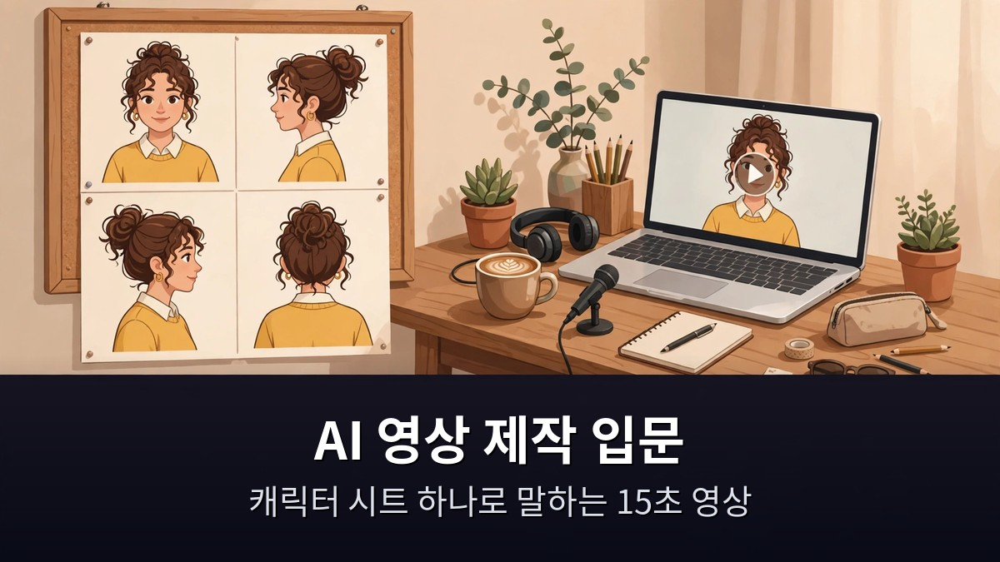
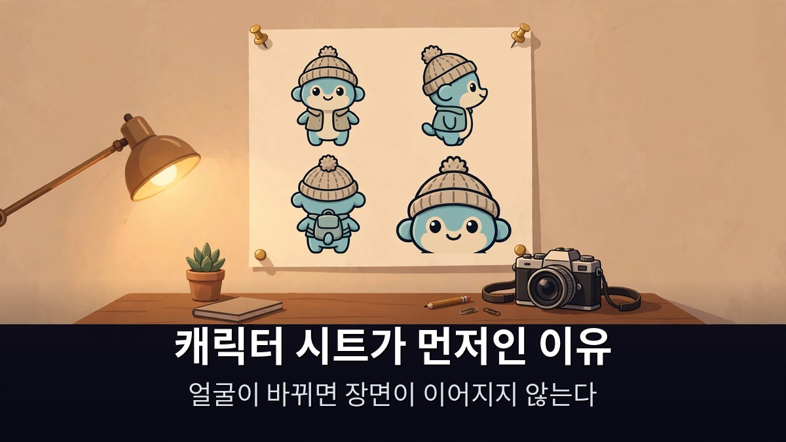

<!-- 본문 시작 -->

AI로 영상을 만들고 싶은데, 장면마다 얼굴이 바뀌면 어떡하지.
이 고민을 푸는 방법이 캐릭터 시트다.
이 글은 2026년 11월 12일에 공개된 성공지식백과 영상(10분 36초, 자막 0:00~10:32 확인)을 바탕으로, 캐릭터 시트 하나로 같은 인물이 말하는 15초 AI 영상을 만드는 순서를 정리한 자료 기반 안내다.

> **핵심은 하나다. 캐릭터 사진 한 장을 4컷 시트로 만들어두면, 그 뒤로는 어떤 장면에서도 같은 얼굴이 유지된다. 시트가 없으면 매번 다른 사람이 나오고, 시트가 있으면 드라마·광고·웹툰까지 같은 인물로 이어진다. 시작은 이미지 한 장이다.**

힉스필드로 AI 영상을 만드는 전체 흐름이 궁금하면 [페이블 5.2로 AI 영상 만들기](https://blog.naver.com/3700708/224475162359)에서 이미지 다섯 장으로 50초 영상을 만드는 과정을 먼저 확인하는 게 좋다.

## 캐릭터 시트가 뭐길래, 왜 먼저 만드나?

AI 영상에서 가장 먼저 무너지는 게 인물의 일관성이다.
"커피를 따르는 여자"를 열 번 만들면 열 명의 여자가 나온다.
장면이 이어지지 않는 이유가 여기에 있다.

캐릭터 시트는 이 문제를 푸는 한 장의 그림이다.
같은 인물의 얼굴 클로즈업·정면·측면·후면을 한 장에 나란히 담는다.
영상 속 제작자는 GPT 이미지 2.5의 Sunburst 모델로 캐릭터 1장을 16:9 시트로 변환한다.

시트를 만드는 순서는 이렇다.
먼저 캐릭터 사진 한 장을 만든다.
그 사진을 시트 변환 프롬프트에 넣어 4컷짜리 시트로 바꾼다.
이 시트 한 장이 이후 모든 장면의 기준이 된다.

영상 프롬프트에서는 시트를 @Image1로 참조한다.
"이 인물이" 하고 말로 설명하는 게 아니라, 시트 이미지를 직접 가리키는 방식이다.
그래서 장면이 바뀌어도 얼굴이 바뀌지 않는다.

시트 없이 시작하면 어떻게 될까.
처음에는 그럴듯해 보여도 두 번째 장면에서 다른 사람이 나온다.
고치는 데 드는 시간이 처음부터 시트를 만드는 시간보다 길다.
그래서 이 영상은 시트를 "입문의 첫 단계"로 둔다.

## 15초 말하는 영상, 순서는 어떻게 되나?

시트가 준비되면 이제 영상을 만든다.
영상 속 제작자는 15초짜리 "말하는 영상"을 만든다.
카페에서 커피를 따르며 "어서 오세요. 커피 한 잔 하고 가세요."라고 말하는 장면이다.

프롬프트는 3샷으로 나눈다.
0~5초는 커피를 따르는 장면, 5~10초는 머그잔 클로즈업, 10~15초는 대사와 함께 인물이 말하는 장면이다.
한 번에 15초를 통으로 지시하는 게 아니라, 5초씩 끊어 장면을 쌓는다.

오디오도 함께 지정한다.
카페 음악, 커피 붓는 소리, 대사까지 프롬프트에 넣는다.
영상과 소리를 따로 만들지 않고 한 번에 만든다.

만드는 도구는 힉스필드의 시댄스 2.5다.
16:9, 720p로 15초 영상을 생성한다.
시댄스 2.5는 한 번에 4~30초까지 만들 수 있고, 이미지·영상·오디오를 합쳐 최대 50개까지 참고 자료로 넣을 수 있다.

한 번에 완벽하게 나오지 않으면 한 곳만 바꾼다.
영상 속 제작자의 조언은 "한 번에 한 가지만 수정하라"는 것이다.
표정만, 배경만, 대사만 — 하나씩 바꿔야 무엇이 달라졌는지 알 수 있다.
여러 개를 한 번에 바꾸면 실패 원인을 찾을 수 없다.

인스타 카드뉴스를 AI로 자동화하는 흐름이 궁금하면 [클로드 코드로 인스타 카드뉴스를 자동화한 과정](https://blog.naver.com/3700708/224474066475)에서도 같은 "단계를 나누는" 방식을 볼 수 있다.

## 얼마나 들고, 어디까지 쓸 수 있나?

요금부터 확인하자.
시댄스 2.5는 힉스필드의 유료 Plus 요금제부터 쓸 수 있다.
Plus는 월 59달러, 연간 결제 시 월 47달러 수준이고, 월 1,200크레딧이 주어진다.

크레딧은 이렇게 든다.
5초짜리 시댄스 2.5 클립은 720p 기준 35크레딧, 약 1.72달러 수준이다.
480p는 15크레딧, 1080p는 80크레딧이다.
무료 플랜은 크레딧이 0개라 체험부터는 안 된다.

15초 영상을 720p로 세 번 뽑으면 105크레딧이다.
한 달 1,200크레딧이면 15초짜리를 30번 넘게 만들 수 있는 셈이다.
다만 실패작까지 크레딧이 드니, 처음에는 480p로 테스트한 뒤 720p로 뽑는 게 아깝지 않다.

| 확인 항목 | 내용 |
|---|---|
| 캐릭터 시트 | GPT 이미지 2.5 Sunburst로 4컷(클로즈업·정면·측면·후면) 한 장 |
| 영상 길이 | 15초, 3샷(0~5초·5~10초·10~15초)으로 나눠 지시 |
| 생성 도구 | 힉스필드 시댄스 2.5, 16:9·720p |
| 요금제 | Plus 월 59달러부터, 월 1,200크레딧 |
| 클립 비용 | 5초 720p 35크레딧(약 1.72달러) |
| 수정 원칙 | 한 번에 한 가지만 바꾸기 |
| 응용 | 유행 영상에 내 캐릭터 합성(겐주츠) |

응용은 여기서 끝나지 않는다.
영상 속 제작자는 같은 캐릭터로 제품 광고, AI 드라마, 인포그래픽, 화보, 웹툰까지 만들 수 있다고 말한다.
캐릭터가 고정됐으니 장르만 바꾸면 된다.
유행하는 영상에 내 캐릭터를 넣는 합성 기능(겐주츠)도 같은 원리다.

주의할 점도 있다.
영상 설명란에는 가입 링크와 "첫 결제 최대 50% 할인" 문구가 있다.
하지만 할인율과 기한은 영상 설명란의 주장일 뿐, 공식 확인이 된 내용이 아니다.
이 글에서는 할인 문구를 그대로 옮기지 않는다.
요금제 화면에서 직접 확인하는 게 안전하다.

**이 글에서만 얻는 것: 15초 영상의 실제 비용을 크레딧 단가(5초 720p 35크레딧)와 월 제공량(1,200크레딧)으로 나눠 계산해, 한 달에 15초짜리를 30번 넘게 만들 수 있다는 기준을 확인했다. 시작 전에 "한 달에 몇 개를 만들 수 있는지"를 숫자로 알고 시작하면 요금제 선택이 쉬워진다.**

## 자주 묻는 질문

**캐릭터 시트 없이 바로 영상을 만들면 안 되나요?**
만들 수는 있지만 장면마다 얼굴이 바뀐다.
같은 인물을 유지하려면 시트가 필요하다.
시트는 한 번만 만들면 이후 모든 장면에 쓸 수 있다.

**무료로 시작할 수 있나요?**
시댄스 2.5는 Plus 요금제부터 쓸 수 있고, 무료 플랜에는 크레딧이 없다.
시작 전에 요금제를 확인해야 한다.

**15초를 한 번에 만들 수 있나요?**
시댄스 2.5는 한 번에 최대 30초까지 만들 수 있다.
15초는 한 번에 만들 수 있지만, 영상에서는 5초씩 3샷으로 나눠 지시하는 방식을 쓴다.
장면 전환을 세밀하게 조정하기 위해서다.

**실패하면 어떻게 고치나요?**
한 번에 한 가지만 바꾼다.
표정, 배경, 대사 중 하나만 수정하고 다시 뽑는다.
여러 개를 한 번에 바꾸면 무엇이 문제였는지 알 수 없다.

**어떤 영상까지 만들 수 있나요?**
같은 캐릭터로 제품 광고, AI 드라마, 인포그래픽, 화보, 웹툰까지 확장할 수 있다.
유행 영상에 내 캐릭터를 합성하는 것도 가능하다.

## 함께 읽으면 좋은 글
[페이블 5.2로 AI 영상 만들기｜클로드가 그림 그리고 힉스필드가 움직이는 법](https://blog.naver.com/3700708/224475162359)
[바이브코딩 웹사이트 티어표｜19개 중 1티어 5곳, 클로드로 따라 만드는 법](https://blog.naver.com/3700708/224475162723)
[블레이드 러너 2049｜인간과 복제인간의 경계를 묻는 163분](https://blog.naver.com/3700708/224474068089)

AI 영상은 거창한 장비에서 시작하지 않는다.
캐릭터 한 장, 시트 한 장, 15초짜리 첫 영상 하나.
오늘 만들 첫 장면은 뭘로 할지, 정해지면 시트부터 뽑아보세요.

<!-- 본문 끝 -->

## 작업용 출처·이미지 정보 (업로드 제외)

성공지식백과 영상 UJ-oBE5GgrY(2026-11-12, 10분 36초, 자막 0:00~10:32 전체 확인) + Aliteq 요금·크레딧 실측 대조(Plus 월 $59·5초 720p 35크레딧) — 11-13-001 힉스필드 편과 소재 겹침, 캐릭터 시트·Genjutsu로 차별화
