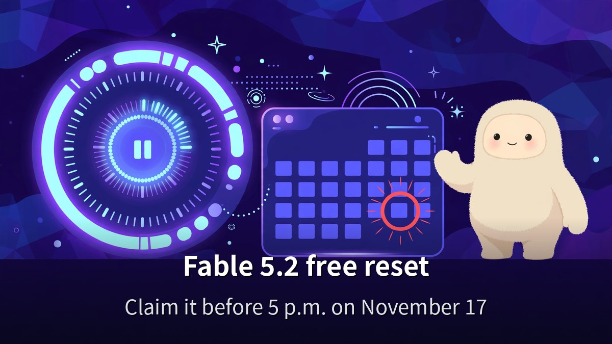
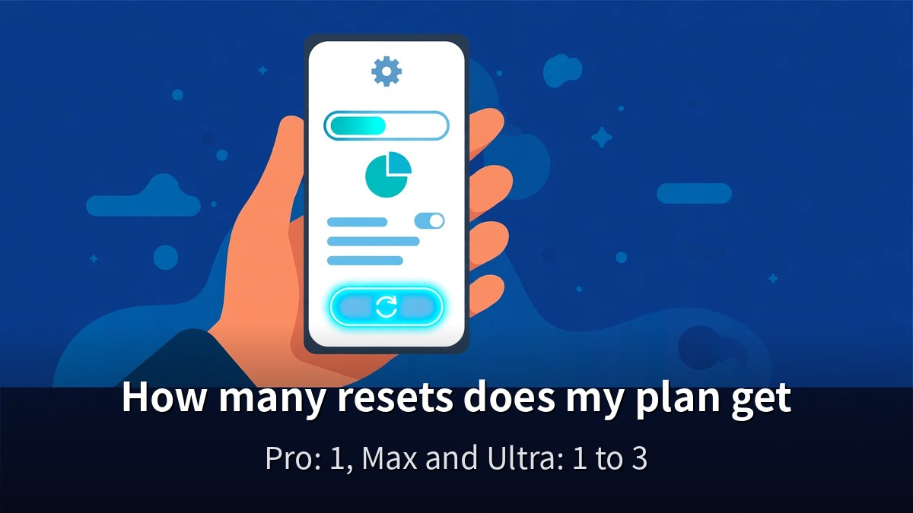
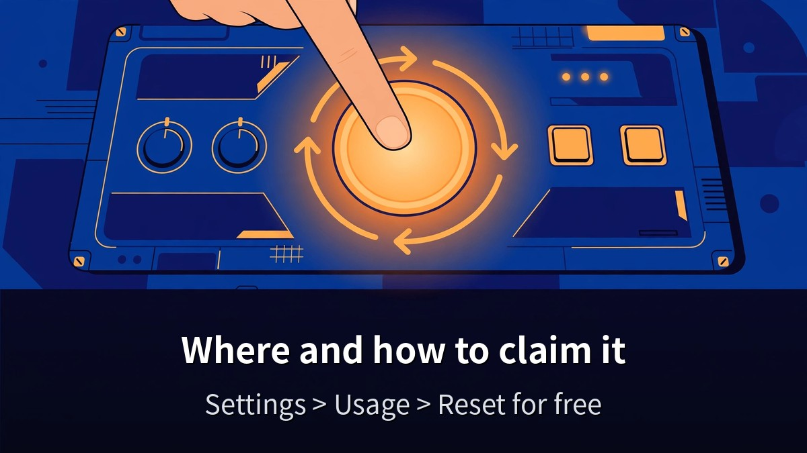
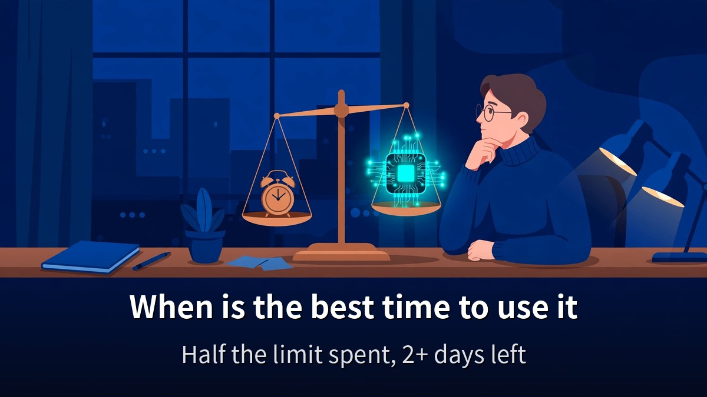

<!-- 본문 시작 -->

If you pay for Claude Pro, there is a button to check right now.
The free Fable 5.2 limit reset.
This post is based on a video published on November 12, 2026 (12 minutes 19 seconds, transcript checked 0:00–12:12) and Anthropic's Help Center launch-offers page, and explains who gets how many resets, where to claim them, and why November 17 is the deadline.

> **The point is simple. Until 5 p.m. Korean time on November 17, Pro users can use Fable 5.2 up to 50% of their weekly limit at no extra cost — plus one free reset. A reset does not raise your limit. It gives back the Fable usage you already spent. When the deadline passes, the reset and the free allowance both disappear. Check today, and decide when to use it. That is all there is to do.**

If you want to see how Fable 5.2 and Opus 5.5 actually differ, [Fable 5.2 vs Opus 5.5 — 4 Experiments That Show the Difference and What It Costs](https://aitechnotesen.blogspot.com/2026/11/fable-52-vs-opus-55-4-experiments-that.html) shows the results of four hands-on experiments first.

## How many resets does my plan get?

Start with eligibility.
Resets go only to accounts that were already paying before 10:00 a.m. Pacific Time on November 9, 2026.
Accounts that joined after that, or on the free plan, do not qualify.
The free plan has no Fable models at all.

Each plan gets something different.

| Plan | Free allowance | Resets | Deadline |
|---|---|---|---|
| Pro | Nov 9–16, up to 50% of weekly limit | 1 | Nov 17, 5 p.m. (Korea time) |
| Team standard seat | Same as Pro | 1 | Nov 17, 5 p.m. (Korea time) |
| Max, Ultra | Included in the plan | 1–3 (by tenure) | March 8, 2027 |
| Team premium seat | Included in the plan | 1–3 (by tenure) | March 8, 2027 |

The free week for Pro and standard Team seats runs from November 9 to November 16 at 11:59 p.m. Pacific Time — exactly one week.
In Korean time it ends at 5 p.m. on November 17.
During that week, Fable models count against up to 50% of your weekly limit at no extra cost.
Past 50%, or past the week, Fable runs on usage credits.

Max, Ultra, and premium Team seats get 1–3 resets.
Less than 6 months of paying: 1. Six to 12 months: 2. More than 12 months: 3.
The deadline is March 8, 2027 — plenty of time.
Unlike Pro, there is no rush.

First, get clear on what a reset is.
A reset does not raise your limit.
It returns the weekly usage you already spent on Fable models.
Usage spent on other models stays where it is.
If your account has a five-hour limit, that whole five-hour window is refilled.

## Where do I claim it, and how?

There is one place.
Open Claude Settings, then Usage.
Under "Limit resets," choose "Reset for free" and confirm.

The same button appears in the notice message when you hit your limit.
You can also use it before hitting the wall.
But once used, it cannot be undone.
And usage credits you already paid for are not refunded.

One thing to watch.
There is no such button in the Claude Code terminal.
You have to claim it on the web or in the app.
If you hit the limit in the terminal and look for a button there, you will not find one.

Open Settings and check whether the "Reset for free" button is there.
If it is not, your account may not qualify.
Eligibility turns on whether paid billing was in place before 10:00 a.m. Pacific Time on November 9.
Accounts that switched to Pro after that do not get a reset.

## When is the best time to use it?

A reset is not something to save — it is something to time.
Use it once and it is gone, so use it when it hurts most.

For Pro users, think of it this way.
If you have used close to half your weekly limit on Fable, and more than two days remain before the next reset, using it now pays off.
Even more so if you plan a big job this week.
But claiming it early "just in case," when you have nothing planned, wastes it.
The reset disappears with the deadline at 5 p.m. on November 17.

Max and Ultra users do not need to hurry.
Their resets stay valid until March 8, 2027.
Use them when a big project starts.

And one misunderstanding to clear up.
Claiming a reset does not let you use Fable without limit.
It only gives back what you already spent, and the 50% weekly cap stays in place.
Past 50%, usage credits start running.

Remember Anthropic's own advice, too.
Use Opus 5.5 for everyday work, and bring out Fable only when you are stuck or the job is big.
Treating Fable as your default model because a reset exists is the fastest way to burn your limit.

If you want to know what the Claude free plan covers before you start, [how to start Claude for free, and the 5 drawbacks to check first](https://aitechnotesen.blogspot.com/2026/11/start-claude-for-free-what-you-get-what.html) lists the five drawbacks to check first.

**What only this post gives you: the deadlines are not the same — Pro's one reset ends at 5 p.m. on November 17, while Max and Ultra resets run until March 8, 2027 — and a reset restores usage, it does not raise the limit. That was checked against Anthropic's Help Center. "When you claim it" is the value of the reset itself.**

## Frequently asked questions

**Does the free plan get a reset?**
No.
The free plan has no Fable models and no resets.
Only paid plans qualify.

**I joined Pro after November 9. Do I get a reset?**
No.
Only accounts with paid billing in place before 10:00 a.m. Pacific Time on November 9, 2026 qualify.
Joining later means no reset.

**Does a reset raise my limit?**
No.
It only returns Fable usage you already spent. The limit itself stays the same.
The 50% weekly cap stays in place too.

**Can I use it before hitting the limit?**
Yes.
You can press "Reset for free" before you hit the wall.
It cannot be undone, so timing matters.

**Can I claim it in the Claude Code terminal?**
No.
There is no button in the terminal.
Use Settings, then Usage, on the web or in the app.

**What happens after November 17?**
Pro's free allowance and its one reset disappear.
After that, Fable on Pro runs on usage credits.
Max and Ultra resets stay valid until March 8, 2027.

## Good reads
[Claude Fable 5.2: What Actually Changed — An OS in 8 Days, Fermat in 30 Hours](https://aitechnotesen.blogspot.com/2026/11/claude-fable-52-what-actually-changed.html)
[How to start Claude for free, and the 5 drawbacks to check first](https://aitechnotesen.blogspot.com/2026/11/start-claude-for-free-what-you-get-what.html)
[Ex Machina — 108 Minutes Asking a Robot If It Has a Mind](https://aitechnotesen.blogspot.com/2026/11/ex-machina-108-minutes-asking-robot-if.html)

The deadline is 5 p.m. on November 17.
Today is November 14 — three days left.
If you are on Pro, open Settings first, and decide whether you have a big Fable job this week.

<!-- 본문 끝 -->

## 작업용 출처·이미지 정보 (업로드 제외)

AI 슬래시 영상 JntTm9xOWzs(2026-11-12, 12분 19초, 자막 0:00~12:12 전체 확인) + Anthropic 도움말 'Claude Fable 5.2 launch offers' 대조(Pro 11-16 23:59 PT·한국 11-17 오후 5시 마감·Max/Ultra 2027-03-08·자격 11-09 10:00 PT 이전 유료 결제) — 11-11 페이블 3편과 중복 피하고 초기화권 단편만 다룸
