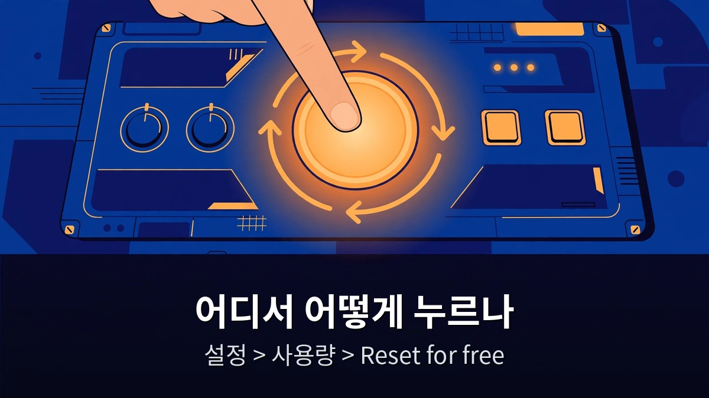

<!-- 본문 시작 -->


페이블 5.2 무료 초기화권, 11월 17일 오후 5시가 마감이다.

클로드 Pro를 쓰고 있다면, 지금 확인해야 할 버튼이 있다.
페이블 5.2 무료 초기화권이다.
**11월 17일 오후 5시(한국 시간)가 지나면 초기화권도, 무료 사용분도 사라진다.**
누가 몇 회 받는지, 어디서 어떻게 누르는지, 오늘 확인하고 쓸 타이밍을 정해두면 된다.

> **Pro 사용자는 11월 17일 오후 5시까지 페이블 5.2를 주간 한도의 50%까지 추가 비용 없이 쓸 수 있고, 초기화권 1회도 함께 받는다. 초기화권은 한도를 늘려주는 게 아니라, 페이블에 쓴 사용량을 되돌려주는 것이다.**

페이블 5.2와 오퍼스 5.5가 실제로 어떻게 다른지 궁금하면 [클로드 페이블 5.2와 오퍼스 5.5의 실험 비교](https://blog.naver.com/3700708/224474078530)에서 직접 실험 4건의 결과를 먼저 확인하는 게 좋다.

```blog
type: heading
level: 2
runs:
  - text: "무료 초기화권, 내 플랜은 몇 회 받나?"
    style: {bold: true, color: "#007aa6"}
```

**자격부터 확인하자. 2026년 11월 9일 오전 10시(태평양 시간) 이전에 이미 유료 결제를 하고 있던 계정만 받는다.**


플랜마다 무료 사용분과 초기화권 횟수, 마감이 다르다. Pro와 Team 표준석은 11월 17일 오후 5시가 마감이다.

그 뒤에 가입했거나 무료 플랜이라면 대상이 아니다.
무료 플랜에는 페이블 모델 자체가 없다.

플랜별로 받는 게 다르다.

```blog
type: table
rows:
  - [{text: "플랜", header: true, style: {background: "#123456", color: "#FFFFFF"}, width: 18}, {text: "무료 사용분", header: true, style: {background: "#123456", color: "#FFFFFF"}, width: 40}, {text: "초기화권", header: true, style: {background: "#123456", color: "#FFFFFF"}, width: 16}, {text: "마감", header: true, style: {background: "#123456", color: "#FFFFFF"}, width: 26}]
  - [{text: "Pro", width: 18}, {text: "11/9~16, 주간 한도 50%", width: 40}, {text: "1회", width: 16}, {text: "11/17 오후 5시", width: 26}]
  - [{text: "Team 표준석", width: 18}, {text: "Pro와 동일", width: 40}, {text: "1회", width: 16}, {text: "11/17 오후 5시", width: 26}]
  - [{text: "Max·Ultra", width: 18}, {text: "플랜에 포함", width: 40}, {text: "1~3회", width: 16}, {text: "2027/3/8", width: 26}]
  - [{text: "Team 고급석", width: 18}, {text: "플랜에 포함", width: 40}, {text: "1~3회", width: 16}, {text: "2027/3/8", width: 26}]
```

Pro와 Team 표준석의 무료 사용분은 **11월 9일부터 16일 오후 11시 59분(태평양 시간)**까지, 딱 일주일이다.
한국 시간으로는 **11월 17일 오후 5시**에 끝난다.
이 기간에 페이블 모델을 쓰면 주간 한도의 50%까지는 추가 비용이 들지 않는다.
50%를 넘기거나, 일주일이 지나면 사용량 크레딧으로 과금된다.

Max·Ultra·Team 고급석은 초기화권이 **1~3회**다.
6개월 미만 구독은 1회, 6~12개월은 2회, 12개월 초과는 3회다.
마감은 **2027년 3월 8일**까지로 넉넉하다.
Pro와 달리 서두를 필요는 없다.

초기화권이 뭔지부터 정확히 알아야 한다.
초기화는 한도를 늘려주는 게 아니다.
**페이블 모델에 이미 쓴 주간 사용량을 되돌려주는 것**이다.
다른 모델에 쓴 사용량은 그대로 남는다.
5시간 한도가 있는 계정이라면 5시간 창이 통째로 채워진다.

```blog
type: heading
level: 2
runs:
  - text: "어디서 어떻게 누르나?"
    style: {bold: true, color: "#007aa6"}
```

**누르는 곳은 한 군데다. 클로드 설정에서 사용량으로 들어가면 된다.**


설정에서 사용량으로 들어가 'Limit resets'의 'Reset for free' 버튼을 누르면 된다.

설정(Settings)에 들어가 사용량(Usage)으로 간다.
"Limit resets" 항목에 있는 **"Reset for free" 버튼**을 누르고 확인하면 된다.

한도에 도달했을 때 뜨는 안내 메시지에도 같은 버튼이 뜬다.
한도에 걸리기 전에도 미리 쓸 수 있다.
다만 **한 번 쓰면 되돌릴 수 없다.**
이미 낸 추가 사용료가 환불되는 것도 아니다.

```blog
type: text
runs:
  - text: "클로드 코드 터미널에는 이 버튼이 없다. 웹이나 앱에서 눌러야 한다."
    style: {bold: true, background: "#FFF3CD"}
```

설정 화면에 들어가면 "Reset for free" 버튼이 있는지부터 확인하자.
버튼이 안 보이면 내 계정이 대상이 아닐 수 있다.
자격은 **11월 9일 오전 10시(태평양 시간) 이전 유료 결제 여부**로 갈린다.
그 뒤에 Pro로 바꾼 계정은 초기화권을 받지 못한다.

```blog
type: heading
level: 2
runs:
  - text: "언제 누르는 게 유리할까?"
    style: {bold: true, color: "#007aa6"}
```

**초기화권은 아껴두는 게 아니라, 타이밍을 재는 것이다. 한 번 쓰면 끝이니, 가장 아까울 때 쓰는 게 맞다.**


한 번 쓰면 끝이다. 가장 아까울 때, 다음 리셋까지 시간이 남았을 때 누르는 게 유리하다.

```blog
type: text
runs:
  - text: "Pro라면."
    style: {bold: true, color: "#ff008c"}
  - text: " 주간 한도의 절반 가까이 페이블에 썼고, 다음 리셋까지 2일 이상 남았다면 지금 누르는 게 유리하다. 이번 주 안에 큰 작업을 더 할 계획이 있다면 더 그렇다. 반대로 이번 주에 쓸 일이 없는데 \"나중에 아까우니까\" 미리 눌러두는 건 손해다. 초기화권은 11월 17일 오후 5시에 함께 사라진다."
```

```blog
type: text
runs:
  - text: "Max·Ultra라면."
    style: {bold: true, color: "#ff008c"}
  - text: " 서두를 필요가 없다. 초기화권이 2027년 3월 8일까지 유효하다. 큰 프로젝트가 시작되는 시점에 맞춰 쓰는 게 낫다."
```

```blog
type: text
runs:
  - text: "초기화권을 눌러도 페이블을 무제한으로 쓸 수 있는 것은 아니다. 돌려받는 건 이미 쓴 분량뿐이고, 주간 한도의 50% 상한은 그대로다."
    style: {bold: true, background: "#FFF3CD"}
```

50%를 넘기면 그때부터는 사용량 크레딧이 나간다.

안트로픽의 권고도 함께 기억하자.
평소에는 **오퍼스 5.5**를 쓰고, 막히거나 큰 작업일 때만 페이블을 꺼내라는 것이다.
초기화권이 있다고 페이블을 기본 모델로 바꾸는 건, 한도를 빨리 태우는 지름길이다.

클로드 무료 플랜으로 어디까지 할 수 있는지 궁금하면 [클로드 무료로 시작하는 법](https://blog.naver.com/3700708/224474079288)에서 시작 전 꼭 확인할 5가지 단점을 함께 보는 게 좋다.

```blog
type: heading
level: 2
runs:
  - text: "마무리"
    style: {bold: true, color: "#007aa6"}
```

마감은 11월 17일 오후 5시다.
글을 쓰는 오늘은 11월 14일, 남은 시간은 사흘이다.
Pro 사용자라면 설정 화면부터 열어두고, 이번 주에 페이블로 할 큰 작업이 있는지 정해두는 게 순서다.
초기화권은 아껴두는 게 아니라, 가장 아까울 때 쓰는 것이다.

## 자주 묻는 질문

**무료 플랜도 초기화권을 받나요?**
아니요.
무료 플랜에는 페이블 모델 자체가 없고, 초기화권도 없다.
Pro 이상 유료 플랜이 대상이다.

**11월 9일 이후에 Pro로 가입했는데 초기화권을 받나요?**
아니요.
2026년 11월 9일 오전 10시(태평양 시간) 이전에 이미 유료 결제를 하고 있던 계정만 대상이다.
그 뒤에 가입하면 초기화권은 없다.

**초기화권을 누르면 한도가 늘어나나요?**
아니요.
이미 쓴 페이블 사용량을 되돌려줄 뿐, 한도 자체는 그대로다.
주간 한도의 50% 상한도 그대로 유지된다.

**한도에 도달하기 전에도 쓸 수 있나요?**
네.
한도에 걸리기 전에도 "Reset for free" 버튼을 눌러 쓸 수 있다.
한 번 쓰면 되돌릴 수 없으니 타이밍을 재는 게 중요하다.

**클로드 코드 터미널에서 누를 수 있나요?**
아니요.
터미널에는 버튼이 없다.
웹이나 앱의 설정 > 사용량에서 눌러야 한다.

**11월 17일이 지나면 어떻게 되나요?**
Pro의 무료 사용분과 초기화권 1회는 사라진다.
이후 Pro에서 페이블을 쓰면 사용량 크레딧으로 과금된다.
Max·Ultra의 초기화권은 2027년 3월 8일까지 유효하다.

## 함께 보면 좋은 글
[클로드 페이블 5.2, 뭐가 달라졌나 — 8일 만에 운영체제, 30시간 만에 페르마 정리](https://blog.naver.com/3700708/224474080104)

[클로드 무료로 시작하는 법｜8분 정리, 시작 전 꼭 확인할 5가지 단점](https://blog.naver.com/3700708/224474079288)

[엑스 마키나｜로봇에게 마음을 묻는 108분, 튜링 테스트의 진짜 질문](https://blog.naver.com/3700708/224474081075)

<!-- 본문 끝 -->

## 작업용 출처·이미지 정보 (업로드 제외)

AI 슬래시 영상 JntTm9xOWzs(2026-11-12, 12분 19초, 자막 0:00~12:12 전체 확인) + Anthropic 도움말 'Claude Fable 5.2 launch offers' 대조(Pro 11-16 23:59 PT·한국 11-17 오후 5시 마감·Max/Ultra 2027-03-08·자격 11-09 10:00 PT 이전 유료 결제) — 11-11 페이블 3편과 중복 피하고 초기화권 단편만 다룸

- rev2 변경 (2026-11-18 처음부터 다시 쓰기): 소제목 3개+마무리를 blog heading 블록(#007aa6)으로, 플랜 비교표를 blog table 블록(18/40/16/26, 머리행 #123456)으로 전환. Pro/Max 타이밍 문단에 #ff008c 라벨 run, 주의 문구 2곳(터미널 버튼 없음·50% 상한 그대로)을 #FFF3CD 하이라이트로 적용. 이미지 4장에 평문 캡션 추가. 도입부 출처 표기 제거, '이 글에서만 얻는 것' 문단 제거, 글 끝의 마감 문단을 마무리 섹션으로 이동해 OG 카드가 글의 마지막이 되게 함. 그 외 사실·수치·표·이미지·링크는 rev1과 동일. (마감 11/17·오늘 11/14·사흘 남음은 원문 작성 시점 기준 유지)
