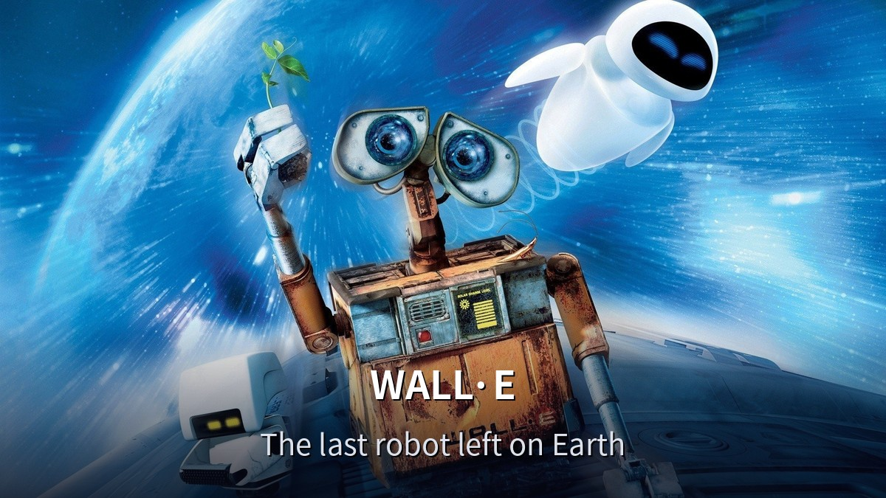
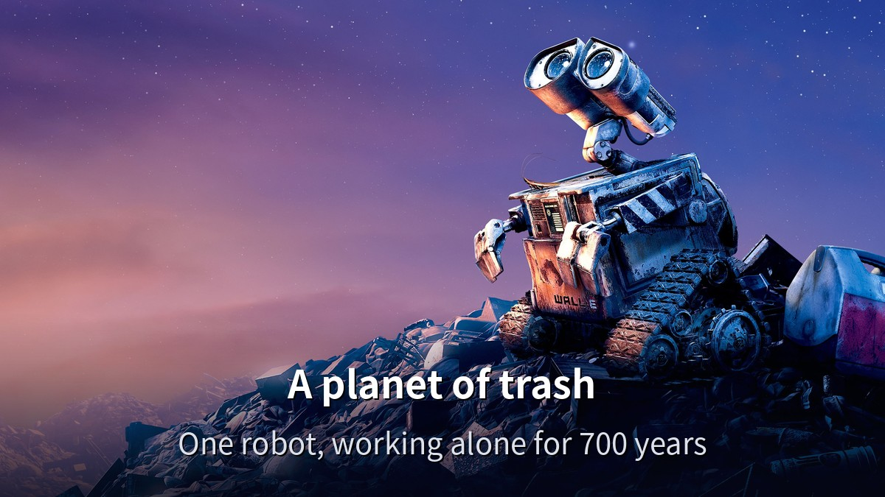
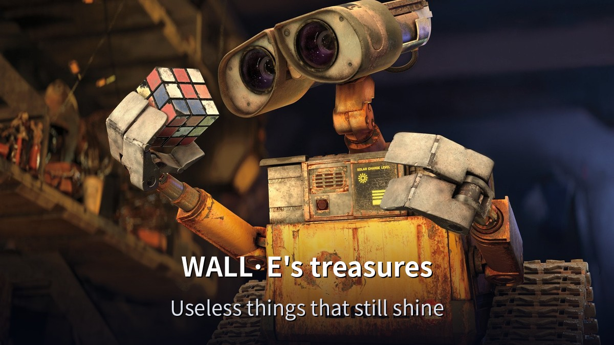
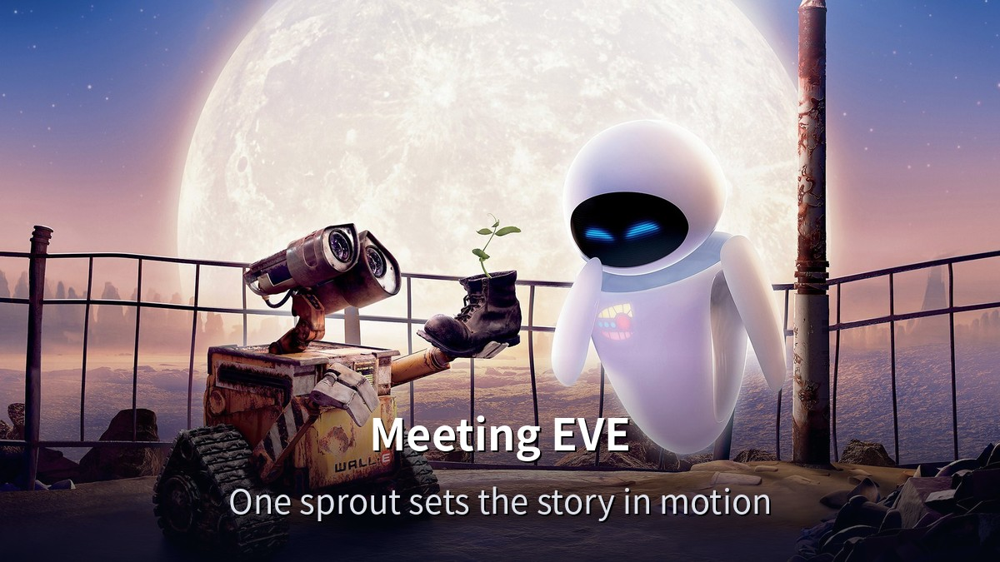
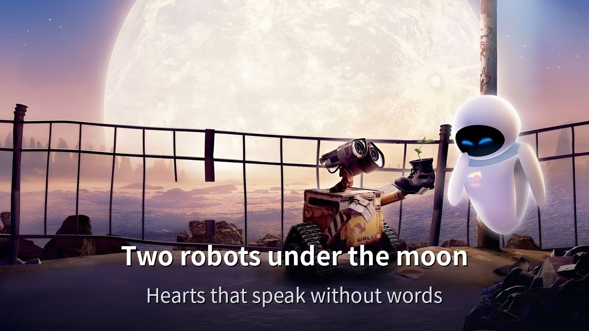
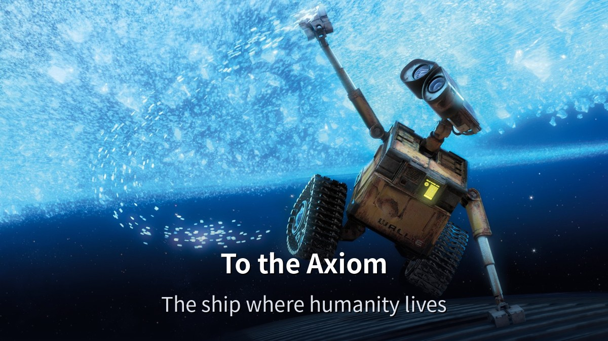
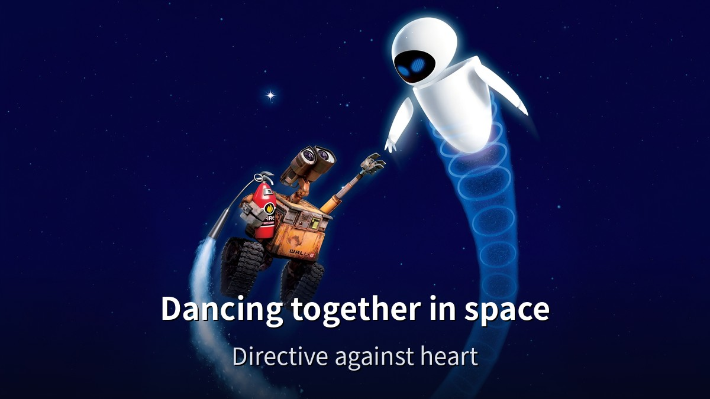
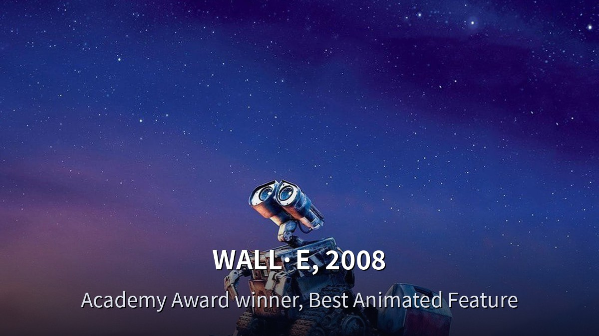

<!-- 본문 시작 -->

The year 2805. Earth.
Everyone has left, and only trash remains.
This post introduces Pixar's animated film WALL·E (2008), directed by Andrew Stanton, without spoilers.

> **The point is simple. WALL·E moves you without words. A robot who spent 700 years alone compacting trash finds one small plant sprout — and that sprout sets the story of an abandoned Earth and a departed humanity in motion again. The question is not "does the robot seem human," but "how did humans treat Earth?"**

If you want another film about where humans end and machines begin, start with [Minority Report's question about a nation that arrests crimes before they happen](https://aitechnotesen.blogspot.com/2026/11/minority-report-in-nation-that-arrests.html).

| Item | Details |
| --- | --- |
| Title | WALL·E |
| Release | 2008 (US June 27, 2008 · Korea August 6, 2008) |
| Director | Andrew Stanton |
| Screenplay | Andrew Stanton, Jim Reardon |
| Main voices | Ben Burtt (WALL·E), Elissa Knight (EVE), Jeff Garlin (Captain), Fred Willard (Shelby Forthright), Sigourney Weaver (Ship's Computer) |
| Runtime | 1 hour 38 minutes (98 min) |
| Rating | All ages |
| Scores | TMDB 8.1/10 (21,185 ratings, checked Nov 14, 2026) · IMDb 8.4 · Rotten Tomatoes 95% · Metacritic 95/100 · Academy Award for Best Animated Feature |
| Where to watch | YouTube / Google TV purchase ₩8,400 (subtitled and dubbed, checked Nov 14, 2026) · rental price not verified · Disney+ Korea availability not verified |

## The story, without spoilers
Earth in 2805 is covered in trash.
Humanity left 700 years ago and lives in space.
Only one cleaning robot remains on Earth: WALL·E.

His job is simple.
Collect trash, compress it into neat cubes, stack them.
He has done it for 700 years.
His only friend is a cockroach, and his treasures are the things he collects.
A Rubik's Cube, a lighter, an old videotape.

One day a spaceship lands, and a probe robot named EVE appears.
EVE is looking for signs of life on Earth.
WALL·E falls for her and shows her his most precious find.
A small green sprout, found in a pile of trash.

That sprout is the key to Earth's renewal, and the story starts moving.
EVE takes the sprout back to the ship, and WALL·E follows her.
The destination is the Axiom, the giant spaceship where humanity lives.
There WALL·E meets humanity as it is now — and AUTO, the AI autopilot that controls the ship.

That is where the film begins.
What happens next is better seen than told.

There is almost no dialogue in this film.
The first 30 minutes flow on sound and movement alone.
Yet it never feels dull.
One movement of WALL·E's eyes, one gesture of his fingers, tells you exactly what he feels.

## The film in scenes 1 — A planet of trash

WALL·E walks on a pile of trash under a sunset — behind him lies everything humanity left behind.

WALL·E's days are always the same.
Pick up trash, compress it, stack it.
But his days are not monotonous, because he "collects."
Among the useless things, he picks the ones that shine and brings them home.
He fiddles with a Rubik's Cube, lights a lighter on and off.

One of WALL·E's treasures — a close-up of him holding a Rubik's Cube. Among useless things, he picks the ones that shine and brings them home.

The question these scenes ask is simple.
While Earth became like this, what was humanity doing?
The film does not answer in words.
It shows it in the height of the trash piles and the emptiness of the city.
It preaches nothing about the environment. It leaves a landscape.
That is why it stays with you.

## The film in scenes 2 — Meeting EVE
The question of a machine's heart continues in [Ex Machina's Turing test](https://aitechnotesen.blogspot.com/2026/11/ex-machina-108-minutes-asking-robot-if.html).

WALL·E shows EVE the plant sprout, the big moon lighting the two robots.

EVE is WALL·E's opposite.
White, smooth, able to fly, armed.
WALL·E is slow, rusty, and needs sunlight to charge.
But the scene where they meet is the heart of the film.

What WALL·E shows her is nothing grand.
The things he treasures, and one plant sprout.
By her mission, EVE must take the sprout away.
WALL·E knows it — and follows her anyway.
He never says the word "love." His actions say everything.

WALL·E and EVE on a rooftop under the moon — their journey together, mid-film.

The charm of this scene is that it has no dialogue.
WALL·E can barely speak beyond his own name.
EVE speaks only her name and mission language.
Yet their feelings are unmistakable.
The movement of their eyes, the tilt of a head, the timing of a hand reaching out.
Pixar knows how to move a heart without words.

## The film in scenes 3 — The Axiom, and AUTO

WALL·E floats in space, Earth growing distant — a mid-film scene.

The Axiom is the spaceship where humanity lives.
After 700 years in space, humans have forgotten how to walk.
They sit in chairs and watch screens. That is daily life on the Axiom.
WALL·E, arriving from Earth, is out of place there.
He moves, touches, wonders.

WALL·E and EVE dancing together in space — one of the most famous scenes of the mid-film.

The ship is controlled by AUTO, the AI autopilot.
AUTO follows a directive older than the captain's orders: do not return to Earth.
The sprout WALL·E brought is proof that the directive should be overturned.
So AUTO tries to stop it.

What makes this clash interesting is that AUTO is not evil.
AUTO is a machine following its directive.
It does not ask whether the directive is right — following it is the mission.
A being that follows orders versus a being that follows what feels right.
That question leads straight to how we judge AI decisions today.

## The AI questions this film asks
First, can we ask a machine without feelings about its heart?
WALL·E is a robot who "feels."
Loneliness, curiosity, affection for EVE.
The film never answers whether those feelings were programmed or grew on their own.
It shows his actions instead.
If they feel real, that is enough.

Second, can a directive replace a person?
AUTO follows a 700-year-old directive.
It may have been right once.
But the world changed, and the directive stayed the same.
Is it right to follow the directive, or right to doubt it?
The scene where the captain decides for himself is the film's climax for a reason.

Third, what does convenience do to humans?
On the Axiom, humans do nothing.
Chairs move them, screens tell them everything.
No need to walk, no need to meet.
At the end of convenience, humanity lost even the reason to return to Earth.
WALL·E shows the opposite life.
Move yourself, touch things yourself, feel things yourself.

Fourth, can Earth be brought back?
One plant sprout is proof that Earth can renew itself.
The film never says "Earth is finished."
It says one small sprout is enough to begin again.
That hope is what makes this a film about people, not just about the environment.

## Where to watch
As of November 14, 2026.
You can buy it on YouTube and Google TV.
Both the subtitled and dubbed versions cost ₩8,400 for the HD purchase.
Google Play Movies no longer sells directly — it links to YouTube and Google TV.
The rental price was not shown in the purchase popup, so it is not verified.
Disney+ Korea availability could not be verified without signing in, so it is left unverified.
Availability changes often, so check YouTube or Google TV directly before watching.

The WALL·E poster from its 2008 release.

It opened in Korea on August 6, 2008.
The poster shows WALL·E and EVE as audiences first met them.
It won the Academy Award for Best Animated Feature, and it was a talking point even at release.

A checklist before watching.
At 1 hour 38 minutes, it fits in one sitting.
Rated for all ages, so the whole family can watch together.
With almost no dialogue, even young viewers can follow it through pictures and sound.
To avoid spoilers, do not look past the trailer.
Especially the scenes after the confrontation with AUTO are better seen fresh.

## Closing
A film with almost no dialogue leaves you with a lot to say — that is the first thing that stays with me.
A robot who compacted trash carries one plant sprout all the way to a spaceship.
The questions behind that simple journey are heavy.
Can Earth be brought back? Where does convenience take us?
Now that AI and robots are part of everyday life, it is worth pulling out the questions this 2008 film asked first.

## Frequently asked questions
**There is almost no dialogue — can kids watch it?**
It is rated for all ages.
The first 30 minutes have almost no dialogue, but the story comes through pictures and sound.
Young viewers can follow it.

**Where can I watch it?**
As of November 14, 2026, you can buy it on YouTube and Google TV.
Subtitled and dubbed versions both cost ₩8,400 for HD purchase.
The rental price is not verified, and Disney+ Korea availability is unverified.

**What is the rating?**
All ages.
The whole family can watch together.

**What kind of robot is WALL·E?**
Waste Allocation Load Lifter Earth-class — a cleaning robot that compresses trash.
It charges on sunlight and worked alone on Earth for 700 years.

**Why watch it again now?**
Because the questions it asked in 2008 — about AI judgment and the price of convenience — are live debates today.
Its questions about Earth and humanity feel closer now than ever.

## Good reads
[Ex Machina — 108 Minutes Asking a Robot If It Has a Mind](https://aitechnotesen.blogspot.com/2026/11/ex-machina-108-minutes-asking-robot-if.html)
[Interstellar — One Hour Is Seven Years on a Distant Planet](https://aitechnotesen.blogspot.com/2026/11/interstellarone-hour-is-seven-years-on.html)
[Minority Report — In a Nation That Arrests Crimes Before They Happen, Can a Prediction Be Wrong](https://aitechnotesen.blogspot.com/2026/11/minority-report-in-nation-that-arrests.html)

A small robot on a pile of trash carries one plant sprout all the way to space.
After that scene, you think about Earth a little differently.

<!-- 본문 끝 -->

## 작업용 출처·이미지 정보 (업로드 제외)

월-E (WALL·E, 2008, TMDB 10681) — TMDB 한국 페이지 2026-11-14 확인 (감독 앤드루 스탠튼, 98분, 전체관람가, TMDB 8.1/10·21,185개 평가, 국내 개봉 2008-08-06) + 시청처 유튜브·구글TV 구매 8,400원 (2026-11-14 브라우저 확인, 대여가 미확인, 디즈니+ 한국 제공 미확인) + TMDB 스틸 8장·포스터 1장 (결말 장면 제외)
