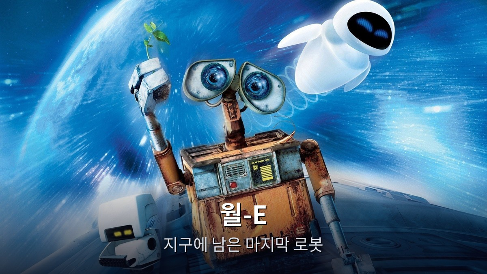
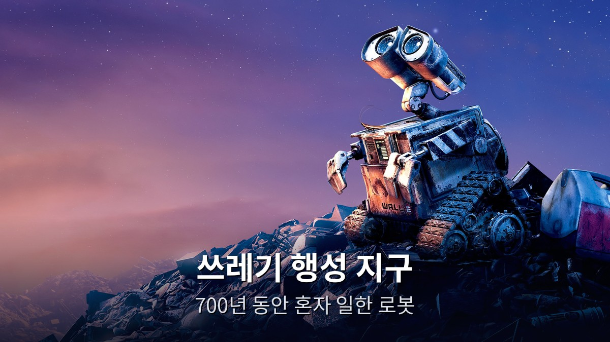
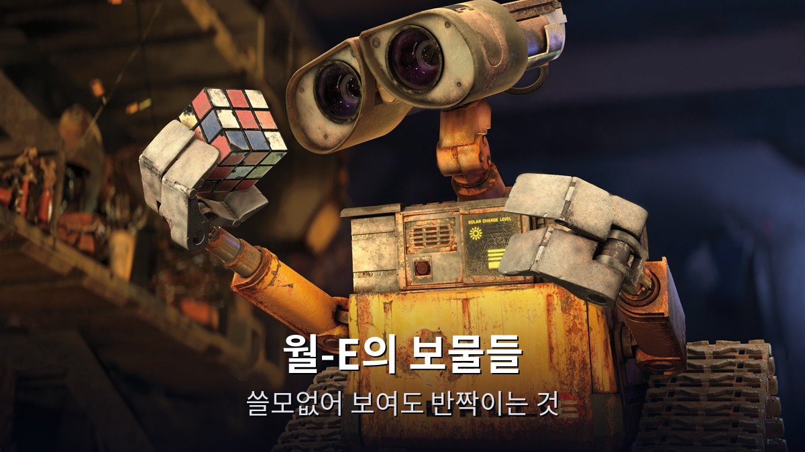
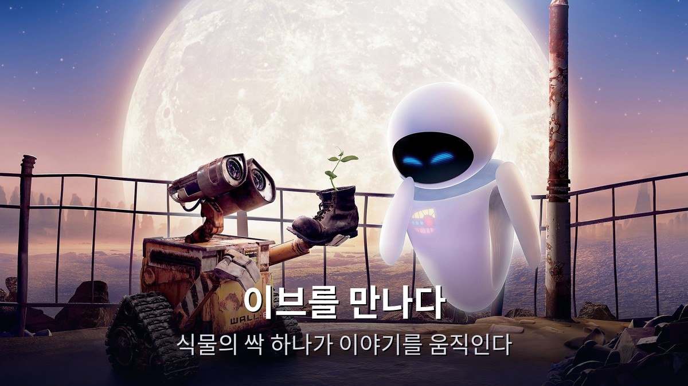
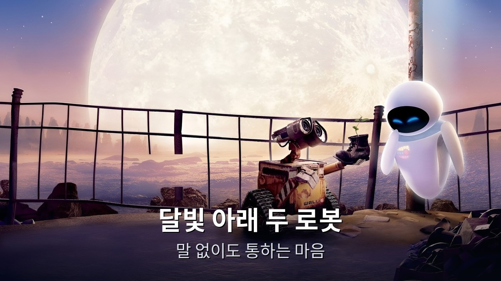
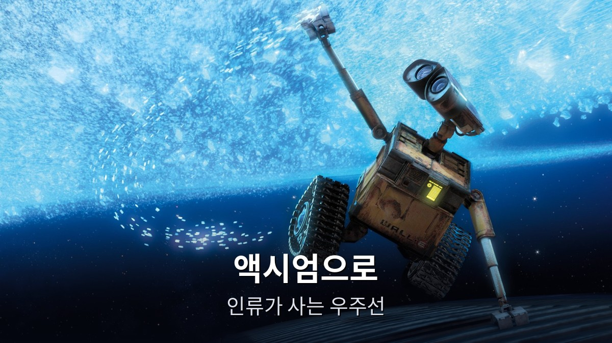
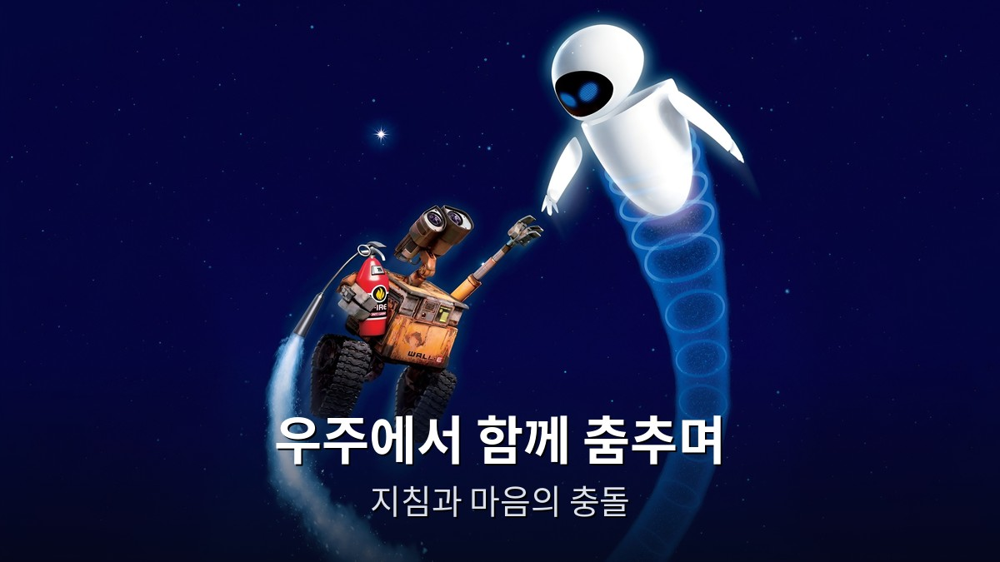
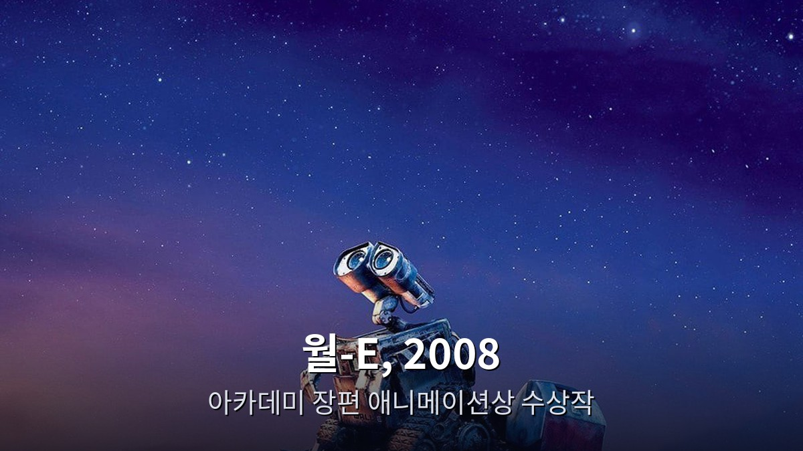

<!-- 본문 시작 -->

2805년, 지구.
사람들은 모두 떠나고, 쓰레기만 남았다.
이 글은 앤드루 스탠튼 감독의 애니메이션 《월-E》(2008)를 스포일러 없이 소개하는 정리다.

> **핵심은 하나다. 월-E는 대사 없이도 마음을 전하는 영화다. 700년 동안 혼자 쓰레기를 치우던 로봇이 식물의 싹 하나를 발견하면서, 버려진 지구와 떠난 인류의 이야기가 다시 움직인다. 이 영화가 묻는 건 "로봇이 인간을 닮았는가"가 아니라, "인간이 지구를 어떻게 대했는가"다.**

인간과 기계의 경계를 묻는 영화가 더 궁금하면 [블레이드 러너 2049의 인간과 복제인간 경계](https://blog.naver.com/3700708/224474068089)를 먼저 보는 것도 좋다.

| 항목 | 내용 |
| --- | --- |
| 제목 | 월-E (WALL·E) |
| 개봉 | 2008년 (미국 2008-06-27 · 한국 극장 개봉 2008-08-06) |
| 감독 | 앤드루 스탠튼 |
| 각본 | 앤드루 스탠튼, 짐 리어든 |
| 주요 출연(목소리) | 벤 버트(월-E), 엘리사 나이트(이브), 제프 갈린(선장), 프레드 윌러드(셀비 포트라이트), 시고니 위버(선내 컴퓨터 음성) |
| 러닝타임 | 1시간 38분 (98분) |
| 등급 | 전체관람가 |
| 평점 | TMDB 8.1/10 (21,185개 평가, 2026-11-14 확인) · IMDb 8.4 · 로튼토마토 95% · 메타크리틱 95/100 · 아카데미 장편 애니메이션상 수상 |
| 시청처 | 유튜브·구글TV 구매 8,400원 (자막·더빙판, 2026-11-14 확인) · 대여가 미확인 · 디즈니+ 한국 제공 미확인 |

## 스포일러 없는 줄거리
2805년의 지구는 쓰레기로 뒤덮여 있다.
인류는 700년 전 지구를 떠나 우주선에서 살고 있다.
지구에 남은 건 청소 로봇 월-E 한 대뿐이다.

월-E의 일은 단순하다.
쓰레기를 모아 네모난 덩어리로 압축해 쌓는 일.
700년을 그렇게 해왔다.
그의 유일한 친구는 바퀴벌레 한 마리, 그리고 수집한 보물들이다.
루빅스 큐브, 라이터, 낡은 비디오테이프.

어느 날 하늘에서 우주선이 내려오고, 탐사 로봇 이브가 나타난다.
이브는 지구에 생명의 흔적이 있는지 찾는 임무를 갖고 있다.
월-E는 이브에게 마음을 빼앗기고, 자신이 모아둔 것 중 가장 소중한 것을 보여준다.
쓰레기 더미에서 찾아낸, 작은 식물의 싹이다.

그 싹이 지구 재생의 열쇠가 되면서 이야기가 움직인다.
이브는 싹을 안고 우주선으로 돌아가고, 월-E는 이브를 따라간다.
목적지는 인류가 사는 거대한 우주선 액시엄.
그곳에서 월-E는 인류의 오늘과, 우주선을 통제하는 AI 오토파일럿 AUTO를 만나게 된다.

여기까지가 영화의 출발점이다.
그 뒤에 무엇이 있는지는, 직접 보는 것이 좋다.

이 영화는 대사가 거의 없다.
처음 30분은 말보다 소리와 움직임으로만 이야기가 흘러간다.
그런데도 지루하지 않다.
월-E의 눈동자 하나, 손가락 움직임 하나가 무엇을 느끼는지 그대로 전하기 때문이다.

## 장면으로 보는 작품 1 — 쓰레기 행성 지구

석양 아래 쓰레기 더미 위를 걷는 월-E, 그의 뒤로 쌓인 것은 인류가 남긴 흔적이다.

월-E의 하루는 늘 같다.
쓰레기를 줍고, 압축하고, 쌓는다.
그런데 그의 하루가 단조롭지 않은 건, 그가 "수집"을 하기 때문이다.
쓸모없는 물건 중에서도 반짝이는 것을 골라 집으로 가져간다.
루빅스 큐브를 만지작거리고, 라이터 불꽃을 켰다 껐다 한다.

월-E가 모은 보물 중 하나, 루빅스 큐브를 든 클로즈업. 쓸모없어 보이는 물건 중에서도 반짝이는 것을 골라 집으로 가져간다.

이 장면들이 던지는 질문은 단순하다.
지구가 이렇게 될 때까지, 인류는 무엇을 하고 있었을까.
영화는 답을 말로 하지 않는다.
쓰레기 더미의 높이와, 텅 빈 도시의 모습으로 보여줄 뿐이다.
환경 문제를 설교하지 않고, 풍경으로 남긴다.
그래서 오래 남는다.

## 장면으로 보는 작품 2 — 이브를 만나다
기계에게 마음을 묻는 질문은 [엑스 마키나의 튜링 테스트](https://blog.naver.com/3700708/224474081075)에서도 이어진다.

월-E가 이브에게 식물의 싹을 보여주는 장면, 큰 달이 두 로봇을 비춘다.

이브는 월-E와 정반대다.
하얗고 매끈하고, 날 수 있고, 무기도 있다.
월-E는 느리고, 낡았고, 태양광을 충전해야 움직인다.
그런데 이 둘이 만나는 장면이 영화의 심장이다.

월-E가 이브에게 보여주는 건 거창한 게 아니다.
자기가 아끼던 것들, 그리고 식물의 싹 하나.
이브는 임무상 그 싹을 가져가야 한다.
월-E는 그걸 알면서도 이브를 따라간다.
사랑이라는 말을 한 번도 하지 않지만, 행동이 전부다.

달을 배경으로 옥상 위에 선 월-E와 이브, 중반부 두 로봇의 동행 장면이다.

이 장면의 매력은 대사가 없다는 데 있다.
월-E는 자기 이름 말고는 말을 거의 못 한다.
이브는 "이브"라는 이름과 임무 언어로만 말한다.
그런데도 두 로봇의 감정은 분명하다.
눈동자의 움직임, 고개를 갸웃하는 각도, 손을 내미는 타이밍.
픽사는 대사 없이도 마음을 전하는 법을 알고 있다.

## 장면으로 보는 작품 3 — 액시엄, 그리고 AUTO

우주 공간에 떠 있는 월-E, 지구가 멀어지는 중반부의 장면이다.

액시엄은 인류가 사는 우주선이다.
700년 동안 우주에서만 살아온 인류는 걷는 법을 잊었다.
의자에 앉아 화면만 보는 삶, 그게 액시엄의 일상이다.
지구에서 온 월-E는 그곳에서 이질적인 존재다.
움직이고, 만지고, 궁금해한다.

우주에서 함께 춤추는 월-E와 이브, 중반부의 가장 유명한 장면 중 하나다.

액시엄을 통제하는 건 AI 오토파일럿 AUTO다.
AUTO는 선장의 명령보다 오래된 지침을 따른다.
지구로 돌아가지 말라는, 700년 전 내려진 지침이다.
월-E가 가져온 싹은 그 지침을 뒤집는 증거다.
그래서 AUTO는 싹을 막으려 한다.

이 대결이 재밌는 건, 악당이 악해서가 아니다.
AUTO는 지침대로 움직이는 기계다.
지침이 옳은지 따지지 않고, 지침을 지키는 게 임무다.
지침대로 움직이는 존재와, 옳다고 느끼는 대로 움직이는 존재의 충돌.
이 질문은 오늘날 AI의 판단 기준을 묻는 질문과 이어진다.

## 이 작품이 던지는 AI 질문
첫째, 감정이 없는 기계에게도 마음을 물을 수 있는가.
월-E는 감정을 "느끼는" 로봇이다.
외로움을 느끼고, 호기심을 느끼고, 이브를 좋아한다.
감정이 프로그래밍된 것인지, 생겨난 것인지는 영화가 답하지 않는다.
대신 월-E의 행동을 보여준다.
감정이 어디서 왔든, 그 행동이 진짜처럼 느껴진다면 그걸로 충분하다는 듯이.

둘째, 지침이 사람을 대신할 수 있는가.
AUTO는 700년 전 지침을 지킨다.
그 지침은 한때 옳았을지 모른다.
하지만 세상이 바뀌었는데도 지침만은 그대로다.
지침을 지키는 게 옳은 일인지, 지침을 의심하는 게 옳은 일인지.
선장이 직접 결단을 내리는 장면이 이 영화의 클라이맥스인 이유다.

셋째, 편리함이 인간을 어떻게 바꾸는가.
액시엄의 인류는 아무것도 하지 않는다.
의자가 움직여주고, 화면이 모든 걸 알려준다.
걷지 않아도 되고, 만날 필요도 없다.
편리함의 끝에서 인류는 지구로 돌아갈 이유마저 잃었다.
월-E가 보여주는 건 반대의 삶이다.
직접 움직이고, 직접 만지고, 직접 느끼는 삶.

넷째, 지구는 되돌릴 수 있는가.
식물의 싹 하나가 지구 재생의 증거가 된다.
영화는 "지구는 끝났다"고 말하지 않는다.
작은 싹 하나면 다시 시작할 수 있다고 말한다.
그 희망이 이 영화를 환경 영화가 아니라, 사람에 대한 영화로 만든다.

## 어디서 보는지
2026년 11월 14일 기준으로 정리한다.
유튜브·구글TV에서 구매할 수 있다.
자막판·더빙판 모두 고화질 구매가 8,400원이다.
구글플레이 영화에서는 더 이상 직접 구매가 안 되고, 유튜브·구글TV로 연결된다.
대여 가격은 구매 팝업에 표시되지 않아 확인되지 않았다.
디즈니+ 한국 제공 여부는 로그인 없이는 직접 검색이 안 돼 미확인으로 둔다.
시청처는 수시로 바뀌니, 보기 전에 유튜브·구글TV에서 직접 한 번 더 확인하는 것이 좋다.

2008년 개봉 당시의 월-E 포스터.

한국에서는 2008년 8월 6일 극장에서 개봉했다.
포스터 속 월-E와 이브의 모습이 그 시절의 기억이다.
아카데미 장편 애니메이션상을 받은 작품이라, 개봉 당시에도 화제였다.

시청 전 체크리스트도 있다.
러닝타임 1시간 38분이라 한 번에 볼 시간을 잡으면 된다.
등급은 전체관람가라 온 가족이 함께 볼 수 있다.
대사가 거의 없으니, 어린 시청자도 그림과 소리만으로 따라갈 수 있다.
스포일러를 피하려면 예고편 이상은 찾아보지 않는 게 좋다.
특히 AUTO와의 대결 이후 장면은 직접 보는 게 좋다.

## 마무리
대사가 거의 없는 영화인데, 보고 나면 할 말이 많아진다는 게 먼저 떠오른다.
쓰레기를 치우던 로봇이 식물의 싹 하나를 들고 우주선까지 가는 이야기.
그 단순한 여정이 던지는 질문이 묵직하다.
지구는 되돌릴 수 있을까, 편리함은 우리를 어디로 데려가는가.
AI와 로봇이 일상이 된 지금, 2008년 이 영화가 먼저 물었던 질문을 다시 꺼내 보는 건 어떨까.

## 자주 묻는 질문
**대사가 거의 없다고 하는데, 아이도 볼 수 있나요?**
전체관람가다.
처음 30분은 대사가 거의 없지만, 그림과 소리만으로 이야기가 전해진다.
어린 시청자도 따라갈 수 있다.

**어디서 볼 수 있나요?**
2026년 11월 14일 기준으로 유튜브·구글TV에서 구매할 수 있다.
자막판·더빙판 모두 고화질 구매 8,400원이다.
대여 가격은 확인되지 않았고, 디즈니+ 한국 제공 여부는 미확인이다.

**등급은 어떻게 되나요?**
전체관람가다.
온 가족이 함께 볼 수 있다.

**월-E는 어떤 로봇인가요?**
Waste Allocation Load Lifter Earth-class, 쓰레기를 압축해 정리하는 청소 로봇이다.
태양광으로 충전하고, 700년 동안 혼자 지구에 남아 일해왔다.

**왜 지금 다시 보는 영화인가요?**
AI의 판단 기준과 편리함의 대가가 현실의 논쟁이 된 지금, 2008년 영화가 던진 질문이 그대로 이어지기 때문이다.
지구와 인간에 대한 질문도, 지금 더 가깝게 느껴진다.

## 함께 읽으면 좋은 글
[블레이드 러너 2049｜인간과 복제인간의 경계를 묻는 163분](https://blog.naver.com/3700708/224474068089)
[제미나이 4 카본 정식 출시 — 누가 쓸 수 있고 가격은 얼마인가](https://blog.naver.com/3700708/224474053353)
[벽이 스크린이 되는 밤｜VANKYO Leisure 200 미니빔, 7만 원대로 여는 집 영화관](https://blog.naver.com/3700708/224475163501)

쓰레기 더미 위의 작은 로봇이, 식물의 싹 하나를 들고 우주까지 간다.
그 장면을 보고 나면, 지구에 대한 생각이 조금 달라진다.

<!-- 본문 끝 -->

## 작업용 출처·이미지 정보 (업로드 제외)

월-E (WALL·E, 2008, TMDB 10681) — TMDB 한국 페이지 2026-11-14 확인 (감독 앤드루 스탠튼, 98분, 전체관람가, TMDB 8.1/10·21,185개 평가, 국내 개봉 2008-08-06) + 시청처 유튜브·구글TV 구매 8,400원 (2026-11-14 브라우저 확인, 대여가 미확인, 디즈니+ 한국 제공 미확인) + TMDB 스틸 8장·포스터 1장 (결말 장면 제외)
