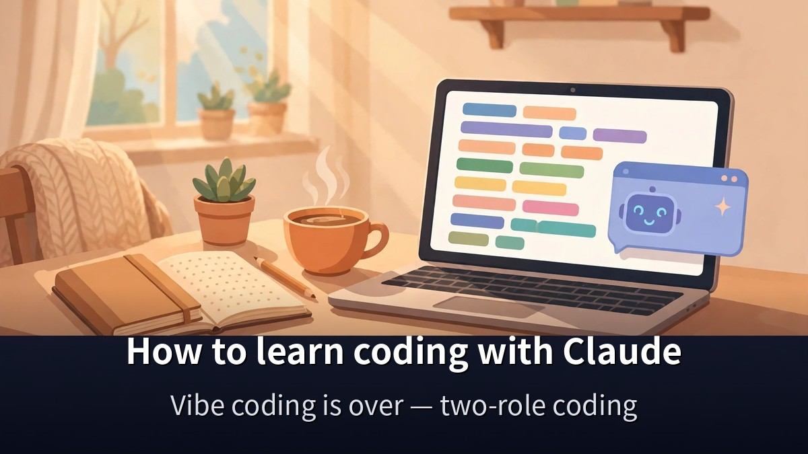
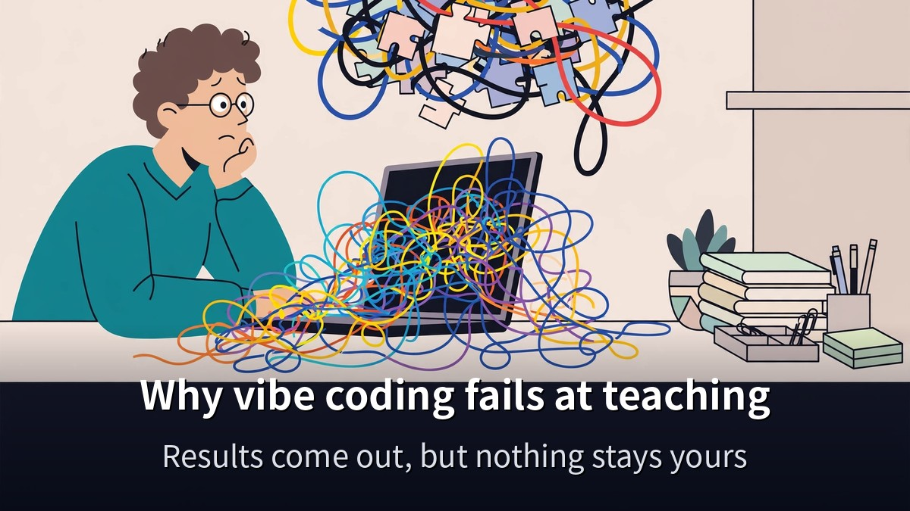
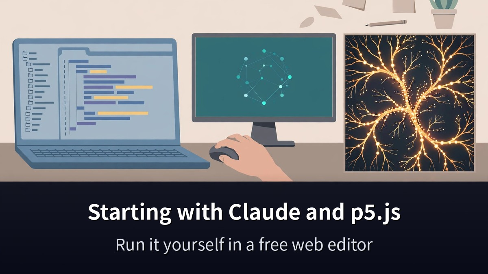
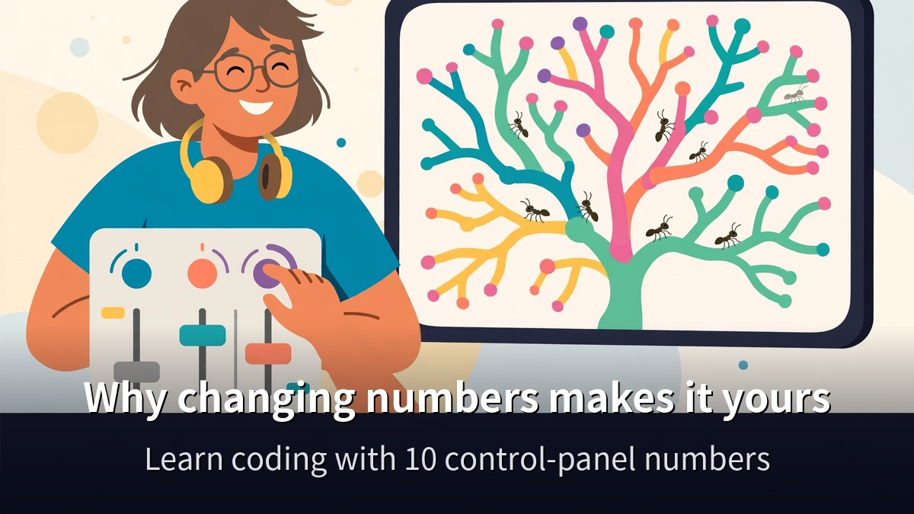

<!-- 본문 시작 -->

These days you can just tell an AI what you want and it writes the code.
Then you hit a wall.
Change one small thing and you have to ask it to start over, because the person who made it does not understand the code.
This post is based on an Ohudaseotssi video (November 14, 2026, 15 minutes 21 seconds, transcript checked 0:00–15:21) and explains how to learn coding with "two-role coding" — asking Claude to act as both developer and teacher.
It is for people learning to code for the first time, and for anyone who wants to fix AI-made results with their own hands.

> **The point is simple. If you only ask AI for a finished result, nothing is left to learn. Give it two roles at once — the developer who writes the code and the teacher who explains it in plain words — and you get both the result and the skill. All you need is Claude and the free web editor p5.js, and you can start today.**

If you want to see how the two Claude models compare before you start, [this comparison of Fable 5.2 and Opus 5.5 across four experiments](https://aitechnotesen.blogspot.com/2026/11/fable-52-vs-opus-55-4-experiments-that.html) shows when the expensive model is worth picking.

## Why does vibe coding fail at teaching?

Vibe coding means telling an AI what you want in words and letting it write the code.
The result appears fast.
The problem is what comes after.
You only asked for it, so you do not know what is inside the code.
Change one small thing and you have to ask from the beginning again.

Coding is not a one-time job.
Making something is only half of it — you also have to keep developing it and running it.
So you need to know, at minimum, which part does what and what changes when you touch a certain spot.
Without that, the result belongs to the AI, and nothing belongs to you.

The video offers a fix with a name of its own.
"Two-role AI coding."
You give the AI two roles.
One is the developer who builds the code.
The other is the teacher who explains that code to you.
If you only hand it the building role, it is the same as vibe coding.
The teaching role is what turns it into learning.

## How do you start two-role coding with Claude and p5.js?

You need two things.
Claude and the p5.js web editor.
p5.js is a tool for writing code that draws pictures, right in the browser.
Go to editor.p5js.org and you can use it at once, with no installation, for free.
Write code on the left, press play, and the picture appears on the right.

Start by picking one example.
The video picks a slime mold simulation from the p5.js examples.
A slime mold is a real microbe that builds net-like paths while searching for food in nature.
Turn that into code and patterns like blood vessels or tree branches appear on screen by themselves.

Copy the whole example code, paste it into Claude, and ask, "Explain this code."
Then add one thing.
"I am a complete beginner. I know nothing about coding. Explain it very simply."
Then Claude drops the hard explanation and tells it like a story.

Imagine 4,000 ants let loose on the screen.
Each ant follows only three simple rules.
Look in three directions ahead, turn toward the brightest one, and take one step forward.
Leave a white dot where you passed.
That white dot slowly fades away over time.
From these rules alone, a net appears on the screen by itself.

The code itself splits into two chunks.
setup runs exactly once, when the program starts — the preparation part.
draw repeats endlessly, 60 times a second.
Because draw keeps running and changing slightly each time, the picture looks alive.
A function is a bundle of commands with a name.
Once you know these two, you can feel why the code moves.

If you want to see how a vibe-coded website is put together, [what actually changed in Claude Fable 5.2](https://aitechnotesen.blogspot.com/2026/11/claude-fable-52-what-actually-changed.html) shows how to judge a finished result instead of just accepting it.

## Why does changing only numbers turn it into your own work?

Once you have heard the explanation, it is time to make it yours.
Ask Claude this:
"Rewrite it with notes in the code about what to change and how."
Then Claude rebuilds the code, full of comments.
A comment is a line that starts with two slashes (//).
The computer skips it; only people read it.
Ask the AI for plenty of comments and the code becomes something you can read.

The new code has a separate zone called the control panel.
All ten numbers you need to change are gathered there.
Each number has one line explaining what it means and what happens when you make it smaller or bigger.
Four recipes are included too — blood vessel, silk, whirlpool, iris.
Start by copying one as it is.

The first two numbers to touch are the ant count and the sensor angle.
Cut the ants from 4,000 to 500 and the lines grow thin and sparse, the pattern less tangled.
Raise them to 2,000 and it grows dense again.
Change the sensor angle from 45 to 25 and the ants look ahead in a narrower cone, so the pattern changes.
Sensor distance, set at 50, works the same way.
Change one number and the screen changes at once — that is the fun of fixing it yourself.

Do not panic when an error appears.
Copy the red error message as it is and paste it into Claude.
In the video, the error came from pasting a whole HTML file.
The p5.js web editor's sketch.js only takes JavaScript, and the HTML code had come along with it.
Claude explained the cause in simple words and pulled out only the JavaScript part.
Copying and pasting the error message is the first step to fixing it.

The last step is saving the instruction.
Ask Claude: "Write the developer and teacher roles as an instruction I can reuse, so the next conversation can start right away."
From the next conversation on, you skip the long explanation and the two roles apply at once.
Open a new AI chat, paste the instruction, and you are in.

**What only this post gives you: the trap of vibe coding is not the result — it is that nothing is learned. The instruction you save turns the next conversation into a shortcut, a point checked by following the full transcript of the video. One saved instruction changes the whole next study session.**

## Frequently asked questions

**Can I start if I know nothing about coding?**
Yes.
Tell Claude first: "I am a beginner. Explain it very simply."
The p5.js web editor runs in the browser with no installation.

**Does p5.js cost money?**
No.
It is free at editor.p5js.org, a web editor you can use without installing anything.

**How is two-role coding different from vibe coding?**
Vibe coding only asks for a result.
Two-role coding gives the AI both the building role and the explaining role.
You get the result, and you can read and fix the code yourself.

**What do I do when an error appears?**
Copy the red error message as it is and paste it into Claude.
It tells you the cause and gives you the fixed code.
An error is not a failure — it is practice in fixing things.

**Do I have to repeat the explanation every time?**
No.
Save the two-role instruction once, and paste it into a new conversation to start right away.

## Good reads
[Claude Fable 5.2 vs Opus 5.5 — Four Experiments That Show When the Expensive Model Is Worth It](https://aitechnotesen.blogspot.com/2026/11/fable-52-vs-opus-55-4-experiments-that.html)
[Ex Machina — 108 Minutes Asking a Robot If It Has a Mind](https://aitechnotesen.blogspot.com/2026/11/ex-machina-108-minutes-asking-robot-if.html)
[Minority Report — In a Nation That Arrests Crimes Before They Happen, Can a Prediction Be Wrong](https://aitechnotesen.blogspot.com/2026/11/minority-report-in-nation-that-arrests.html)

The video's sharpest point was this: in an age when AI writes the code, your own skill can still be left behind.
I have done it myself — taken the result and said "done."
Now I know that changing numbers one by one, with my own hands, is where learning to code actually begins.

<!-- 본문 끝 -->

## 작업용 출처·이미지 정보 (업로드 제외)

오후다섯씨 영상 JpiSI6EXTg0(2026-11-14, 15분 21초, 자막 0:00~15:21 전체 확인) + p5.js 무료 웹 에디터(editor.p5js.org) 검색 확인 — 두 역할 코딩(개발자+선생님), 점균류 시뮬레이션(개미 4,000마리·setup 1회/draw 초당 60회·조절판 숫자 10개·레서피 4개), 두 역할 지침 저장법
