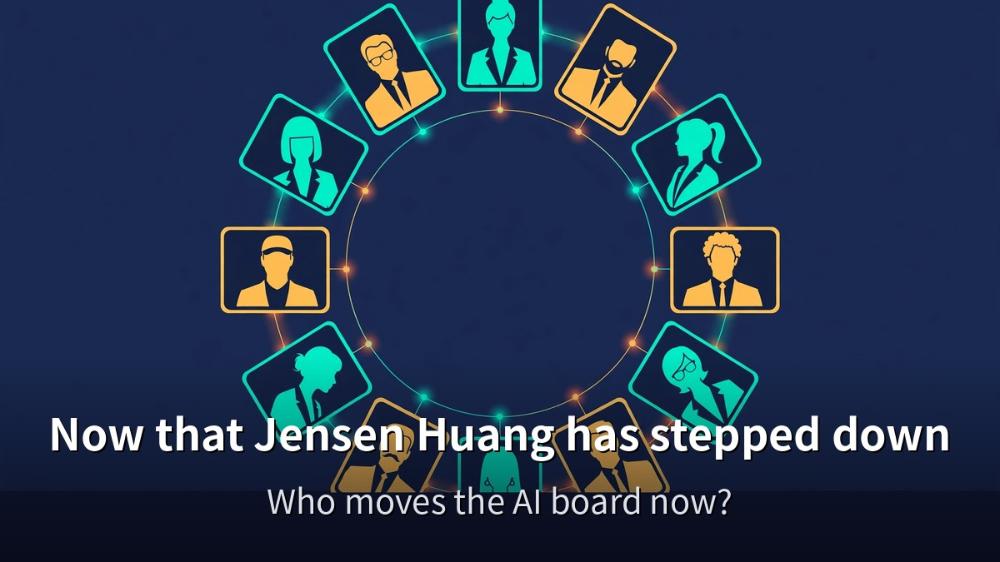
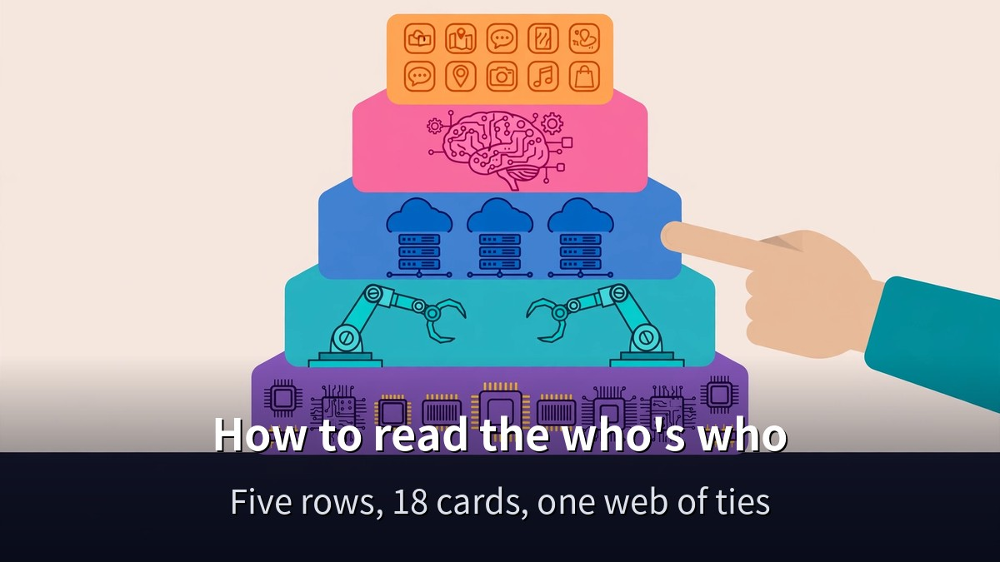
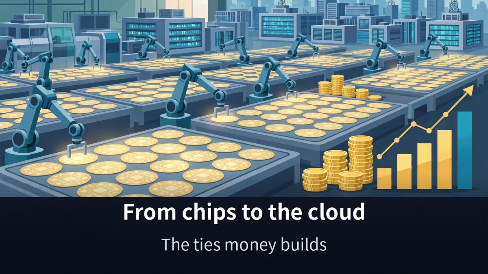
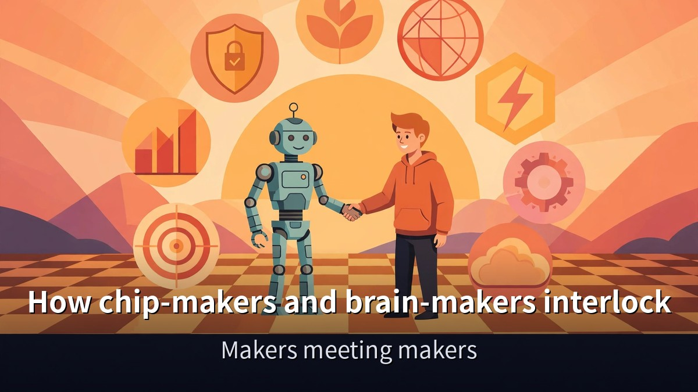

<!-- 본문 시작 -->

Jensen Huang has stepped down as CEO of Nvidia.
That news is already out, but the next question remains.
With Huang gone, who moves the AI board now?
This post is based on a honjobs video (November 14, 2026, 15 minutes, transcript checked 0:00–15:00) and follows the "AI who's who" — 18 people chosen from 30 candidates — to map the connections that run the AI board.
It does not repeat the resignation news. The who's who itself is the new fact.

> **The point is simple. The AI board is not one person's seat — it is a web of connections. Eighteen people across five rows — chips, AI brains, cloud, AI services, robots — are tied together by investment and contracts, shared company pasts, and lawsuits. Start at Jensen Huang, turn 18 cards, and you come back to Jensen Huang. What moves the board is not one person but this circle.**

For how the other flagship model of the same week is judged, [what actually changed in Claude Fable 5.2](https://aitechnotesen.blogspot.com/2026/11/claude-fable-52-what-actually-changed.html) is worth reading alongside this post.

## How do you read the who's who?

The who's who splits into five rows.
The top row, chips, holds the people who make the semiconductors AI computes on.
Below it, the AI brains row holds the people who build AI models like ChatGPT and Claude.
The cloud row holds the people who rent out the giant data centers that run those brains.
The AI services row holds the people who build the apps and tools we use every day with those brains.
The bottom row, robots, holds the people who give AI a body.

Remember one thing.
These rows are not a ranking — they are seats.
Being higher up does not mean being more important. It means which layer of the AI cake that person covers.
The structure comes from Huang himself, who called AI a five-layer cake at the Davos Forum in January this year.
Energy at the bottom, then chips, then cloud and AI models, then the services we use at the top.

The rule for turning the cards is also one.
Turn one card, and the next card you turn is a person actually connected to the one you just turned.
Investment, contracts, shared company pasts, lawsuits — only connections confirmed by filings, official announcements, or court rulings count.
Turn the 18th card and the line comes back to the start.
This post does not list all 18 people. It picks the ten key connections along the way.

## From chips to cloud, what do the money connections look like?

The first card is Jensen Huang.
The first seat in chips, Nvidia.
Nvidia makes the GPUs that train and run AI.
In the last quarterly results Huang announced as CEO, in August, revenue was $96.2 billion.
More than double a year earlier.
That figure is confirmed by Nvidia's official earnings release.

The second card is Euisun Chung.
Last October, Nvidia announced it would build an AI factory with Hyundai Motor Group using 50,000 Blackwell GPUs.
Chung's name stood next to Huang's in that announcement.
Chung chairs Hyundai Motor Group, but in the who's who he sits in the robots row.
Hyundai Motor Group is the parent of Boston Dynamics, which builds the humanoid robot Atlas.

The third card is Demis Hassabis.
The mass-production Atlas does not only go to Hyundai factories.
Boston Dynamics said this year's units would be split between Hyundai Motor Group's robot application center and an AI research lab.
The partner putting the brain into the robot is Google DeepMind.
Hassabis co-founded DeepMind, the lab behind the Go AI AlphaGo, and won the 2024 Nobel Prize in Chemistry.
In August this year he handed over DeepMind's day-to-day operations and is now DeepMind chair and Alphabet chief scientist.

The fourth card is Sundar Pichai.
Pichai is the person who announced Hassabis's role change himself.
CEO of Google and Alphabet, in the cloud row.
Google holds the AI model Gemini, its own AI chip TPU, and Google Cloud, which rents them out — all in one company.
Google Cloud revenue reached $30.7 billion in the third quarter of this year alone, more than double a year earlier.
That figure is confirmed by Alphabet's official earnings release.

The fifth card is Michael Truell.
Google does not only grow its own AI — it also puts money into other AI companies.
The CEO of the AI coding company Google newly invested in last November is Truell.
He is the co-founder and CEO of Cursor, an AI coding tool.
In the investment last November, with Google and Nvidia joining in, Cursor was valued at $29.3 billion.

The sixth card is Elon Musk.
Five months later, in April this year, a buyer appeared offering $60 billion for Cursor.
A rocket company, no less.
Musk leads Tesla and SpaceX, but in the who's who he sits in the robots row.
Tesla said in its October results that it had begun building its humanoid robot Optimus at pilot production quality at its Fremont factory.
SpaceX acquired Cursor last August for $60 billion in stock.
That deal is also confirmed by SpaceX's own filing.

The seventh card is Satya Nadella.
Grok, the AI from xAI, does not only run on Musk's own servers.
Last May, Microsoft announced it would host Grok directly in its own data centers and sell it.
Nadella is Microsoft's chair and CEO, in the cloud row.
Microsoft holds about a 24% stake in OpenAI, the maker of ChatGPT, and OpenAI agreed to use $250 billion more of Microsoft's Azure cloud, according to the video.
Anthropic, the maker of Claude, also promised to use $30 billion of Azure.
These three figures are numbers introduced in the video and not separately verified.

The eighth card is Michael Intrator.
Microsoft also rents computers from another company that rents out GPUs.
By last year's reporting, 71% of that company's quarterly revenue came from Microsoft.
Intrator is the co-founder and CEO of CoreWeave.
CoreWeave buys Nvidia GPUs in bulk and rents them to AI companies.
Nvidia itself invested $2 billion directly in the company in January this year, according to the video.

The ninth card is Mark Zuckerberg.
The company that signed a contract with CoreWeave for up to $14.2 billion of compute through 2031 is Meta.
That contract is confirmed by CoreWeave's filing.
Zuckerberg is Meta's CEO, in the AI services row.
Meta set its capital expenditure outlook for this year at $135 billion to $145 billion.
That figure is confirmed by Meta's official earnings release.

Choosing the right seat matters here too — [this comparison of Fable 5.2 and Opus 5.5 across four experiments](https://aitechnotesen.blogspot.com/2026/11/fable-52-vs-opus-55-4-experiments-that.html) shows when the expensive model is worth picking.

## How do the chip makers and the brain makers fit together?

The tenth card is Lisa Su.
Meta does not buy the house for its superintelligence from Nvidia alone.
This February, Meta signed a power deal of up to 6 GW with another chip company.
Su is AMD's chair and CEO, in the chips row.
AMD's data center revenue reached $8.5 billion in the third quarter of this year, nearly double a year earlier.
That figure is confirmed by AMD's official earnings release.

The eleventh card is C.C. Wei.
AMD and Nvidia only design chips.
The factory that actually prints them sits elsewhere.
Wei is TSMC's chair and CEO, in the chips row.
TSMC is the foundry that produces the latest AI chips for Nvidia and AMD — a company that makes other people's chips for them.

The twelfth card is Kwak Noh-jung.
An AI chip does not work alone.
Next to the GPU sits HBM, the memory that moves data very fast.
TSMC signed a memorandum of understanding with a Korean company to build the next-generation HBM4 together.
Kwak is the president and CEO of SK Hynix, in the chips row.
SK Hynix's revenue reached 104.6 trillion won in the third quarter of this year, passing 100 trillion won in a quarter for the first time.
Operating profit was 83.3 trillion won, an 80% operating margin.
Those figures are confirmed by SK Hynix's official earnings release.

The thirteenth card is Sam Altman.
Last October, SK Hynix signed a letter of intent with Samsung Electronics to supply memory for one AI company's giant data center plan.
That company's CEO came to Korea in person late last month and met SK chair Chey Tae-won.
Altman is OpenAI's CEO, in the AI brains row.
The giant data center plan is called Stargate.
OpenAI closed its funding round in March this year: $122 billion committed, at an $852 billion valuation.
Amazon put in $50 billion, Nvidia and SoftBank $30 billion each.

The fourteenth card is Aravind Srinivas.
OpenAI is also a company that produces many founders.
Two people in this who's who left OpenAI and started their own companies.
One of them worked at OpenAI for a year, left, and started a company to challenge Google Search.
Srinivas is the co-founder and CEO of Perplexity, in the AI services row.
Founded in 2022, Perplexity is an answer engine that shows a sourced answer directly instead of a list of links.
But its AI browser, Comet, collided head-on with one company.
Last November, Amazon sued Perplexity, and in March this year a district court blocked Comet from shopping on Amazon.
In August, the U.S. Ninth Circuit Court of Appeals vacated that decision and sent the case back to the district court.
The lawsuit is not over.
This timeline is confirmed by reporting on the court rulings.

The fifteenth card is Andy Jassy.
Jassy is the other side of that lawsuit — Amazon's president and CEO, in the cloud row.
AWS revenue reached $46.0 billion in the third quarter of this year alone, up 39% from a year earlier.
That figure is confirmed by Amazon's official earnings release.
Amazon put $50 billion into OpenAI, but it partnered with another AI company first.
That company called Amazon "our primary cloud and training partner" in its official announcement.

The sixteenth card is Dario Amodei.
The other of the two OpenAI alumni founded this company.
Amodei is the co-founder and CEO of Anthropic, in the AI brains row.
He left OpenAI at the end of 2020, founded Anthropic in 2021, and built the AI Claude.
In its May investment this year, the company was valued at $965 billion, and it is now preparing to list its shares.

The seventeenth card is Liang Wenfeng.
This February, Anthropic claimed that three Chinese AI labs had pulled Claude's answers at scale to train their own models.
That is called distillation.
It is Anthropic's one-sided claim, and the other companies have not answered publicly.
The founder of one of those three labs is Liang.
He is the founder and CEO of China's DeepSeek, in the AI brains row.
DeepSeek released its R1 model in January 2025.
It announced the model as comparable to OpenAI's reasoning model, and opened it for anyone to download — which made headlines.

The eighteenth card is Wang Xing.
In February 2025, Liang attended a private-enterprise forum in Beijing chaired by President Xi Jinping.
One of the businesspeople in the same room was Wang.
Wang is the founder and CEO of Unitree, a Chinese robotics company, in the robots row.
This May in Taiwan, one company presented a research humanoid built on a Unitree robot body.
The company that made that presentation was Nvidia.
From the last card, we are back at the first card, Jensen Huang.

One joker card is still left out of the who's who.
Lee Jae-yong, chair of Samsung Electronics.
The next post will cover what seat Samsung takes on this AI board.

**What only this post gives you: each figure in the video was checked one by one, and the confirmed figures were separated from the video-only figures. Nvidia's $96.2 billion, Google Cloud's $30.7 billion, AWS's $46.0 billion, Cursor's $29.3 billion valuation and $60 billion acquisition, OpenAI's $122 billion raise and $852 billion valuation, Anthropic's $965 billion, the CoreWeave–Meta $14.2 billion contract, Meta's $135–145 billion capex outlook, AMD's $8.5 billion data center revenue, and SK Hynix's 104.6 trillion won were confirmed by official releases, filings, or reporting. Microsoft's roughly 24% OpenAI stake and the extra Azure amounts are written as video-only figures.**

## Frequently asked questions

**Are the 18 people in the who's who ranked?**
No.
The five rows are seats, not a ranking.
They show which layer — chips, AI brains, cloud, AI services, or robots — each person covers.

**How were the connections verified?**
Investment, contracts, shared company pasts, and lawsuits — only connections confirmed by filings, official announcements, or court rulings are followed.
This post also separates confirmed figures from video-only figures.

**What happens to Nvidia now that Jensen Huang has stepped down?**
Nvidia's board is now looking for a full-time CEO.
The Korean government has also said Nvidia's plan to supply 260,000 GPUs stands at the company level.

**Why is the joker card, Lee Jae-yong, not in the who's who?**
He could fit in chips, the robots row, or the AI services row, so he was kept aside.
Samsung's seat will be covered in the next post.

**Is the who's who finished once it is made?**
No.
People's seats change fast.
When a seat changes, the who's who has to be remade.

## Good reads
[Claude Fable 5.2: What Actually Changed — An OS in 8 Days, Fermat in 30 Hours](https://aitechnotesen.blogspot.com/2026/11/claude-fable-52-what-actually-changed.html)
[Ex Machina — 108 Minutes Asking a Robot If It Has a Mind](https://aitechnotesen.blogspot.com/2026/11/ex-machina-108-minutes-asking-robot-if.html)
[Minority Report — In a Nation That Arrests Crimes Before They Happen, Can a Prediction Be Wrong](https://aitechnotesen.blogspot.com/2026/11/minority-report-in-nation-that-arrests.html)

After turning all 18 cards, AI news reads differently.
News that used to read as company names now reads first as who is connected to whom.
With the center of the board gone, the next card to turn feels even more interesting.

<!-- 본문 끝 -->

## 작업용 출처·이미지 정보 (업로드 제외)

honjobs 영상 sXVrAu0SWKY(2026-11-14, 15분, 자막 0:00~15:00 전체 확인) — 11-13-003 젠슨 황 사임 후속, 새 사실은 18장 인물도감(칩·두뇌·클라우드·서비스·로봇 5줄, 투자·계약·출신·소송 연결). 수치 12개 공식 발표·공시·보도 대조(확인된 수치와 영상 전용 수치 구분 표기) — 엔비디아 962억 달러·구글 클라우드 307억 달러·AWS 460억 달러·커서 293억 달러·오픈AI 1,220억 달러·앤트로픽 9,650억 달러
