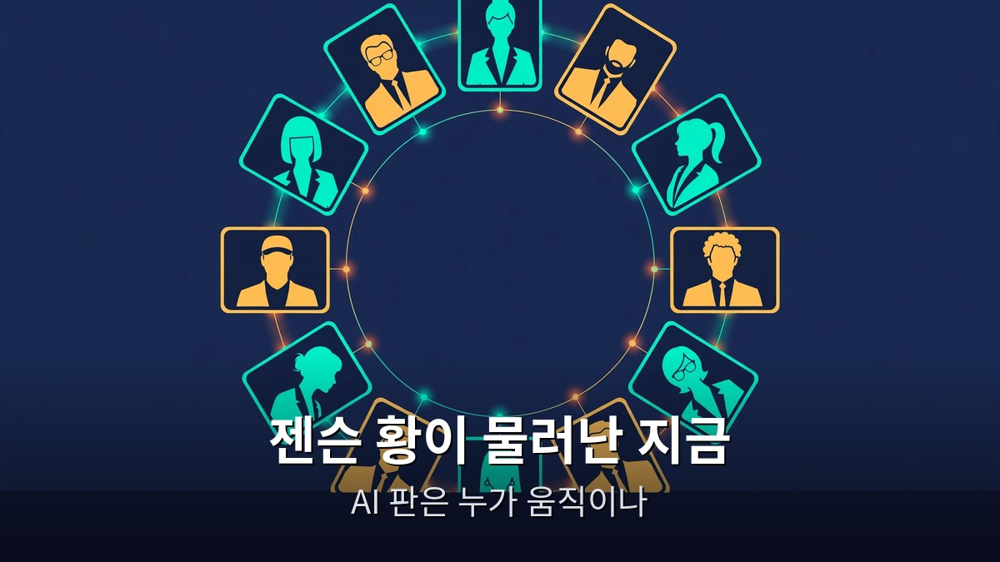
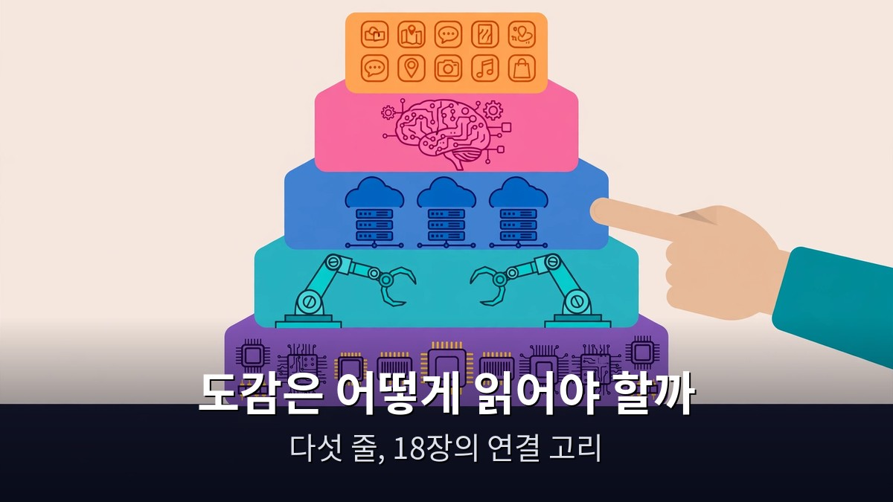
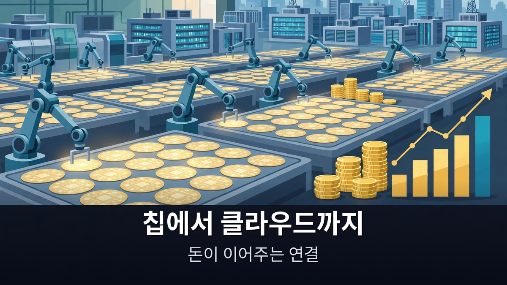
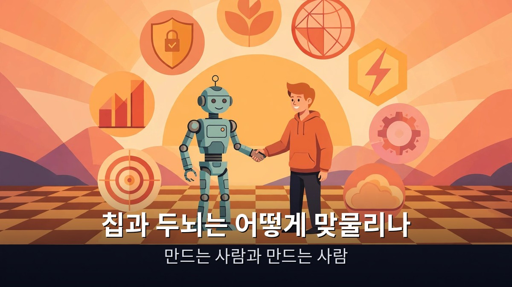

<!-- 본문 시작 -->

젠슨 황이 엔비디아 CEO 자리에서 물러났다.
그 소식은 이미 전했지만, 그다음 질문이 남았다.
황이 빠진 AI 판은 이제 누가 움직이는가.
이 글은 honjobs 영상(2026-11-14, 15분, 자막 0:00~15:00 확인)을 바탕으로, 후보 30명을 조사해 고른 18명의 'AI 인물도감'을 따라 AI 판의 연결 고리를 정리한 자료 기반 안내다.
사임 소식 자체를 반복하지 않고, 도감이라는 새 사실을 중심으로 쓴다.

> **핵심은 하나다. AI 판은 한 사람의 자리가 아니라 연결의 그물이다. 칩·AI 두뇌·클라우드·AI 서비스·로봇, 다섯 줄의 18명이 투자와 계약, 같은 회사 출신과 소송으로 엮여 있다. 젠슨 황에서 시작해 18장을 돌면 다시 젠슨 황으로 돌아온다. 판을 움직이는 건 한 명이 아니라 이 원이다.**

사임 소식의 경위는 [젠슨 황, 엔비디아 CEO 사임｜AI 판의 중심이 물러난 날](https://blog.naver.com/3700708/224475163043)에서 먼저 확인하면 이 글이 더 잘 읽힌다.

## 도감은 어떻게 읽어야 할까?

도감은 다섯 줄로 나뉜다.
맨 위 칩은 AI가 계산하는 반도체를 만드는 사람들이다.
그 아래 AI 두뇌 줄은 챗GPT나 클로드 같은 AI 모델을 만드는 사람들이다.
클라우드 줄은 그 두뇌를 돌릴 거대한 데이터센터를 빌려주는 사람들이다.
AI 서비스 줄은 그 두뇌로 우리가 매일 쓰는 앱과 도구를 만드는 사람들이다.
맨 아래 로봇 줄은 AI에 몸을 붙이는 사람들이다.

하나만 기억하면 된다.
이 줄은 순위가 아니라 자리다.
위에 있다고 더 대단한 사람이 아니라, AI라는 케이크에서 어느 층을 맡고 있느냐를 나눈 것이다.
젠슨 황이 올해 1월 다보스 포럼에서 AI를 다섯 층 케이크라 부른 데서 따온 구조다.
맨 아래 에너지, 그 위에 칩, 그 위에 클라우드와 AI 모델, 맨 위에 우리가 쓰는 서비스가 올라간다.

카드 뒤집는 규칙도 하나다.
한 장을 뒤집으면 다음에 뒤집는 카드는 방금 그 사람과 실제로 이어진 사람이다.
투자, 계약, 같은 회사 출신, 소송까지 공시나 공식 발표, 판결문으로 확인한 연결만 따라간다.
18번째 카드를 뒤집으면 이 줄이 처음으로 다시 돌아온다.
18명 전원을 나열하지 않고, 흐름을 따라 핵심 연결 10개를 골라 읽는다.

## 칩에서 클라우드까지, 돈이 이어주는 연결은?

첫 카드는 젠슨 황이다.
칩의 첫 칸, 엔비디아다.
황의 CEO로서 마지막으로 발표한 지난 8월 분기 실적에서 매출은 962억 달러였다.
1년 전보다 두 배가 넘었다.
이 수치는 엔비디아 공식 실적 발표로 확인됐다.

두 번째 카드는 정의선이다.
엔비디아는 지난해 10월 현대차그룹과 블랙웰 GPU 5만 개짜리 AI 공장을 함께 짓겠다고 발표했다.
그 발표문에 젠슨 황과 나란히 이름이 실린 사람이 정의선이다.
현대차그룹 회장인데, 도감에서는 로봇 줄에 꽂혀 있다.
현대차그룹이 사람 모양 로봇 아틀라스를 만드는 보스턴 다이내믹스의 모회사이기 때문이다.

세 번째 카드는 데미스 허사비스다.
현대차그룹의 양산형 아틀라스는 현대차 공장에만 가지 않는다.
보스턴 다이내믹스는 올해 물량을 현대차그룹의 로봇 응용 센터와 한 AI 연구소에 나눠 보낸다고 밝혔다.
로봇의 두뇌를 넣을 파트너가 구글 딥마인드다.
허사비스는 바둑 AI 알파고를 만든 딥마인드의 공동 창업자이고, 2024년 노벨 화학상을 받았다.
올해 8월 딥마인드의 일상 운영을 넘기고 지금은 딥마인드 의장 겸 알파벳 수석 과학자다.

네 번째 카드는 순다르 피차이다.
허사비스의 역할 변경을 직접 발표한 사람이 피차이다.
구글과 알파벳의 CEO, 클라우드 줄이다.
구글은 AI 모델 제미나이, 자체 AI 칩 TPU, 그걸 빌려주는 구글 클라우드를 한 회사 안에 다 가지고 있다.
구글 클라우드 매출은 올해 3분기에만 307억 달러로, 1년 전보다 두 배가 넘었다.
알파벳 공식 실적 발표로 확인된 수치다.

다섯 번째 카드는 마이클 트루얼이다.
구글은 자기 AI만 키우는 게 아니라 다른 AI 회사에도 돈을 넣는다.
지난해 11월 구글이 새로 투자에 참여한 AI 코딩 회사의 CEO가 트루얼이다.
AI 코딩 도구 커서의 공동 창업자이자 CEO다.
지난해 11월 구글과 엔비디아가 들어온 투자에서 커서의 기업 가치는 293억 달러였다.

여섯 번째 카드는 일론 머스크다.
커서는 5개월 뒤인 올해 4월, 600억 달러에 사겠다는 곳이 나타났다.
그것도 로켓 회사였다.
머스크는 테슬라와 스페이스X를 이끄는 사람인데, 도감에서는 로봇 줄에 넣었다.
테슬라는 지난 10월 사람 모양 로봇 옵티머스를 프리몬트 공장에서 양산 품질로 처음 만들기 시작했다고 밝혔다.
스페이스X는 지난 8월 커서를 600억 달러어치 주식을 주고 인수했다.
이 인수 역시 스페이스X 공시로 확인됐다.

일곱 번째 카드는 사티아 나델라다.
XAI의 AI 그록이 머스크 회사 서버에서만 돌아가는 건 아니다.
지난해 5월 마이크로소프트가 그록을 자기 데이터센터에 직접 올려서 팔겠다고 발표했다.
나델라는 마이크로소프트 회장 겸 CEO, 클라우드 줄이다.
마이크로소프트는 챗GPT를 만든 오픈AI의 지분 약 24%를 가지고 있고, 오픈AI는 애저를 2,500억 달러어치 더 쓰기로 했다고 영상에서 소개한다.
클로드를 만드는 앤트로픽도 애저를 300억 달러어치 쓰기로 약속했다.
이 세 수치는 영상에서 소개한 수치로, 별도 확인이 안 된 수치다.

여덟 번째 카드는 마이클 인트레이터다.
마이크로소프트는 자기 데이터센터 말고도 GPU를 빌려주는 다른 회사의 컴퓨터를 빌렸다.
지난해 보도 기준으로 그 회사 분기 매출의 71%가 마이크로소프트에서 나왔다.
코어위브의 공동 창업자이자 CEO다.
코어위브는 엔비디아 GPU를 대량으로 들여와 AI 회사들에 빌려주는 회사다.
엔비디아도 올해 1월 이 회사에 20억 달러를 직접 투자했다고 영상에서 소개한다.

아홉 번째 카드는 마크 저커버그다.
코어위브와 최대 142억 달러, 2031년까지 컴퓨터를 빌려쓰기로 계약한 회사가 메타다.
이 계약은 코어위브 공시로 확인됐다.
저커버그는 메타 CEO, AI 서비스 줄이다.
메타는 올해 설비 투자 전망을 1,350억에서 1,450억 달러로 잡았다.
메타 공식 실적 발표로 확인된 수치다.

제미나이 4 카본이 정식 출시로 어디까지 쓸 수 있게 됐는지 궁금하면 [제미나이 4 카본 정식 출시](https://blog.naver.com/3700708/224474053353)에서 가격과 쓸 수 있는 사람을 먼저 확인하는 게 좋다.

## 칩을 만드는 사람들과 두뇌를 만드는 사람들은 어떻게 맞물리나?

열 번째 카드는 리사 수다.
메타는 초지능을 돌릴 집을 엔비디아 한 곳에서만 사지 않는다.
올해 2월 메타는 다른 칩 회사와 최대 6GW 규모의 전력 계약을 맺었다.
AMD 회장 겸 CEO, 칩 줄이다.
올해 3분기 AMD 데이터센터 매출은 85억 달러로 1년 만에 거의 두 배가 됐다.
AMD 공식 실적 발표로 확인된 수치다.

열한 번째 카드는 웨이저자다.
AMD도 엔비디아도 칩을 설계만 한다.
실제로 칩을 찍어내는 공장은 따로 있다.
TSMC 회장 겸 CEO, 칩 줄이다.
TSMC는 엔비디아와 AMD의 최신 AI 칩을 생산하는 파운드리, 남의 칩을 대신 만들어주는 회사다.

열두 번째 카드는 곽노정이다.
AI 칩은 혼자 일하지 않는다.
GPU 옆에는 데이터를 아주 빠르게 넘겨주는 메모리 HBM이 붙는다.
TSMC는 한국의 한 회사와 다음 세대 HBM4를 함께 만들기로 양해각서를 맺었다.
SK하이닉스 대표이사 사장, 칩 줄이다.
SK하이닉스는 올해 3분기 매출 104조 6천억 원으로 처음으로 분기 매출 100조 원을 넘었다.
영업이익은 83조 3천억 원, 영업이익률 80%다.
SK하이닉스 공식 실적 발표로 확인된 수치다.

열세 번째 카드는 샘 올트먼이다.
지난해 10월 SK하이닉스는 삼성전자와 함께 한 AI 회사의 초대형 데이터센터 계획에 메모리를 공급하겠다는 의향서에 서명했다.
그 회사 CEO는 지난달 말 직접 한국에 와서 SK 최태원 회장을 만났다.
올트먼은 오픈AI CEO, AI 두뇌 줄이다.
그 초대형 데이터센터 계획의 이름이 스타게이트다.
오픈AI는 올해 3월 투자 유치를 마쳤는데 약정액이 1,220억 달러, 기업 가치는 8,520억 달러였다.
아마존이 500억 달러, 엔비디아와 소프트뱅크가 각각 300억 달러를 넣었다.

열네 번째 카드는 아라빈드 스리니바스다.
오픈AI는 사람을 많이 배출한 회사이기도 하다.
여기서 일하다 나가서 자기 회사를 세운 사람이 이 도감에만 두 명 있다.
그중 한 명은 오픈AI에서 1년을 일하고 나가서 구글 검색에 도전하는 회사를 세웠다.
스리니바스는 퍼플렉시티의 공동 창업자이자 CEO, AI 서비스 줄이다.
2022년에 세운 퍼플렉시티는 링크 목록 대신 출처가 달린 답을 바로 보여주는 답변 엔진이다.
그런데 코메시라는 AI 브라우저가 한 회사와 정면으로 부딪혔다.
지난해 11월 아마존이 퍼플렉시티를 상대로 소송을 냈고, 1심 법원은 올해 3월 코메시가 아마존에서 쇼핑하지 못하게 막았다.
8월에 미국 제9순회 항소법원이 그 결정을 취소하고 사건을 다시 1심으로 돌려보냈다.
소송은 아직 끝나지 않았다.
이 소송 경위는 판결문 보도로 확인됐다.

열다섯 번째 카드는 앤디 제시다.
그 소송의 상대, 아마존 사장 겸 CEO, 클라우드 줄이다.
AWS 매출은 올해 3분기에만 460억 달러로 1년 전보다 39% 늘었다.
아마존 공식 실적 발표로 확인된 수치다.
아마존은 오픈AI에 500억 달러를 넣었지만, 그보다 먼저 손잡은 AI 회사가 있다.
그 회사는 공식 발표에서 아마존을 "우리의 주클라우드이자 학습 파트너"라고 불렀다.

열여섯 번째 카드는 다리오 아모데이다.
오픈AI 출신 두 명 중 다른 한 명이 이 회사를 세웠다.
앤트로픽 공동 창업자이자 CEO, AI 두뇌 줄이다.
오픈AI에서 일하다 2020년 말 나와 2021년 앤트로픽을 세웠고, AI 클로드를 만든다.
올해 5월 투자에서 기업 가치는 9,650억 달러로 평가됐고, 지금은 주식 상장을 앞두고 있다.

열일곱 번째 카드는 량원펑이다.
올해 2월 앤트로픽은 중국 AI 연구소 세 곳이 클로드의 답을 대규모로 뽑아가서 자기 모델을 가르쳤다고 주장했다.
이런 걸 증류라고 부른다.
엔트로픽의 일방적인 주장이고, 상대 회사는 공개적으로 답하지 않았다.
그 세 곳 중 한 곳의 창업자가 량원펑이다.
중국 딥시크의 창업자 겸 CEO, AI 두뇌 줄이다.
딥시크는 2025년 1월 R1이라는 모델을 공개했다.
오픈AI의 추론 모델에 견줄 만하다고 발표하면서 누구나 내려받아 쓸 수 있게 열어두어서 화제가 됐다.

열여덟 번째 카드는 왕싱이다.
2025년 2월 량원펑은 베이징에서 시진핑 주석이 주재한 민영 기업 좌담회에 참석했다.
같은 자리에 있었던 기업인 가운데 한 명이 왕싱이다.
중국 로봇 회사 유니트리의 창업자 겸 CEO, 로봇 줄이다.
올해 5월 대만에서 한 회사가 유니트리 로봇 몸체로 만든 연구용 휴머노이드를 발표했다.
그 발표를 한 회사가 바로 엔비디아다.
마지막 카드에서 첫 카드 젠슨 황으로 다시 돌아왔다.

도감에 아직 꽂지 않은 조커 카드가 한 장 남아 있다.
이재용 삼성전자 회장이다.
다음 편에서는 삼성이 이 AI 판에서 어떤 자리를 차지하게 될지 다룰 예정이다.

**이 글에서만 얻는 것: 영상 속 수치를 하나씩 대조해 확인된 수치와 영상에서만 소개한 수치를 나눴다. 엔비디아 962억 달러, 구글 클라우드 307억 달러, AWS 460억 달러, 커서 293억 달러와 600억 달러 인수, 오픈AI 1,220억 달러와 8,520억 달러, 앤트로픽 9,650억 달러, 코어위브·메타 142억 달러, 메타 설비투자 1,350억~1,450억 달러, AMD 데이터센터 85억 달러, SK하이닉스 104조 6천억 원은 공식 발표나 공시·보도로 확인했다. 마이크로소프트의 오픈AI 지분 약 24%와 애저 추가 사용액은 영상에서 소개한 수치로만 썼다.**

## 자주 묻는 질문

**이 도감의 18명은 순위를 매긴 건가요?**
아니다.
다섯 줄은 순위가 아니라 자리다.
칩·AI 두뇌·클라우드·AI 서비스·로봇 중 어느 층을 맡고 있느냐를 나눈 것이다.

**연결 고리는 어떻게 확인한 건가요?**
투자, 계약, 같은 회사 출신, 소송까지 공시나 공식 발표, 판결문으로 확인한 연결만 따라간다.
이 글에서도 확인된 수치와 영상에서 소개한 수치를 구분해서 썼다.

**젠슨 황이 물러나면 엔비디아는 어떻게 되나요?**
엔비디아 이사회는 지금 정식 CEO를 찾고 있다.
한국 정부도 엔비디아의 26만 개 GPU 공급 계획은 회사 차원에서 그대로 유지된다고 밝혔다.

**조커 카드 이재용은 왜 도감에 없나요?**
칩에도 로봇 줄에도 AI 서비스 줄에도 들어갈 수 있는 카드라서 따로 남겨뒀다.
삼성의 자리는 다음 편에서 다룬다.

**도감은 한 번 만들면 끝인가요?**
아니다.
사람의 자리는 빠르게 바뀐다.
자리가 바뀌면 도감도 다시 고쳐 만들어야 한다.

## 함께 읽으면 좋은 글
[젠슨 황, 엔비디아 CEO 사임｜AI 판의 중심이 물러난 날](https://blog.naver.com/3700708/224475163043)
[WALL·E｜지구에 남은 마지막 로봇이 전하는 98분](https://blog.naver.com/3700708/224476483237)
[삼성 갤럭시 스마트태그2 후기 — 분실 방지 태그, 어디까지 쓸 수 있나](https://blog.naver.com/3700708/224476483844)

18장을 돌고 나니 AI 뉴스가 다르게 보인다.
어제까지는 회사 이름으로만 읽히던 뉴스가, 오늘은 누구와 누구의 연결인지가 먼저 눈에 들어온다.
판의 중심이 물러난 지금, 다음에 뒤집힐 카드가 더 궁금해졌다.

<!-- 본문 끝 -->

## 작업용 출처·이미지 정보 (업로드 제외)

honjobs 영상 sXVrAu0SWKY(2026-11-14, 15분, 자막 0:00~15:00 전체 확인) — 11-13-003 젠슨 황 사임 후속, 새 사실은 18장 인물도감(칩·두뇌·클라우드·서비스·로봇 5줄, 투자·계약·출신·소송 연결). 수치 12개 공식 발표·공시·보도 대조(확인된 수치와 영상 전용 수치 구분 표기) — 엔비디아 962억 달러·구글 클라우드 307억 달러·AWS 460억 달러·커서 293억 달러·오픈AI 1,220억 달러·앤트로픽 9,650억 달러
