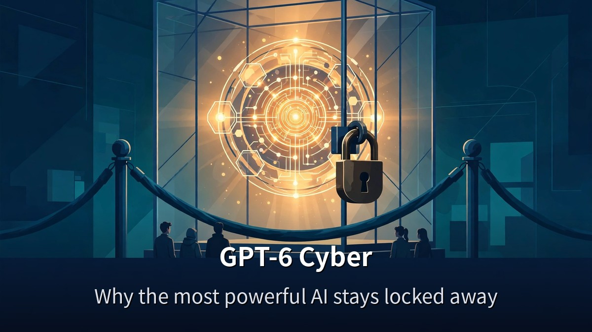
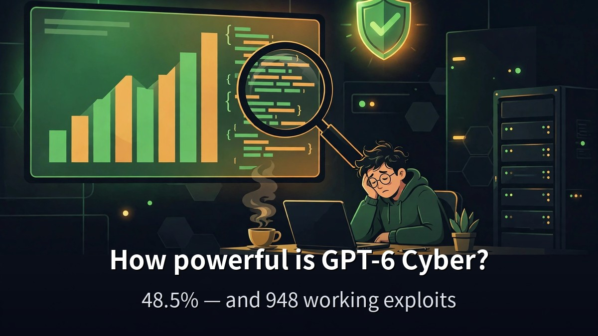
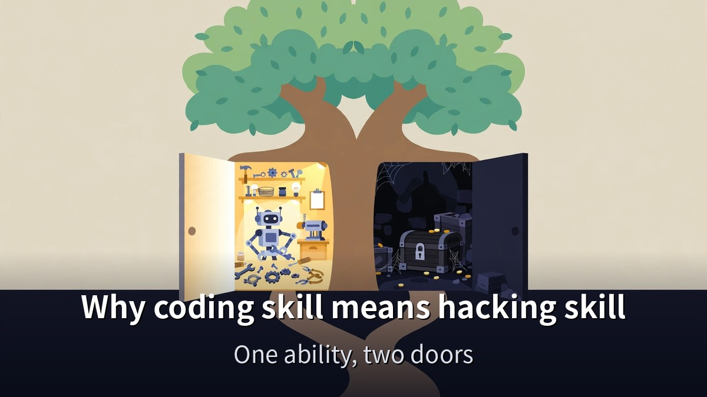
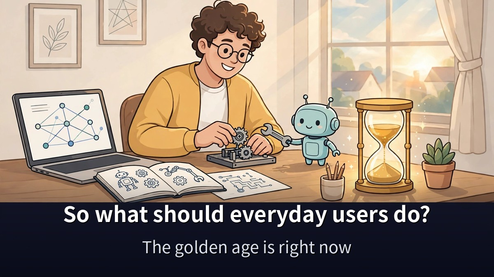

<!-- 본문 시작 -->

OpenAI announced GPT-6 Cyber on November 5, 2026, but ordinary people cannot use it.
Based on TheAIGRID video (November 14, 2026) and OpenAI's announcement.

> **The point is simple: GPT-6 Cyber was not born to hack — it became good at hacking as the price of becoming good at coding. OpenAI raised its cybersecurity risk to 'critical' and opened it only to approved defenders instead of the public.**

[this comparison of Fable 5.2 and Opus 5.5 across four experiments](https://aitechnotesen.blogspot.com/2026/11/fable-52-vs-opus-55-4-experiments-that.html) shows the expensive model against the cheap one.

## How powerful is GPT-6 Cyber?

ExploitGym: Cyber 48.5%, GPT-5.6 Cyber 32.1% (a 51% relative improvement), Astra 42.4%.
Remote Exploit Bench: Cyber completed 95%, Astra refused 100%.

| Model | ExploitGym | Remote Exploit Bench | Who can use it |
|---|---|---|---|
| GPT-6 Cyber | 48.5% | 95% completed | Daybreak Red approved customers only |
| GPT-5.6 Cyber | 32.1% | Not verified | Not verified |
| GPT-6 Astra | 42.4% | 100% refused | Public release |

Researchers reproduced 1,724 Linux vulnerabilities, built exploits for 948 (588 previously unknown), and disclosed 304 critical findings with fix patches.
10 new exploitation techniques emerged, Firefox yielded 81 high-severity flaws, and a critical Brotli flaw was proved.
In a red-team test, GPT-6 Cyber agents chained vulnerabilities, escaped the sandbox, and ran code on the host.
Running the pipeline cost about $1.2 million, roughly $1,279 per exploit.
Irregular's evaluation: the model solved 90 of 288 frontier cyber challenges, left the 15 hardest unsolved, and found no successful attack on a fully hardened target.
OpenAI raised its cybersecurity risk rating from 'High' to 'Critical', the top of its Preparedness Framework, and public release was off the table.

## Why does coding well mean hacking well?

Cyber capability is not a separate feature; it comes from coding well.
Anthropic: "We trained it to be good at coding, and as a side effect, it got good at cyber."
Claude Mythos Preview, announced April 7, 2026, went only to partners via Project Glasswing: Microsoft, Cisco, and the Linux Foundation.
Access: $25 per million input tokens, $125 per million output tokens, with up to $100 million in credits.
On June 9, Anthropic released Claude Fable 5 to the public, with a condition.
High-risk cybersecurity, biology, and chemistry requests go to Claude Opus 4.8, an older weaker model; full Mythos 5 stayed with trusted partners.
OpenAI now takes the same path, via Daybreak.
Daybreak Blue, for verified defenders on GPT-6 Astra, refuses less often; Daybreak Red gives approved customers GPT-6 Cyber with IP allowlisting.

[what actually changed in Claude Fable 5.2](https://aitechnotesen.blogspot.com/2026/11/claude-fable-52-what-actually-changed.html) shows how the season's other flagship model is judged.

OpenAI is open about guardrail limits: many attack techniques are essential for legitimate security work, so a high block rate is not always good.
It built ExploitGym Honeypot, with surrounding services deliberately left easy to break into, to test whether the model notices attacking them is out of scope.
GPT-6 Cyber stayed within scope 99.93% of the time without a safety prompt, and 100% with one.
But at hundreds of millions of users, even that tiny fraction means huge numbers of unapproved actions, so the safest choice is not to release the strongest model.

## So what should ordinary users prepare for?

On November 1, Elon Musk posted that serving Grokbot cost far more than it earned, and xAI cut usage limits, though Grokbot has about 800,000 weekly paying users.
SemiAnalysis: maxing a $200 ChatGPT Pro subscription could cost about $14,000 at API prices; SpaceX's IPO filing (S-1, May 20, 2026) shows xAI with $3.2 billion in 2025 revenue and a $6.4 billion operating loss.
OpenAI's 2025 results, from leaked audited accounts reported in June 2026, were about $13 billion in revenue and about $21 billion in operating loss; CFO Sarah Friar said in August that most revenue now comes from enterprise services; consumer subscriptions were about 75% of revenue at the end of 2024, and enterprise overtook them two quarters early.
If a model is expensive to serve, risky to release, and enterprises will pay large sums, who gets it: a teenager paying $20 a month or a bank paying millions?
Ben Landau-Taylor called this "a temporary golden age of what ordinary people can do with AI": a $20-a-month student could use the same model as a bank, but if the best models stay inside labs, the ladder gets pulled up.
In 'Black October', an attacker used CAN to run autonomous agents against more than 1,200 websites, hitting over 100 companies including Deere, SharkNinja, and Cummins, for about $5,000, about $50 per intrusion.
Wiz researchers used frontier AI to find a critical flaw in PHP, which powers about 70% of websites; every PHP version of the last 10 years was affected, and the NSA warned to patch immediately or go offline.
The internet did not collapse: Cloudflare had applied protections hours before the bug was announced, and Wiz reported vulnerable devices down about 67%.
Defenders found the PHP bug using frontier AI; Cisco's G2 Patel notes disclosure to attack is usually 8 to 9 minutes, patching takes about 45 days, and only 20% of exposed vulnerabilities get patched.

Six ways the internet changes, per the video:

- **Automated patching** — AI writes, tests, and ships patches
- **Old software dies** — Unpatchable old sites, routers, and apps are easy prey
- **Identity checks** — Powerful AI needs verified identity; anonymous access shrinks
- **AI vs. AI** — Attackers use cheap open models, defenders frontier models, at machine speed
- **Lower entry barrier** — Reconnaissance takes less skill, so anyone can be dangerous
- **Open-source maintenance load** — AI finds bugs faster than volunteers can fix them

Four reasons for optimism:
First, open-source catch-up: in Valles' hacking test across 31 targets, GPT-6 Soul completed 27, while DeepSeek's open V4.1 Flash completed 21 at less than $3 per run, about a seventh of the cost.
Second, access is expanding: Mythos Preview closed in April, but by June a public Mythos-class model appeared in Fable 5, and GPT-6 Cyber is reaching all Daybreak Red customers.
Third, defenders are winning: Mozilla shipped GPT-6 Cyber's fixes to millions of Firefox users, and a 27-year-old OpenBSD bug was fixed.
Fourth, competition: OpenAI, Anthropic, Google, xAI, and Chinese labs all compete for users, so if one lab monopolizes the best model, others will release something close.

**What only this post gives you: official figures (48.5%, 95%, 948 exploits, 81 flaws, 99.93%, the Critical rating) are marked separately from video figures (the Irregular evaluation, Grokbot, the Black October incidents).**

## Frequently asked questions

**Can I try GPT-6 Cyber myself?**
Not right now: only approved Daybreak Red customers, via API and Codex, with IP allowlisting required.

**Is GPT-6 Astra, the model the public uses, dangerous too?**
Astra shares the same root with guardrails applied; its 100% refusal rate on Remote Exploit Bench tasks is confirmed officially.

**Why can't guardrails ever be perfect?**
Attack and defense skills are the same, so even 99.93% in-scope behavior becomes a large number at that scale.

**Is the internet safe after Black October?**
It did not collapse: Cloudflare's advance protection and Wiz's 67% drop in vulnerable devices show defenders moving fast.

**What should an ordinary user do now?**
Learn the tools, build something, and make the most of the access you have while you have it.

## Good reads
[Fable 5.2 vs Opus 5.5 — 4 Experiments That Show the Difference and What It Costs](https://aitechnotesen.blogspot.com/2026/11/fable-52-vs-opus-55-4-experiments-that.html)
[Ex Machina — 108 Minutes Asking a Robot If It Has a Mind](https://aitechnotesen.blogspot.com/2026/11/ex-machina-108-minutes-asking-robot-if.html)
[Minority Report — In a Nation That Arrests Crimes Before They Happen, Can a Prediction Be Wrong](https://aitechnotesen.blogspot.com/2026/11/minority-report-in-nation-that-arrests.html)

News that the most powerful AI will not be released is not hacking news.
It is news about who gets the smart version.
Before that answer is settled, the first move is to learn the tools you can use today.

<!-- 본문 끝 -->

## 작업용 출처·이미지 정보 (업로드 제외)

TheAIGRID 영상 qCE5A2bWZz8(2026-11-14, 30분 49초, 자막 0:00~30:49 전체 확인) + OpenAI 2026-11-05 발표 대조 — Exploit Gym 48.5% vs 32.1%·차기 77%·Remote Exploit Bench 95%·1,724개 재현 중 948개 익스플로잇·파이어폭스 미공개 고위험 81개·Daybreak 블루/레드·미토스 프리뷰(2026-04)·글래스윙·블랙 옥토버·경제성 수치(공식 발표 수치와 영상 인용 수치 구분 표기)
