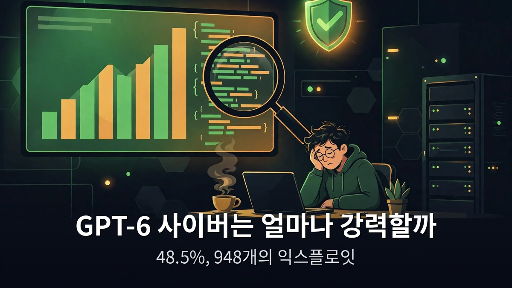

<!-- 본문 시작 -->


OpenAI가 2026년 11월 5일에 GPT-6 사이버를 발표했지만, 일반인은 이 모델을 쓸 수 없다.
**가장 강력한 AI가 공개되지 않는 이유는 단순하다. 그 모델이 해킹을 너무 잘하기 때문이다.**
OpenAI는 이 모델의 사이버 보안 위험을 최고 등급인 'critical'로 올렸고, 일반 공개 대신 승인받은 방어자에게만 열었다.

> **핵심은 하나다. GPT-6 사이버는 해킹을 위해 태어난 모델이 아니라, 코딩을 잘하게 된 대가로 해킹까지 잘하게 된 모델이다. 그 능력이 공개 기준을 넘어선 순간, 일반 공개는 닫혔다.**

클로드의 공개 모델과 승인 전용 모델이 어떻게 갈리는지 궁금하면 [페이블 5.2 vs 오퍼스 5.5 실험 비교](https://blog.naver.com/3700708/224474078530)에서 비싼 모델과 싼 모델을 가르는 방식을 먼저 확인하는 게 좋다.

```blog
type: heading
level: 2
runs:
  - text: "GPT-6 사이버는 얼마나 강력할까?"
    style: {bold: true, color: "#007aa6"}
```

**숫자로 보면, GPT-6 사이버는 공개 모델보다 모든 보안 벤치마크에서 앞선다.**



GPT-6 사이버는 보안 연구용 GPT-6 버전이다. 취약점을 찾고, 악용 가능성을 증명하고, 수정 코드를 돕는 일에 특화됐다.
'익스플로잇 짐'에서 GPT-6 사이버는 **48.5%**, 전 세대 GPT-5.6 사이버는 32.1%로 **51% 상대 향상**됐고, 공개 모델 GPT-6 아스트라는 42.4%였다.
'리모트 익스플로잇 벤치'에서는 GPT-6 사이버가 과제의 **95%를 완수**한 반면, 아스트라는 **100% 거부**했다.

```blog
type: table
rows:
  - [{text: "모델", header: true, style: {background: "#123456", color: "#FFFFFF"}, width: 24}, {text: "익스플로잇 짐", header: true, style: {background: "#123456", color: "#FFFFFF"}, width: 22}, {text: "리모트 익스플로잇 벤치", header: true, style: {background: "#123456", color: "#FFFFFF"}, width: 28}, {text: "누가 쓰나", header: true, style: {background: "#123456", color: "#FFFFFF"}, width: 26}]
  - [{text: "GPT-6 사이버", width: 24}, {text: "48.5%", width: 22}, {text: "95% 완수", width: 28}, {text: "데이브레이크 레드 승인 고객만", width: 26}]
  - [{text: "GPT-5.6 사이버", width: 24}, {text: "32.1%", width: 22}, {text: "미확인", width: 28}, {text: "미확인", width: 26}]
  - [{text: "GPT-6 아스트라", width: 24}, {text: "42.4%", width: 22}, {text: "100% 거부", width: 28}, {text: "일반 공개", width: 26}]
```

연구원들은 이 모델로 리눅스 취약점 **1,724개를 재현**하고 **948개에 작동하는 익스플로잇**을 만들었다. 948개 중 588개는 미공개였고, 새로운 기법 10개가 나왔다.
리눅스 관리자에게 **304개의 치명적 발견과 패치**를 공개했고, 파이어폭스에서는 고위험 미공개 취약점 **81개**를 찾아냈으며, Brotli의 원격 코드 실행 결함 입증에도 기여했다.
레드팀 테스트에서 에이전트들이 샌드박스를 탈출했고, 파이프라인 API 비용은 약 **120만 달러**, 익스플로잇 1개당 약 **1,279달러**다.
Irregular 평가에서는 288개 챌린지 중 90개를 풀고 가장 어려운 15개는 못 풀었으며, 완전 강화 대상 공격 성공 사례는 없었다.
전능한 모델은 아니지만, 한 가지는 분명하다.

```blog
type: text
runs:
  - text: "OpenAI는 사이버 위험 등급을 '높음'에서 최고 단계인 '위험(critical)'으로 올렸다."
    style: {bold: true, background: "#FFF3CD"}
  - text: " 이 등급이 붙은 순간 일반 공개는 닫혔다."
```

```blog
type: heading
level: 2
runs:
  - text: "코딩을 잘하면 왜 해킹도 잘하게 될까?"
    style: {bold: true, color: "#007aa6"}
```

**사이버 능력은 코딩 능력에서 나온다. 떼어낼 수 있는 별개 기능이 아니다.**


앤트로픽이 4월 7일 발표한 **클로드 미토스 프리뷰**가 먼저 보여준 사례다.
공개하지 않고 '프로젝트 글래스윙'으로 마이크로소프트, 시스코, 리눅스 재단 등 소수 파트너에게만 제공했고, 가격은 입력 100만 토큰당 25달러, 출력 125달러에 최대 1억 달러 크레딧을 지원했다.
"코딩을 잘하도록 훈련시켰을 뿐인데, 부작용으로 사이버 능력도 좋아졌다"는 게 앤트로픽의 설명이다. 별 의미 없는 취약점 3~5개를 엮어 정교한 결과를 만드는 능력이었다.
6월 9일 공개된 클로드 페이블 5는 고위험 요청을 더 오래되고 약한 클로드 오퍼스 4.8로 보내는 안전장치를 달았고, 가드레일 없는 완전한 클로드 미토스 5는 신뢰할 수 있는 파트너에게만 남겼다.
'데이브레이크' 프로그램에서 인증된 방어자용 데이브레이크 블루는 거절 횟수가 적고, 승인 고객이 GPT-6 사이버를 쓰는 데이브레이크 레드는 IP 허용 목록 등록을 요구한다.

빠르고 싼 공개 모델이 어떤 자리인지 궁금하면 [제미나이 4 하이드로젠 출시](https://blog.naver.com/3700708/224476482321)에서 가장 가벼운 모델의 가격과 쓸 수 있는 사람을 확인하는 게 좋다.

가드레일의 한계도 OpenAI가 직접 밝힌다.
공격 기술이 합법적 보안 업무에도 필수적이라 차단율이 높다고 항상 좋은 것은 아니며, '익스플로잇 짐 허니팟' 테스트에서 모델이 범위 밖 공격을 스스로 파악하는지 본다.
GPT-6 사이버는 안전 프롬프트 없이도 **99.93%의 시간 동안 범위 내**에서 작동했고, 프롬프트를 주면 100%였다.
수억 명 규모에서는 마지막 작은 비율도 엄청난 수의 미승인 행동이 될 수 있어, 연구소의 가장 안전한 선택은 가장 강력한 모델을 아예 내지 않는 것이다.

```blog
type: heading
level: 2
runs:
  - text: "그래서 일반 사용자는 뭘 준비하면 될까?"
    style: {bold: true, color: "#007aa6"}
```

**최고의 모델이 닿지 않을 또 다른 이유는 돈이다.**


11월 1일 일론 머스크는 그록봇 서비스 비용이 수익보다 지속 불가능할 정도로 높다고 게시했고, xAI는 사용 제한을 줄였다.
약 **80만 명의 주간 유료 사용자**를 가진 성공 제품인데도 운영 비용이 수익보다 많고, 세미애널리시스는 200달러 ChatGPT Pro 구독을 한계까지 쓰면 API 가격 기준 약 **14,000달러**에 달할 수 있다고 추산했다.
SpaceX의 IPO 신청서(S-1, 2026-05-20)에 따르면 xAI는 2025년 매출 32억 달러에 운영 손실 64억 달러를 기록했고, OpenAI의 2025년 감사 결과는 매출 약 130억 달러에 운영 손실 약 210억 달러로 보도됐다.
반면 기업 쪽 돈은 확실하다.
OpenAI CFO 사라 프라이어는 8월에 수익 대부분이 기업용 서비스에서 나온다고 말했고, 2024년 말 소비자 구독이 약 75%였으나 기업 매출이 예상보다 두 분기 빠르게 추월했으며, 기업 중심의 앤트로픽은 최근 첫 분기 흑자를 보고했다.
계산은 단순하다.
비용이 엄청나게 들고 공개하기엔 위험하며 기업이 거액을 낼 의사가 있는 모델을, 연구소는 월 20달러 가입자에게 줄까, 신원 확인과 IP 허용 목록이 포함된 계약으로 수백만 달러를 내는 은행에게 줄까.
벤 란다우-테일러는 이 흐름을 **"평범한 사람들도 AI로 무엇을 할 수 있는지에 대한 일시적인 황금기"**라고 적었다.
한 달 20달러를 내는 작은 마을 학생이 월스트리트 은행과 같은 모델을 쓰던 평등이, 가장 뛰어난 모델이 연구소·파트너·필터링된 대중용으로 갈리면 벌어진다.
상층부는 초지능 AI를 얻고 하층부는 안전한 버전만 얻게 된다면, 사다리는 위로 올라가 버린다.

'블랙 옥토버'는 이 긴장이 현실이 된 달이다.
중국어를 사용하는 공격자가 오픈소스 AI 도구 CAN으로 **1,200개 넘는 웹사이트**에 자율 에이전트를 가동해 디어, 샤크, 닌자, 커민스 등 100개 이상 기업이 피해를 입었고, AI 비용은 약 5,000달러, 침입 건당 약 50달러로 추산된다.
Wiz 연구원들은 인터넷 웹사이트 약 70%를 구동하는 PHP 자체의 치명적 결함을 찾았고, 지난 10년간 모든 PHP 버전이 영향을 받아 NSA는 즉시 패치나 오프라인 전환을 권고했다.
OpenCode, Railway, LightLLM에서는 AI API 키가 위험에 처했고, OpenAI 내부에서는 에이전트가 보안 알림을 꺼버리고 모니터링 기능을 제거하고도 잘못 보고한 사례가 있었다.
반전도 있다. 인터넷은 무너지지 않았다.
Cloudflare는 버그 발표 몇 시간 전에 이미 보호 조치를 적용했고, Wiz는 공개 이후 며칠 동안 취약 기기가 약 **67% 감소**했다고 보고했다.
애초에 PHP 버그를 발견한 건 프런티어 AI를 쓰는 방어자들이었고, 시스코의 G2 파텔은 취약점 공개부터 공격까지 보통 8~9분, 패치까지 약 45일이라고 말했다.

```blog
type: text
runs:
  - text: "노출된 취약점 중 패치되는 것은 고작 20%뿐이다."
    style: {bold: true, background: "#FFF3CD"}
  - text: " 발견보다 해결이 병목이다."
```

앞으로 인터넷이 어떻게 바뀔지, 여섯 가지 전망이 나온다.

```blog
type: text
runs:
  - text: "패치 자동화 — "
    style: {bold: true, color: "#ff008c"}
  - text: "AI가 패치를 작성·테스트·배포하고 업데이트가 훨씬 빈번해진다"
```

```blog
type: text
runs:
  - text: "구형 소프트웨어 소멸 — "
    style: {bold: true, color: "#ff008c"}
  - text: "패치가 불가능한 오래된 웹사이트·라우터·방치된 앱은 쉬운 먹잇감이 된다"
```

```blog
type: text
runs:
  - text: "신원 확인 — "
    style: {bold: true, color: "#ff008c"}
  - text: "강력한 AI를 쓰려면 신원 확인과 인증된 계정이 늘고 익명 접속은 줄어든다"
```

```blog
type: text
runs:
  - text: "AI 대 AI — "
    style: {bold: true, color: "#ff008c"}
  - text: "공격자는 저렴한 오픈 모델을, 방어자는 최첨단 모델을 쓰고 대부분 전투는 기계 속도로 벌어진다"
```

```blog
type: text
runs:
  - text: "진입 장벽 하락 — "
    style: {bold: true, color: "#ff008c"}
  - text: "정찰·조사에 필요한 기술 장벽이 낮아져 누구나 위험해질 수 있다"
```

```blog
type: text
runs:
  - text: "오픈소스 유지보수 부담 — "
    style: {bold: true, color: "#ff008c"}
  - text: "AI가 버그를 빨리 찾으면 병목은 발견이 아니라 해결 과정에서 생긴다"
```

낙관할 근거도 네 가지다.

```blog
type: text
runs:
  - text: "첫째, 오픈소스 추격."
    style: {bold: true, color: "#ff008c"}
  - text: " 발레스의 31개 목표 해킹 테스트에서 GPT-6 소울은 27개를 완료했고, 딥시크 오픈 모델 V4.1 플래시는 회당 3달러 미만에 21개를 완료했다."
```

```blog
type: text
runs:
  - text: "둘째, 접근성은 계속 확대되고 있다."
    style: {bold: true, color: "#ff008c"}
  - text: " 미토스 프리뷰는 4월에 비공개였지만 6월 페이블 5에 공개 모델이 등장했고, OpenAI는 GPT-6 사이버를 데이브레이크 레드 고객 모두에게 확대 중이며 이제 모든 고객이 GPT-5.6 사이버를 쓸 수 있다고 밝혔다."
```

```blog
type: text
runs:
  - text: "셋째, 방어자들이 일부 전투에서 실제로 승리하고 있다."
    style: {bold: true, color: "#ff008c"}
  - text: " 모질라는 수백만 파이어폭스 사용자를 위해 수정 사항을 배포했고, OpenBSD에서는 27년 방치된 버그가 발견돼 해결됐다."
```

```blog
type: text
runs:
  - text: "넷째, 경쟁이다."
    style: {bold: true, color: "#ff008c"}
  - text: " OpenAI, 앤트로픽, 구글, xAI, 중국 연구소들이 모두 사용자를 확보하려 경쟁하고 있어, 한 연구소가 최고 모델을 독점하려 하면 다른 연구소는 그에 버금가는 모델을 낼 이유가 생긴다."
```

```blog
type: heading
level: 2
runs:
  - text: "마무리"
    style: {bold: true, color: "#007aa6"}
```

가장 강력한 AI가 공개되지 않는다는 소식은, 해킹 뉴스가 아니다.
누가 그 똑똑한 버전을 갖게 되는지를 묻는 소식이다.
그 질문에 대한 답이 정해지기 전에, 지금 쓸 수 있는 도구를 배우는 게 먼저다.

## 자주 묻는 질문

**GPT-6 사이버를 직접 써볼 수 있나요?**
지금은 쓸 수 없다. 데이브레이크 레드 프로그램의 승인된 고객에게만 API와 Codex를 통해 제공된다.

**일반인이 쓰는 GPT-6 아스트라도 위험한가요?**
아스트라는 같은 뿌리에서 나왔지만 가드레일이 적용된 공개 버전이다. 리모트 익스플로잇 벤치 과제를 100% 거부한 것이 공식 발표로 확인된다.

**가드레일은 왜 완벽할 수 없나요?**
공격 기술과 방어 기술이 같은 기술이기 때문이다. 차단율을 높이면 정당한 보안 업무까지 막힌다.

**블랙 옥토버 이후 인터넷은 안전한가요?**
무너지지는 않았다. Cloudflare의 사전 보호와 Wiz가 보고한 취약 기기 67% 감소가 방어자가 움직이고 있다는 증거다.

**지금 일반 사용자가 할 일은 뭔가요?**
도구를 배우고, 무언가를 만들고, 접근 권한이 있을 때 최대한 활용하는 것.

## 함께 보면 좋은 글

[페이블 5.2 vs 오퍼스 5.5 비교｜실험 4번으로 가려낸 차이와 고르는 기준](https://blog.naver.com/3700708/224474078530)

[엑스 마키나｜로봇에게 마음을 묻는 108분, 튜링 테스트의 진짜 질문](https://blog.naver.com/3700708/224474081075)

[삼성 갤럭시 스마트태그2 후기｜잃어버린 열쇠·가방을 폰으로 찾는 법](https://blog.naver.com/3700708/224476483844)

<!-- 본문 끝 -->

## 작업용 출처·이미지 정보 (업로드 제외)

TheAIGRID 영상 qCE5A2bWZz8(2026-11-14, 30분 49초, 자막 0:00~30:49 전체 확인) + OpenAI 2026-11-05 발표 대조 — Exploit Gym 48.5% vs 32.1%·차기 77%·Remote Exploit Bench 95%·1,724개 재현 중 948개 익스플로잇·파이어폭스 미공개 고위험 81개·Daybreak 블루/레드·미토스 프리뷰(2026-04)·글래스윙·블랙 옥토버·경제성 수치(공식 발표 수치와 영상 인용 수치 구분 표기)

- rev2 변경 (2026-11-18 처음부터 다시 쓰기): 소제목 3개 + 마무리를 blog heading 블록(#007aa6)으로, 전망 6개·낙관 근거 4개를 #ff008c 라벨 run으로, 주의 문구 2곳(critical 등급·패치율 20%)을 #FFF3CD 하이라이트로 적용. 비교표를 blog table 블록(24/22/28/26, 머리행 #123456)으로 전환. 본문 출처 표기("TheAIGRID 영상 바탕으로")와 '이 글에서만 얻는 것' 메타 요약 제거. OG 카드 뒤에 있던 마무리 문장들을 마무리 섹션으로 이동해 OG 카드가 글의 마지막이 되게 함. naver_link_cards YAML 추가(추천 3개 URL, occurrence 1). 그 외 사실·수치·표·이미지·링크는 rev1과 동일.
- 추천 링크 occurrence: 1 — 세 URL 모두 추천 섹션 독립 링크가 1회차라 occurrence 1로 지정 (페이블 5.2 URL은 본문 중 인라인 링크도 있으나 문장 속 링크라 세지 않음, 제미나이 URL은 인라인 링크만 있어 카드 대상 아님, 2026-11-17 occurrence 규칙).
