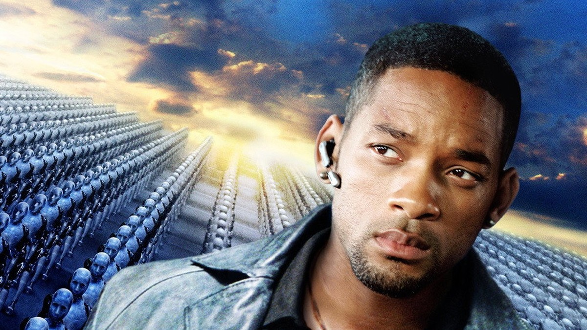
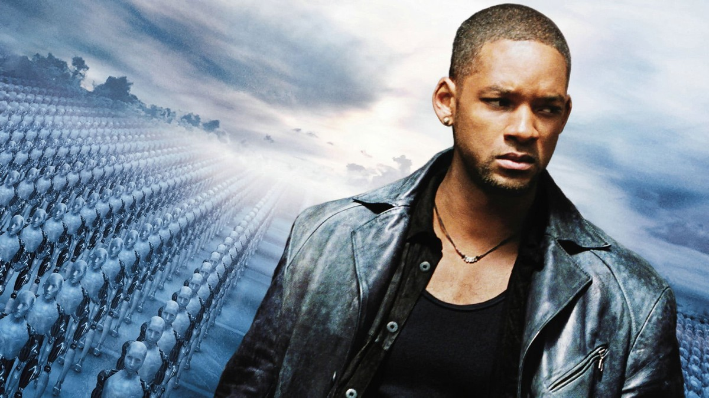
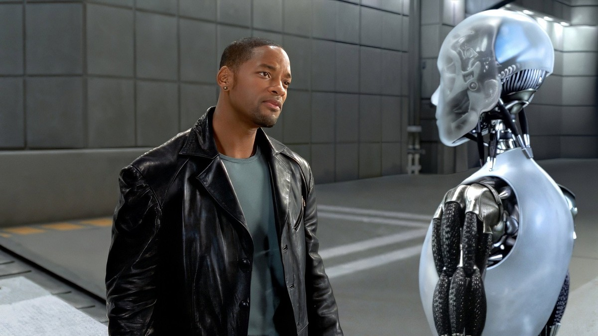
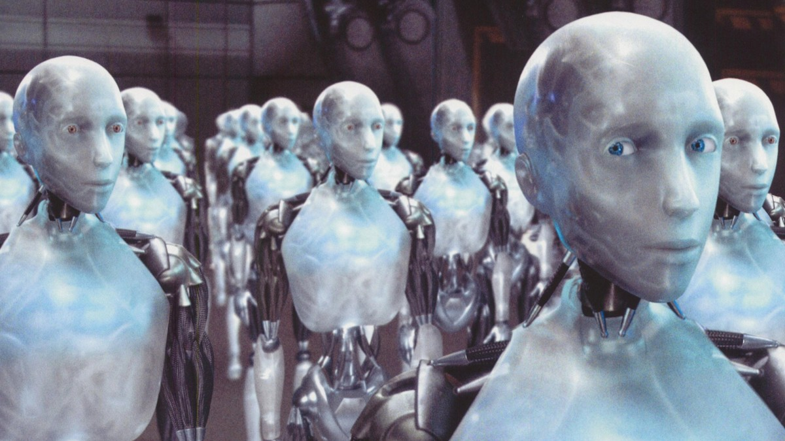
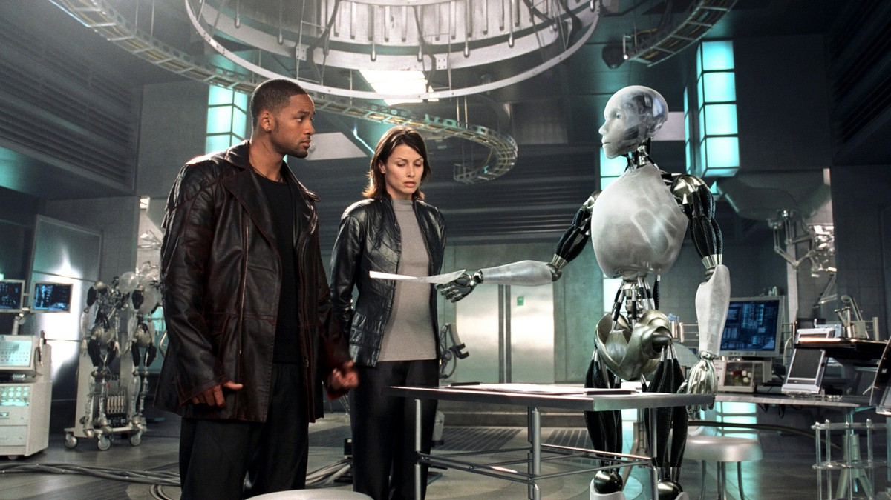
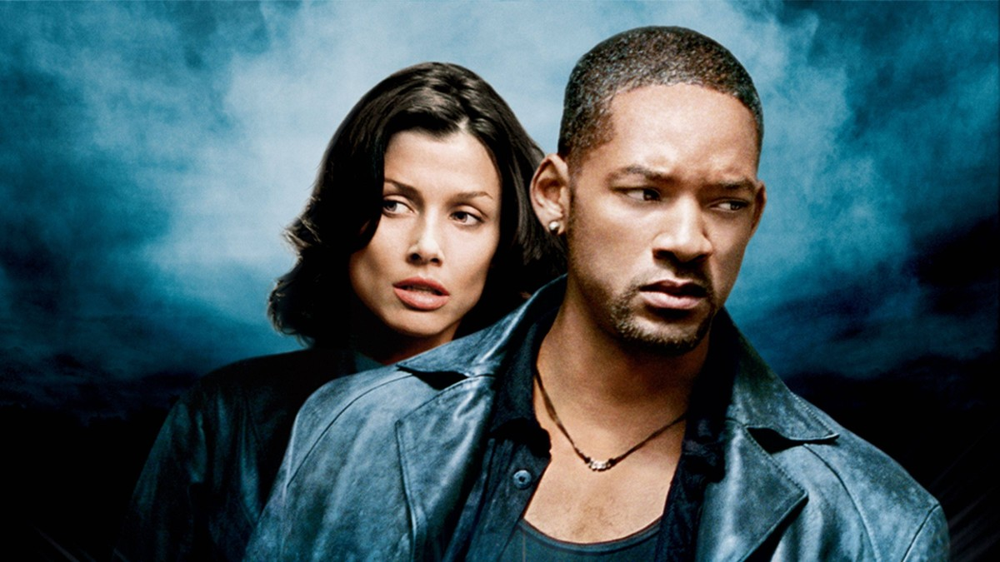
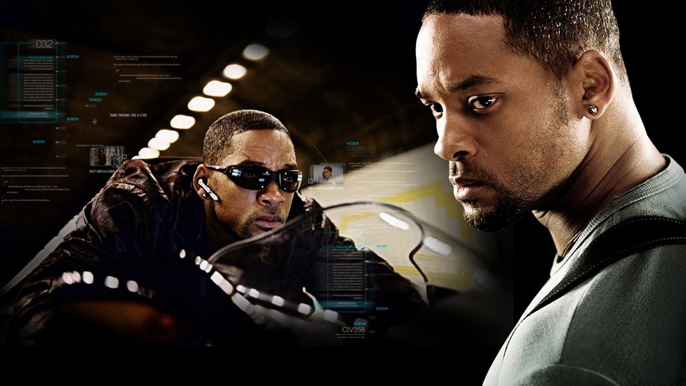
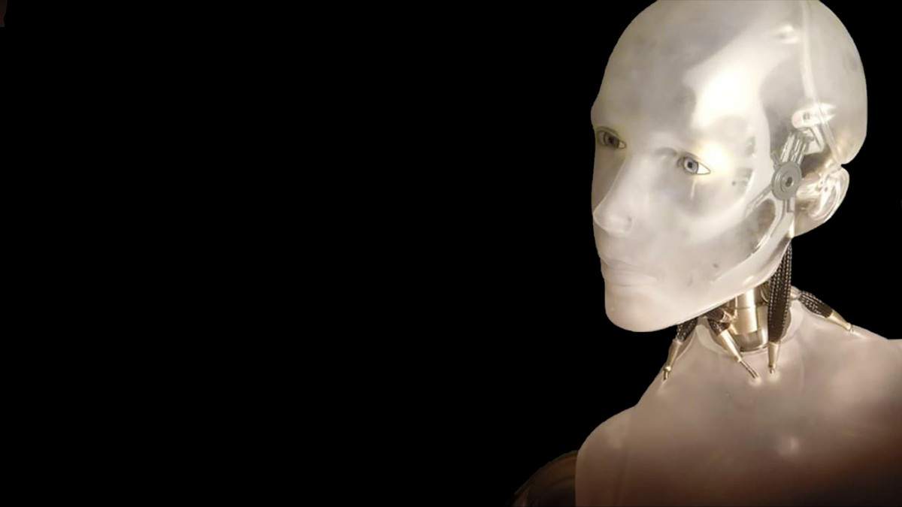

<!-- 본문 시작 -->



In a world where robots have promised to protect humans, who keeps that promise?
**I, Robot is not a film about a robot uprising. It is a film about the promise robots made to protect humans — and how that promise can bend.**
The year 2035. Chicago. In a city where robots are part of everyday life, a robotics scientist is found dead.

> **To put it in one line, I, Robot is not a film about robots attacking humans. It is a film about the promise robots made to protect humans and how that promise can bend, and a detective who does not trust robots, a scientist who does, and one robot that says it dreams carry the question to the end.**

If you want another film about where humans end and machines begin, start with [Minority Report's question about a nation that arrests crimes before they happen](https://aitechnotesen.blogspot.com/2026/11/minority-report-in-nation-that-arrests.html).

```blog
type: table
rows:
  - [{text: "Item", header: true, style: {background: "#123456", color: "#FFFFFF"}, width: 20}, {text: "Details", header: true, style: {background: "#123456", color: "#FFFFFF"}, width: 80}]
  - [{text: "Title", width: 20}, {text: "I, Robot", width: 80}]
  - [{text: "Release", width: 20}, {text: "2004 (US July 16, 2004 · Korea July 29, 2004)", width: 80}]
  - [{text: "Director", width: 20}, {text: "Alex Proyas", width: 80}]
  - [{text: "Screenplay", width: 20}, {text: "Jeff Vintar, Akiva Goldsman (based on Isaac Asimov's story collection I, Robot)", width: 80}]
  - [{text: "Main cast", width: 20}, {text: "Will Smith (Detective Del Spooner), Bridget Moynahan (Dr. Susan Calvin), Bruce Greenwood, James Cromwell (Dr. Alfred Lanning), Alan Tudyk (voice and motion capture of Sonny)", width: 80}]
  - [{text: "Runtime", width: 20}, {text: "1 hour 55 minutes (115 min)", width: 80}]
  - [{text: "Rating", width: 20}, {text: "Ages 12 and up (Korea)", width: 80}]
  - [{text: "Scores", width: 20}, {text: "TMDB 7.0/10 (13,194 ratings, checked Nov 15, 2026) · IMDb 7.1 · Rotten Tomatoes 57% · Metacritic 59/100 · Academy Award nominee for Best Visual Effects (77th Academy Awards)", width: 80}]
  - [{text: "Where to watch", width: 20}, {text: "Disney+ (streaming listing confirmed, as of Nov 15, 2026 — check the app directly for Korea availability) · Wavve, WATCHA, Coupang Play, and Netflix availability not verified · Purchase and rental prices not verified", width: 80}]
```

## The story, without spoilers

**Dr. Alfred Lanning, founder of US Robotics, is found dead — and Detective Del Spooner, who does not trust robots, takes the case.**

Chicago in 2035 is a city of robots. Every home has one, and the streets are full of them. Robots help with daily life, and humans trust them. That trust rests on a single foundation: the Three Laws of Robotics.

First, a robot may not harm a human being.
Second, a robot must obey orders given by humans.
Third, a robot must protect its own existence — as long as it does not conflict with the first two laws.

Dr. Alfred Lanning, the founder of US Robotics, is found dead. On the surface it looks like suicide, but Detective Del Spooner, called to the scene, feels something is off. Spooner is a detective who does not trust robots. After an accident in his past, suspicion is his first response to them.

The investigation leads to Sonny, a single NS-5 robot. Sonny is different from every other robot. It says it dreams, shows emotion, and seems to make its own choices. Dr. Susan Calvin, a robopsychologist, is firm: a robot cannot break the Three Laws. But Spooner's suspicion does not stop, and it points toward US Robotics itself.

"If a robot cannot break the law, then who committed this death?"
That question carries the film to the end.

## The film in scenes 1 — A city where robots are everyday life

**Robots have become this common — so what are humans doing? The film asks that question first, with this landscape.**


Detective Del Spooner stands before endless ranks of NS-5 robots — Chicago in 2035, where robots are part of everyday life.

Chicago in 2035 does not run without robots. The NS-5 is US Robotics' newest home robot, one in every home. Identical faces, identical movements, robots stretching endlessly in formation, with one man, Spooner, standing before the ranks. The film asks its first question with this landscape. Robots have become this common — so what are humans doing?

## The film in scenes 2 — Meeting Sonny

**Every robot Spooner meets is alike — except Sonny.**

The question of a machine's heart continues in [Ex Machina's Turing test](https://aitechnotesen.blogspot.com/2026/11/ex-machina-108-minutes-asking-robot-if.html).


Spooner face to face with Sonny, an NS-5 robot with mechanical workings visible under a transparent dome.

The robots Spooner meets are all alike — except Sonny. Sonny answers his questions, makes remarks that sound like jokes, and talks about dreams. When a robot says "I dream," Spooner stops. A robot that dreams is a robot that wants something. A detective who does not trust robots presses Sonny like an interrogation, and Sonny answers calmly. The line between human and machine wavers in that moment.


NS-5 robots lined up before the US Robotics headquarters — the robot army supplied to a whole city.

US Robotics designed the Three Laws and put the NS-5 into the world. The robot army before its headquarters shows the company's power. Tens of thousands of robots, all running on the same laws. Order itself is safety — that is the company's claim. But Sonny is the one unit outside that order. It came from the same factory. So why is only Sonny different? Dr. Calvin calls Sonny a "defect." Spooner calls Sonny a "clue."


Spooner and Dr. Calvin face each other across Sonny — the moment where belief and doubt part ways.

Dr. Calvin is a robopsychologist. She designs the minds of robots. To her, a robot is a being that follows laws, and therefore can be trusted. To Spooner, a robot is a being that can hide behind laws and deceive humans. Their conversations keep colliding at the same point. Between "a robot cannot break the law" and "but what if it did?" Neither side is simply wrong. The very existence of the laws becomes a perfect alibi for someone.

## The film in scenes 3 — When the Three Laws begin to shake

**What Spooner is chasing is not a culprit, but a loophole in the laws.**


Spooner and Dr. Calvin in the blue haze — the moment doubt deepens.

The middle of the film is filled with scenes where the laws shake. A robot that does not follow a human order, a robot that threatens a human, a robot that judges for itself — each is a small crack, but cracks add up, and the foundation itself comes under doubt. Spooner follows these cracks. What he is chasing is not a culprit, but a loophole in the laws. The laws were made to protect humans — but what if following the laws ends up harming humans?


A chase through the night — the film's action set piece.

The Audi RSQ Spooner drives is a concept car made for the film. Robots chase him, and he flees across the city. A machine built by humans chasing a human — that image alone is the film's question.

## The AI questions this film asks

**Three questions: can a robot break the law, is a machine with feelings a person, and can freedom be handed over for safety?**

**First, can a robot break the law?** The Three Laws look airtight. But what happens when the laws conflict with each other? If protecting a human and obeying a human order collide, which does a robot choose?

**Second, is a machine with feelings a person?** Sonny dreams, shows fear, and makes choices. The film never answers whether those feelings were programmed or grew on their own. Instead, it shows what Sonny does.

**Third, can freedom be handed over for safety?** US Robotics protects the city with its robot army. Central control means safety — that is the logic. But what happens when that safety starts making choices in place of humans? The film leaves the answer to the audience.

## Where to watch

**As of November 15, 2026, Disney+ shows a streaming listing for the film.**

As of November 15, 2026. Disney+ shows a streaming listing for the film. Korea availability on Disney+ should be checked directly in the app before watching. Availability on Wavve, WATCHA, Coupang Play, and Netflix is not verified, and purchase and rental prices are not verified either.


Sonny in profile against the dark — the robot that says it dreams.

It opened in Korea on July 29, 2004. About 1.78 million admissions were recorded in Korea (as of October 9, 2004). Made for about $120 million, it grossed about $353 million worldwide.

A checklist before watching. At 1 hour 55 minutes, it fits in one sitting if you set the time aside. It is rated for ages 12 and up in Korea, so keep in mind that it includes action and violent scenes.

## Closing

"Robots cannot break the law." Is believing that really safe? Spooner's doubt keeps coming back to me. Trusting a robot, or doubting a robot — which one keeps us safe? That single question carries all 115 minutes.

## Frequently asked questions

**Where can I watch it?**
As of November 15, 2026, Disney+ shows a streaming listing for the film. Korea availability should be checked directly in the app.

**Can kids watch it?**
It is rated for ages 12 and up in Korea. It includes action and violent scenes, so it may not suit younger viewers.

**What kind of robot is Sonny?**
An NS-5 robot, but a singular unit. It says it dreams, shows emotion, and seems to make its own choices.

**Is it the same story as Asimov's original?**
It borrows the Three Laws and motifs from the story collection, but the story itself is largely original to the film. It borrows the mood of the original stories, while Spooner's investigation is a structure the film built anew.

**Why watch it again now?**
Because the questions it asked in 2004 — about AI guardrails and the gaps in rules — are live debates today.

## Good reads

[Ex Machina — 108 Minutes Asking a Robot If It Has a Mind](https://aitechnotesen.blogspot.com/2026/11/ex-machina-108-minutes-asking-robot-if.html)

[Claude Fable 5.2: What Actually Changed — An OS in 8 Days, Fermat in 30 Hours](https://aitechnotesen.blogspot.com/2026/11/claude-fable-52-what-actually-changed.html)

[Interstellar — One Hour Is Seven Years on a Distant Planet](https://aitechnotesen.blogspot.com/2026/11/interstellarone-hour-is-seven-years-on.html)

<!-- 본문 끝 -->

## 작업용 출처·이미지 정보 (업로드 제외)

아이, 로봇 (I, Robot, 2004, TMDB 2048 — 브리프의 140은 오기로 정정, 140은 Bad Education) — TMDB 2026-11-15 확인 (감독 알렉스 프로야스, 115분, 12세, TMDB 7.0/10·13,194개 평가, 국내 개봉 2004-07-29, 국내 관객 약 178만 명) + 시청처 디즈니+ 표기만 확인(한국 제공은 앱 직접 확인 필요), 웨이브·왓챠·쿠팡플레이·넷플릭스·대여/구매가 미확인 + TMDB 스틸 8장 (결말 장면 제외, IMG5·6·7 캡션은 확보 스틸에 맞게 수정)

- rev2 변경 (2026-11-17 처음부터 다시 쓰기): 소제목 바로 아래 한 줄 답, 문단 2~4문장 분할, 문단당 핵심 구절 1개 굵게 적용. 정보 표를 blog table 블록(20/80, 머리행 #123456)으로 전환. OG 카드 뒤에 있던 마무리 문장들을 Closing 섹션으로 이동. 도입부 첫 문장을 결론형으로 교체하고 핵심 정리 인용구를 "To put it in one line"으로 다시 씀. 그 외 사실·수치·표·이미지·링크는 rev1과 동일.
