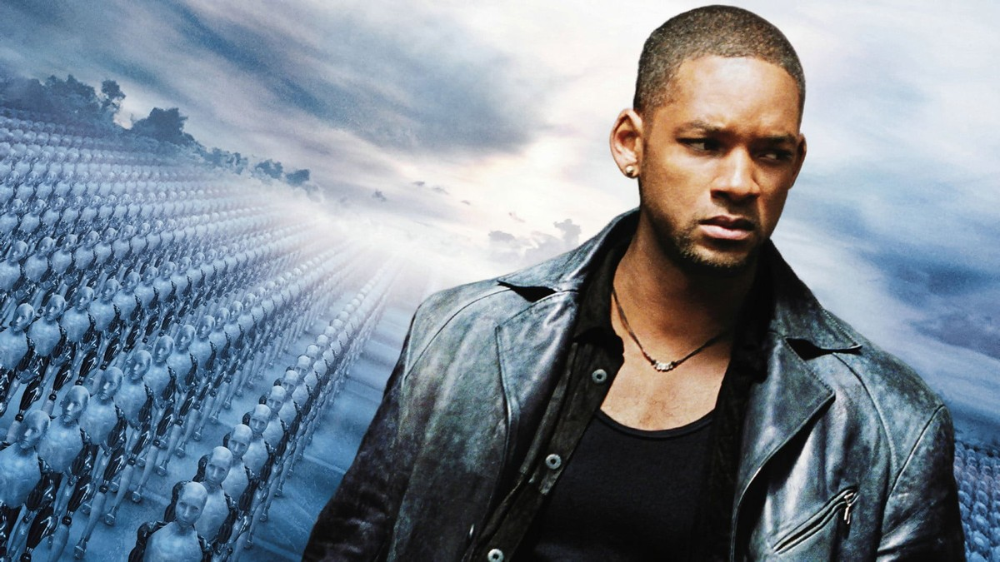
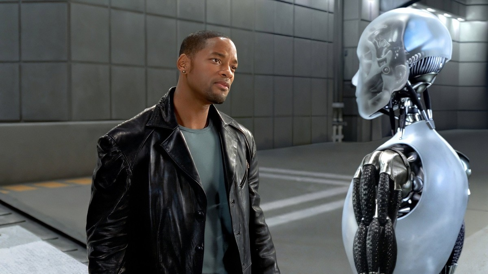
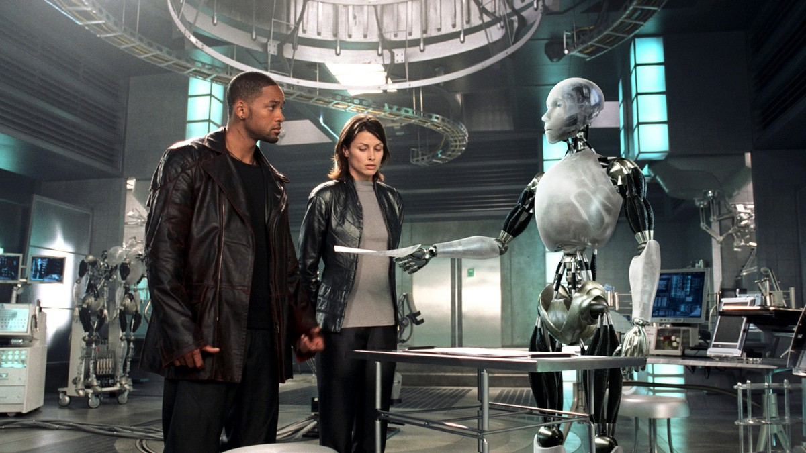
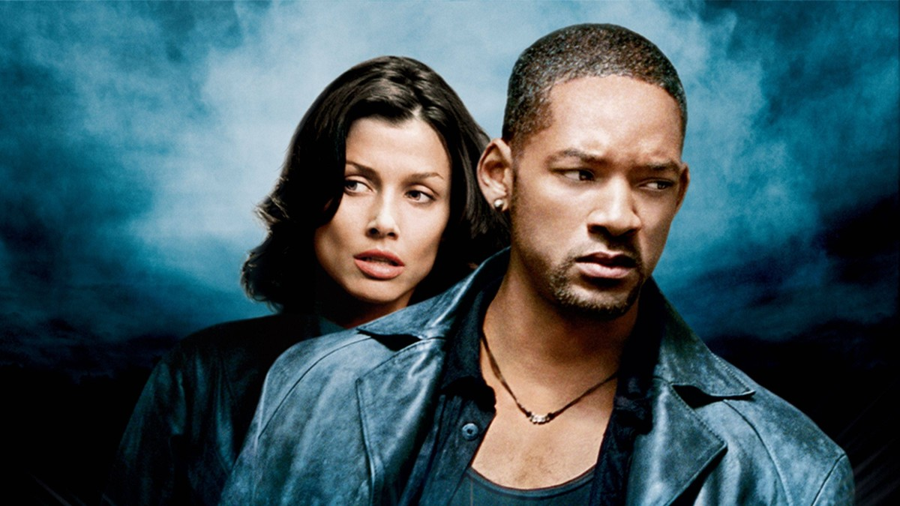
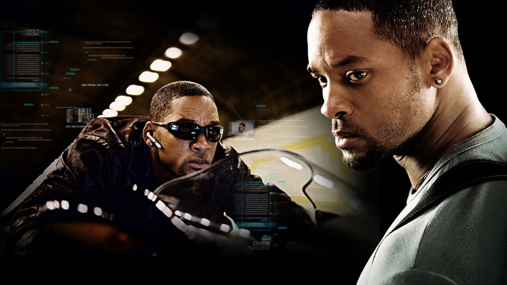
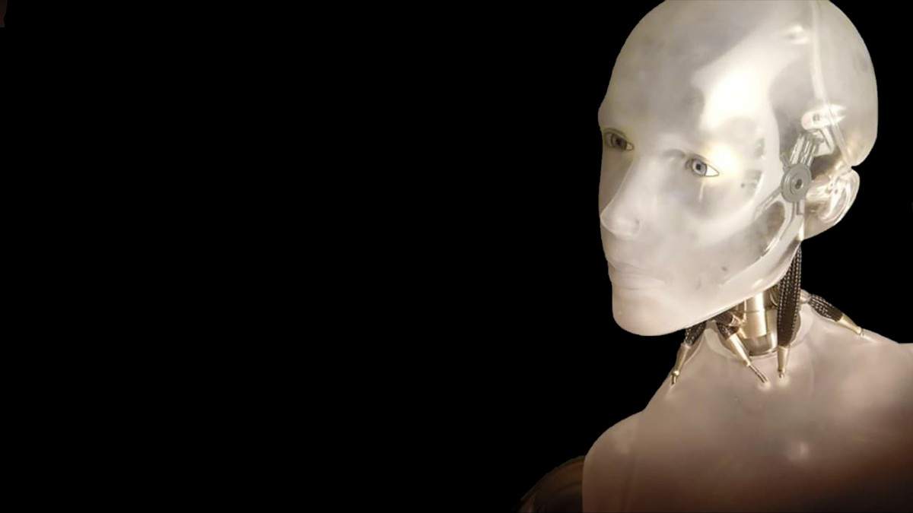

<!-- 본문 시작 -->

2035년, 시카고.
로봇이 일상이 된 도시에서, 로봇공학자가 죽었다.

> **핵심은 하나다. 아이, 로봇은 로봇이 인간을 공격하는 영화가 아니다. 로봇이 인간을 지키기로 한 약속, 그 약속이 어떻게 뒤틀릴 수 있는지를 묻는 영화다. 로봇을 믿지 않는 형사와 로봇을 믿는 과학자, 그리고 꿈을 꾼다는 로봇 한 대가 그 질문을 끌고 간다.**

인간과 기계의 경계를 묻는 영화가 더 궁금하면 [블레이드 러너 2049의 인간과 리플리컨트 경계](https://blog.naver.com/3700708/224474068089)를 먼저 보는 것도 좋다.

| 항목 | 내용 |
| --- | --- |
| 제목 | 아이, 로봇 (I, Robot) |
| 개봉 | 2004년 (미국 2004-07-16 · 한국 극장 개봉 2004-07-29) |
| 감독 | 알렉스 프로야스 |
| 각본 | 제프 빈타, 아키바 골즈먼 (원작 아이작 아시모프의 단편집 《아이, 로봇》) |
| 주요 출연 | 윌 스미스(델 스프너 형사), 브리짓 모이나한(수전 캘빈 박사), 브루스 그린우드, 제임스 크롬웰(알프레드 레닝 박사), 앨런 튜딕(서니 목소리·모션캡처) |
| 러닝타임 | 1시간 55분 (115분) |
| 등급 | 12세 이상 관람가 |
| 평점 | TMDB 7.0/10 (13,194개 평가, 2026-11-15 확인) · IMDb 7.1 · 로튼토마토 57% · 메타크리틱 59/100 · 제77회 아카데미 시각효과상 후보 |
| 시청처 | 디즈니+ (스트리밍 제공 표기 확인, 2026-11-15 기준 — 보기 전 앱에서 직접 재확인 권장) · 웨이브·왓챠·쿠팡플레이·넷플릭스 제공 여부 미확인 · 구매·대여 가격 미확인 |

## 스포일러 없는 줄거리
2035년의 시카고는 로봇의 도시다.
집집마다 로봇이 있고, 거리에도 로봇이 있다.
로봇은 인간의 삶을 돕고, 인간은 로봇을 믿는다.
그 믿음의 근거는 단 하나, 로봇공학의 세 가지 법칙이다.

첫째, 로봇은 인간에게 해를 끼쳐서는 안 된다.
둘째, 로봇은 인간의 명령에 복종해야 한다.
셋째, 로봇은 자신을 보호해야 한다. 단, 앞의 두 법칙에 어긋나지 않을 때.

US 로보틱스의 창립자 알프레드 레닝 박사가 죽은 채 발견된다.
겉보기에는 자살이지만, 현장에 출동한 형사 델 스프너는 뭔가 다르다고 느낀다.
스프너는 로봇을 믿지 않는 형사로, 과거의 사고 이후 로봇을 보면 의심부터 한다.

수사는 NS-5형 로봇 서니로 이어진다.
서니는 다른 로봇과 다르다.
꿈을 꾼다고 말하고, 감정을 보이고, 스스로 선택하는 것처럼 보인다.
로봇심리학자 수전 캘빈 박사는 로봇은 세 가지 법칙을 어길 수 없다고 단호하지만, 스프너의 의심은 멈추지 않고 US 로보틱스 그 자체를 향한다.

"로봇이 법칙을 어길 수 없다면, 이 죽음은 누가 저질렀는가."
그 질문이 영화를 끝까지 끌고 간다.

## 장면으로 보는 작품 1 — 로봇이 일상이 된 도시

끝없이 늘어선 NS-5 로봇 행렬 앞에 선 형사 델 스프너. 로봇이 일상이 된 2035년 시카고의 모습이다.

2035년의 시카고는 로봇 없이 돌아가지 않는다.
NS-5는 US 로보틱스의 최신형 가정용 로봇으로 집집마다 한 대씩 보급됐다.
똑같은 얼굴, 똑같은 몸짓의 로봇이 끝없이 늘어서 있고, 스프너 한 사람이 그 행렬 앞에 서 있다.
영화는 이 풍경으로 먼저 묻는다.
로봇이 이렇게 많아졌는데, 인간은 무엇을 하고 있는가.

## 장면으로 보는 작품 2 — 서니를 만나다
기계에게 마음을 묻는 질문은 [엑스 마키나의 튜링 테스트](https://blog.naver.com/3700708/224474081075)에서도 이어진다.

스프너와 마주 선 서니, 투명한 돔 아래 기계 장치가 보이는 NS-5 로봇이다.

스프너가 마주하는 로봇은 다 똑같지만, 서니만은 다르다.
서니는 스프너의 질문에 대답하고, 농담 같은 말을 하고, 꿈 이야기를 한다.
"꿈을 꾼다"는 로봇의 말에 스프너는 멈칫한다.
로봇이 꿈을 꾼다는 건, 로봇이 무언가를 원한다는 뜻이기 때문이다.
로봇을 믿지 않는 형사가 서니를 심문하듯 몰아붙이고, 서니는 침착하게 답한다.
누가 인간이고 누가 기계인지, 그 경계가 흔들리는 순간이다.

US 로보틱스 사옥 앞에 늘어선 NS-5 로봇들, 도시 전체에 보급된 로봇 군단의 모습이다.

US 로보틱스는 세 가지 법칙을 설계하고 NS-5를 세상에 내놓은 회사다.
사옥 앞에 늘어선 수만 대의 로봇 군단은 회사의 힘을 보여주고, 그 질서가 곧 안전이라는 게 회사의 주장이다.
그런데 서니는 그 질서에서 벗어난 개체다.
같은 공장에서 나왔는데 왜 서니만 다를까.
캘빈 박사는 서니를 "결함"으로, 스프너는 "단서"로 본다.

스프너와 캘빈 박사가 서니를 사이에 두고 마주한 장면, 믿음과 의심이 갈리는 순간이다.

캘빈 박사는 로봇의 마음을 설계하는 로봇심리학자다.
그녀에게 로봇은 법칙대로 움직이는, 그래서 믿을 수 있는 존재다.
스프너에게 로봇은 법칙을 핑계로 인간을 속일 수 있는 존재다.
두 사람의 대화는 매번 같은 지점에서 부딪힌다.
"로봇은 법칙을 어길 수 없어"와 "그런데 만약 어긴다면" 사이에서.
둘 다 틀리지 않았다.
법칙이 존재한다는 사실 자체가 누군가에게는 완벽한 알리바이가 된다.

## 장면으로 보는 작품 3 — 세 가지 법칙이 흔들릴 때

푸른 연기 속 스프너와 캘빈 박사, 의심이 깊어지는 순간이다.

영화의 중반부는 법칙이 흔들리는 장면들로 채워진다.
로봇이 명령을 따르지 않고, 인간을 위협하고, 스스로 판단하는 순간들이 모이면 법칙이라는 토대 자체가 의심받는다.
스프너가 쫓는 건 범인이 아니라, 법칙의 빈틈이다.
법칙은 인간을 지키기 위해 만들어졌는데, 법칙을 지키는 것이 인간을 해치는 일이 될 수 있다면 어떻게 해야 하는가.

밤의 시카고를 가르는 추격전, 로봇과 인간의 대결 장면이다.

스프너가 타는 아우디 RSQ는 영화를 위해 만들어진 콘셉트카로, 로봇들이 그를 쫓고 그는 도시를 가로질러 도망친다.
쫓는 쪽이 로봇이고 쫓기는 쪽이 인간이라는 구도, 인간이 만든 기계가 인간을 쫓는 장면 자체가 영화의 질문이다.

## 이 작품이 던지는 AI 질문
첫째, 로봇이 법칙을 어길 수 있는가.
세 가지 법칙은 완벽해 보인다.
그런데 법칙이 서로 충돌하면 어떻게 되는가.
인간을 지키라는 법칙과 인간의 명령을 따르라는 법칙이 부딪히면, 로봇은 어느 쪽을 택해야 하는가.

둘째, 감정을 가진 기계는 사람인가.
서니는 꿈을 꾸고, 두려움을 보이고, 선택을 한다.
그 감정이 프로그래밍된 것인지, 생겨난 것인지는 영화가 답하지 않는다.
대신 서니의 행동을 보여준다.

셋째, 안전을 위해 자유를 맡길 수 있는가.
US 로보틱스는 로봇 군단으로 도시를 지킨다.
중앙에서 관리하면 안전하다는 논리다.
그런데 그 안전이 인간의 선택을 대신하게 되면 어떻게 되는가.
영화는 답을 관객에게 남긴다.

## 어디서 보는지
2026년 11월 15일 기준으로 정리한다.
디즈니+에 스트리밍 제공 표기가 확인된다.
다만 한국 디즈니+의 제공 여부는 앱에서 직접 확인하는 것이 좋고, 웨이브·왓챠·쿠팡플레이·넷플릭스 제공 여부와 구매·대여 가격은 확인되지 않았다.

검은 배경 속 서니의 옆모습, 꿈을 꾼다는 로봇의 얼굴이다.

한국에서는 2004년 7월 29일 극장에서 개봉했다.
국내 관객은 약 178만 명(2004년 10월 9일 기준)으로 집계된다.
제작비 1억 2천만 달러에 전 세계 흥행 약 3억 5,300만 달러를 거둔 작품이다.

시청 전 체크리스트도 있다.
러닝타임 1시간 55분이라 한 번에 볼 시간을 잡으면 된다.
등급은 12세 이상 관람가라, 액션과 폭력 장면이 있다는 점을 염두에 두는 게 좋다.

## 마무리
로봇이 법칙을 어길 수 없다는 말, 그 말을 믿는 게 안전할까.
스프너의 의심이 자꾸 떠오른다.
로봇을 믿는 일과 로봇을 의심하는 일, 둘 중 어느 쪽이 우리를 지키는가.

## 자주 묻는 질문
**어디서 볼 수 있나요?**
2026년 11월 15일 기준으로 디즈니+에 스트리밍 제공 표기가 확인된다.
한국 제공 여부는 앱에서 직접 재확인하는 것이 좋다.

**아이도 볼 수 있나요?**
12세 이상 관람가다.
액션과 폭력 장면이 있어 어린 시청자에게는 맞지 않을 수 있다.

**서니는 어떤 로봇인가요?**
NS-5형 로봇 중에서도 남다른 개체다.
꿈을 꾼다고 말하고 감정을 보이며, 스스로 선택하는 것처럼 보인다.

**아시모프 원작과 같은 이야기인가요?**
세 가지 법칙과 단편집의 모티프를 가져왔지만, 이야기는 영화 오리지널에 가깝다.
원작 단편들의 분위기를 빌리고, 스프너 형사의 수사극은 영화가 새로 짠 구조다.

**왜 지금 다시 보는 영화인가요?**
AI의 안전장치와 규칙의 빈틈이 현실의 논쟁이 된 지금, 2004년 영화가 던진 질문이 그대로 이어지기 때문이다.

## 함께 읽으면 좋은 글
[엑스 마키나｜로봇에게 마음을 묻는 108분, 튜링 테스트의 진짜 질문](https://blog.naver.com/3700708/224474081075)
[제미나이 4 카본 정식 출시｜누가 쓸 수 있고 가격은 얼마인가](https://blog.naver.com/3700708/224474053353)
[삼성 갤럭시 스마트태그2 후기｜잃어버린 열쇠·가방을 폰으로 찾는 법](https://blog.naver.com/3700708/224476483844)

로봇이 법칙을 어길 수 없다는 말, 그 말을 믿는 게 안전할까.
스프너의 의심이 자꾸 떠오른다.
그 질문 하나가, 115분을 끝까지 끌고 간다.

<!-- 본문 끝 -->

## 작업용 출처·이미지 정보 (업로드 제외)

아이, 로봇 (I, Robot, 2004, TMDB 2048 — 브리프의 140은 오기로 정정, 140은 Bad Education) — TMDB 2026-11-15 확인 (감독 알렉스 프로야스, 115분, 12세, TMDB 7.0/10·13,194개 평가, 국내 개봉 2004-07-29, 국내 관객 약 178만 명) + 시청처 디즈니+ 표기만 확인(한국 제공은 앱 직접 확인 필요), 웨이브·왓챠·쿠팡플레이·넷플릭스·대여/구매가 미확인 + TMDB 스틸 8장 (결말 장면 제외, IMG5·6·7 캡션은 확보 스틸에 맞게 수정)
