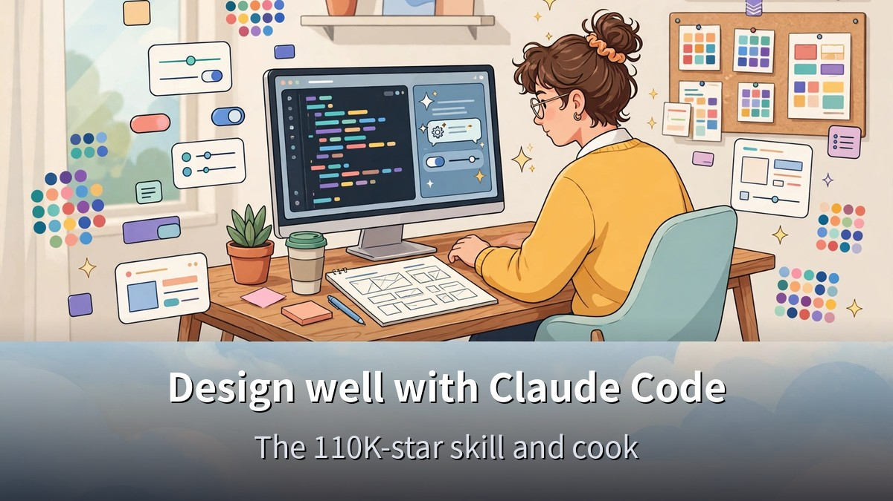
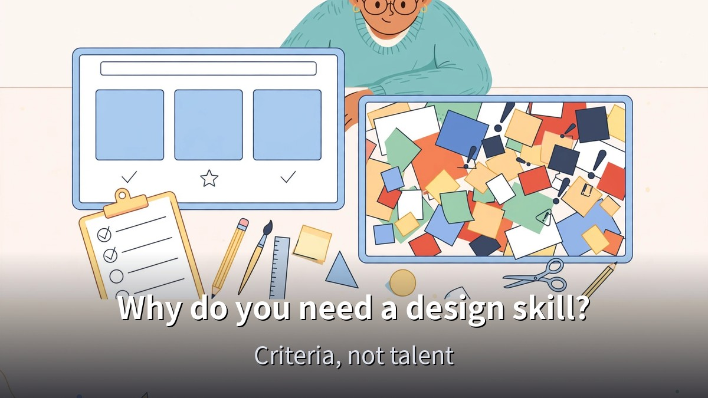
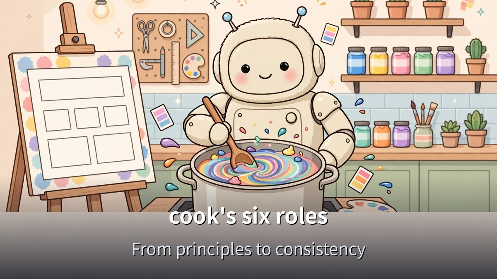
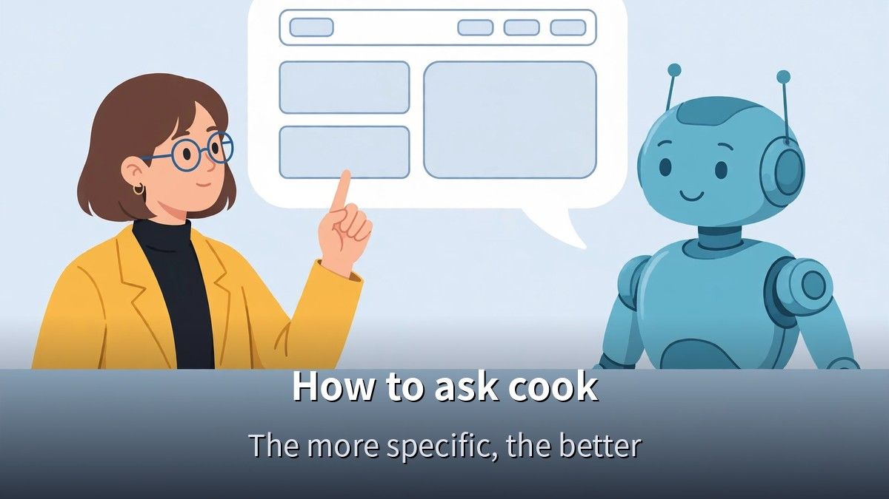

<!-- 본문 시작 -->



Have you ever asked Claude Code to design something and felt let down by the result?
The colors clash, the spacing feels off, and you cannot even tell what is wrong.

**To put it plainly, design is not a matter of talent but of criteria. When you organize the criteria of good design into a skill and hand it to Claude Code, the AI designs by those criteria. Without criteria, you are leaving it to luck. With criteria, the result becomes repeatable.**

It is for people who can code but whose designs always feel slightly off, and for anyone tired of pages that scream "made by AI."

> **To put it in one line, giving criteria comes before fixing designs. The three parts of taste-skill (principles, examples, checklist) and the six roles of cook are those criteria.**

If you are new to Claude Code itself, start with [How to Start Claude for Free](https://aitechnotesen.blogspot.com/2026/11/start-claude-for-free-what-you-get-what.html) to set up an account and open your first conversation.

## Why Do You Need a Design Skill?

**The real reason design feels hard is not a lack of talent. It is that without a standard to judge by, you cannot tell what is wrong. With a standard, even the AI can design by it.**



Lex, who created the design skill, runs a design skill repository on GitHub.
His starting question was simple: "Is there a standard for telling good design from bad design?"
The real reason design feels hard is not a lack of talent. It is that **without a standard to judge by, you cannot tell what is wrong.**
So he organized the standards of design into a skill.

Look inside the skill and you will find three parts.

**Principles** — the rules to follow when designing, split into basic principles, advanced principles, and practical principles.

**Examples** — good and bad designs sit side by side, so you can compare them with your own eyes.

**Checklist** — the items to check after a design is finished. Color, typography, layout, spacing — every design criterion is in there.

Together, the three parts give you **an eye for judging design**.

The skill itself is this: the GitHub repository Leonxlnx/taste-skill, with **116,141 stars (checked directly through the GitHub API on 2026-11-16)**.
Its GitHub description reads: "Agent skills that give coding agents taste."
It covers art direction, reference images, and checking its own work in a browser.
The goal is pages that look **reviewed by a designer, not generic AI pages**.
It is free and open source, so anyone can download it from GitHub.

## What Is cook, and What Are Its Six Roles?

**cook is an agent app that lets you design inside Claude Code. It does real design work using taste-skill's criteria.**



Released together with taste-skill is cook.
Download it from the GitHub repository Leonxlnx/cook and install it, and you can use it in Claude Code.
Its GitHub description reads: "Give your agent a target, a bar and time, then let it cook."
It is a skill for visual work that has to match reference images or videos.

cook plays six roles.

**Telling principles** — it tells you the principles of design.

**Showing examples** — it shows you design examples.

**Giving feedback** — it gives feedback on your design.

**Pointing the fix direction** — it tells you which direction to fix things.

**Raising finish quality** — it raises the finish quality of your design.

**Keeping consistency** — it keeps your design consistent.

When all six come together, the design turns out well — that is how the video explains it.

The structure is simple.
While Claude Code designs, cook helps from the side.
cook supplies the information Claude Code needs: which color to use, which font to use.
So Claude Code does not wander while designing.
So far, the video and the GitHub descriptions agree.
**How good the results really are cannot be settled from one demo scene in the video.** The right order is to run it yourself once and judge with your own eyes.

```blog
type: table
rows:
  - [{text: "Tool", header: true, style: {background: "#123456", color: "#FFFFFF"}, width: 20}, {text: "What it is", header: true, style: {background: "#123456", color: "#FFFFFF"}, width: 80}]
  - [{text: "taste-skill", width: 20}, {text: "A skill holding design criteria — principles (basic, advanced, practical), examples (good and bad), checklist", width: 80}]
  - [{text: "cook", width: 20}, {text: "An agent app that does design work with those criteria — six roles (principles, examples, feedback, fix direction, finish quality, consistency)", width: 80}]
```

If you have ever handed a website to an AI, [the vibe-coding website tier list](https://aitechnotesen.blogspot.com/2026/11/vibe-coding-website-tier-list5-top-tier.html) shows how top-tier features get built in Claude's hands, and it is a useful comparison before you try cook.

## How Do You Ask cook to Design?

**Using cook itself is simple. Run cook in Claude Code and ask for the design you want — specifically.**



If you dislike part of the result, ask cook to fix it.
cook will fix it.

There is one knack in how you ask.
**Ask specifically.**
Not "design this page," but "design the hero section of this page in a modern style."
The more specific you are, the better the design cook makes, according to the video.
This advice fits the design skill's principles as well.
**The more specific the criteria, the more specific the result.**

The video also shows cook running and designing in real time.
The colors fit, the layout fits, the typography fits — that is the video's verdict.
**That verdict is the creator's claim, and it is worth keeping that distinction in mind.**
The facts I can check directly are separate: the skill and the app are public, the repository with more than 110,000 stars really exists, and you can install it and try it right away.
Today's one task is simple: download taste-skill and cook from GitHub and apply them to one of your own pages that always felt slightly off.
Whether the result got better, and where it changed, you can judge with your own eyes.

## Closing thoughts

The line that stayed with me was that my AI-made pages felt off not because the model was weak, but because there were no criteria.
Once you gain an eye for judging design, the words you give the AI change too.
Start today by downloading taste-skill and applying it to one of your pages.

## Frequently Asked Questions

**Where do I get taste-skill?**
From the GitHub repository Leonxlnx/taste-skill.
It is an open-source skill with 116,141 stars (checked 2026-11-16).

**How is cook different from taste-skill?**
taste-skill is a skill holding design criteria, and cook is an agent app that does real design work with those criteria.
Both were released by the same developer, Lex, and are meant to be used together.

**Do I need Claude Code?**
The method in the video assumes Claude Code.
Both the skill and cook are tools for designing inside Claude Code.

**Does it cost money?**
The skill and cook themselves are free public materials on GitHub.
Claude Code usage fees are separate.

**Can I use it if I know nothing about design?**
Yes.
The video recommends it because people who know design and people who do not can both design better with cook.
Still, it is better to review the result with your own eyes.

## Good Reads Together

[Start Claude for Free — What You Get, What You Don't, and 5 Drawbacks to Check First](https://aitechnotesen.blogspot.com/2026/11/start-claude-for-free-what-you-get-what.html)

[Automating Instagram Card News with Claude Code — From Reference Collection to Finished Posts](https://aitechnotesen.blogspot.com/2026/11/automating-instagram-card-news-with.html)

[Vibe Coding Website Tier List｜5 Top-Tier Sites Out of 19, Recreated with Claude](https://aitechnotesen.blogspot.com/2026/11/vibe-coding-website-tier-list5-top-tier.html)

<!-- 본문 끝 -->

## Working notes — sources and images (do not upload)

Ai-Con Lab 영상 Xv1otnnWCzc(2026-11-15, 12분 48초, 자막 0:02~12:45 전체 확인) + GitHub API 2026-11-16 대조 (taste-skill 116,141개·cook 549개) — Lex(Leonxlnx), taste-skill=원칙(기본·심화·실전)+예시(좋은/나쁜)+체크리스트(색·서체·레이아웃·간격), cook=에이전트 앱 6가지 역할(원칙 전달·예시 제공·피드백·수정 방향·완성도 향상·일관성 유지), 구체적 요청법

- rev2 changes (2026-11-17 rewrite from scratch): intro conclusion-first; removed source attribution sentence ("based on the Ai-Con Lab video...") and the "What only this post gives you" meta paragraph — their content is covered in the body (giving criteria comes first, three parts and six roles, 110K+ stars verified). Closing thoughts moved from after the recommendation links to before the FAQ, so the recommendation links are last. taste-skill/cook summary table added as a blog table block (20/80, header #123456). Section headings are plain markdown (EN has no Naver colors). All facts, numbers, tables, images, links identical to rev1.
- Self-review: no "In this post" / "In conclusion" / numbered advantages. No subscription CTA, no teaser. No FAQ change — same 5 questions as rev1. Recommendation links are the same blogspot URLs as rev1 (start Claude for free, card news automation, vibe coding tier list).
