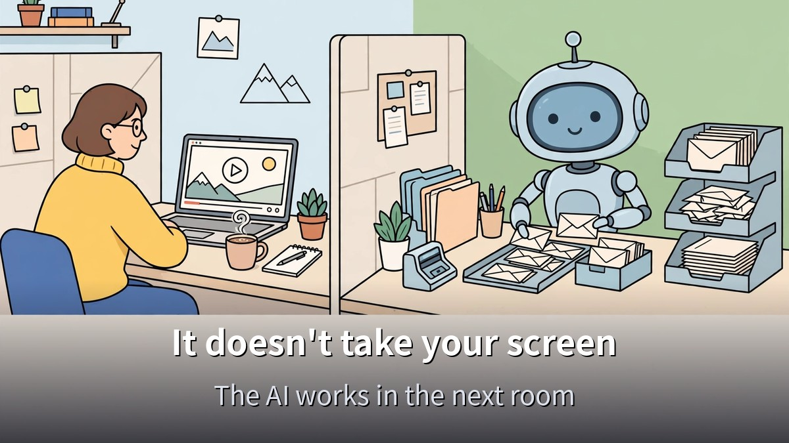
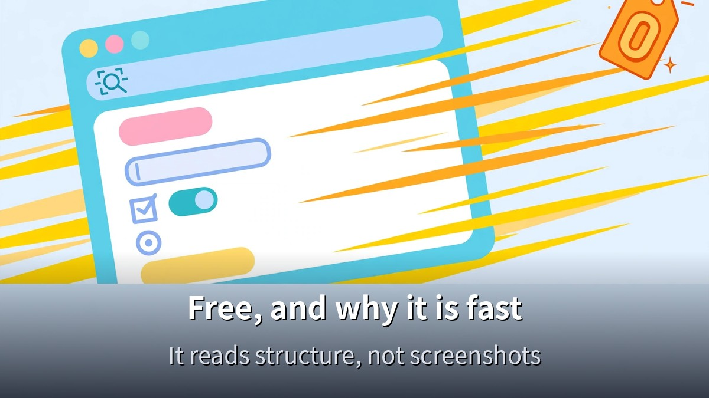

<!-- 본문 시작 -->

Hand a browser task to an AI, and it usually takes your screen and your mouse with it.
While the AI works, you wait, and you cannot even touch your own tabs.
**Ego Lite is a free browser built so the AI works in its own "Space," not on your screen.**
It is for people who run Claude Code or Codex on a PC, and for anyone who wants to hand repetitive work — sorting mail, checking prices — to an AI.

> **The point is simple. Ego Lite is a browser where the AI works in its own "Space," not in your tabs. You keep doing your work on your screen, and the AI does its work in the next room. The browser itself is free, with no login or account needed.**

Ego Lite works by letting **a PC AI such as Claude Code or Codex drive the browser directly**. If you only use AI in a website chat window, you cannot move this browser. A PC AI installed on your machine is the precondition.

Install takes about **2 minutes**, according to the official docs. Installing it also sets up the connection tool for Claude Code or Codex on first launch.

Then type the slash command for **"browser"** in Claude Code and tell it what to do. In the app, use the Code tab, not the Cowork tab, or the command will not show. On Windows, reopen the terminal after installing, or the command will not be found.

## What Does "It Doesn't Take Your Screen" Mean?

**Because the AI works in its own workspace, a "Space," not in your tabs.**

The first advantage is that it **does not invade your workspace**. Some AI tools share your screen and mouse while they work. Then you may have to wait until the AI finishes.

In Ego Lite, the AI works in a **separate workspace called a Space**. It is like a partitioned room next door inside the same browser. The official site puts it this way: "Agents work in their own Spaces, not in your tabs." It does not grab the mouse or steal focus from what you are doing.

You can run **several rooms at once** — one for Claude Code, one for Codex, side by side. How many depends on your computer's specs, according to the official docs.

One fair point is worth stating: not grabbing the mouse is not something only Ego Lite can do. Other tools can avoid it too, depending on their settings. **What makes Ego Lite different is that it was built from the start as a browser for working separately.**

## Why Is It Free, and Why Is It Fast?

**The browser itself is free, and the AI reads the page structure instead of taking screenshots.**

The second advantage is that it is **free**. Browsers with their own built-in AI often charge a separate fee to run that AI properly. Ego Lite is driven by an AI you already use, so there is no extra cost on the browser side.

The official download page says it is "**completely free**, no login or account creation needed." The official docs also say there is no runtime fee, no per-task fee, and no per-hour fee.

The maker is Citro Labs, a company incorporated in Singapore. To be precise, **what is free is the browser itself**. Claude Code or Codex fees stay as they were, and business pricing for companies or teams is quoted separately. There is no paid plan for personal use right now. If AI fees worry you, the official docs also explain how to connect a local model running on your own computer.

The third advantage is **speed**. Ego Lite does not take pictures of the screen to see it. It reads the structure inside the page and drives it. It receives a list of where the buttons, text, and input fields are, and picks what to press directly.

And it sends several actions at once, in a few lines of short code. Typing in the search box, pressing search, waiting for results, and reading the list — **all in one go**. The official docs name these two things as the reasons it is fast and uses fewer tokens. Screenshots are used together only when the picture itself matters.

The numbers need care, though. In the company's own test, **31 tasks finished in 6 minutes 40 seconds on average**, while the other tools compared took around 10 minutes. Those are the company's own numbers. The company's docs also say one small test cannot settle a ranking.

An independent review of an earlier version found the same job taking anywhere from **16 to 76 seconds** depending on Claude Code's permission settings. How it feels depends on the settings. That review also agreed tokens are saved, and traced it to sending several actions bundled together.

If you want a standard for judging a browser before choosing one, [the vibe-coding website tier list](https://aitechnotesen.blogspot.com/2026/11/vibe-coding-website-tier-list5-top-tier.html) shows how the tier list was ranked, and it is a useful comparison.

## What Can You Actually Hand Over, and Where Should You Be Careful?

**You can hand over repetitive work like sorting mail and bookkeeping, but logins, CAPTCHAs, and payments stay with you.**

The fourth advantage is that it can be used for **work automation**. Some sites block AI from looking at them. Checking Naver Mail with AI from Chrome was sometimes blocked. Ego Lite lets the AI use the browser you are already logged into, so it worked in many cases. But not in all of them.

When gathering shopping-mall prices, Naver Shopping showed a temporary access limit and had to be left out. Ego Lite does not try to break through such things. The official docs say it does **not bypass CAPTCHAs or security checks**.

There are two ways it is actually used. One is **sorting mail and drafting replies**. Sorting advertising mail and suspected scam or malicious mail with links used to take time every day. Now Claude opens each mail in Ego Lite and sorts them at a set time. It also drafts replies, and the creator checks them once before sending. If you try it first, start with reading and organizing, and press the send or submit button yourself.

The other is **monthly bookkeeping**. Logins that need a password or certificate are done by hand, and after that the AI collects documents from each tab and organizes them.

The fifth advantage is that it **brings over your Chrome login information in one go**. On first launch, it asks once whether to bring over open tabs, bookmarks, saved passwords, extensions, and login state from Chrome. It can bring them over from Edge or Brave as well.

**It copies rather than moves**, so Chrome stays as it is. Passwords and login information are stored on your computer, like Chrome does. The official blog says bringing them over does not send your passwords to the company. So the AI uses the sites you are already logged into. Some sites will still ask you to log in again.

The sixth advantage is that **AI work is divided into Spaces, and a Space in use shows in blue**. Open the Space button at the top right to watch, stop, or take over. When a moment needs a human hand — login, CAPTCHA, two-factor authentication — the AI stops by itself and hands control back.

The November 12 update notes also say it does not guess passwords and **returns control**. On a practice login page, it stopped on the spot without even trying a password, and handed it over. The official docs separately warn not to paste passwords or authentication codes into the AI chat window.

There are cautions too. **A Space divides tabs, not accounts.** Login cookies are shared between Spaces, so make a separate profile if you want separate accounts.

The **Windows version is still in beta**, and there is no mobile app. Linux is listed only as on the roadmap, with no date. In settings, check whether the option to join Citro Labs' feature and performance improvement program is on, and turn it off if you do not want it.

**Do not hand payments or money transfers to the AI.** And remember that the content of the pages the AI worked on goes to the AI company you chose.

The GitHub repository citrolabs/ego-lite has **22,955 stars** (as of 2026-11-16). The browser itself is not open source. The Windows beta has been out since October 19, 2026.

Today's one task: download it from the official site and give it **one job that needs no login**.

**What only this post gives you: the real difference in Ego Lite is not "fast" but the structure of "not taking your screen." I checked all six advantages and the cautions, and separated the company's claim (31 tasks in 6 minutes 40 seconds on average) from the independent review (16–76 seconds). The browser itself is free, and the AI fee is separate — that boundary is part of the summary.**

## Frequently Asked Questions

**Does Ego Lite cost money?**
The browser itself is free, with no login or account needed.
Claude Code or Codex fees stay as they were.

**Does it only work on Mac?**
No.
It runs on macOS and Windows, and the Windows beta came out on October 19, 2026.
Linux is only on the roadmap, with no date.

**Is the browser itself open source?**
No.
The GitHub repository holds the skill and docs, and the browser is a separate free download.

**Do I have to delete Chrome?**
No.
On first launch it asks whether to bring over your Chrome information, and it copies rather than moves, so Chrome stays as it is.

**Can I hand payments to the AI?**
Better not to.
Do not hand payments or money transfers to the AI.
Press the send or submit button yourself.

## Good Reads Together
[An AI System That Runs a One-Person Business — Chief of Staff, Advisor, and Skills](https://aitechnotesen.blogspot.com/2026/11/an-ai-system-that-runs-one-person.html)
[Automating Instagram Card News with Claude Code — From Reference Collection to Finished Posts](https://aitechnotesen.blogspot.com/2026/11/automating-instagram-card-news-with.html)
[Start Claude for Free — What You Get, What You Don't, and 5 Drawbacks to Check First](https://aitechnotesen.blogspot.com/2026/11/start-claude-for-free-what-you-get-what.html)

Handing the browser to an AI did not mean handing over my whole screen.
With a structure that lets it work in the next room, the waiting time becomes time to keep doing my own work.
Start today with one job that needs no login, and watch how the AI works on your own computer.

<!-- 본문 끝 -->

## 작업용 출처·이미지 정보 (업로드 제외)

honjobs 영상 NsPsrOmhLBY(2026-11-15, 8분 11초, 자막 0:00~8:06 전체 확인) + GitHub API 2026-11-16 대조 (citrolabs/ego-lite 22,955개) — 6가지 장점(Spaces·무료 브라우저 본체·빠름·업무 자동화·크롬 로그인 가져오기·로그인/캡차/2FA에서 멈춤), 정정 사항(윈도우 베타 2026-10-19·브라우저 본체 비오픈소스·macOS+윈도우만·Spaces 쿠키 공유), 회사 주장(31개 과제 평균 6분 40초)과 독립 리뷰(16~76초) 구분 표기
