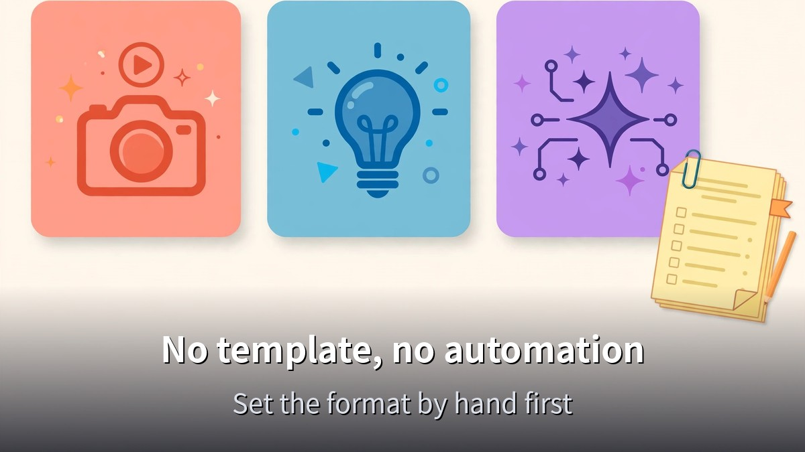

<!-- 본문 시작 -->


Video editing takes a lot of work, from planning to shooting to cutting.
What if you could hand that process to Claude Code and let it run on its own?

**To put it plainly, automating video editing is not magic where the AI does everything by itself. First build three standards — a proven editing tool, a template for each format, and an editing manual — and the AI runs by those standards. The standards are the whole of automation.**

This post covers the essentials of part 2.
Part 1 drew a big response and a flood of questions, so the leftover stories were put together in a hurry as an extra episode.
That is why watching part 1 first is the premise.
Installing the three open-source tools and the tools that help with editing effects, as explained in part 1, comes first.
Then comes the order in part 2.
It is for people who watched part 1, and for solo creators and marketers who have to produce video content again and again.

> **To put it in one line, the order of automation is "tool, then template, then manual, then skill." The time spent building those four standards is the body of automation — and without a standard, there is no standard in the result either.**

If you want to see the same channel's automation approach, [automating Instagram card news with Claude Code](https://aitechnotesen.blogspot.com/2026/11/automating-instagram-card-news-with.html) follows the flow from reference collection to finished posts.

## Why Must the Editing Tool Be CapCut or Premiere Pro?

**Use CapCut or Premiere Pro. The layer data Claude builds up while editing with these tools becomes the material for the next automation.**


Some people edit with other tools, and the video goes so far as to say, "Please don't do that."
When Claude Code edits with CapCut or Premiere Pro, data piles up: subtitles, motions for each cut, sound effects, and layer data.
The more of this source material there is, the more varied, plentiful, and accurate the material Claude can refer to becomes.
The layer, effect, and data the editing tool itself creates become the material for the next video's automation.

The creator's team publishes about **50 Reels and carousel posts a month**.
Looking around, everything ends up converging on this method, according to the video.
There may be better tools, but using a proven one is the starting point of automation.

## Why Automation Fails Without Templates and a Manual

**It may seem like the AI will handle everything by itself, but the AI in the middle — Claude — needs a standard to work by. The template becomes the standard, and the manual writes down how to work by that standard.**



Videos come in too many kinds.
There can be vlogs, information videos, or videos made 100% by AI.
Each kind of video you handle needs its own **template for each format**.
The template becomes the standard, and when you write a work manual so the AI can work by that standard, the moment the AI refers to the standard and the manual and runs by itself — that is automation.

**Template** — pick one video as the standard for each kind of video you make. Vlogs, information videos, videos made 100% by AI: each kind needs its own template.

**Manual** — a document explaining the editing method that fits the standard. A Markdown file works, and so does Notion. The format is free. With this manual, the AI gains a clear standard to refer to.

**Skill** — save how to make videos this way as a Claude Code skill, and later you only need to drop a video into Google Drive and use Claude Code's routine feature to check the folder every one or two hours on its own. The moment you upload a video, editing runs by itself. Set up exporting and uploading too, and it can run in an infinite loop. And the script inside the finished video can branch out into text marketing pieces such as Threads or blog posts.

The way of saving a skill follows the same idea as [learning coding with Claude](https://aitechnotesen.blogspot.com/2026/11/how-to-learn-coding-with-claudevibe.html), where a two-role instruction is saved so the next conversation can start right away.

```blog
type: table
rows:
  - [{text: "Standard", header: true, style: {background: "#123456", color: "#FFFFFF"}, width: 20}, {text: "What it is", header: true, style: {background: "#123456", color: "#FFFFFF"}, width: 80}]
  - [{text: "Editing tool", width: 20}, {text: "CapCut or Premiere Pro — the layer data built up while editing becomes the material for the next automation", width: 80}]
  - [{text: "Template", width: 20}, {text: "One standard video for each kind of video you make", width: 80}]
  - [{text: "Manual", width: 20}, {text: "A document with the editing method that fits the standard (Markdown or Notion, format is free)", width: 80}]
  - [{text: "Skill", width: 20}, {text: "Saved in Claude Code — drop a video in Drive and the folder is checked every 1–2 hours to run the edit", width: 80}]
```

## How Does It Actually Run — a 34-Second Video in 40 Minutes

**The order is simple. Open the Claude Code screen, install the tools from part 1, upload your video to Google Drive, and ask Claude to edit it, naming the video.**


First, open the Claude Code screen.
Install the three open-source tools from part 1 and the tools that help implement editing effects.
Then upload one of your videos to Google Drive.
A video shot on a phone or recorded audio is fine as it is.
Ask Claude to refer to that Drive folder and run a video edit.
Give it the **video's name** at this point.

The video also shows a real test.
The format did not match, which was a worry, but Claude handled it on its own.
Looking at the progress, it said the work was **60% done**, brought the original video from Google Drive, transcribed it to secure the script, cut repeated words, and edited while referring to the work manual's numbered steps.
Editing a **34-second video took about 40 minutes**.

One caution belongs here.
**If there is no video matching the template, the chance of a fitting video coming out is low.**
The video honestly says that the example videos shown first, second, and third had no matching video, so a test video was copied into Drive and used instead.
Without a standard, there is no standard in the result either.

The video also shows other things the AI made.
**69 times a day** — the number of times the company's AI browser worked on its own at set times.
An example of making a webpage on your computer with a single spoken sentence, without knowing any coding.
Codex built a checklist on its own.
There are also templates for a stock analysis website and a real-estate gap-investment automation website.
The AI gives insights from stock analysis to chart analysis, and shows regional analysis and jeonse ratios together.
Once these templates are made, every video uploaded to the channel is made in an automated way.
With CapCut, subtitles, effects, and visuals are applied evenly and consistently, and other videos keep coming out with a similar tone and manner.

The scope of automation in the video is worth stating precisely.
The title says "100% video production automation," but what the video shows is automation of **the editing process**.
Setting up exporting and uploading so it runs in an infinite loop is a plan, and parts still need a human hand.
**Automation does not make human review disappear.**

## Closing thoughts

I thought automation meant sitting back and waiting.
After this video, I see automation is the work of building standards.
One template, one manual page comes first.
Only with those standards can the AI run in my place.
Today, start by picking one kind of video you repeat, and choosing the video that will be its standard.

## Frequently Asked Questions

**Can I skip part 1 and start with part 2?**
Not recommended.
The video repeatedly says to watch part 1 first.
Installing the open-source tools and preparing the tools are in part 1.

**Can I use an editing tool other than CapCut?**
The video says to use CapCut or Premiere Pro.
The layer data Claude builds up while editing with these tools becomes the material for the next automation.

**Is a video really made 100% automatically?**
What the video shows is automation of the editing process.
Editing a 34-second video took about 40 minutes, and setting up exporting and uploading so it runs in an infinite loop is a plan that was presented.
Human setup and review are still needed.

**How do I make a template?**
Pick one video as the standard for each kind of video you make, and write the editing method of that video into a manual.
A Markdown file or Notion works.

**How long does it take?**
In the video's test, editing a 34-second video took about 40 minutes.
Once the template and manual are in place, the next ones follow a faster structure.

## Good Reads Together

[Automating Instagram Card News with Claude Code — From Reference Collection to Finished Posts](https://aitechnotesen.blogspot.com/2026/11/automating-instagram-card-news-with.html)

[How to Learn Coding with Claude｜Vibe Coding Is Over — Learn in Order with Two-Role Coding](https://aitechnotesen.blogspot.com/2026/11/how-to-learn-coding-with-claudevibe.html)

[Vibe Coding Website Tier List｜5 Top-Tier Sites Out of 19, Recreated with Claude](https://aitechnotesen.blogspot.com/2026/11/vibe-coding-website-tier-list5-top-tier.html)

<!-- 본문 끝 -->

## Working notes — sources and images (do not upload)

신영선 영상 X1jGARiC7RY(2026-11-13, 11분 03초, 자막 0:00~10:59 전체 확인) — 2편 후속, 편집 툴은 캡컷·프리미어 프로여야 함(레이어 데이터가 다음 자동화 재료), 형식별 템플릿+작업 매뉴얼(MD/노션)+스킬 저장, 1~2시간마다 드라이브 폴더 순회, 시작 순서(1편 3개 오픈소스 설치→드라이브 업로드→영상 이름으로 편집 요청), 시험 34초 영상 약 40분, '100% 자동화' 제목 과장 지적(편집 과정 자동화 범위, 내보내기·업로드는 계획 단계)

- rev2 changes (2026-11-17 rewrite from scratch): intro conclusion-first; removed source attribution sentence ("based on the Shin Young-sun's AI Exploration video...") and the "What only this post gives you" meta paragraph — their content is covered in the body (tool → template → manual → skill order, 34 seconds / 40 minutes, template limits). Closing thoughts moved from after the recommendation links to before the FAQ, so the recommendation links are last. Four-standards summary table added as a blog table block (20/80, header #123456). Section headings are plain markdown (EN has no Naver colors). All facts, numbers, tables, images, links identical to rev1.
- Self-review: no "In this post" / "In conclusion" / numbered advantages. No subscription CTA, no teaser. No FAQ change — same 5 questions as rev1. Recommendation links are the same blogspot URLs as rev1 (card news, learn coding with Claude, vibe coding tier list).
