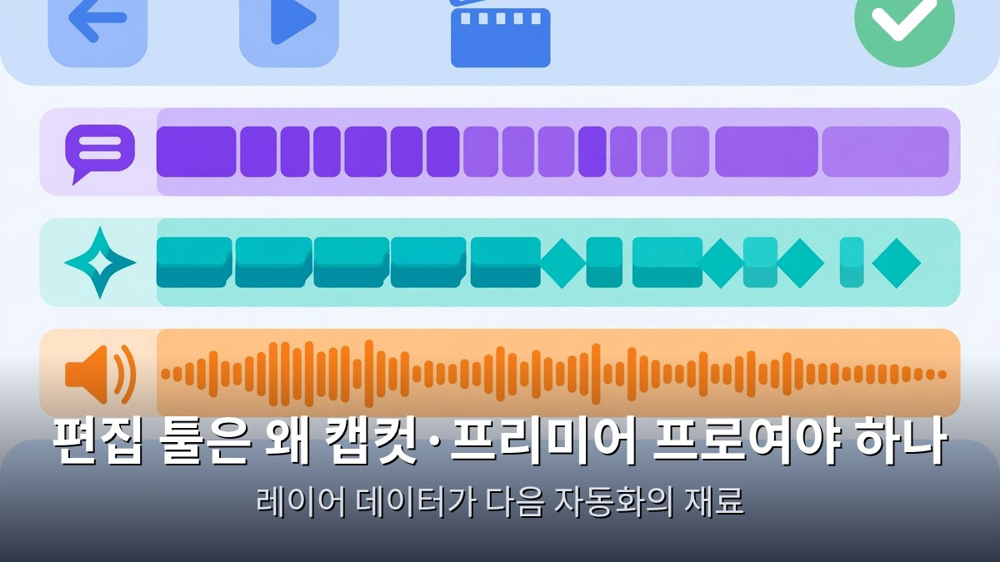
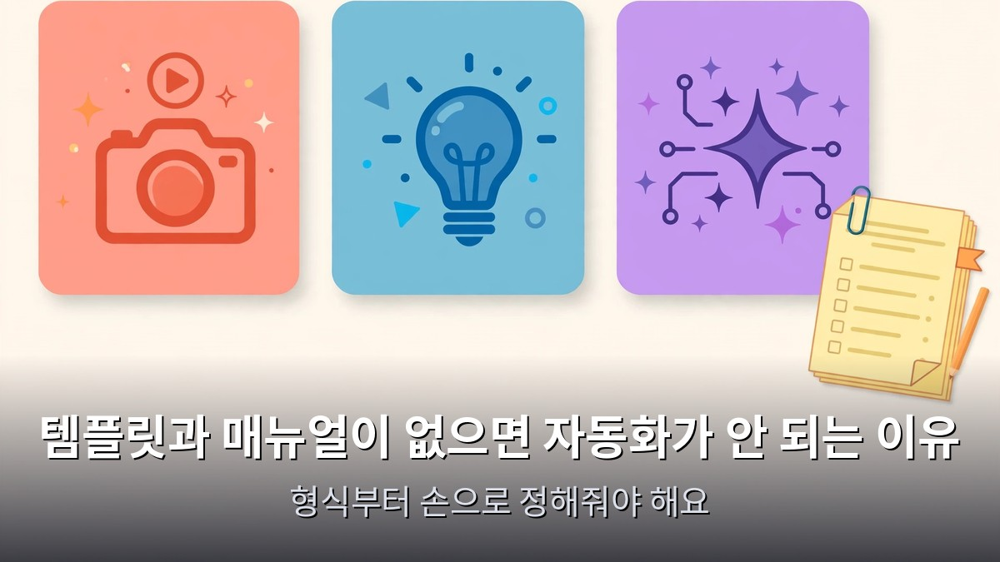

<!-- 본문 시작 -->

영상 편집은 기획부터 촬영, 편집까지 공수가 많이 드는 일이다.
그런데 그 과정을 클로드 코드에 맡겨 자동으로 돌릴 수 있다면 어떨까.
이 글은 신영선의 AI탐구 영상(2026-11-13, 11분 3초, 자막 0:00~10:59 전체 확인)을 바탕으로, 클로드 코드로 영상 편집을 자동화하는 2편의 핵심을 정리한 자료 기반 안내다.
1편을 본 사람, 영상 콘텐츠를 반복해서 만들어야 하는 1인 크리에이터·마케터가 읽으면 된다.

> **핵심은 하나다. 영상 편집 자동화는 AI가 알아서 해주는 마법이 아니다. 검증된 편집 도구(캡컷·프리미어 프로) + 포맷별 템플릿 + 편집 업무 매뉴얼, 이 세 가지 기준을 먼저 만들어두면 AI가 그 기준대로 돌아간다. 기준이 자동화의 전부다.**

같은 채널의 자동화 방식이 궁금하면 [클로드 코드 인스타 카드뉴스 자동화](https://blog.naver.com/3700708/224474066475)에서 레퍼런스 수집부터 카드뉴스 제작까지 이어지는 흐름을 먼저 보는 것도 좋다.

이 영상은 1편의 후속 2편이다.
1편이 큰 반응을 얻어 문의가 쏟아졌고, 못다 한 이야기를 급하게 추가로 다룬 에피소드다.
그래서 1편을 먼저 보고 오는 것이 전제다.
1편에서 안내한 오픈소스 세 가지 설치와 편집 효과 구현을 돕는 도구 설치가 먼저다.
그다음이 2편의 순서다.

## 편집 툴은 왜 캡컷·프리미어 프로여야 하나?

첫 번째로 알아야 될 건 편집 툴이다.
캡컷이나 프리미어 프로를 써야 한다.
다른 편집 도구를 쓰는 사람이 있는데, 영상에서는 "제발 그러지 마세요"라고까지 말한다.
이유는 분명하다.
클로드 코드가 캡컷이나 프리미어 프로로 편집을 하면, 자막과 컷별로 들어가야 하는 모션, 효과음 같은 레이어 데이터가 쌓인다.
이런 원천 소스가 많을수록 클로드가 참고할 수 있는 자료가 다양해지고 많아지고 정확해진다.
편집 도구 자체가 만드는 레이어·효과·자료 데이터가, 다음 영상을 만드는 자동화의 재료가 된다.
검증된 도구를 쓰는 이유가 여기에 있다.

영상 제작자의 팀은 한 달에 릴스·캐러셀 발행량이 50개에 이른다.
주변을 봐도 결국 다 이런 방식으로 귀결된다는 것이 영상의 설명이다.
좋은 도구가 더 있을 수도 있지만, 검증된 것을 쓰는 것이 자동화의 출발점이다.

## 템플릿과 매뉴얼이 없으면 자동화가 안 되는 이유

두 번째는 영상 포맷별 템플릿이다.
AI가 다 알아서 해줄 것 같지만, 가운데 있는 AI(클로드)가 일하려면 기준이 필요하다.
영상은 종류가 너무 다양하다.
브이로그가 있을 수 있고, 정보를 전달하는 영상이 있을 수 있고, 100% AI로 만든 영상일 수도 있다.
내가 취급하는 그 영상마다 템플릿이 있어야 한다.
템플릿이 기준이 되고, 이 기준대로 일할 수 있게 업무 매뉴얼을 만들어주면 AI가 기준과 매뉴얼을 참고해서 스스로 돌아가는 순간, 그게 자동화다.

세 번째는 편집 업무 매뉴얼이다.
기준에 맞는 편집 방식이 설명된 문서가 있어야 한다.
마크다운 파일도 되고, 노션도 된다.
형식은 자유롭다.
이 매뉴얼이 있어야 AI가 참고할 수 있는 명확한 기준이 생긴다.

네 번째는 스킬로 남기는 것이다.
이렇게 만든 영상을 만드는 방법을 클로드 코드 스킬로 남겨두면, 나중에는 구글 드라이브에 영상만 올려놓고 클로드 코드의 루틴 기능을 활용해 1시간 또는 2시간마다 폴더를 알아서 체크하게 할 수 있다.
스킬을 남겨두는 방식은 [클로드로 코딩 배우는 법](https://blog.naver.com/3700708/224477517696)에서 두 역할 지침을 저장해 다음 대화부터 바로 시작하는 순서와 같은 원리다.
영상을 올려놓는 순간 알아서 편집이 돌아가는 구조다.
업로드까지 세팅하면 무한루프로 돌릴 수도 있다.
그리고 영상 안에 있는 스크립트를 가지고 쓰레드나 블로그 같은 텍스트 마케팅 요소로도 파생할 수 있다.

## 실제로 어떻게 돌리는가 — 34초 영상, 40분

시작 순서는 이렇다.
먼저 클로드 코드 화면을 연다.
1편에서 안내한 오픈소스 세 가지와 편집 효과 구현을 돕는 도구들을 설치한다.
그다음 내 영상을 구글 드라이브에 하나 올려놓는다.
핸드폰이나 오디오로 촬영한 영상 그대로면 된다.
그 드라이브 폴더를 클로드에게 참고해서 영상 편집을 진행해보자고 요청한다.
이때 영상 이름을 지정해준다.

영상에서는 실제 테스트 장면도 보여준다.
포맷이 안 맞는 영상이라 걱정이 됐지만, 클로드가 알아서 해줬다.
진행 상황을 보면 60%까지 작업했다고 하고, 구글 드라이브에서 원본 영상을 가져와 받아쓰기로 스크립트를 확보하고, 반복되는 말은 잘라내고, 업무 매뉴얼 번호를 참고해 정리하면서 편집을 한다.
34초짜리 영상이 만들어지는 데 편집 시간은 약 40분이 걸렸다.

여기서 한 가지 주의할 점이 있다.
템플릿에 맞는 영상이 없으면 적합한 영상이 만들어질 가능성이 낮다.
영상에서는 첫 번째·두 번째·세 번째로 예시로 보였던 영상에 맞는 영상이 없어서, 테스트용 영상을 복사해 드라이브에 넣어 진행했다고 솔직하게 말한다.
기준이 없으면 결과도 기준이 없다.

영상에서는 AI가 만든 다른 결과물도 보여준다.
하루 69번, 회사 AI 브라우저가 정해둔 시간에 알아서 일한 횟수다.
코딩을 하나도 몰라도 말 한마디로 내 컴퓨터에 웹페이지를 만드는 예시도 있다.
체크리스트를 코덱스가 혼자 만들었다.
주식 분석 웹사이트와 부동산 갭투자 자동화 웹사이트 템플릿도 있다.
종목 분석부터 차트 분석까지 AI가 인사이트를 주고, 지역 분석과 전세가율 같은 것을 종합해 보여주는 웹사이트다.
이런 템플릿을 만들어놓으면, 채널에 올리는 영상들이 전부 자동화된 방식으로 만들어진다.
캡컷으로 해야 자막·효과·비주얼이 일관되게 균일하게 적용되고, 다른 영상을 만들 때도 비슷한 톤과 매너의 영상이 계속 나온다.

영상 속 자동화의 범위를 정확히 짚어둘 필요가 있다.
"100% 영상 제작 자동화"라는 제목 표현이 있지만, 영상에서 보여준 것은 편집 과정의 자동화다.
내보내고 업로드까지 세팅하면 무한루프로 돌릴 수 있다는 것은 구상이고, 아직 손이 가는 부분이 남아 있다.
자동화가 된다고 해서 사람의 검수가 사라지는 것은 아니다.

**이 글에서만 얻는 것: 영상 편집 자동화의 핵심은 '도구+템플릿+매뉴얼+스킬'이라는 네 가지 기준을 만드는 순서다. 34초 영상에 40분이 걸렸다는 실제 소요 시간과, 템플릿이 없으면 적합한 영상이 나오기 어렵다는 한계까지 영상 자막 전체(0:00~10:59)를 따라가며 정리했다. 기준을 만드는 시간이 자동화의 본체다.**

## 자주 묻는 질문

**1편을 안 보고 2편부터 봐도 되나요?**
권하지 않는다.
영상에서도 1편을 먼저 보라고 거듭 말한다.
오픈소스 설치와 도구 준비가 1편에 있기 때문이다.

**캡컷 말고 다른 편집 도구는 안 되나요?**
영상에서는 캡컷이나 프리미어 프로를 쓰라고 한다.
클로드가 이 도구들로 편집하면서 쌓는 레이어 데이터가 다음 자동화의 재료가 되기 때문이다.

**정말 100% 자동으로 영상이 만들어지나요?**
영상에서 보여준 것은 편집 과정의 자동화다.
34초 영상 편집에 약 40분이 걸렸고, 내보내기·업로드까지 세팅하면 무한루프로 돌릴 수 있다는 구상까지 제시됐다.
사람의 검수와 세팅은 여전히 필요하다.

**템플릿은 어떻게 만드나요?**
내가 만드는 영상 종류마다 기준이 되는 영상을 하나 정하고, 그 영상의 편집 방식을 매뉴얼로 정리한다.
마크다운 파일이나 노션이면 된다.

**얼마나 걸리나요?**
영상 속 테스트에서는 34초짜리 영상 편집에 약 40분이 걸렸다.
템플릿과 매뉴얼이 갖춰지면 그다음부터는 빨라지는 구조다.

## 함께 읽으면 좋은 글
[클로드 코드 인스타 카드뉴스 자동화｜레퍼런스부터 제작까지](https://blog.naver.com/3700708/224474066475)
[클로드로 코딩 배우는 법｜두 역할 코딩으로 배우는 순서](https://blog.naver.com/3700708/224477517696)
[바이브코딩 웹사이트 티어표｜1티어 4곳, 클로드에 시키는 법](https://blog.naver.com/3700708/224475162723)

자동화라는 말이, 손을 놓고 기다리는 일인 줄 알았다.
이 영상을 보고 나니 자동화는 기준을 만드는 일이었다.
템플릿 하나, 매뉴얼 한 장이 먼저다.
그 기준이 있어야 AI가 내 대신 돌아간다.
오늘은 내가 반복하는 영상 종류 하나를 정해, 그 기준이 될 영상을 골라보는 것부터 시작하면 된다.

<!-- 본문 끝 -->

## 작업용 출처·이미지 정보 (업로드 제외)

신영선 영상 X1jGARiC7RY(2026-11-13, 11분 03초, 자막 0:00~10:59 전체 확인) — 2편 후속, 편집 툴은 캡컷·프리미어 프로여야 함(레이어 데이터가 다음 자동화 재료), 형식별 템플릿+작업 매뉴얼(MD/노션)+스킬 저장, 1~2시간마다 드라이브 폴더 순회, 시작 순서(1편 3개 오픈소스 설치→드라이브 업로드→영상 이름으로 편집 요청), 시험 34초 영상 약 40분, '100% 자동화' 제목 과장 지적(편집 과정 자동화 범위, 내보내기·업로드는 계획 단계)
