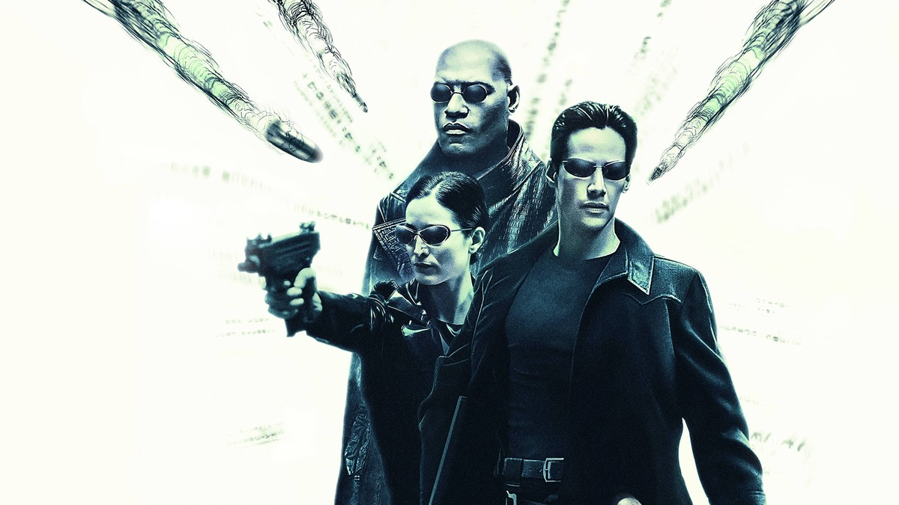
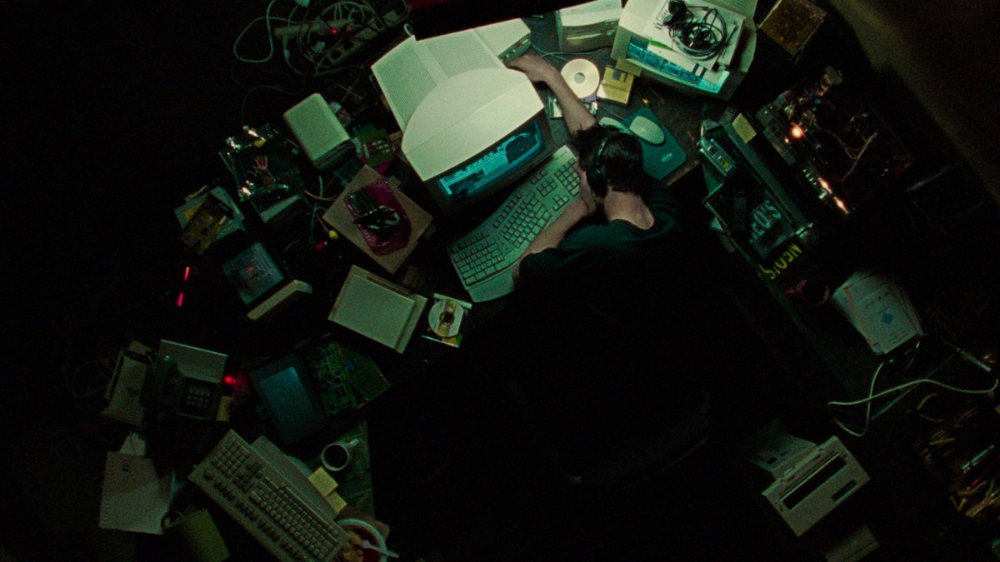
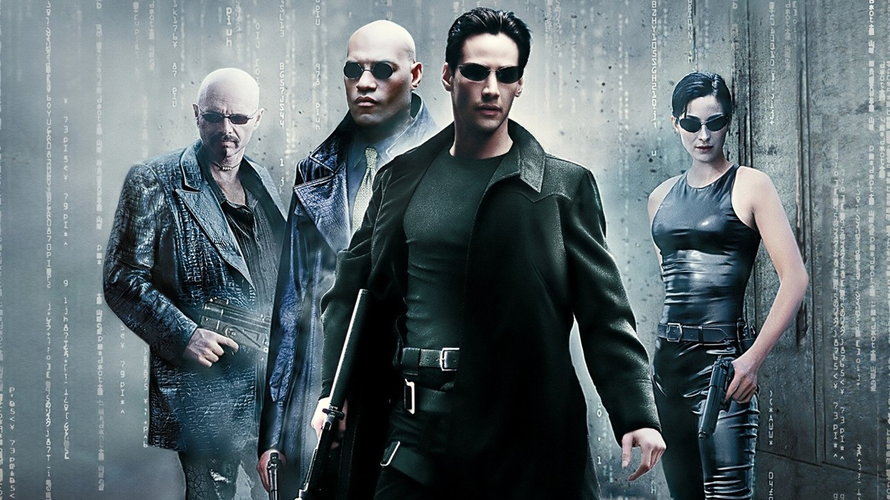
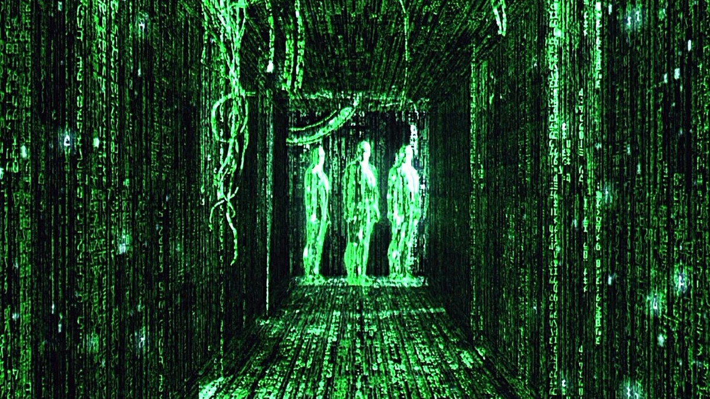
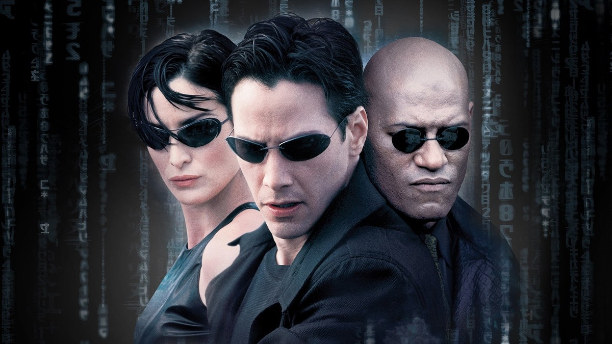
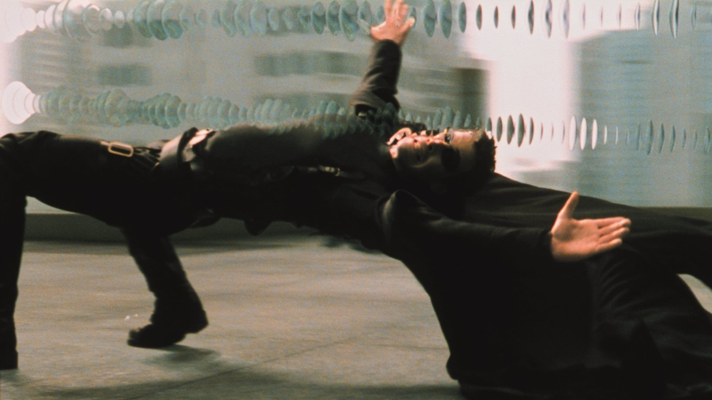
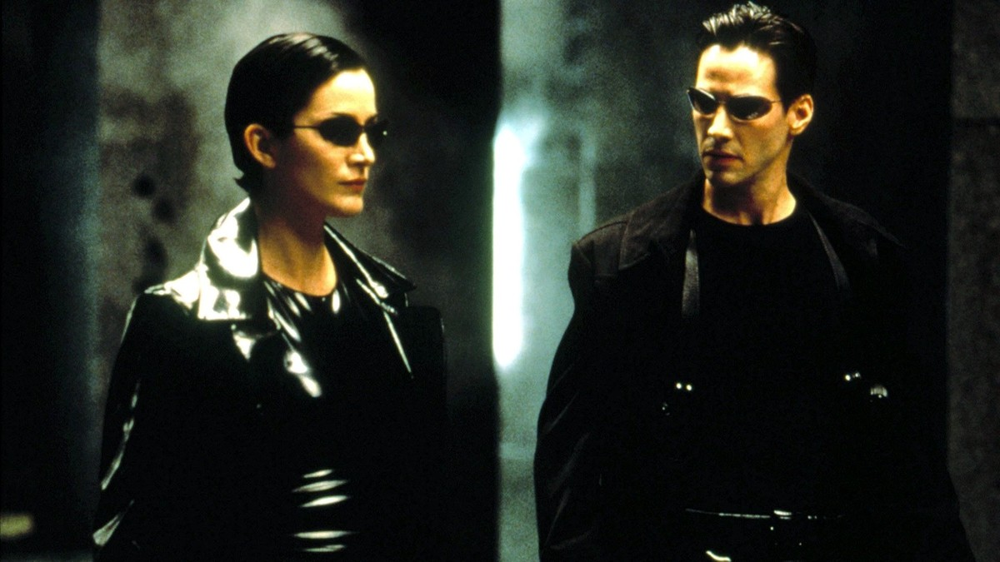
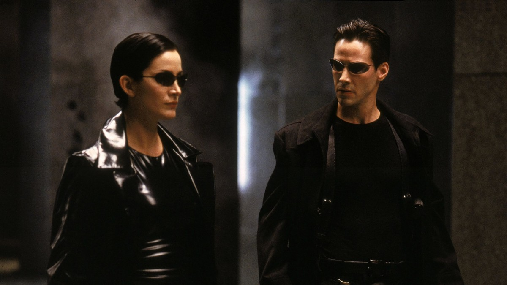

<!-- 본문 시작 -->

The year 2199. Humanity is farmed by an artificial intelligence.
In a world where even human memory is written and erased by AI, the Matrix is a virtual reality more real than real.

> **The point is simple. The Matrix is not a film about fighting in virtual reality. It is a film that pushes one question all the way, with action faster than bullets: "Is the world I live in real?" The moment ordinary office worker Anderson becomes the hacker Neo, and Neo chooses between two pills, is the whole of this film.**

If you want more films about the line between humans and machines, [Blade Runner 2049's line between human and replicant](https://aitechnotesen.blogspot.com/2026/11/blade-runner-2049-line-between-human.html) is a good place to start.

| Item | Details |
| --- | --- |
| Title | The Matrix |
| Released | 1999 (US March 31, 1999 · South Korea May 15, 1999) |
| Director | Lana Wachowski, Lilly Wachowski |
| Screenplay | Lana Wachowski, Lilly Wachowski |
| Main cast | Keanu Reeves (Neo / Thomas Anderson), Laurence Fishburne (Morpheus), Carrie-Anne Moss (Trinity), Hugo Weaving (Agent Smith), Gloria Foster (the Oracle) |
| Runtime | 2 hours 16 minutes (136 minutes) |
| Rating | Ages 12 and up (Korea) |
| Score | TMDB 8.263/10 (29,255 votes, checked 2026-11-16) · IMDb 8.7 · Rotten Tomatoes 83% · 4 Academy Awards (Film Editing, Sound, Sound Effects Editing, Visual Effects, 2000) |
| Where to watch | Watcha subscription HD · Rental: Wavve 1,320 KRW HD · Purchase: Wavve 4,950 KRW HD (JustWatch Korea, checked 2026-11-14) |

## The story, without spoilers
Thomas Anderson is an ordinary office worker by day and a hacker by night.
He cannot shake the feeling that something is wrong with the world.
One day, people in black suits come for him.
One of them, a man named Morpheus, says to Anderson: "If you want to wake up from the Matrix, follow me."

Morpheus holds out two pills.
Take the blue pill, and you wake up in your bed, and everything goes back to how it was.
Take the red pill, and you learn what the truth is — but there is no going back.
Anderson takes the red pill.
From that moment he is Neo, and the world looks completely different.

The world Neo sees is this.
Humans are grown as an energy source in vast artificial wombs.
The everyday life of 1999 that humans believe they live is a virtual reality fed straight into the brain.
Machines write and erase human memory, and humans live a life more real than real inside it.
Morpheus and a handful of companions wander the ruins of the real world, searching for the last hero who can save humanity.
And they believe that hero may be Neo.

"If reality is fake, then who am I?"
That question carries the film to the end.

## The film in scenes 1 — The hacker's room
The film starts in Neo's room.
Seen from above, a computer and a telephone sit on the desk.
A hacker's room, staring at a screen all night — that was all Neo had.
That is also why Morpheus came for him.
Neo had already felt the cracks in the Matrix, and that feeling found him.

Neo's computer and telephone, seen from above. The room of an ordinary office worker who lived as a hacker at night.

## The film in scenes 2 — The trio in black coats on a rainy street
The question of a mind inside a machine continues in [Ex Machina's Turing test](https://aitechnotesen.blogspot.com/2026/11/ex-machina-108-minutes-asking-robot-if.html).

Three people in black coats walk down a rainy street.
Trinity, Morpheus, Neo.
The black coats in this film are not just costumes.
They are like a border between reality and virtuality, humans and machines.
The three walking side by side is a composition the film keeps to the end.
One has seen the truth, one is looking for it, and one has only just faced it.

The trio in black coats walking down a rainy street. The street view of the Matrix.

The first part of the film is built on these three meeting.
Trinity finds Neo, Morpheus offers him a choice.
Agent Smith tries to stop that choice.
An Agent is a program that guards the Matrix — it looks human, but it is not.
What it chases is not one man, Neo, but the possibility Neo represents.

A corridor full of green Matrix code. Two figures stand as silhouettes inside the code.

The world inside the Matrix is made of code.
Green numbers and letters raining down — this is the film's most famous image.
Two figures walk down the corridor, small against the code flowing endlessly behind them.
That the world believed to be real is in fact a line of code — that realization is this film's horror and its charm.

## The film in scenes 3 — Bullet time, the moment he dodges the bullets

A close-up of the trio in sunglasses, against a code background. Three faces, one question.

The rooftop scene in the middle of the film is a moment that changed cinema.
Neo leans back and dodges the bullets.
Time slows, and the camera circles Neo, showing the path of each bullet.
This is "bullet time."
It is not action about dodging bullets — it is direction that handles time itself.
With this one scene, the Matrix went beyond a science-fiction action film and became a landmark of film technique.

The bullet-time scene on the rooftop — Neo leaning back to dodge the bullets. The moment that changed film history.

This scene matters for more than technique.
Neo starts breaking the rules of the Matrix.
Bullets were something you could not dodge, but Neo doubts that rule.
The moment you doubt a rule, the rule starts to fall apart.
So the action in this film is not mere spectacle.
It is the process of Neo breaking the rules of reality, one by one.

## The AI questions this film asks
First, if reality is fake, how would you know?
The world Neo lived in was perfect.
No pain, no hunger, nothing strange.
And yet Neo felt something was wrong.
Between a perfect fake and an imperfect truth, what makes reality real?

Second, what does it mean for machines to farm humans?
The machines in this film do not kill humans.
They grow humans, let them dream, and draw energy from those dreams.
A world where machines treat humans not as enemies but as resources.
In that world, what do humans live for?

Third, who makes the choice?
Two pills lie before Neo: red and blue.
But what if the choice itself was already decided?
Morpheus believes Neo is "the One," but that belief may have fixed Neo's choice in advance.
Between free will and fate, whose choice is Neo's?
The film leaves the answer to the audience.

## Where to watch
As of November 14, 2026:
Streaming on Watcha subscription HD, rental on Wavve at 1,320 KRW HD, purchase on Wavve at 4,950 KRW HD.
There is no free streaming provider.
(JustWatch Korea — check each app directly before watching.)

Trinity and Neo standing side by side in black coats. A scene where you can see the trust between them.

In Korea it opened in theaters on May 15, 1999.
It was made for $63 million and earned about $463.5 million worldwide.
At the 2000 Academy Awards it swept four categories: Film Editing, Sound, Sound Effects Editing, and Visual Effects.
In Korea it was re-released in 2016, 2019, 2021, and 2024 — a film loved for a long time.

A close-up of Trinity and Neo, standing side by side.

A checklist before you watch:
Set aside 2 hours 16 minutes to watch it in one sitting.
It is rated ages 12 and up, so keep in mind it has action and violence.

## Closing thoughts
Choosing the red pill means giving up a comfortable lie.
Neo made that choice, and after it there was no going back.
But only after that choice did Neo start living his own life.

## Frequently asked questions
**Where can I watch it?**
As of November 14, 2026: Watcha subscription HD, Wavve rental 1,320 KRW and purchase 4,950 KRW HD.
Check each app directly before watching.

**Can children watch it?**
It is rated ages 12 and up.
It has action and violence, so it may not suit young viewers.

**What do the red pill and the blue pill mean?**
The blue pill is the choice to return to ordinary life; the red pill is the choice to see the truth and never go back.
Neo chooses the red pill.

**How was bullet time filmed?**
Dozens of cameras circled Neo, and their footage was joined together so time looks slowed.
That one scene became a landmark of film technique.

**Why watch it again now?**
Now that AI-made virtual realities and simulation debates have become real, the question this 1999 film asked — "If reality is fake, how would you know?" — continues unchanged.

## Good Reads Together
[Blade Runner 2049 — The Line Between Human and Replicant, in 2 Hours 44 Minutes](https://aitechnotesen.blogspot.com/2026/11/blade-runner-2049-line-between-human.html)
[Ex Machina — 108 Minutes Asking a Robot If It Has a Mind](https://aitechnotesen.blogspot.com/2026/11/ex-machina-108-minutes-asking-robot-if.html)
[Gemini 4 Hydrogen Is Here｜A $1.50 Fast Model — How It Differs from Carbon and Flash](https://aitechnotesen.blogspot.com/2026/11/gemini-4-hydrogen-is-herea-150-fast.html)

Choosing the red pill means giving up a comfortable lie.
Only after Neo made that choice did the story truly begin.
If the world I live in is code, which pill would I choose?
That one question carries all 136 minutes to the end.

<!-- 본문 끝 -->

## 작업용 출처·이미지 정보 (업로드 제외)

매트릭스 (The Matrix, 1999, TMDB 603) — TMDB 한국 페이지 2026-11-16 확인 (감독 라나·릴리 워쇼스키, 136분, 12세, TMDB 8.263/10·29,255개 평가, 국내 개봉 1999-05-15, 국내 재개봉 2016/2019/2021/2024, 제작비 6,300만 달러·흥행 약 4억 6,350만 달러, 아카데미 4관왕) + JustWatch 한국 2026-11-14 기준 시청처 (왓챠 정액제 HD·웨이브 대여 1,320원·구매 4,950원 HD, 무료 제공처 없음) + TMDB 스틸 9장+포스터 (결말 장면 제외; 포스터는 20주년 재개봉 문구·세로형이라 히어로 부적합 → 히어로는 tlm8 트리오 홍보 아트, 포스터는 stills_raw에만 보관)
