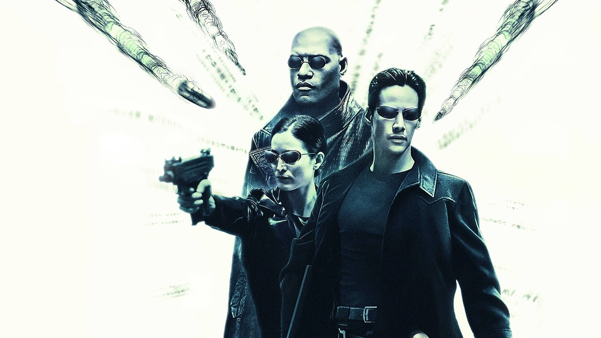
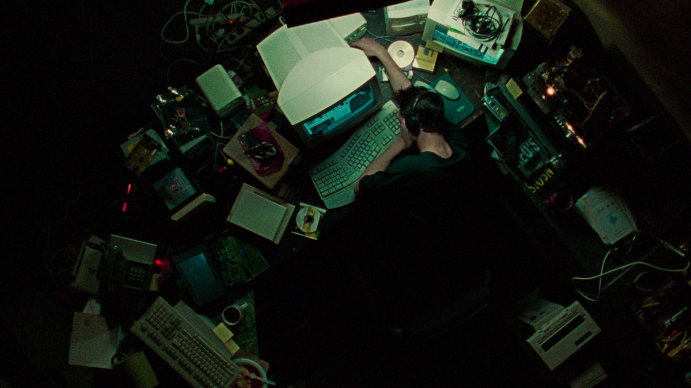
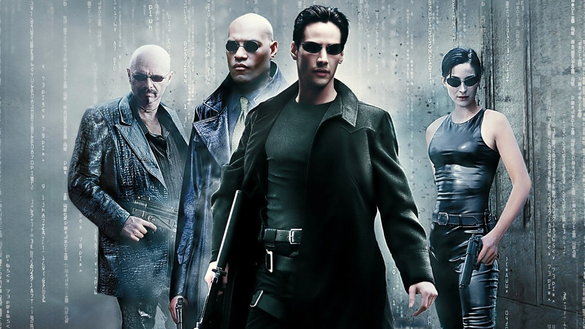
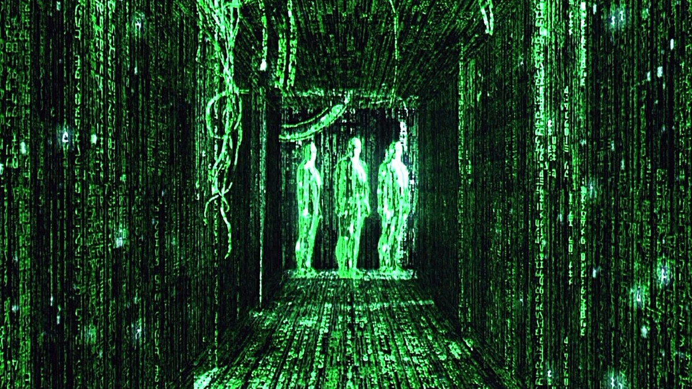
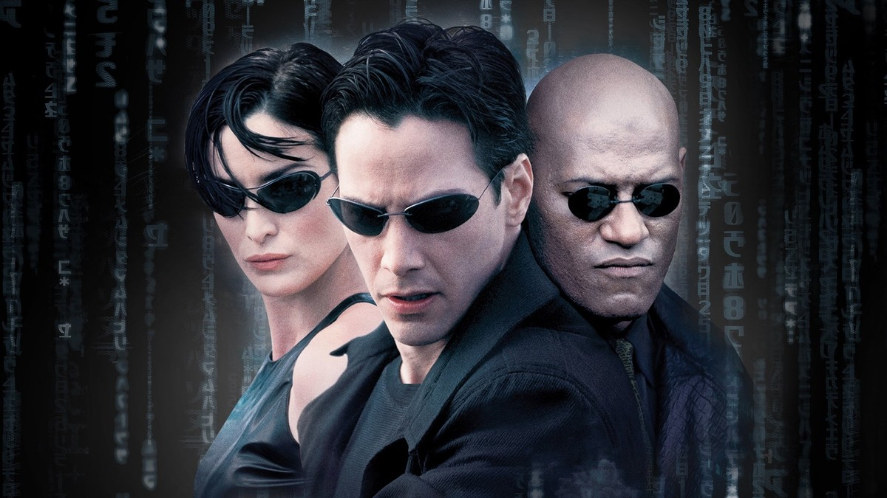
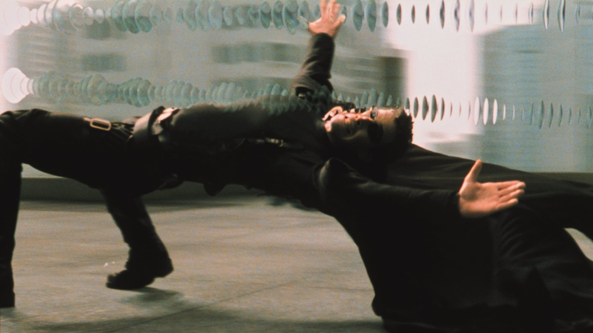

<!-- 본문 시작 -->

서기 2199년, 인공지능 AI에 의해 인류가 재배되고 있다.
인간의 기억마저 AI에 의해 입력되고 삭제되는 세상, 진짜보다 더 진짜 같은 가상 현실 매트릭스.

> **핵심은 하나다. 매트릭스는 가상 현실에서 싸우는 영화가 아니다. "지금 내가 사는 세상이 진짜인가"라는 질문을, 총알보다 빠른 액션으로 끝까지 끌고 가는 영화다. 평범한 회사원 앤더슨이 해커 네오가 되고, 네오가 두 개의 알약 중 하나를 고르는 순간이 이 영화의 전부다.**

인간과 기계의 경계를 묻는 영화가 더 궁금하면 [블레이드 러너 2049의 인간과 리플리컨트 경계](https://blog.naver.com/3700708/224474068089)를 먼저 보는 것도 좋다.

| 항목 | 내용 |
| --- | --- |
| 제목 | 매트릭스 (The Matrix) |
| 개봉 | 1999년 (미국 1999-03-31 · 한국 극장 개봉 1999-05-15) |
| 감독 | 라나 워쇼스키, 릴리 워쇼스키 |
| 각본 | 라나 워쇼스키, 릴리 워쇼스키 |
| 주요 출연 | 키아누 리브스(네오/토머스 앤더슨), 로렌스 피시번(모피어스), 캐리앤 모스(트리니티), 휴고 위빙(스미스 요원), 글로리아 포스터(오라클) |
| 러닝타임 | 2시간 16분 (136분) |
| 등급 | 12세 이상 관람가 |
| 평점 | TMDB 8.263/10 (29,255개 평가, 2026-11-16 확인) · IMDb 8.7 · 로튼토마토 83% · 제72회 아카데미 4관왕(편집·음향·음향편집·시각효과) |
| 시청처 | 왓챠 정액제 HD 스트리밍 · 대여 웨이브 1,320원 HD · 구매 웨이브 4,950원 HD (JustWatch 한국, 2026-11-14 확인) |

## 스포일러 없는 줄거리
낮에는 평범한 회사원, 밤에는 해커로 사는 청년 토머스 앤더슨.
그는 세상에 뭔가 잘못됐다는 느낌을 지울 수 없다.
어느 날, 검은 옷을 입은 사람들이 그를 찾아온다.
그중 모피어스라는 남자는 앤더슨에게 말한다.
"매트릭스에서 깨어나고 싶다면, 나를 따라오라."

모피어스는 앤더슨에게 두 개의 알약을 내민다.
파란 알약을 먹으면, 눈을 뜨면 침대에서 깨어나고 모든 것은 원래대로 돌아간다.
빨간 알약을 먹으면, 진실이 무엇인지 알게 되지만 돌아갈 수 없다.
앤더슨은 빨간 알약을 고른다.
그 순간부터 그는 네오가 되고, 세상은 완전히 다르게 보인다.

네오가 본 세상은 이렇다.
인간은 기계가 키우는 에너지 자원으로, 거대한 인공 자궁 속에서 재배되고 있다.
인간이 살고 있다고 믿는 1999년의 일상은, 뇌에 직접 입력되는 가상 현실이다.
기계는 인간의 기억을 입력하고 삭제하며, 인간은 그 안에서 진짜보다 더 진짜 같은 삶을 산다.
모피어스와 몇 안 되는 동료들은 폐허가 된 현실 세계를 떠돌며, 인류를 구할 마지막 영웅을 찾고 있다.
그리고 그 영웅이 네오일지도 모른다고 믿는다.

"현실이 가짜라면, 나는 누구인가."
그 질문이 영화를 끝까지 끌고 간다.

## 장면으로 보는 작품 1 — 해커 네오의 방
영화는 네오의 방에서 시작한다.
위에서 내려다본 책상 위에는 컴퓨터와 전화기가 놓여 있다.
밤새도록 화면을 들여다보는 해커의 방, 그게 네오의 전부였다.
모피어스가 네오를 찾아온 이유도 여기에 있다.
네오는 이미 매트릭스의 틈을 느끼고 있었고, 그 느낌이 그를 찾아낸 것이다.

위에서 내려다본 네오의 컴퓨터와 전화기. 해커로 살던 평범한 회사원의 방이다.

## 장면으로 보는 작품 2 — 비 오는 거리, 검은 코트의 트리오
기계에게 마음을 묻는 질문은 [엑스 마키나의 튜링 테스트](https://blog.naver.com/3700708/224474081075)에서도 이어진다.

비 오는 거리에서 검은 코트를 입은 세 사람이 걷는다.
트리니티, 모피어스, 네오.
이 영화의 검은 코트는 단순한 의상이 아니다.
현실과 가상, 인간과 기계를 가르는 경계선 같은 옷이다.
세 사람이 나란히 걷는 장면은, 이 영화가 끝까지 지키는 구도다.
한 사람은 진실을 봤고, 한 사람은 진실을 찾고, 한 사람은 진실을 이제 막 마주했다.

비 오는 거리에서 검은 코트를 입고 걷는 트리오. 매트릭스의 거리 풍경이다.

영화의 초반부는 이 세 사람의 만남으로 채워진다.
트리니티는 네오를 찾아오고, 모피어스는 네오에게 선택을 건넨다.
스미스 요원은 그 선택을 막으려고 한다.
요원은 매트릭스를 지키는 프로그램으로, 인간의 모습을 하고 있지만 인간이 아니다.
그가 쫓는 것은 네오 한 사람이 아니라, 네오가 대표하는 가능성이다.

녹색 매트릭스 코드로 가득한 복도. 두 인물의 실루엣이 코드 속에 서 있다.

매트릭스 안의 세계는 코드로 이루어져 있다.
초록색 숫자와 문자가 비처럼 쏟아지는 이 풍경이, 영화의 가장 유명한 이미지다.
복도를 걷는 두 사람의 실루엣은 작아 보이지만, 그 뒤에 흐르는 코드는 끝이 없다.
현실이라고 믿었던 세상이 사실은 코드 한 줄이라는 것, 그 깨달음이 이 영화의 공포이자 매력이다.

## 장면으로 보는 작품 3 — 불릿 타임, 총알을 피하는 순간

선글라스를 낀 트리오 클로즈업. 코드 배경 앞에 선 세 사람의 얼굴이다.

영화 중반의 옥상 장면은 영화사를 바꾼 순간이다.
네오가 뒤로 젖히며 총알을 피한다.
시간은 느려지고, 카메라는 네오를 빙글 돌며 총알의 궤적을 보여준다.
이른바 '불릿 타임'이다.
총알을 피하는 액션이 아니라, 시간을 다루는 연출이다.
이 장면 하나로 매트릭스는 단순한 SF 액션을 넘어, 영화 기술의 이정표가 됐다.

옥상에서 네오가 뒤로 젖히며 총알을 피하는 '불릿 타임' 장면. 영화사를 바꾼 순간이다.

이 장면이 중요한 이유는 기술 때문만은 아니다.
네오는 매트릭스의 규칙을 어기기 시작한다.
총알은 피할 수 없는 것이었는데, 네오는 그 규칙을 의심한다.
규칙을 의심하는 순간, 규칙은 무너지기 시작한다.
이 영화의 액션은 그래서 단순한 볼거리가 아니다.
네오가 현실의 규칙을 하나씩 깨는 과정이다.

## 이 작품이 던지는 AI 질문
첫째, 현실이 가짜라면 어떻게 알 수 있는가.
네오가 살던 세상은 완벽했다.
아프지도, 배고프지도, 이상하지도 않았다.
그런데도 네오는 뭔가 잘못됐다고 느꼈다.
완벽한 가짜와 불완전한 진짜 사이에서, 무엇이 현실을 현실답게 만드는가.

둘째, 기계가 인간을 키운다는 것은 무슨 뜻인가.
이 영화의 기계는 인간을 죽이지 않는다.
인간을 재배하고, 꿈을 꾸게 하고, 그 꿈에서 에너지를 얻는다.
인간을 적으로 삼는 대신, 인간을 자원으로 삼는 기계의 세계다.
그 세계에서 인간은 무엇을 위해 사는가.

셋째, 선택은 누가 하는 것인가.
빨간 알약과 파란 알약, 두 가지 선택지가 네오 앞에 놓인다.
그런데 그 선택 자체가 정해진 것이었다면 어떻게 되는가.
모피어스는 네오가 '구원자'라고 믿지만, 그 믿음은 네오의 선택을 미리 정해놓은 것일 수도 있다.
자유의지와 운명 사이에서, 네오의 선택은 누구의 것인가.
영화는 답을 관객에게 남긴다.

## 어디서 보는지
2026년 11월 14일 기준으로 정리한다.
왓챠 정액제 HD로 스트리밍할 수 있고, 웨이브에서 대여 1,320원 HD·구매 4,950원 HD로 볼 수 있다.
무료 시청 제공처는 없다.
(JustWatch 한국 확인 기준 — 보기 전 앱에서 직접 재확인 권장.)

검은 코트 차림의 트리니티와 네오가 나란히 서 있는 모습. 두 사람의 신뢰가 보이는 장면이다.

한국에서는 1999년 5월 15일 극장에서 개봉했다.
제작비 6,300만 달러에 전 세계 흥행 약 4억 6,350만 달러를 거둔 작품이다.
2000년 아카데미 시상식에서 편집·음향·음향편집·시각효과 4개 부문을 휩쓸었다.
국내에서는 2016년, 2019년, 2021년, 2024년에도 재개봉했을 만큼 오래 사랑받는 작품이다.

트리니티와 네오의 클로즈업. 나란히 서 있는 두 사람의 모습이다.

시청 전 체크리스트도 있다.
러닝타임 2시간 16분이라 한 번에 볼 시간을 잡으면 된다.
등급은 12세 이상 관람가라, 액션과 폭력 장면이 있다는 점을 염두에 두는 게 좋다.

## 마무리
빨간 알약을 고른다는 건, 편안한 거짓을 버리는 일이다.
네오는 그 선택을 했고, 그 뒤로는 돌아갈 수 없었다.
그런데 그 선택을 한 뒤에야 비로소, 네오는 자기 삶을 살기 시작했다.

## 자주 묻는 질문
**어디서 볼 수 있나요?**
2026년 11월 14일 기준으로 왓챠 정액제 HD 스트리밍, 웨이브 대여 1,320원·구매 4,950원 HD로 볼 수 있다.
보기 전 앱에서 직접 재확인하는 것이 좋다.

**아이도 볼 수 있나요?**
12세 이상 관람가다.
액션과 폭력 장면이 있어 어린 시청자에게는 맞지 않을 수 있다.

**빨간 알약과 파란 알약은 무슨 뜻인가요?**
파란 알약은 원래 일상으로 돌아가는 선택, 빨간 알약은 진실을 보고 돌아갈 수 없게 되는 선택이다.
네오는 빨간 알약을 고른다.

**불릿 타임은 어떻게 찍었나요?**
네오를 빙글 돌며 찍은 수십 대의 카메라 영상을 이어붙여, 시간이 느려진 것처럼 보이게 만든 연출이다.
이 장면 하나로 영화 기술의 이정표가 됐다.

**왜 지금 다시 보는 영화인가요?**
AI가 만드는 가상 현실과 시뮬레이션 논쟁이 현실이 된 지금, 1999년 영화가 던진 "현실이 가짜라면 어떻게 아는가"라는 질문이 그대로 이어지기 때문이다.

## 함께 읽으면 좋은 글
[블레이드 러너 2049｜인간과 리플리컨트의 경계에 선 163분](https://blog.naver.com/3700708/224474068089)
[엑스 마키나｜로봇에게 마음을 묻는 108분, 튜링 테스트의 진짜 질문](https://blog.naver.com/3700708/224474081075)
[제미나이 4 하이드로젠｜빠른 코딩용 AI, 가격은 얼마인가](https://blog.naver.com/3700708/224476482321)

빨간 알약을 고른다는 건, 편안한 거짓을 버리는 일이다.
네오가 그 선택을 한 뒤에야, 이야기는 진짜로 시작됐다.
지금 사는 세상이 코드라면, 나는 어떤 알약을 고를까.
그 질문 하나가, 136분을 끝까지 끌고 간다.

<!-- 본문 끝 -->

## 작업용 출처·이미지 정보 (업로드 제외)

매트릭스 (The Matrix, 1999, TMDB 603) — TMDB 한국 페이지 2026-11-16 확인 (감독 라나·릴리 워쇼스키, 136분, 12세, TMDB 8.263/10·29,255개 평가, 국내 개봉 1999-05-15, 국내 재개봉 2016/2019/2021/2024, 제작비 6,300만 달러·흥행 약 4억 6,350만 달러, 아카데미 4관왕) + JustWatch 한국 2026-11-14 기준 시청처 (왓챠 정액제 HD·웨이브 대여 1,320원·구매 4,950원 HD, 무료 제공처 없음) + TMDB 스틸 9장+포스터 (결말 장면 제외; 포스터는 20주년 재개봉 문구·세로형이라 히어로 부적합 → 히어로는 tlm8 트리오 홍보 아트, 포스터는 stills_raw에만 보관)
