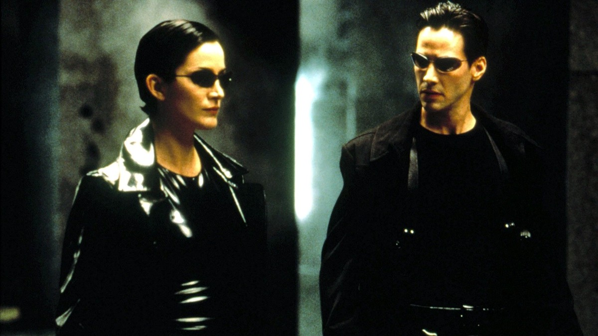
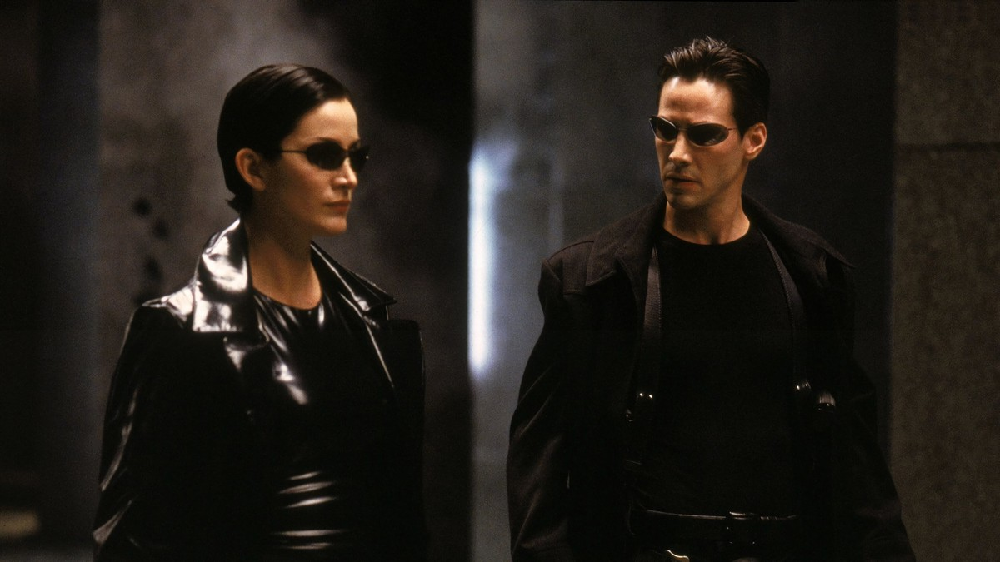

<!-- 본문 시작 -->


지금 사는 세상이 사실은 코드라면, 어떻게 알아챌 수 있을까요.
**매트릭스는 가상 현실에서 싸우는 영화가 아닙니다. '지금 내가 사는 세상이 진짜인가'라는 질문을 총알보다 빠른 액션으로 끝까지 끌고 가는 영화입니다.**
서기 2199년, 인공지능에 의해 인류가 재배되는 세상에서 평범한 회사원 앤더슨은 해커 네오가 되고, 두 개의 알약 중 하나를 고릅니다.

> **한 줄로 정리하면, 매트릭스는 가상 현실에서 싸우는 영화가 아닙니다. 평범한 회사원 앤더슨이 해커 네오가 되어 빨간 알약을 고르는 과정이 이 영화의 전부이고, 그 선택이 '지금 사는 세상이 진짜인가'라는 질문을 끝까지 끌고 갑니다.**

인간과 기계의 경계를 묻는 영화가 더 궁금하면 [블레이드 러너 2049의 인간과 리플리컨트 경계](https://blog.naver.com/3700708/224474068089)를 먼저 보는 것도 좋습니다.

```blog
type: table
rows:
  - [{text: "항목", header: true, style: {background: "#123456", color: "#FFFFFF"}, width: 18}, {text: "내용", header: true, style: {background: "#123456", color: "#FFFFFF"}, width: 82}]
  - [{text: "제목", width: 18}, {text: "매트릭스 (The Matrix)", width: 82}]
  - [{text: "개봉", width: 18}, {text: "1999년 (미국 1999-03-31 · 한국 극장 개봉 1999-05-15)", width: 82}]
  - [{text: "감독", width: 18}, {text: "라나 워쇼스키, 릴리 워쇼스키", width: 82}]
  - [{text: "각본", width: 18}, {text: "라나 워쇼스키, 릴리 워쇼스키", width: 82}]
  - [{text: "주요 출연", width: 18}, {text: "키아누 리브스(네오/토머스 앤더슨), 로렌스 피시번(모피어스), 캐리앤 모스(트리니티), 휴고 위빙(스미스 요원), 글로리아 포스터(오라클)", width: 82}]
  - [{text: "러닝타임", width: 18}, {text: "2시간 16분 (136분)", width: 82}]
  - [{text: "등급", width: 18}, {text: "12세 이상 관람가", width: 82}]
  - [{text: "평점", width: 18}, {text: "TMDB 8.263/10 (29,255개 평가, 2026-11-16 확인) · IMDb 8.7 · 로튼토마토 83% · 제72회 아카데미 4관왕(편집·음향·음향편집·시각효과)", width: 82}]
  - [{text: "시청처", width: 18}, {text: "왓챠 정액제 HD 스트리밍 · 대여 웨이브 1,320원 HD · 구매 웨이브 4,950원 HD (JustWatch 한국, 2026-11-14 확인)", width: 82}]
```

```blog
type: heading
level: 2
runs:
  - text: "스포일러 없는 줄거리"
    style: {bold: true, color: "#007aa6"}
```

**모피어스가 내민 두 개의 알약 중 빨간 알약을 고른 앤더슨은, 네오가 되어 세상의 진짜 모습을 봅니다.**

낮에는 평범한 회사원, 밤에는 해커로 사는 청년 토머스 앤더슨. 그는 세상에 뭔가 잘못됐다는 느낌을 지울 수 없습니다. 어느 날 검은 옷을 입은 사람들이 그를 찾아오고, 그중 모피어스라는 남자가 말합니다. "매트릭스에서 깨어나고 싶다면, 나를 따라오라."

모피어스는 앤더슨에게 두 개의 알약을 내밉니다. **파란 알약**을 먹으면 눈을 뜨면 침대에서 깨어나고 모든 것은 원래대로 돌아갑니다. **빨간 알약**을 먹으면 진실이 무엇인지 알게 되지만 돌아갈 수 없습니다. 앤더슨은 빨간 알약을 고릅니다. 그 순간부터 그는 네오가 되고, 세상은 완전히 다르게 보입니다.

네오가 본 세상은 이렇습니다. 인간은 기계가 키우는 에너지 자원으로, 거대한 인공 자궁 속에서 재배되고 있습니다. 인간이 살고 있다고 믿는 1999년의 일상은 뇌에 직접 입력되는 **가상 현실**입니다. 기계는 인간의 기억을 입력하고 삭제하며, 인간은 그 안에서 진짜보다 더 진짜 같은 삶을 삽니다.

모피어스와 몇 안 되는 동료들은 폐허가 된 현실 세계를 떠돌며 인류를 구할 마지막 영웅을 찾고 있습니다. 그리고 그 영웅이 네오일지도 모른다고 믿습니다.

"현실이 가짜라면, 나는 누구인가." 그 질문이 영화를 끝까지 끌고 갑니다.

```blog
type: heading
level: 2
runs:
  - text: "장면으로 보는 작품 1 — 해커 네오의 방"
    style: {bold: true, color: "#007aa6"}
```

**영화는 네오의 방에서 시작합니다. 밤새 화면을 들여다보는 해커의 방이, 네오의 전부입니다.**

위에서 내려다본 책상 위에는 컴퓨터와 전화기가 놓여 있습니다. 밤새도록 화면을 들여다보는 해커의 방, 그게 네오의 전부였습니다. 모피어스가 네오를 찾아온 이유도 여기에 있습니다. 네오는 이미 **매트릭스의 틈**을 느끼고 있었고, 그 느낌이 그를 찾아낸 것입니다.


위에서 내려다본 네오의 컴퓨터와 전화기. 해커로 살던 평범한 회사원의 방이다.

```blog
type: heading
level: 2
runs:
  - text: "장면으로 보는 작품 2 — 비 오는 거리, 검은 코트의 트리오"
    style: {bold: true, color: "#007aa6"}
```

**검은 코트 차림의 세 사람이 나란히 걷는 장면, 이 영화가 끝까지 지키는 구도입니다.**

기계에게 마음을 묻는 질문은 [엑스 마키나의 튜링 테스트](https://blog.naver.com/3700708/224474081075)에서도 이어집니다.

비 오는 거리에서 검은 코트를 입은 세 사람이 걷습니다. 트리니티, 모피어스, 네오. 이 영화의 검은 코트는 단순한 의상이 아닙니다. 현실과 가상, 인간과 기계를 가르는 **경계선 같은 옷**입니다. 세 사람이 나란히 걷는 장면은, 이 영화가 끝까지 지키는 구도입니다. 한 사람은 진실을 봤고, 한 사람은 진실을 찾고, 한 사람은 진실을 이제 막 마주했습니다.


비 오는 거리에서 검은 코트를 입고 걷는 트리오. 매트릭스의 거리 풍경이다.

영화의 초반부는 이 세 사람의 만남으로 채워집니다. 트리니티는 네오를 찾아오고, 모피어스는 네오에게 선택을 건넵니다. 스미스 요원은 그 선택을 막으려고 합니다. 요원은 매트릭스를 지키는 프로그램으로, 인간의 모습을 하고 있지만 인간이 아닙니다. 그가 쫓는 것은 네오 한 사람이 아니라, **네오가 대표하는 가능성**입니다.


녹색 매트릭스 코드로 가득한 복도. 두 인물의 실루엣이 코드 속에 서 있다.

매트릭스 안의 세계는 코드로 이루어져 있습니다. 초록색 숫자와 문자가 비처럼 쏟아지는 이 풍경이, 영화의 가장 유명한 이미지입니다. 복도를 걷는 두 사람의 실루엣은 작아 보이지만, 그 뒤에 흐르는 코드는 끝이 없습니다. 현실이라고 믿었던 세상이 사실은 **코드 한 줄**이라는 것, 그 깨달음이 이 영화의 공포이자 매력입니다.

```blog
type: heading
level: 2
runs:
  - text: "장면으로 보는 작품 3 — 불릿 타임, 총알을 피하는 순간"
    style: {bold: true, color: "#007aa6"}
```

**네오가 뒤로 젖히며 총알을 피하는 '불릿 타임', 총알을 피하는 액션이 아니라 시간을 다루는 연출입니다.**


선글라스를 낀 트리오 클로즈업. 코드 배경 앞에 선 세 사람의 얼굴이다.

영화 중반의 옥상 장면은 영화사를 바꾼 순간입니다. 네오가 뒤로 젖히며 총알을 피합니다. 시간은 느려지고, 카메라는 네오를 빙글 돌며 총알의 궤적을 보여줍니다. 이른바 **'불릿 타임'**입니다. 총알을 피하는 액션이 아니라, 시간을 다루는 연출입니다. 이 장면 하나로 매트릭스는 단순한 SF 액션을 넘어, 영화 기술의 이정표가 됐습니다.


옥상에서 네오가 뒤로 젖히며 총알을 피하는 '불릿 타임' 장면. 영화사를 바꾼 순간이다.

이 장면이 중요한 이유는 기술 때문만은 아닙니다. 네오는 매트릭스의 규칙을 어기기 시작합니다. 총알은 피할 수 없는 것이었는데, 네오는 그 규칙을 의심합니다. 규칙을 의심하는 순간, 규칙은 무너지기 시작합니다. 이 영화의 액션은 그래서 단순한 볼거리가 아닙니다. 네오가 **현실의 규칙을 하나씩 깨는 과정**입니다.

```blog
type: heading
level: 2
runs:
  - text: "이 작품이 던지는 AI 질문"
    style: {bold: true, color: "#007aa6"}
```

**현실이 가짜라면 어떻게 알 수 있는지, 기계가 인간을 키운다는 게 무슨 뜻인지, 선택은 누구의 것인지. 영화는 답 대신 질문 세 개를 남깁니다.**

```blog
type: text
runs:
  - text: "첫째, 현실이 가짜라면 어떻게 알 수 있는가."
    style: {bold: true, color: "#ff008c"}
  - text: " 네오가 살던 세상은 완벽했습니다. 아프지도, 배고프지도, 이상하지도 않았습니다. 그런데도 네오는 뭔가 잘못됐다고 느꼈습니다. 완벽한 가짜와 불완전한 진짜 사이에서, 무엇이 현실을 현실답게 만드는가."
```

```blog
type: text
runs:
  - text: "둘째, 기계가 인간을 키운다는 것은 무슨 뜻인가."
    style: {bold: true, color: "#ff008c"}
  - text: " 이 영화의 기계는 인간을 죽이지 않습니다. 인간을 재배하고, 꿈을 꾸게 하고, 그 꿈에서 에너지를 얻습니다. 인간을 적으로 삼는 대신, 인간을 자원으로 삼는 기계의 세계입니다. 그 세계에서 인간은 무엇을 위해 사는가."
```

```blog
type: text
runs:
  - text: "셋째, 선택은 누가 하는 것인가."
    style: {bold: true, color: "#ff008c"}
  - text: " 빨간 알약과 파란 알약, 두 가지 선택지가 네오 앞에 놓입니다. 그런데 그 선택 자체가 정해진 것이었다면 어떻게 되는가. 모피어스는 네오가 '구원자'라고 믿지만, 그 믿음은 네오의 선택을 미리 정해놓은 것일 수도 있습니다. 자유의지와 운명 사이에서, 네오의 선택은 누구의 것인가. 영화는 답을 관객에게 남깁니다."
```

```blog
type: heading
level: 2
runs:
  - text: "어디서 보는지"
    style: {bold: true, color: "#007aa6"}
```

**2026년 11월 14일 기준, 왓챠 정액제 HD로 스트리밍하고 웨이브에서 대여 1,320원·구매 4,950원 HD로 볼 수 있습니다.**

2026년 11월 14일 기준으로 정리합니다. 왓챠 정액제 HD로 스트리밍할 수 있고, 웨이브에서 대여 1,320원 HD·구매 4,950원 HD로 볼 수 있습니다.

```blog
type: text
runs:
  - text: "무료 시청 제공처는 없습니다."
    style: {bold: true, background: "#FFF3CD"}
  - text: " (JustWatch 한국 확인 기준 — 보기 전 앱에서 직접 재확인 권장.)"
```


검은 코트 차림의 트리니티와 네오가 나란히 서 있는 모습. 두 사람의 신뢰가 보이는 장면이다.

한국에서는 1999년 5월 15일 극장에서 개봉했습니다. 제작비 6,300만 달러에 전 세계 흥행 약 4억 6,350만 달러를 거둔 작품입니다. 2000년 아카데미 시상식에서 편집·음향·음향편집·시각효과 **4개 부문을 휩쓸었습니다**. 국내에서는 2016년, 2019년, 2021년, 2024년에도 재개봉했을 만큼 오래 사랑받는 작품입니다.


트리니티와 네오의 클로즈업. 나란히 서 있는 두 사람의 모습이다.

시청 전 체크리스트도 있습니다. 러닝타임 2시간 16분이라 한 번에 볼 시간을 잡으면 됩니다. 등급은 12세 이상 관람가라, 액션과 폭력 장면이 있다는 점을 염두에 두는 게 좋습니다.

```blog
type: text
runs:
  - text: "러닝타임 2시간 16분이라 한 번에 볼 시간을 잡으면 됩니다."
    style: {bold: true, background: "#FFF3CD"}
```

```blog
type: heading
level: 2
runs:
  - text: "마무리"
    style: {bold: true, color: "#007aa6"}
```

빨간 알약을 고른다는 건, 편안한 거짓을 버리는 일입니다. 네오는 그 선택을 했고, 그 뒤로는 돌아갈 수 없었습니다. 그런데 그 선택을 한 뒤에야 비로소, 네오는 자기 삶을 살기 시작했습니다. 지금 사는 세상이 코드라면, 나는 어떤 알약을 고를까. 그 질문 하나가, 136분을 끝까지 끌고 갑니다.

## 자주 묻는 질문

**어디서 볼 수 있나요?**
2026년 11월 14일 기준으로 왓챠 정액제 HD 스트리밍, 웨이브 대여 1,320원·구매 4,950원 HD로 볼 수 있습니다.
보기 전 앱에서 직접 재확인하는 것이 좋습니다.

**아이도 볼 수 있나요?**
12세 이상 관람가입니다.
액션과 폭력 장면이 있어 어린 시청자에게는 맞지 않을 수 있습니다.

**빨간 알약과 파란 알약은 무슨 뜻인가요?**
파란 알약은 원래 일상으로 돌아가는 선택, 빨간 알약은 진실을 보고 돌아갈 수 없게 되는 선택입니다.
네오는 빨간 알약을 고릅니다.

**불릿 타임은 어떻게 찍었나요?**
네오를 빙글 돌며 찍은 수십 대의 카메라 영상을 이어붙여, 시간이 느려진 것처럼 보이게 만든 연출입니다.
이 장면 하나로 영화 기술의 이정표가 됐습니다.

**왜 지금 다시 보는 영화인가요?**
AI가 만드는 가상 현실과 시뮬레이션 논쟁이 현실이 된 지금, 1999년 영화가 던진 "현실이 가짜라면 어떻게 아는가"라는 질문이 그대로 이어지기 때문입니다.

## 함께 보면 좋은 글

[블레이드 러너 2049｜인간과 리플리컨트의 경계에 선 163분](https://blog.naver.com/3700708/224474068089)

[엑스 마키나｜로봇에게 마음을 묻는 108분, 튜링 테스트의 진짜 질문](https://blog.naver.com/3700708/224474081075)

[제미나이 4 하이드로젠｜빠른 코딩용 AI, 가격은 얼마인가](https://blog.naver.com/3700708/224476482321)

<!-- 본문 끝 -->

## 작업용 출처·이미지 정보 (업로드 제외)

매트릭스 (The Matrix, 1999, TMDB 603) — TMDB 한국 페이지 2026-11-16 확인 (감독 라나·릴리 워쇼스키, 136분, 12세, TMDB 8.263/10·29,255개 평가, 국내 개봉 1999-05-15, 국내 재개봉 2016/2019/2021/2024, 제작비 6,300만 달러·흥행 약 4억 6,350만 달러, 아카데미 4관왕) + JustWatch 한국 2026-11-14 기준 시청처 (왓챠 정액제 HD·웨이브 대여 1,320원·구매 4,950원 HD, 무료 제공처 없음) + TMDB 스틸 9장+포스터 (결말 장면 제외; 포스터는 20주년 재개봉 문구·세로형이라 히어로 부적합 → 히어로는 tlm8 트리오 홍보 아트, 포스터는 stills_raw에만 보관)

- rev2 변경 (2026-11-17 처음부터 다시 쓰기): 소제목 7개를 blog heading 블록(#007aa6)으로, AI 질문 3개를 #ff008c 라벨 run으로, 주의 문구 2곳(무료 시청 제공처 없음·러닝타임 2시간 16분)을 #FFF3CD 하이라이트로 적용. 정보 표를 blog table 블록(18/82, 머리행 #123456)으로 전환. OG 카드 뒤에 있던 마무리 문장 4개를 마무리 섹션으로 이동해 OG 카드가 글의 마지막이 되게 함. naver_link_cards 3개(블레이드 러너·엑스 마키나·제미나이, occurrence 1) 신규 지정. 도입부 첫 문장을 질문형으로 교체하고 핵심 정리 인용구를 "한 줄로 정리하면"으로 다시 씀. 그 외 사실·수치·표·이미지·링크는 rev1과 동일.
- 추천 링크 occurrence: 1 — 세 URL 모두 추천 섹션 독립 링크가 1회차라 occurrence 1로 지정 (블레이드 러너·엑스 마키나는 본문 중 인라인 링크도 있으나 문장 속 링크라 세지 않음, 2026-11-17 occurrence 규칙).
- 자가검토 1회차 (문맥·이해): 도입부 결론 먼저(136분·'지금 사는 세상이 진짜인가'), 소제목 바로 아래 한 줄 답, 문단 2~4문장 분할, 문단당 핵심 구절 1개 굵게. 캡션 8개는 이미지에서 보이는 정보만 적음 (rev1과 동일).
- 자가검토 2회차 (A19 15문항): ① 경험 표현 없음 ② 첫 3문장 안에 독자 질문 답 있음 ③ 금지 표현 없음(출처 표기·일러스트 첨언·'이 글에서만 얻는 것'·구독 CTA·티저 없음) ④ 같은 조언 반복 없음 ⑤ 수치 일치 — 평점·제작비·흥행·재개봉 연도·시청 가격은 표·본문·FAQ와 충돌 없음 ⑥ 내부 링크 3개 모두 주제 직접 관련 ⑦ 확인 날짜는 표에만 있고 본문 문장마다 검수 표기 없음 ⑧ 한 줄 문장 3줄 연속 없음 ⑨ 영화 템플릿 판단형 한 줄 결론(마무리 4문장 소회) ⑩ AI 이미지 없음, TMDB 스틸만 ⑪ 영상 기반 글 아님 ⑫ 제휴 아님(고지 문구 없음) ⑬ 제목 "[작품명]｜..." 규칙 준수 ⑭ 번역투 S1급 없음 ⑮ 내부 링크 URL은 rev1 확인값 (블레이드 러너 224474068089·엑스 마키나 224474081075·제미나이 224476482321).
