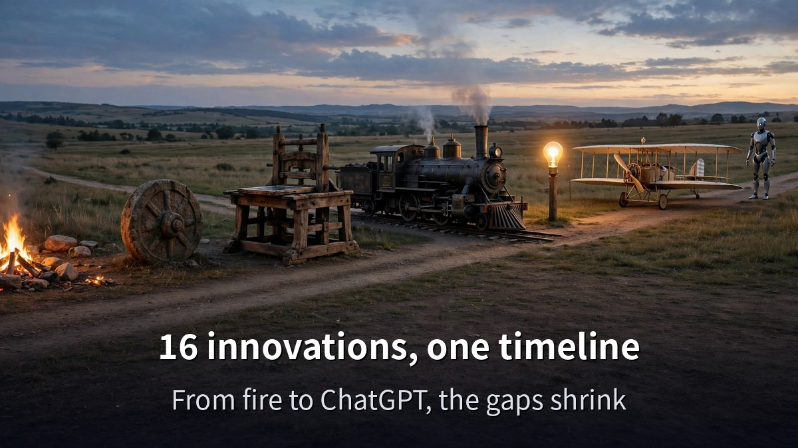
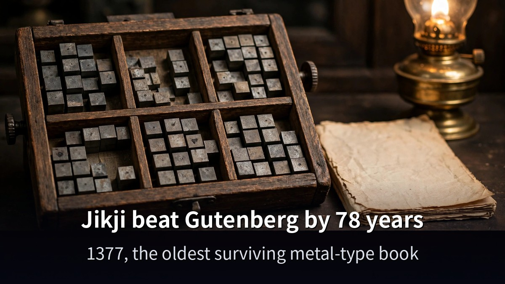
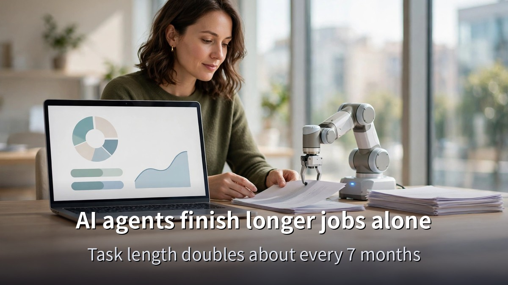
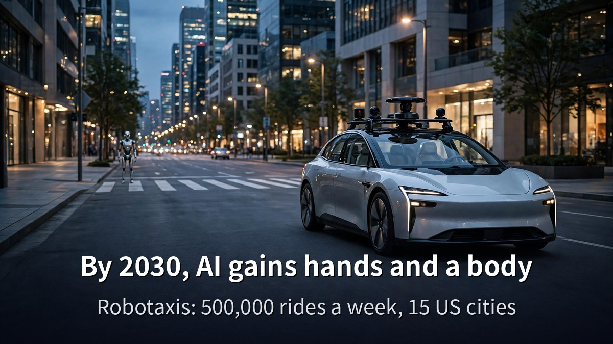

<!-- 본문 시작 -->


From fire to AI: 16 innovations on a single timeline.

From coin to printing, about 2,000 years. From the web to the iPhone, 16 years. From the iPhone to ChatGPT, 15 years.
The gaps between innovations are shrinking.
This post lays out 16 innovations from fire to AI on one timeline and asks where AI is headed by 2030.
It is for anyone who wants to know how past innovations became everyday life, and how far AI might go by 2030.

> **Innovation feels strange at first, then becomes everyday life. Fire, printing, electricity, and the internet all took that path, and AI is walking it now. The question for 2030 is not how smart AI gets, but how far it goes once it gains hands and a body.**

If you are curious about the next step for AI models, start with [How to Start Claude for Free](https://aitechnotesen.blogspot.com/2026/11/start-claude-for-free-what-you-get-what.html) to see what a current AI can do for free before going further.

## 16 Innovations: What Changed?

**The gaps shrank. Coin to printing took about 2,000 years; iPhone to ChatGPT took 15.**


Jikji, printed with metal type in 1377 — the oldest surviving book of its kind, 78 years before the Gutenberg Bible.

The timeline starts with fire.
People used fire long before any record survives.
Farming began with wheat and barley in what is now Iraq, Syria, and Turkiye, and **world population around year 1 was about 230 million**.
The oldest known wooden wheel came from the Ljubljana marshes in Slovenia.
Its diameter is about 72 cm.

Writing began with cuneiform in Uruk.
The first surviving text is a barley distribution ledger.
Coins were made about 2,600 years ago in Lydia from a **gold and silver alloy**, and 93 of them were found at the Ephesus temple site.

Printing starts with a Korean story.
**Jikji, printed with metal type in 1377, is the oldest surviving book of its kind**, and UNESCO lists it on the Memory of the World Register.
It predates the Gutenberg Bible by about 78 years.
By 1500, more than 20 million books had been printed in Europe.
In 1687, Newton's Principia appeared.

The steam engine began with Newcomen's engine in 1712, and Watt's 1769 patent **cut fuel use to about a quarter**.
When machines took jobs, the Luddite movement followed in the 1810s.
Vaccination began with Jenner's smallpox inoculation in 1796.
Smallpox killed about 300 million people in the 20th century alone, and the WHO declared it eradicated in 1980.

Electricity lit up with Edison's carbon filament bulb in 1879, and the first commercial power station opened in New York in 1882.
In 2024, **91.9% of the world's people used electricity**.
The Wright brothers flew for 12 seconds over about 37 meters in 1903.
Sixty-six years later, humans landed on the Moon.
Air passengers in 2025 were projected at about 5 billion.

Fertilizer began when Haber synthesized ammonia in 1909, and Bosch scaled it to factory size in 1913.
Today **about half the world's people depend on food grown with this fertilizer**.
Antibiotics began with Fleming's discovery of penicillin in 1928, and mass production started in the 1940s.
Life expectancy was 32 years in 1900.
By 2023, it had reached 73.2 years.

The computer began with ENIAC in 1945, and Bell Labs made the transistor in 1947.
By 2018, humanity had made **about 130 sextillion transistors**.
The internet began in October 1969, when UCLA tried to send "LOGIN" to Stanford and only "LO" got through.
Today 73.6% of the world's people, about 6 billion, use the internet.

The web was created by Tim Berners-Lee in 1989, and the first website went public in 1991.
The first smartphone appeared in 1994, and the iPhone made it mainstream from 2007.
In 2024, 58% of the world's people, **4.7 billion, used mobile internet**.
AI as a field began at the Dartmouth meeting in 1956, and it reached ordinary people with ChatGPT in November 2022.
As of OpenAI's February 2026 announcement, **weekly users stood at about 900 million**.

The numbers alone show how the gaps shrank.

```blog
type: table
rows:
  - [{text: "Between", header: true, style: {background: "#123456", color: "#FFFFFF"}, width: 20}, {text: "Gap", header: true, style: {background: "#123456", color: "#FFFFFF"}, width: 20}, {text: "What happened", header: true, style: {background: "#123456", color: "#FFFFFF"}, width: 60}]
  - [{text: "Coin → printing", width: 20}, {text: "About 2,000 years", width: 20}, {text: "After money came, it took 2,000 years to print knowledge", width: 60}]
  - [{text: "Printing → steam engine", width: 20}, {text: "314 years", width: 20}, {text: "Books spread, then coal started turning machines", width: 60}]
  - [{text: "Web → iPhone", width: 20}, {text: "16 years", width: 20}, {text: "The internet moved into our pockets", width: 60}]
  - [{text: "iPhone → ChatGPT", width: 20}, {text: "15 years", width: 20}, {text: "The computer in our hand met an AI that talks", width: 60}]
```

## How Far Will AI Go by 2030?

**The innovation of 2030 is AI gaining hands and a body. Agents are the hands, robotaxis and robots are the body.**


A robot arm sorting papers beside a person: AI is starting to take on work that needs hands.

The case for 2030 starts with AI agents (the host's view).
According to METR's evaluation, the length of jobs AI can finish alone has **doubled about every 7 months since 2019**.
Measured from 2023 onward, it doubled about every 4 months, so the pace is quickening.
But this number measures software work at a 50% success rate.
In the same METR data, the task length at an 80% success rate is 4 to 6 times shorter.
**For real work, the 80% number is the one to watch.**

Gartner looks at the other side.
In a June 2025 forecast, it predicted that **more than 40% of enterprise agentic AI projects would be cancelled by the end of 2027**.
The reasons were escalating costs, unclear business value, and inadequate risk controls.

Some AI already has a body.
Waymo's robotaxis recorded **more than 500,000 paid rides a week as of April 2026**, and expanded to 15 US cities that September.
The first CRISPR gene-editing treatment was approved in 2023.
Humanoid robot forecasts for 2030 range from 500,000 to 1.2 million units depending on the institution.
Brain-computer interfaces are in clinical trials, quantum computers are at the research stage, and the ITER fusion reactor's main experiment is set for 2039, so it is hard to see it by 2030.
**The humanoid forecast of 500,000 to 1.2 million units differs by institution, so it should not be read as one number.**

So the conclusion is this (the host's view).
The innovation of 2030 is AI gaining hands and a body.
Agents are the hands, robotaxis and robots are the body.

To see what agents actually do in practice, [the vibe-coding website tier list](https://aitechnotesen.blogspot.com/2026/11/vibe-coding-website-tier-list5-top-tier.html) shows how top-tier features get built in AI's hands, and it is a useful comparison.

## What Can You Try Right Now?

**Start with one small job you do yourself. Pick one chatbot and give it a daily job.**


A sensor-fitted robotaxi driving through the city: a car with an empty driver's seat is already in service.

Hearing a forecast and stopping there leaves nothing behind.
What you can try now is small.

**First.** Pick one chatbot and give it a daily job. ChatGPT or Claude, both free to start, are good starting points. Begin with jobs that have clear boundaries: drafting an email, organizing a schedule, or summarizing a text.

**Second.** Give an agent a small job with a visible ending. Something like "gather the data and put it in a table," where you can check the result. People should make the important decisions themselves, and review what the agent produces.

**Third.** Check the cost and the conditions first. Going past the free tier adds charges, and the longer an agent works, the more it costs. Check the pricing plan before you start, and set the size of each job in advance.

These three steps are not grand preparation.
They are how you find out, by trying AI yourself, how far you can trust it.

**Confirmed facts vs. claims**
There are four confirmed facts.
METR's doubling time for task length is about 7 months since 2019 and about 4 months since 2023, checked against METR's Time Horizon 1.1 from January 2026.
Gartner's 40% cancellation forecast was confirmed in its press release of June 25, 2025.
Waymo's figure of more than 500,000 paid rides a week comes from Alphabet's earnings remarks on April 29, 2026, and its service in 15 US cities from the September 2026 expansion.
That Jikji is a 1377 metal-type book, the oldest surviving of its kind, comes from UNESCO's Memory of the World Register, and that it predates the Gutenberg Bible by 78 years comes from the French National Library's records.

The claims and forecasts stay separate.
That AI agents are the top reason for 2030, and the conclusion that "AI gains hands and a body," are the host's views.
The humanoid forecast of 500,000 to 1.2 million units differs by institution, so it should not be read as one number.
The other timeline figures are taken as given.

## Closing thoughts

The first people to see fire, and the first to open a printed book, must have felt the same strangeness.
Feeling strange about AI today is not very different.
This time, though, the people who try it directly learn faster than the people who only watch.
Start by handing an agent one small job and seeing with your own eyes how far it goes.

## Frequently asked questions

**Why is the 80% success rate figure shorter in the METR evaluation?**
A 50% success rate means succeeding five times out of ten.
An 80% success rate demands eight successes out of ten, so the length of jobs AI can take on becomes 4 to 6 times shorter.
In short, the 50% number shows what is possible, and the 80% number shows what is usable in real work.

**Can an agent do my job for me?**
Start with jobs that have clear boundaries.
In a METR experiment from 2025, experienced developers took 19% longer when they used early AI tools.
A faster tool does not automatically mean your work gets shorter.

**Can I ride a Waymo robotaxi in Korea?**
As of November 2026, paid service runs in 15 US cities only.
There is no commercial service in Korea.
If you get a chance abroad, check the cities covered in the Waymo app first.

## Good Reads Together

[Start Claude for Free: What You Get, What You Don't, and 5 Drawbacks to Check First](https://aitechnotesen.blogspot.com/2026/11/start-claude-for-free-what-you-get-what.html)

[Vibe Coding Website Tier List｜5 Top-Tier Sites Out of 19, Recreated with Claude](https://aitechnotesen.blogspot.com/2026/11/vibe-coding-website-tier-list5-top-tier.html)

<!-- 본문 끝 -->

## 작업용 출처·이미지 정보 (업로드 제외)

## Working notes — sources and images (not for upload)

- METR, Time Horizon 1.1 (2026-01-29): 50% task-length doubling time, about 7 months since 2019, about 131 days since 2023
- Gartner press release (2025-06-25): more than 40% of agentic AI projects cancelled by end of 2027
- Alphabet Q1 2026 earnings remarks (2026-04-29): Waymo, more than 500,000 paid rides a week
- Waymo expansion reports (2026-09–10): paid service in 15 US cities
- UNESCO Memory of the World Register and the French National Library: Jikji, 1377, 78 years before the Gutenberg Bible
- honjobs, "AI 시대 기회를 잡으려면? 과거에서 배우는 인류혁신 연대표" (2026-11-16, 8 minutes 9 seconds): the starting point for the timeline and forecasts; timeline figures follow the video transcript

- rev3 changes (2026-11-17 rewrite from scratch): gap table converted to a blog table block (20/20/60, header #123456). Closing paragraph moved from after the recommendation links into Closing thoughts, so the recommendation links are last. Plain captions added to all 4 images; "(Illustration)" notes removed. Intro source attribution removed. Section headings are plain markdown (EN has no Naver colors); step labels use bold lead-ins. All facts, numbers, tables, images, links identical to rev2.
