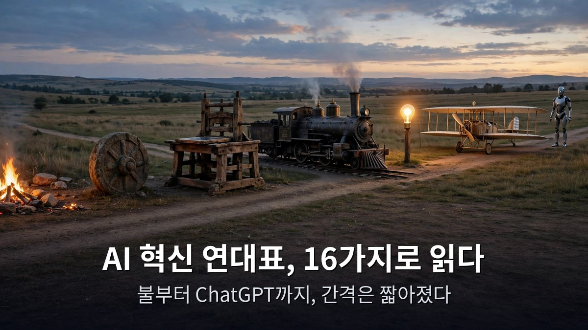
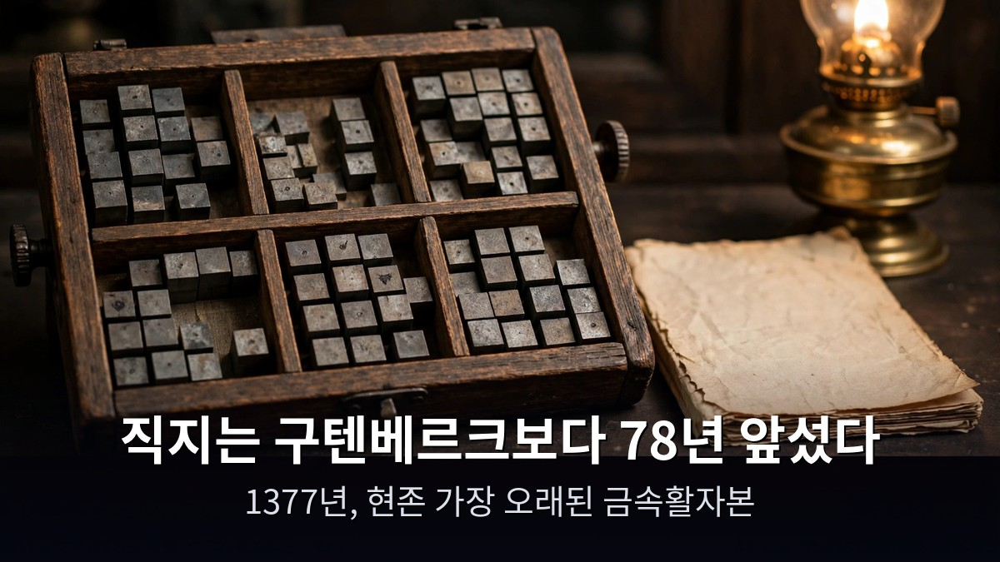
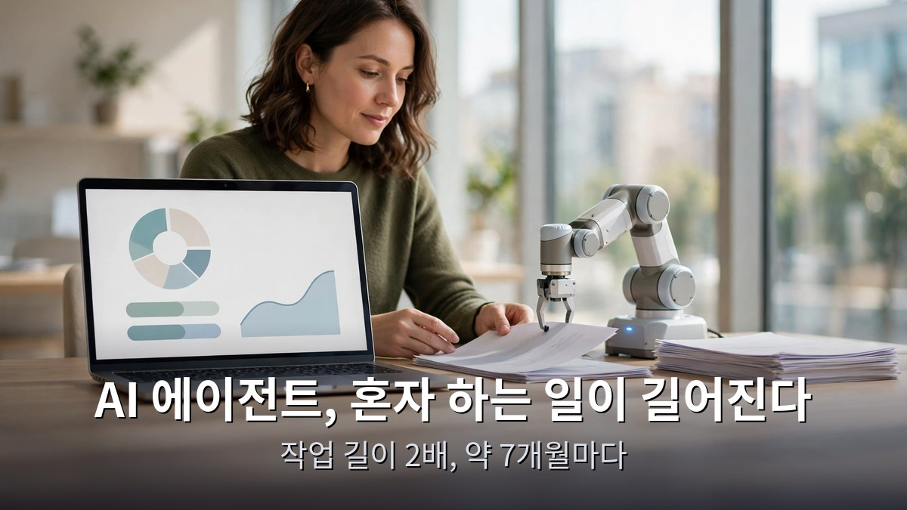
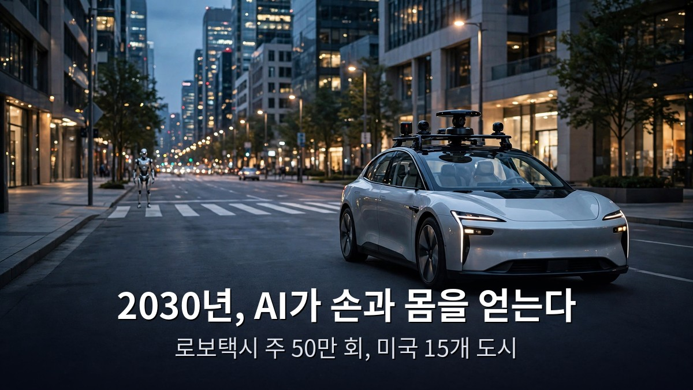

<!-- 본문 시작 -->

동전에서 인쇄술까지 2,000년, 웹에서 아이폰까지 16년, 아이폰에서 ChatGPT까지 15년.
혁신 사이의 간격이 짧아지고 있다.
이 글은 honjobs 영상(2026-11-16, 8분 9초, 자막 0:00~8:02 전체 확인)을 바탕으로, 불부터 AI까지 16가지 혁신을 연표로 정리하고 2030년의 향방을 가늠한 자료 기반 안내다.
과거의 혁신이 어떻게 일상이 됐는지 아는 사람, 2030년에 AI가 어디까지 올지 궁금한 사람이 읽으면 된다.

> **혁신은 처음엔 낯설고, 나중엔 일상이 된다. 불, 인쇄술, 전기, 인터넷이 그랬고, AI도 같은 길을 걷고 있다. 2030년의 질문은 AI가 얼마나 똑똑해지느냐가 아니라, AI가 손과 몸을 얻어 어디까지 일을 맡느냐이다.**

AI 모델의 다음 단계가 궁금하다면 [GPT-6 사이버 소식](https://blog.naver.com/3700708/224477518377)에서 최신 모델 소식을 먼저 보는 게 순서가 맞다.

## 16가지 혁신, 무엇이 바뀌었나?

(일러스트) 나무 상자에 담긴 금속활자, 활자 하나하나가 책 한 페이지를 만들었다.

연표는 불에서 시작한다.
기록이 남기 전부터 인류는 불을 썼다.
농사는 이라크, 시리아, 튀르키예 일대에서 밀과 보리를 키우며 시작됐고, 서기 1년 세계 인구는 약 2억 3천만 명이었다.
바퀴는 슬로베니아 류블리아나 습지에서 나온 나무 바퀴가 가장 오래됐다.
지름은 약 72cm다.

문자는 우루크의 쐐기 문자에서 시작됐다.
처음 남은 글은 보리 분배 장부였다.
동전은 약 2,600년 전 리디아에서 금과 은 합금으로 만들었고, 에페소스 신전 터에서는 93개가 나왔다.

인쇄술은 한국 이야기가 먼저다.
직지는 1377년 금속활자로 찍은 현존 가장 오래된 책으로, 유네스코 세계기록유산에 올랐다.
구텐베르크 성경보다 약 78년 앞선다.
1500년까지 유럽에서 2천만 권 이상이 인쇄됐다.
1687년에는 뉴턴의 프린키피아가 나왔다.

증기기관은 1712년 뉴커먼의 기관에서 시작됐고, 1769년 와트의 특허는 연료를 약 4분의 1로 줄였다.
기계가 일자리를 빼앗자 1810년대 러다이트 운동이 일어났다.
백신은 1796년 제너의 우두 접종에서 시작됐다.
천연두는 20세기에만 약 3억 명의 목숨을 앗았고, 1980년 WHO가 박멸을 선언했다.

전기는 1879년 에디슨의 탄소 필라멘트 전구로 불이 켜졌고, 1882년 뉴욕에 첫 상업 발전소가 들어섰다.
2024년 세계 인구의 91.9%가 전기를 쓴다.
비행기는 1903년 라이트 형제가 12초 동안 약 37m를 날았다.
그로부터 66년 뒤 인류는 달에 착륙했다.
2025년 항공 승객은 약 50억 명으로 전망된다.

비료는 1909년 하버가 암모니아 합성을 성공시켰고, 1913년 보슈가 공장 규모로 키웠다.
지금 세계 인구의 약 절반은 이 비료로 키운 식량에 의존한다.
항생제는 1928년 플레밍이 페니실린을 발견했고, 1940년대 대량 생산이 시작됐다.
기대수명은 1900년 32세였다.
2023년에는 73.2세로 늘었다.

컴퓨터는 1945년 ENIAC에서 시작됐고, 1947년 벨연구소가 트랜지스터를 만들었다.
2018년까지 만든 트랜지스터는 약 130자에 달한다.
인터넷은 1969년 10월 UCLA에서 스탠퍼드로 "LOGIN"을 보내려다 "LO"만 전송되며 시작됐다.
지금 세계 인구의 73.6%, 약 60억 명이 인터넷을 쓴다.

웹은 1989년 팀 버너스리가 만들었고, 1991년 첫 웹사이트가 공개됐다.
스마트폰은 1994년 첫 제품이 나왔고, 2007년 아이폰부터 대중화됐다.
2024년 세계 인구의 58%, 47억 명이 모바일 인터넷을 쓴다.
AI는 학문으로 1956년 다트머스 회의에서 시작됐고, 일반인의 손에 닿은 것은 2022년 11월 ChatGPT부터다.
2026년 2월 OpenAI 발표 기준으로 주간 사용자는 약 9억 명이다.

숫자만 떼어놓고 보면 간격이 어떻게 줄었는지 더 잘 보인다.

| 혁신 사이 | 간격 | 이때 일어난 일 |
|---|---|---|
| 동전 → 인쇄술 | 약 2,000년 | 돈이 생긴 뒤, 지식을 찍어내는 데 2천 년이 걸렸다 |
| 인쇄술 → 증기기관 | 314년 | 책이 퍼지고, 석탄으로 기계를 돌리기 시작했다 |
| 웹 → 아이폰 | 16년 | 인터넷이 주머니 속으로 들어갔다 |
| 아이폰 → ChatGPT | 15년 | 손안의 컴퓨터가 말하는 AI를 만났다 |

## 2030년, AI는 어디까지 갈까?

(일러스트) 사람 옆에서 서류를 집는 로봇 팔, 손이 필요한 일까지 AI가 맡기 시작했다.

2030년을 가늠하는 근거로 영상이 1순위에 두는 것은 AI 에이전트다(진행자 견해).
METR의 평가에 따르면, AI가 혼자 끝낼 수 있는 일의 길이는 2019년 이후 약 7개월마다 2배가 됐다.
2023년 이후로만 재면 약 4개월마다 2배로, 속도가 더 빨라졌다.
다만 이 수치는 소프트웨어 일을 기준으로 잰 50% 성공률이다.
같은 METR 자료에서 80% 성공률 기준의 작업 길이는 4~6배 짧다.
실무에 쓸 때는 50% 수치가 아니라 80% 수치를 보는 게 맞다.

가트너는 다른 쪽을 본다.
2025년 6월 전망에서 기업 에이전트 프로젝트의 40% 이상이 2027년 말까지 취소될 것으로 내다봤다.
이유는 비용 상승, 불분명한 사업 가치, 부족한 리스크 통제다.

이미 몸을 얻은 AI도 있다.
웨이모 로보택시는 2026년 4월 기준 주 50만 회 이상 유료 운행을 기록했고, 같은 해 9월 미국 15개 도시로 넓어졌다.
유전자 편집 치료제는 2023년 첫 크리스퍼 치료제가 승인됐다.
휴머노이드 로봇은 2030년 전망이 기관마다 50만 대에서 120만 대로 갈린다.
BCI는 임상 시험 단계, 양자컴퓨터는 연구 단계, 핵융합은 ITER 본실험이 2039년으로 잡혀 있어 2030년 안에 보기는 어렵다.

그래서 영상의 결론은 이렇다(진행자 견해).
2030년의 혁신은 AI가 손과 몸을 얻는 쪽이다.
에이전트가 손, 로보택시와 로봇이 몸이다.

에이전트가 실제로 뭘 해내는지 보려면 [클로드 코드 디자인 스킬과 cook](https://blog.naver.com/3700708/224478572452)에서 AI에게 일을 맡기는 방식을 확인하는 게 도움이 된다.

## 지금 무엇을 해보면 좋을까?

(일러스트) 센서를 단 로보택시가 도심을 달린다, 운전석이 비어 있는 차가 이미 영업 중이다.

전망을 듣고 끝내면 남는 게 없다.
지금 해볼 수 있는 일은 작다.

첫째, 챗봇 하나를 골라 매일 쓰는 일을 맡겨본다.
무료로 시작할 수 있는 ChatGPT나 클로드가 출발점이다.
메일 초안, 일정 정리, 글 요약처럼 범위가 분명한 일부터 맡기는 게 좋다.

둘째, 에이전트에게는 작고 끝이 보이는 일을 준다.
"자료를 모아 표로 정리해줘"처럼 결과가 확인되는 일이다.
중요한 결정은 사람이 직접 내리고, 에이전트 결과는 검수한다.

셋째, 비용과 조건을 먼저 확인한다.
무료 범위를 넘으면 요금이 붙고, 에이전트가 오래 일할수록 비용이 커진다.
쓰기 전에 요금제를 확인하고, 한 번에 맡기는 일의 크기를 정해두는 게 좋다.

이 세 가지는 거창한 준비가 아니다.
AI를 직접 써보면서 어디까지 믿을 수 있는지 가늠하는 방법이다.

## 확인된 사실과 영상 주장, 무엇이 다른가?

직접 대조한 것은 네 가지다.
METR의 작업 길이 2배 주기는 2019년 이후 약 7개월, 2023년 이후 약 4개월로, 2026년 1월 METR Time Horizon 1.1에서 대조했다.
가트너의 40% 취소 전망은 2025년 6월 25일 보도자료에서 확인했다.
웨이모의 주 50만 회 이상 유료 운행은 2026년 4월 29일 알파벳 실적 발표에서, 미국 15개 도시 운행은 2026년 9월 기준 확장에서 확인했다.
직지가 1377년 금속활자본으로 현존 가장 오래된 책이라는 점은 유네스코 세계기록유산 등재 기록에서, 구텐베르크 성경보다 78년 앞선다는 점은 프랑스 국립도서관 자료에서 확인했다.

영상 주장과 전망은 따로 둔다.
2030년 혁신 1순위가 AI 에이전트라는 점, "AI가 손과 몸을 얻는 쪽"이라는 결론은 진행자 견해다.
휴머노이드 50만~120만 대 전망은 기관마다 달라, 하나의 숫자로 읽으면 안 된다.
연표의 나머지 수치는 영상 자막을 기준으로 썼다.

## 자주 묻는 질문

**METR 평가에서 80% 성공률 기준은 왜 더 짧나요?**
50% 성공률은 열 번 중 다섯 번 성공하면 되는 기준이다.
80% 성공률은 열 번 중 여덟 번을 요구하니, AI가 맡을 수 있는 일의 길이가 4~6배 짧아진다.
즉 50% 수치는 가능성을, 80% 수치는 실무에서 쓸 만한 수준을 보여준다.

**에이전트가 내 일을 대신할 수 있나요?**
범위가 분명한 일부터 맡기는 게 순서다.
METR의 2025년 실험에서는 숙련된 개발자가 초기 AI 도구를 썼을 때 오히려 19% 더 오래 걸렸다는 결과도 있다.
도구가 빨라졌다고 내 일이 바로 줄어드는 것은 아니다.

**웨이모 로보택시는 한국에서도 탈 수 있나요?**
2026년 11월 기준으로 미국 15개 도시에서만 유료 운행한다.
한국에는 상용 서비스가 없다.
해외에서 탈 기회가 생기면 웨이모 앱에서 운행 도시부터 확인하면 된다.

## 함께 보면 좋은 글
[GPT-6 사이버](https://blog.naver.com/3700708/224477518377)
[매트릭스](https://blog.naver.com/3700708/224478573702)

불을 처음 본 사람도, 인쇄된 책을 처음 펼친 사람도 낯설었을 것이다.
지금 AI를 낯설게 보는 마음도 크게 다르지 않다.
다만 이번에는 지켜보는 쪽보다 직접 써보는 쪽이 배우는 게 빠르다.
작은 일 하나를 에이전트에게 맡겨보고, 어디까지 되는지 내 눈으로 확인하는 것부터 시작하면 된다.

<!-- 본문 끝 -->

## 작업용 출처·이미지 정보 (업로드 제외)

**출처**
- METR, Time Horizon 1.1 (2026-01-29): 50% 작업 길이 2배 주기, 2019년 이후 약 7개월, 2023년 이후 약 131일
- Gartner 보도자료 (2025-06-25): 에이전트 프로젝트 40% 이상, 2027년 말까지 취소 전망
- Alphabet 2026년 1분기 실적 발표 (2026-04-29): 웨이모 주 50만 회 이상 유료 운행
- Waymo 확장 보도 (2026-09~10): 미국 15개 도시 유료 운행
- UNESCO 세계기록유산·프랑스 국립도서관: 직지 1377년, 구텐베르크 성경보다 78년 앞섬
- honjobs, "AI 시대 기회를 잡으려면? 과거에서 배우는 인류혁신 연대표" (2026-11-16, 8분 9초): 연표·전망의 출발점, 연표 수치는 영상 자막 기준
