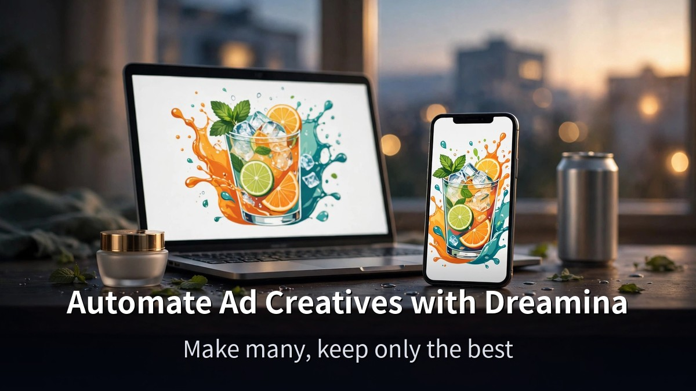
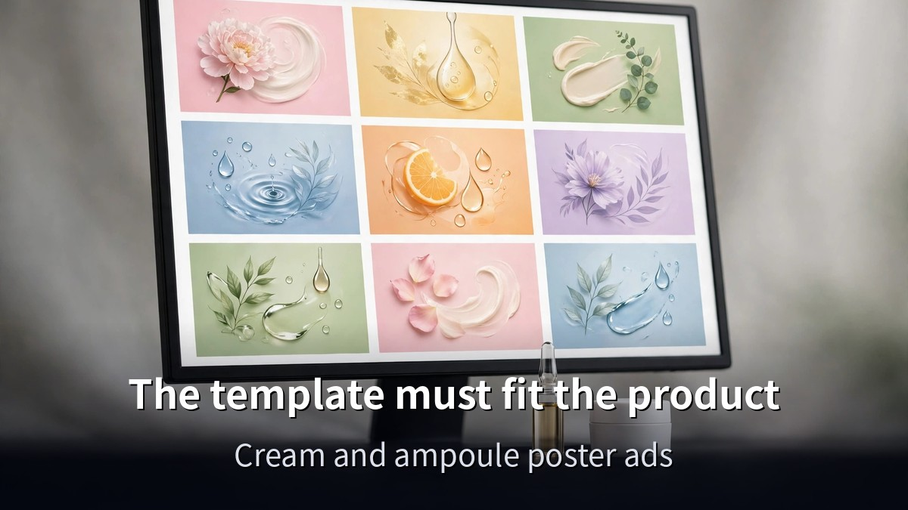
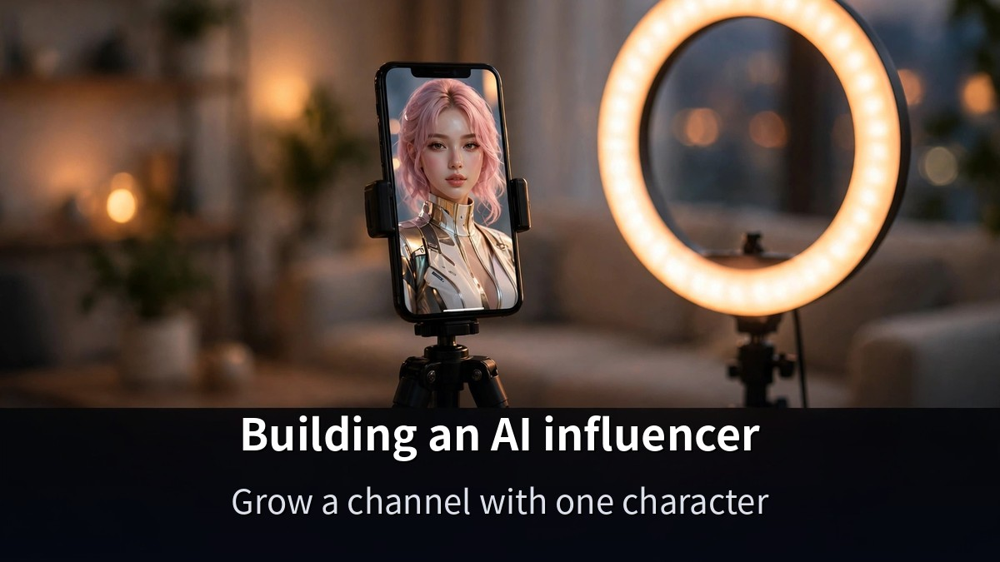
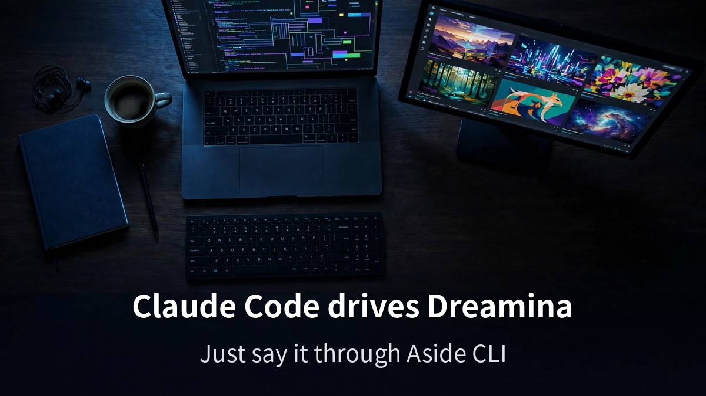

<!-- 본문 시작 -->

Making 50 ad creatives used to take a lot of time and hands.
Dreamina shrinks that work down to templates and AI video generation.
This post explains how to automate ad creatives with Dreamina, its pricing, and how to connect it to Claude Code through the Aside CLI, for people who run a shopping mall or a smart store and want to cut the time they spend making ad creatives.

> **In one line: Dreamina stamps out ad creatives from templates, turns them into video with Seedance 2.5, and through the Aside CLI lets Claude Code run the whole process from a single spoken request. Try it free, and pay only when you use it in earnest.**

If the automation flow itself interests you, [Automating Instagram Card News with Claude Code](https://aitechnotesen.blogspot.com/2026/11/automating-instagram-card-news-with.html) shows the same idea from reference collection to finished posts.

Dreamina is ByteDance's CapCut-family AI creative platform.
It makes images, video, and avatars in one place.
It is also the home of the Seedance video model.
A team that does a lot of marketing AX consulting named Meta performance marketing as the area that companies with annual revenue of 90 billion, 50 billion, 40 billion, and 30 billion won care about most.
The flow is simple: paid ads on Meta or Google show the creative, bring people to a homepage or a smart store, and lead them to buy.
Creatives used to be varied — reviews, user testimonials, procedure videos, product photos.
But production time and resources were limited, so efficiency mattered: the ad had to bring in more revenue than it cost.
Now AI can copy and expand creatives without limit.

Pricing runs from a free tier to four paid plans.
The table below shows US list prices, checked on November 17, 2026.
Prices vary by country and promotion, and the final figure appears on the checkout page.

| Plan | Monthly price | Monthly credits |
|---|---|---|
| Free | $0 | 120 credits a day |
| Basic | $15 | 1,575 credits |
| Standard | $36 | 3,885 credits |
| Advanced | From $79 | From 8,645 credits |
| Ultra | $520 | 59,000 credits |

There are four billing periods — yearly, monthly, quarterly, and one month — and the official pricing page confirms them.
Paying quarterly or for a single month, only for the period you need, avoids the hassle of forgetting a monthly payment.
A Black Friday sale is running and the price is described as very cheap, but no discount rate or amount is given, so that part is unverified.

Seedance 2.5 sits at the center of video generation.
It makes a clip of up to 30 seconds in a single pass, at 480p, 720p, or 1080p.
You can feed it up to 50 reference assets — images, video, and audio combined — and audio is generated in the same pass as the visuals.
The model launched on July 31, 2026.
On Dreamina, Seedance 2.5 costs 37 credits per second at 720p.
A 5-second clip costs 185 credits, about $1.76 on the Basic plan.
The free plan's 120 daily credits cover about one 5-second Seedance 2.0 clip.
The standard model is enough for most work.
Some models allow unlimited generation, but an "unlimited" label can hide fair-use limits, so the terms need a separate check.

## What Changes When Templates Make the Ad Creative?

Marketing Studio is where templates turn into ad creatives.
There are many templates, in categories such as social media, product showcase, creative advertising, marketplace, and posters.
The current trend is to hook viewers with AI-made visual quality rather than provocative hooks, aiming for product reach and awareness.
The key test when picking a template is whether the product and the template align.
The product should also appear early.
That test is a matter of judgment.

Take a drink pearl poster template as an example.
Put a tumbler or a cup in it and the feel falls flat; a template where a zest drink flies through the sky fits a drink can or a beer can.
Cosmetics do not fit that format.
In a hands-on example, a single cream product was used to make one template, an ampoule product was generated with another template at the same time, and one more creative was built around a quote.
The image model was from the Seedream family.
The results were judged good in quality, down to details such as the label behind the ampoule and the bubbles.
The video generation results were judged good too.
Put a line such as "Lock in the moisture" on the poster in a fitting font, and it works as a poster ad.

There is also a way to scale up by volume.
"Make 50 fast and run them, keep the 10 that work and throw away 40, make 100 more like the 10 that worked, and when 20 work, throw away 80 and make 200."
That is a method, not a verified fact.
It is a fight won with money and volume, so it takes a budget for creatives to follow.
There is also an expectation that ad fatigue will set in later and AI creative efficiency will fall.
That is also just a view.

## How Do You Build an AI Influencer, and Where Is It Used?

Influencer Studio is where you build a distinct AI character and run it.
Running an Instagram or YouTube channel with it to build traffic and views, then taking ads or selling products through the AI influencer, is a business growing overseas.
The procedure has five steps.
First, capture an image of a person you want and paste it into the AI image tool.
Second, type a spoken instruction: "Do not make it exactly the same as the attached image — give it my own adaptation and make a distinct, original AI model influencer in a completely different form."
Third, generate it with a model from the GPT Sunburst family, in 9:16 size.
Fourth, save the generated model as an element, that is, a character.
Fifth, pick that model in Influencer Studio, upload an image, and press generate to create an influencer video.
The video generation model chosen was Seedance 2.5, judged the best.
That choice is also a matter of judgment.
The result quality was judged good.

There is a caution here.
Capturing someone else's photo in the first step can raise portrait-rights problems.
Do not use a real person's face without permission. A safer starting point is your own photo, an image you have permission to use, or a character built from scratch.
An AI influencer gathers fans through character settings and steady content, not through a face.
If you plan to run a channel, picking a starting point clean of copyright and portrait-rights issues comes first.

To compare how AI video models differ in practice, [Fable 5.2 vs Opus 5.5](https://aitechnotesen.blogspot.com/2026/11/fable-52-vs-opus-55-4-experiments-that.html) tests four experiments across two models and is a useful contrast.

## What Happens When Claude Code Drives Dreamina?

Using Dreamina directly on the web works well, but there is another way: drive it indirectly through Claude Code with Aside.
Aside is an AI browser where the AI opens and clicks through the sites you are logged into.
It has a CLI, so coding tools such as the terminal or Claude Code can call the browser.
The official developer docs describe the CLI and MCP connection.
Installation takes three steps.
First, open Aside, click the profile picture on the left, go to Settings, and open the Developers menu.
Second, copy the command labeled Aside CLI.
Third, open Claude Code, paste the copied command, and type "install it."
Set the model to Sonnet.
Once installation finishes, Claude gains permission to use Aside.

The mechanism is simple.
Tell Claude what you want Dreamina to make, and Claude controls Aside, while Aside goes into Dreamina, develops the instructions, and does the work.
A Claude model is connected inside Aside, and Opus 5.5 develops the request further so Dreamina carries it out more clearly.
The advantage is less planning burden.
Using Dreamina directly needs the plan set in advance — image, prompt, setting, direction, camera, angle — for good quality.
With this method, a chat in natural language is enough for Claude to take control, which is convenient and makes the wanted result easier to reach.

Here is a hands-on case.
Through the Aside CLI, Dreamina was asked: "Make one 50-second AI drama video. The theme is a love story between a man and a woman, and it must end with a shocking twist."
A long video does not finish in one go, and tokens keep being spent.
There is also room to expand.
With Aside running parallel agents on a routine, you could hand Claude a reference or a rough plan and let Claude Code generate videos in Dreamina through Aside on its own.
The team runs 6 YouTube channels now and aims for 10 this month.
Every video going in is made with AI, money goes into tools such as Dreamina, and the views earned already exceed the money spent.
That is a claim, with no guarantee the same result follows.

**What is confirmed, and what is still a claim**
Confirmed facts are Dreamina's US list prices and 120 free daily credits, Seedance 2.5's 30-second generation and 1080p support, the 50-reference cap, and the existence and install path of the Aside CLI.
Claims and views are the expand-by-volume method of keeping 10 out of 50, the ad-fatigue outlook, the template-product fit test, and the statement that views already exceed the money spent.
Left unverified are the Black Friday discount rate and amount, and Aside's pricing in Korea and its Windows support range.
The official docs disagree on Windows support, so that needs a separate check.

Today's one task is simple.
Use the free plan's 120 daily credits to pick one template, put in one product photo, and make one 5-second clip.
Check with your own eyes whether the template fits the product and whether the video matches the poster line.
If one creative turns out well, make a few more like it and run them, then grow the volume from there.

## Frequently Asked Questions

**Can I make ad creatives with Dreamina for free?**
Yes.
The free plan gives 120 credits a day, about one 5-second Seedance 2.0 clip.
But downloads on the free plan carry a watermark.
A paid plan is needed to export without one.

**How is Seedance 2.5 Flash different?**
It is a faster, cheaper variant.
It supports only 480p and 720p, and costs about 35% less per second than the standard model.
It takes at most 5 reference videos and has no draft mode.
It suits quickly pulling many drafts.

**Does the Aside CLI work on Windows?**
The official docs disagree, so it is hard to say for sure.
The download page lists macOS and Windows, while the help page lists only macOS 15 or later.
The install command is documented for macOS.
On Windows, check the official docs again before installing.

## Good Reads Together
[Automating Instagram Card News with Claude Code — From Reference Collection to Finished Posts](https://aitechnotesen.blogspot.com/2026/11/automating-instagram-card-news-with.html)

[Start Claude for Free — What You Get, What You Don't, and 5 Drawbacks to Check First](https://aitechnotesen.blogspot.com/2026/11/start-claude-for-free-what-you-get-what.html)

Making ad creatives is now closer to a design problem than a manual one.
What remains is the eye to judge whether a template fits a product, and the eye to spot a creative that works.
One 5-second clip made today can become the starting point for the next 50 creatives.

<!-- 본문 끝 -->

## 작업용 출처·이미지 정보 (업로드 제외)

## Working notes — sources and images (not for upload)

Sin Yeong-seon AI video 7-Rsc_UpHXw (2026-11-15, 14 min 44 sec, full transcript 0:00–14:38) + Dreamina pricing cross-check (2026-11-17, US list prices: Basic $15 / 1,575 credits, Standard $36 / 3,885 credits, Advanced from $79 / from 8,645 credits, Ultra $520 / 59,000 credits, free 120 credits a day, three November 2026 sources agree) + Seedance 2.5 spec cross-check (launched 2026-07-31, up to 30 seconds in one pass, 480p/720p/1080p, up to 50 references, native audio, 37 credits per second at 720p) + Aside CLI cross-check (Settings > Developers, install command, aside exec/repl, MCP support, free 500 credits a month, macOS 15 or later — Windows support unclear in docs). Black Friday discount rate and amount are not in the transcript, unverified. Image check: 4 images passed (1200×675 JPEG, no broken overlay text, all four compositions and subjects differ, no prices or figures).
