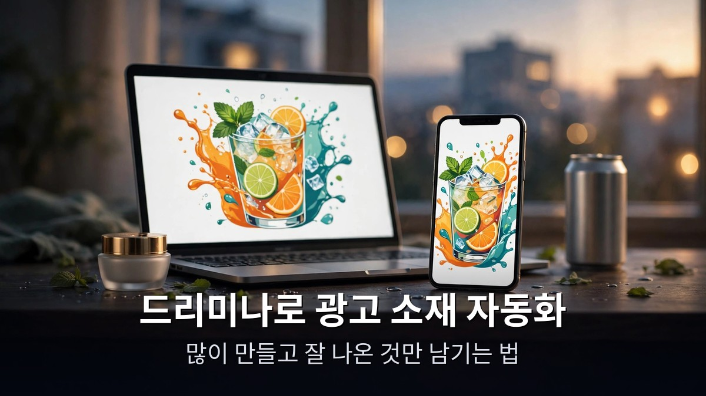
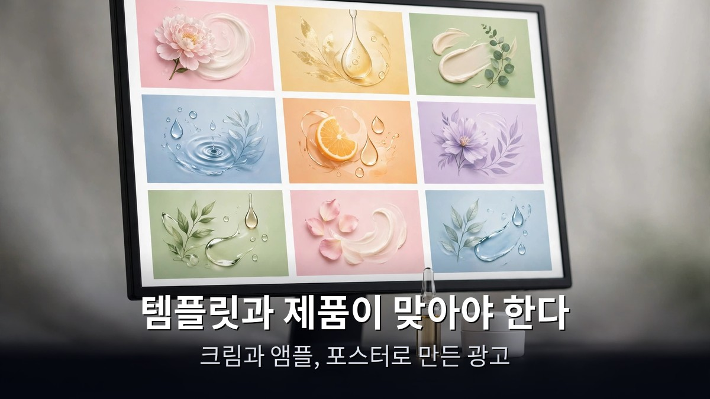
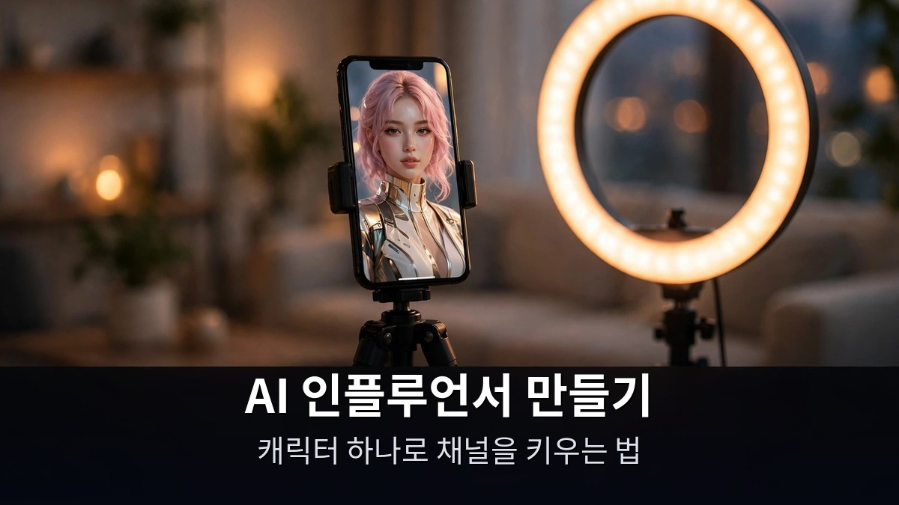
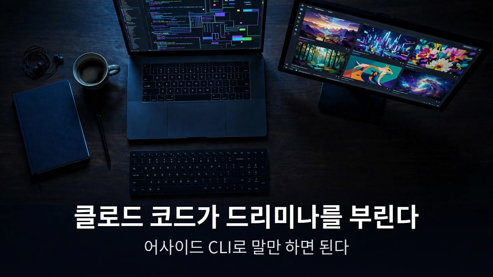

<!-- 본문 시작 -->


노트북과 폰 화면에 뜬 음료 광고처럼, 템플릿 하나면 소재가 금방 나온다.

광고 소재 50개를 만드는 일은 이제 손이 아니라 설계의 문제다.
드리미나는 **템플릿으로 소재를 찍어내고 시데스 2.5로 영상을 만드는** 도구다.
어사이드 CLI로는 클로드 코드가 이 과정을 말 한마디로 돌리게 한다.

> **핵심만 먼저 말하면, 드리미나는 광고 소재를 템플릿으로 찍어내고 시데스 2.5로 영상을 만들며, 어사이드 CLI로는 클로드 코드가 이 과정을 말 한마디로 돌리게 하는 도구다. 무료로 맛보고, 본격적으로 쓸 때만 유료 플랜을 고르면 된다.**

클로드 코드로 반복 작업을 자동화하는 흐름 자체가 궁금하다면 [클로드 코드로 인스타 카드뉴스 자동화](https://blog.naver.com/3700708/224474066475)에서 레퍼런스 수집부터 제작까지 이어지는 방식을 먼저 보는 게 순서가 맞다.

드리미나는 바이트댄스 캡컷 계열의 AI 창작 플랫폼이다.
이미지, 영상, 아바타를 한곳에서 만든다.
영상 모델 **시데스(Seedance)의 본거지**이기도 하다.

마케팅 AX 컨설팅을 많이 하는 팀이 연매출 900억, 500억, 400억, 300억 회사들이 가장 관심을 갖는 영역으로 **메타 퍼포먼스 마케팅**을 꼽았다.
메타나 구글 페이드 광고로 소재를 노출하고, 홈페이지나 스마트스토어로 유입시켜 구매를 유도하는 흐름이다.
과거 소재는 리뷰, 사용 후기, 시술 영상, 제품 사진 등 다양했다.
하지만 제작 시간과 리소스 한계 때문에 광고비보다 더 많은 매출을 내는 효율이 중요해졌다.
지금은 AI로 소재를 무한 복제하고 확장하는 시대가 됐다.

요금제는 무료부터 네 단계 유료 플랜까지 있다.
아래 표는 미국 기준 정가로, 2026년 11월 17일 확인한 내용이다.

```blog
type: table
rows:
  - [{text: "플랜", header: true, style: {background: "#123456", color: "#FFFFFF"}, width: 20}, {text: "월 요금", header: true, style: {background: "#123456", color: "#FFFFFF"}, width: 20}, {text: "월 크레딧", header: true, style: {background: "#123456", color: "#FFFFFF"}, width: 60}]
  - [{text: "무료", width: 20}, {text: "0달러", width: 20}, {text: "하루 120크레딧", width: 60}]
  - [{text: "베이식", width: 20}, {text: "15달러", width: 20}, {text: "1,575크레딧", width: 60}]
  - [{text: "스탠더드", width: 20}, {text: "36달러", width: 20}, {text: "3,885크레딧", width: 60}]
  - [{text: "어드밴스드", width: 20}, {text: "79달러부터", width: 20}, {text: "8,645크레딧부터", width: 60}]
  - [{text: "울트라", width: 20}, {text: "520달러", width: 20}, {text: "59,000크레딧", width: 60}]
```

연간, 월간, 분기별, 1개월 네 가지 결제 방식은 공식 요금제 페이지에서도 확인된다.
분기나 1개월 단위로 필요한 기간만 쓰면 월간 결제를 깜빡해 생기는 번거로움을 피할 수 있다.
블랙프라이데이 할인 중이라 가격이 많이 내려가 있다고 하는데, 구체적인 할인율과 금액은 확인하지 않았다.

```blog
type: text
runs:
  - text: "가격은 국가와 프로모션에 따라 달라지고, 최종 금액은 결제 화면에서 확인해야 한다."
    style: {bold: true, background: "#FFF3CD"}
```

영상 생성의 중심은 시데스 2.5다.
한 번에 최대 30초짜리 영상을 만들며, 해상도는 480p, 720p, 1080p를 지원한다.
참조 자료는 이미지, 영상, 오디오를 합쳐 최대 50개까지 넣는다.
2026년 7월 31일에 출시된 모델이다.

드리미나에서 720p 기준으로 시데스 2.5는 **초당 37크레딧**을 쓴다.
5초짜리 클립 하나면 185크레딧이고, 베이식 요금제 기준 약 1.76달러다.
무료 플랜의 하루 120크레딧으로는 5초짜리 시데스 2.0 클립 하나 정도가 나온다.
대부분 표준 모델로 충분하다.
일부 모델은 무제한 생성이 가능하다고 소개됐으나, 무제한 표기 뒤에 숨은 공정 이용 제한은 약관을 따로 확인해야 한다.

```blog
type: heading
level: 2
runs:
  - text: "템플릿으로 광고 소재를 만들면 뭐가 달라지나?"
    style: {bold: true, color: "#007aa6"}
```

**템플릿과 제품이 맞으면 소재가 나온다. 템플릿을 고를 때 핵심 기준은 제품과의 일치다.**


크림과 앰플, 아홉 칸 포스터로 만든 광고. 템플릿과 제품이 맞아야 한다.

마케팅 스튜디오는 템플릿으로 광고 소재를 만드는 공간이다.
템플릿 종류가 많고, 카테고리도 소셜 미디어, 제품 쇼케이스, 크리에이티브 광고, 마켓플레이스, 포스터 등으로 나뉜다.
요즘 트렌드는 자극적인 후킹보다 **AI로 만든 비주얼 감도로 후킹해 제품 도달과 인지를 노리는 방식**이다.

```blog
type: text
runs:
  - text: "제품과 템플릿의 일치."
    style: {bold: true, color: "#ff008c"}
  - text: " 템플릿을 고를 때 첫 번째로 볼 기준이다. 이 기준은 참고 의견이다."
```

```blog
type: text
runs:
  - text: "제품은 초반에 나와야 한다."
    style: {bold: true, color: "#ff008c"}
  - text: " 템플릿을 고를 때 함께 알아두면 좋은 점이다."
```

예로 든 음료 펄 포스터 템플릿이 있다.
텀블러나 컵을 넣으면 감도가 안 나오고, 제스트 음료수가 하늘로 날아가는 템플릿은 음료수 캔이나 맥주 캔에 어울린다.
화장품을 넣으면 포맷이 맞지 않는다.
예를 들어 단일 제품 크림으로 템플릿 하나를 만들고, 다른 템플릿으로 앰플 제품도 동시에 생성할 수 있다.
인용구를 뽑는 소재도 하나 더 만들 수 있다.
이미지 생성에는 시드림 계열 모델이 쓰인다.
생성 결과는 **앰플 뒤 라벨과 기포 디테일** 같은 부분에서 퀄리티가 좋다.
영상 생성 결과도 괜찮다.
포스터에 "수분을 잡아가세요" 같은 문구를 감도 있는 폰트로 올리면 포스터 광고로도 손색없다.

양을 늘리는 방식도 있다.
"빠르게 50개 만들어 돌리고, 10개만 잘 나오면 40개 버리고, 잘 나온 10개와 비슷한 것 100개 더 만들고, 20개가 잘 나오면 80개 버리고 200개 만들기"라는 흐름이다.
이건 검증된 사실이 아니라 **하나의 방법론**이다.
돈과 양으로 승부를 보는 방식이라, 소재를 만들 예산이 어느 정도 있어야 따라 한다.
나중에는 소재 피로도가 생겨 AI 소재 효율도 떨어질 것이라는 전망도 있다.
이 전망 역시 의견일 뿐이다.

```blog
type: heading
level: 2
runs:
  - text: "AI 인플루언서는 어떻게 만들고, 어디에 쓰나?"
    style: {bold: true, color: "#007aa6"}
```

**캐릭터 설정과 꾸준한 콘텐츠로 팬을 모으는 가상의 인물이다. 얼굴이 아니라 캐릭터가 자산이다.**


링라이트 앞 폰 속에 뜬 AI 인플루언서. 캐릭터 하나로 채널을 키운다.

인플루언서 스튜디오는 독특한 AI 캐릭터를 만들어 운영하는 공간이다.
인스타그램이나 유튜브 채널을 키워 트래픽과 조회수를 만들고, 광고를 받거나 AI 인플루언서로 제품을 파는 비즈니스가 해외에서 늘고 있다.
절차는 다섯 단계다.

```blog
type: text
runs:
  - text: "첫째."
    style: {bold: true, color: "#ff008c"}
  - text: " 원하는 인물의 이미지를 캡처해 AI 이미지에 붙여넣는다."
```

```blog
type: text
runs:
  - text: "둘째."
    style: {bold: true, color: "#ff008c"}
  - text: " \"첨부한 이미지와 완전 똑같은 것이 아니라 나만의 각색을 입힌 독특하고 개성 있는 완전히 다른 형태의 AI 모델 인플루언서를 만들어 줘\"라고 말로 입력한다."
```

```blog
type: text
runs:
  - text: "셋째."
    style: {bold: true, color: "#ff008c"}
  - text: " 모델은 GPT 선버스트 계열로, 9:16 사이즈로 생성한다."
```

```blog
type: text
runs:
  - text: "넷째."
    style: {bold: true, color: "#ff008c"}
  - text: " 생성된 모델을 요소, 즉 캐릭터로 저장한다."
```

```blog
type: text
runs:
  - text: "다섯째."
    style: {bold: true, color: "#ff008c"}
  - text: " 인플루언서 스튜디오에서 해당 모델을 선택해 이미지를 업로드하고 생성 버튼을 눌러 인플루언서 영상을 만든다. 영상 생성 모델은 시데스 2.5가 가장 좋다고 평가됐다. 이 선택도 하나의 판단이다."
```

```blog
type: text
runs:
  - text: "타인의 사진을 캡처해 쓰는 방식은 초상권 문제를 일으킬 수 있다. 실제 인물의 얼굴을 무단으로 가져다 쓰면 안 된다."
    style: {bold: true, background: "#FFF3CD"}
```

AI 인플루언서는 얼굴이 아니라 **캐릭터 설정과 꾸준한 콘텐츠**로 팬을 모은다.
채널 운영까지 생각한다면 처음부터 저작권과 초상권이 깨끗한 출발점을 고르는 게 먼저다.
본인 사진이나 사용 허락을 받은 이미지, 또는 아예 새로 만든 캐릭터를 출발점으로 삼는 편이 안전하다.

AI로 영상을 만드는 다른 접근이 궁금하다면 [페이블 5.2로 AI 영상 만들기](https://blog.naver.com/3700708/224475162359)에서 클로드가 그림을 그리고 힉스필드가 움직이는 방식을 대조해보는 것도 도움이 된다.

```blog
type: heading
level: 2
runs:
  - text: "클로드 코드가 드리미나를 부리면 어떻게 되나?"
    style: {bold: true, color: "#007aa6"}
```

**말만 하면 된다. 클로드가 어사이드를 통제하고, 어사이드가 드리미나에 들어가 작업을 수행한다.**


코드 화면이 뜬 노트북과 AI 이미지 화면. 말만 하면 클로드 코드가 드리미나를 부린다.

드리미나를 웹에서 직접 쓰는 방법도 좋지만, 어사이드(Aside)를 활용해 클로드 코드로 간접 조작하는 방법도 있다.
어사이드는 **로그인된 사이트를 AI가 직접 열고 클릭하며 다니는 AI 브라우저**다.
CLI가 있어 터미널이나 클로드 코드 같은 코딩 도구에서 브라우저를 부른다.
공식 개발자 문서에도 CLI와 MCP 연결이 안내돼 있다.
설치는 세 단계다.

```blog
type: text
runs:
  - text: "첫째."
    style: {bold: true, color: "#ff008c"}
  - text: " 어사이드에서 왼쪽 프로필 사진을 누르고 설정으로 들어가 디벨로퍼스 메뉴를 연다."
```

```blog
type: text
runs:
  - text: "둘째."
    style: {bold: true, color: "#ff008c"}
  - text: " 어사이드 CLI라고 적힌 명령을 복사한다."
```

```blog
type: text
runs:
  - text: "셋째."
    style: {bold: true, color: "#ff008c"}
  - text: " 클로드 코드 화면을 열어 복사한 명령을 붙여넣고 \"설치해 줘\"라고 입력한다. 모델은 손넷으로 설정한다. 설치가 끝나면 클로드가 어사이드를 쓸 권한을 얻는다."
```

동작 원리는 간단하다.
클로드에게 드리미나로 만들고 싶은 것만 말하면, 클로드가 어사이드를 통제하고 어사이드가 드리미나에 들어가 명령어를 발전시켜 작업을 수행한다.
어사이드 안에는 클로드 모델이 연결돼 있고, 오푸스 5.5가 요청을 더 발전시켜 드리미나에서 작업을 더 명확하게 수행한다고 설명됐다.

장점은 **기획 부담이 줄어든다는 점**이다.
드리미나를 직접 쓰면 이미지, 프롬프트, 상황, 연출, 카메라, 앵글 등 기획이 어느 정도 정해져 있어야 퀄리티가 잘 나온다.
이 방식은 자연어 채팅만으로 클로드가 통제해주니 편리하고 원하는 결과물을 뽑기 쉽다.

실습 사례도 있다.
어사이드 CLI로 드리미나를 조작해 "50초짜리 AI 드라마 영상 한 편을 만들어 줘. 주제는 남녀의 사랑 이야기, 마지막에 충격적인 반전이 있어야 한다"고 요청하는 식이다.
긴 영상은 한 번에 끝나지 않고 토큰이 계속 든다.

확장 가능성도 있다.
어사이드를 활용해 병렬 에이전트로 루틴을 걸어 놓으면, 레퍼런스나 기획감만 클로드에게 주면 클로드 코드가 알아서 어사이드를 활용해 드리미나로 영상을 생성하는 워크플로우를 만든다.
팀은 유튜브 채널 6개를 운영 중이고, 이번 달 10개까지 늘리는 게 목표다.
들어가는 영상은 모두 AI로 만든 것이며, 드리미나 등에 쓰는 돈이 들어가지만 이미 쓴 돈만큼 조회수가 더 많이 나왔다고 한다.
이 대목은 **하나의 주장이라, 같은 결과가 나온다는 보장은 아니다.**

**확인된 사실과 아직 주장인 것**
확인된 것은 드리미나 요금제 미국 기준 정가와 무료 하루 120크레딧, 시데스 2.5의 30초 생성과 1080p 지원, 참조 50개, 어사이드 CLI의 존재와 설치 경로다.
주장과 견해로 남는 것은 50개에서 10개를 남기는 확장 방법론, 소재 피로도 전망, 템플릿과 제품의 일치 기준, 쓴 돈만큼 조회수가 나왔다는 말이다.
미확인으로 남는 것은 블랙프라이데이 할인의 구체 금액과 할인율, 어사이드의 국내 요금과 윈도우 지원 범위다.
공식 문서가 엇갈려 윈도우 지원 여부는 따로 확인이 필요하다.

오늘 할 일은 하나다.
무료 플랜의 하루 120크레딧으로 템플릿 하나를 골라 제품 사진 한 장을 넣어보고, 5초짜리 클립 하나를 만들어보는 것이다.
템플릿과 제품이 맞는지, 영상이 포스터 문구와 어울리는지 직접 눈으로 확인하면 된다.
잘 나온 소재가 있으면 그와 비슷한 것을 몇 개 더 만들어 돌려보는 식으로 양을 늘리면 된다.

```blog
type: heading
level: 2
runs:
  - text: "마무리"
    style: {bold: true, color: "#007aa6"}
```

소재 50개를 만든다는 말에 처음에는 양이 먼저 떠올랐다.
직접 써보니 남는 건 고르는 눈이었다.
템플릿과 제품이 맞는지, 잘 나온 소재를 알아보는지.
오늘 만든 5초짜리 클립 하나가 다음 소재 50개의 출발점이 될 수도 있다.

## 자주 묻는 질문

**드리미나 무료로도 광고 소재를 만들 수 있나요?**
만든다.
무료 플랜은 하루 120크레딧을 주고, 5초짜리 시데스 2.0 클립 하나 정도가 나온다.
다만 무료로 내려받은 결과물에는 워터마크가 붙는다.
워터마크 없이 쓰려면 유료 플랜이 필요하다.

**시데스 2.5 플래시는 뭐가 다른가요?**
빠르고 저렴한 변형이다.
480p와 720p만 지원하고 초당 비용이 표준보다 약 35% 낮다.
참조 영상은 최대 5개까지만 넣고, 드래프트 모드는 없다.
빨리 여러 안을 뽑아볼 때 쓰기 좋다.

**어사이드 CLI는 윈도우에서도 되나요?**
공식 문서가 엇갈려 단정하기 어렵다.
다운로드 페이지는 macOS와 윈도우를 적고 있고, 도움말 페이지는 macOS 15 이상만 적고 있다.
설치 명령은 macOS 기준 문서에 나와 있다.
윈도우에서 쓴다면 설치 전에 공식 문서를 다시 확인하는 게 안전하다.

## 함께 보면 좋은 글

[에고 라이트｜AI가 내 화면 안 뺏고 일하는 무료 브라우저, 6가지 장점 정리](https://blog.naver.com/3700708/224478572879)

[클로드 코드로 영상 편집 자동화하는 법｜캡컷·템플릿·매뉴얼, 2편 핵심 정리](https://blog.naver.com/3700708/224478573210)

<!-- 본문 끝 -->

## 작업용 출처·이미지 정보 (업로드 제외)

신영선의 AI탐구 영상 7-Rsc_UpHXw(2026-11-15, 14분 44초, 자막 0:00~14:38 전체 확인) + 드리미나 요금제 대조(2026-11-17, 미국 기준 정가: 베이식 15달러·1,575크레딧, 스탠더드 36달러·3,885크레딧, 어드밴스드 79달러부터·8,645크레딧부터, 울트라 520달러·59,000크레딧, 무료 하루 120크레딧, 3개 2026-11월 자료 일치) + 시데스 2.5 스펙 대조(2026-07-31 출시, 한 번에 최대 30초, 480p·720p·1080p, 참조 최대 50개, 네이티브 오디오, 720p 초당 37크레딧) + 어사이드 CLI 대조(설정 > Developers, 설치 명령, aside exec/repl, MCP 지원, 무료 월 500크레딧, macOS 15 이상 — 윈도우 지원은 문서 엇갈려 미확인). 블랙프라이데이 구체 할인율·금액은 스크립트에 없어 미확인. 이미지 4장 검수 통과(1200×675 JPEG, 오버레이 글자 깨짐 없음, 구도·주제 모두 다름, 가격·수치 없음).

- rev3 변경 (2026-11-17 처음부터 다시 쓰기): 소제목 3개+마무리를 blog heading 블록(#007aa6)으로, 요금표를 blog table 블록(20/20/60, 머리행 #123456)으로 전환. 템플릿 기준 라벨 2개·인플루언서 5단계·어사이드 설치 3단계를 #ff008c run으로, 주의 문구 2곳(결제 화면 최종 금액 확인·초상권)을 #FFF3CD 하이라이트로 적용. 이미지 4장에 평문 캡션 추가. OG 카드 뒤에 있던 마무리 문단을 마무리 섹션으로 이동해 OG 카드가 글의 마지막이 되게 함. 그 외 사실·수치·표·이미지·링크는 rev2와 동일.
