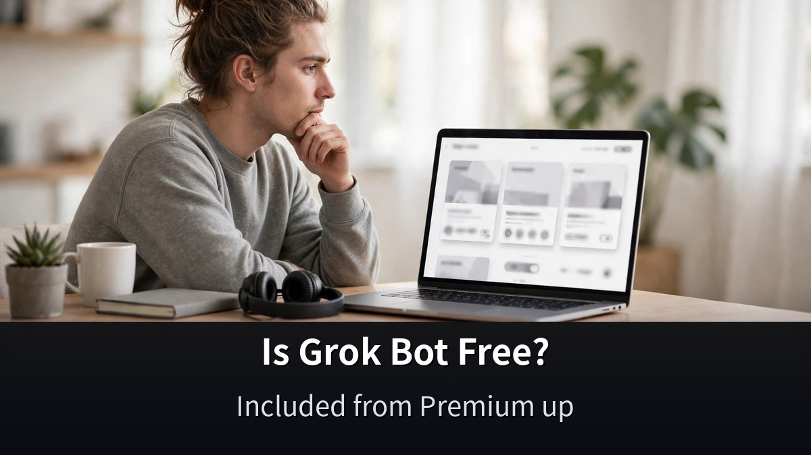
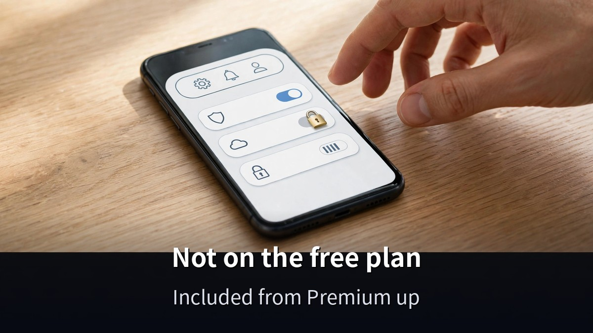
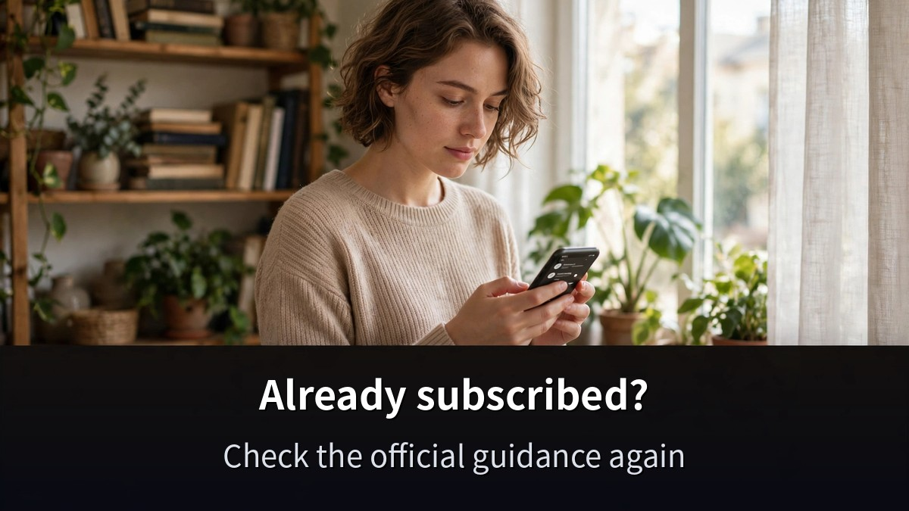

<!-- 본문 시작 -->

You cannot use Grok Bot for free.
As of November 2026, Grok Bot is included in The X Subscription Premium plan ($30/month) and above.
It is not in the Free or Plus plans.

> **In short, Grok Bot starts at $30 a month. The free plan does not include it, and there is no always-on free trial. If you were using it through Cursor Pro, the plan system has changed, so check the official guidance to see whether your plan still includes it.**

If you want to know how Grok Bot works, [Three Ways Grok Bot Automates Your Work](https://aitechnotesen.blogspot.com/2026/10/just-say-it-once-and-your-morning.html) covers scheduled runs, email triggers, and tool connections. This post covers price and conditions only.

## Is Grok Bot free?

No, it is not free.
The official xAI pricing page (x.ai/pricing, checked November 17, 2026) lists the Free plan at $0 a month, but Grok Bot is not in its included features.
Free plan usage is shown only as "Limited."

The Plus plan is the same.
Even at $8 a month, Grok Bot is not included.
Its usage is shown as "Basic."

There is no always-on free trial either.
The pricing page has no trial-period wording. The Free plan itself is always free, but it does not include Grok Bot.
So there is no way to try Grok Bot for free on the pricing page.

In short, you need a paid plan to use Grok Bot.
The starting point is in the next section.

(Illustration) The free plan does not include Grok Bot. That is what the pricing page shows.

## What is the cheapest way to use it?

The cheapest way is the Premium plan.
It costs $30 a month and includes Grok Bot.
Usage is shown as 4x the Plus plan.

| Plan | Monthly price | Grok Bot included |
|---|---|---|
| Free | $0 | No |
| Plus | $8 | No |
| Premium | $30 | Yes (4x Plus) |
| Super | $100 | Yes (15x Plus) |
| Ultra | $200 | Yes (50x Plus) |

The prices in this table are monthly prices checked on x.ai/pricing on November 17, 2026.
Annual billing is not shown on the pricing page, so no annual figures are listed here.
The listed prices exclude taxes and fees. You can cancel anytime, but you must cancel at least 24 hours before renewal.

Super costs $100 a month and Ultra costs $200 a month.
Both include Grok Bot, with usage at 15x and 50x the Plus plan.
The more you use it, the more the expensive plans make sense, but Premium is the starting point for a first try.

Prices change often.
These prices are as of November 2026, so check x.ai/pricing again before you pay.

(Illustration) Grok Bot starts at $30 a month, included from the Premium plan.

## What if you already use Cursor or SuperGrok?

First, one distinction matters.
Since October 12, 2026, new sign-ups have been unified under The X Subscription, and Grok Bot has no standalone price.
So the old guidance — "Cursor Pro at $20 a month lets you use Grok Bot" — no longer applies.

If you were using Grok Bot through Cursor Pro, the plan system has changed, so check the official xAI guidance to see whether your plan still includes it.
This post does not state the migration terms for existing subscribers, because the official guidance can change.

The same applies if you were using it under the SuperGrok name.
The plans on the pricing page today are Free, Plus, Premium, Super, and Ultra.
Check which plan on today's pricing page matches the one you use, and whether it includes Grok Bot.

For reference, the Teams plan is $30 per user per month and Enterprise is custom, and both include Grok Bot.
If several people at a company use it together, check these plans instead of a personal one.

(Illustration) Existing subscribers should check the official guidance again, because the plan system has changed.

## Frequently asked questions

**Is there a free trial for Grok Bot?**
No always-on free trial is shown on the pricing page.
The Free plan itself is $0 a month and always free, but it does not include Grok Bot.
Stories about a 7-day usage credit differ by source, so this post does not cover them.

**Is there a cheaper way than Premium?**
Not on the pricing page.
Free and Plus do not include Grok Bot, and Premium ($30 a month) is the cheapest plan that does.
The Teams plan is also $30 per user per month, so it is not a cheaper workaround for one person.

**Do prices change?**
They can.
These prices are as of November 2026. Check x.ai/pricing again before you pay.
Plan names and included features can change too, so look at the included features on the checkout screen one last time.

## More to read

[Start Claude for Free — What You Get, What You Don't, and 5 Drawbacks to Check First](https://aitechnotesen.blogspot.com/2026/11/start-claude-for-free-what-you-get-what.html)

[Lorantech Stand Review | A Foldable Phone & Tablet Stand Backed by 15,689 Reviews](https://aitechnotesen.blogspot.com/2026/11/lorantech-stand-review-foldable-phone.html)

Once the price is clear, Grok Bot is not a tool to try lightly.
At $30 a month to start, it makes sense to sign up when you know what you will use it for.
If the picture is clear — a morning report waiting for you every day — start with Premium.
If the picture is not clear yet, trying other things on the free plan first is fine too.
The price is set. Now it is only a question of whether you will use it.

<!-- 본문 끝 -->

## 작업용 출처·이미지 정보 (업로드 제외)

<!-- Sources -->
- x.ai/pricing (checked 2026-11-17): Free $0, Plus $8 excluded; Premium $30, Super $100, Ultra $200 included (4x, 15x, 50x Plus); no annual billing shown; no always-on free trial wording; Teams $30/user/month, Enterprise custom, both included
- Basis for the 2026-10-21-002 FAQ correction: since 2026-10-12, new sign-ups are unified under The X Subscription and Grok Bot has no standalone price
