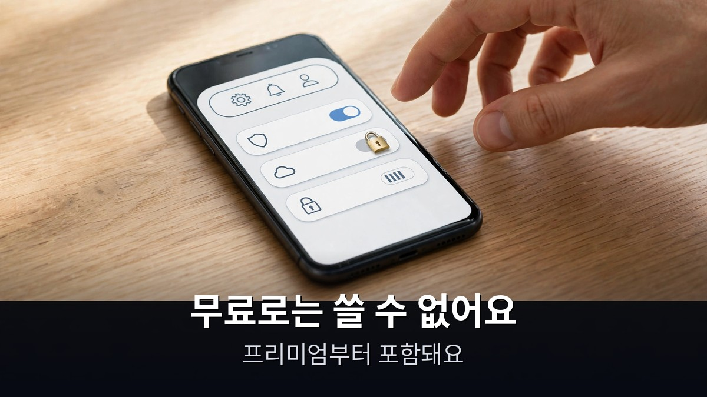

<!-- 본문 시작 -->

그록봇을 무료로 쓸 수는 없다.
2026년 11월 기준, 그록봇은 The X Subscription Premium(월 30달러) 이상 플랜에 포함된다.
Free와 Plus 플랜에는 들어 있지 않다.

> **핵심만 먼저 말하면, 그록봇의 시작 가격은 월 30달러다. 무료 플랜으로는 쓸 수 없고, 상시 무료 체험도 없다. 기존에 Cursor Pro로 쓰고 있었다면 플랜 체계가 바뀐 뒤라 공식 안내에서 포함 여부를 다시 확인해야 한다.**

그록봇을 어떻게 쓰는지 궁금하면 [그록봇 업무 자동화 3가지](https://blog.naver.com/3700708/224448503247)에서 스케줄 실행·이메일 트리거·도구 연결 방식을 먼저 보는 것도 좋다. 이 글은 가격과 조건만 정리한다.

## 그록봇은 무료인가요?

무료로는 쓸 수 없다.
xAI 공식 가격표(x.ai/pricing, 2026년 11월 17일 확인)에는 Free 플랜이 월 0달러로 적혀 있지만, 그록봇은 포함 항목에 없다.
Free 플랜의 사용량은 'Limited'로만 표시된다.

Plus 플랜도 마찬가지다.
월 8달러를 내도 그록봇은 포함되지 않는다.
사용량은 'Basic' 수준이다.

상시 무료 체험도 없다.
가격표에 기간제 무료 체험 문구가 없고, Free 플랜 자체가 상시 무료인 형태다.
다만 Free 플랜에는 그록봇이 들어 있지 않으니, 체험으로 그록봇을 써보는 방법은 가격표에 없다.

정리하면, 그록봇을 쓰려면 유료 플랜에 들어가야 한다.
그 시작점은 다음 문단에서 확인한다.

(일러스트) 무료 플랜에는 그록봇이 들어 있지 않다. 가격표에서 확인되는 그대로다.

## 가장 싸게 쓰는 방법은?

가장 싼 방법은 Premium 플랜이다.
월 30달러, 그록봇이 포함된다.
사용량은 Plus 대비 4배로 표시된다.

| 플랜 | 월 요금 | 그록봇 포함 |
|---|---|---|
| Free | $0 | 미포함 |
| Plus | $8 | 미포함 |
| Premium | $30 | 포함 (Plus 대비 4배) |
| Super | $100 | 포함 (Plus 대비 15배) |
| Ultra | $200 | 포함 (Plus 대비 50배) |

표의 가격은 2026년 11월 17일 x.ai/pricing에서 확인한 월 요금이다.
연간 결제 안내는 가격표 페이지에서 확인되지 않았으니, 연간 금액은 적지 않는다.
표시 가격은 세금·수수료 미포함이고, 해지는 언제든 가능하며 갱신 최소 24시간 전에 해지해야 한다는 안내가 있다.

Super는 월 100달러, Ultra는 월 200달러다.
둘 다 그록봇이 포함되고, 사용량은 각각 Plus 대비 15배와 50배다.
많이 쓸수록 비싼 플랜이 맞지만, 처음 써보는 사람에게는 Premium이 시작점이다.

가격은 수시로 바뀐다.
이 글의 가격은 2026년 11월 기준이니, 결제 전에 x.ai/pricing에서 다시 확인하는 것이 안전하다.

(일러스트) 그록봇의 시작 가격은 월 30달러, Premium 플랜부터 포함된다.

## 이미 Cursor·슈퍼그록을 쓰고 있다면?

먼저 구분해야 할 것이 있다.
2026년 10월 12일부터 신규 가입은 The X Subscription으로 통합됐고, 그록봇은 단독 가격이 없다.
그래서 예전에 보던 'Cursor Pro 월 20달러면 그록봇을 쓸 수 있다'는 안내는 지금은 맞지 않는다.

기존에 Cursor Pro로 그록봇을 쓰고 있었다면, 플랜 체계가 바뀐 뒤라 내 플랜에 그록봇이 계속 포함되는지 xAI 공식 안내에서 다시 확인해야 한다.
이 글에서는 기존 가입자별 전환 조건을 단정하지 않는다.
공식 안내가 바뀌면 조건도 바뀔 수 있기 때문이다.

슈퍼그록이라는 이름으로 쓰고 있었다면 마찬가지다.
지금 가격표에 적힌 플랜 이름은 Free·Plus·Premium·Super·Ultra다.
내가 쓰는 플랜이 지금 가격표의 어느 플랜에 해당하는지, 그록봇이 포함되는지를 확인하는 것이 순서다.

참고로 Teams 플랜은 월 30달러(사용자당), Enterprise는 맞춤형이며, 두 플랜 모두 그록봇이 포함된다.
회사에서 여러 사람이 함께 쓴다면 개인 플랜이 아니라 이쪽을 확인하는 것이 맞다.

(일러스트) 기존 가입자는 플랜 체계가 바뀐 뒤라 공식 안내에서 포함 여부를 다시 확인해야 한다.

## 자주 묻는 질문

**그록봇 무료 체험은 없나요?**
상시 무료 체험은 가격표에서 확인되지 않는다.
Free 플랜 자체는 월 0달러로 상시 무료이지만, 그록봇은 Free 플랜에 포함되지 않는다.
7일 사용 크레딧 같은 체험 이야기는 출처마다 달라서 이 글에서는 다루지 않는다.

**Premium 말고 더 싸게 쓸 방법은 없나요?**
가격표 기준으로는 없다.
Free와 Plus에는 그록봇이 들어 있지 않고, 포함되는 가장 싼 플랜이 Premium(월 30달러)이다.
Teams 플랜도 사용자당 월 30달러라 개인이 싸게 쓰는 우회로는 되지 않는다.

**가격은 언제든 바뀌나요?**
바뀔 수 있다.
이 글의 가격은 2026년 11월 기준이며, 결제 전에는 x.ai/pricing에서 다시 확인하는 것이 안전하다.
플랜 이름과 포함 여부도 바뀔 수 있으니, 결제 화면의 포함 항목을 마지막에 한 번 더 본다.

## 함께 보면 좋은 글

[클로드 무료로 시작하는 법｜8분 정리, 시작 전 꼭 확인할 5가지 단점](https://blog.naver.com/3700708/224474079288)

[로랜텍 거치대 후기｜리뷰 15,689개가 고른 접이식 태블릿·폰 거치대](https://blog.naver.com/3700708/224478574315)

가격을 먼저 확인하고 나니, 그록봇은 '한 번 써볼까' 하고 가볍게 시작하는 도구가 아니었다.
월 30달러라는 시작점이 분명하니, 쓸 일이 확실할 때 들어가는 것이 맞다.
매일 아침 보고서를 받아본다는 그림이 그려진다면 Premium부터 시작하면 되고, 아직 그림이 안 그려진다면 무료 플랜으로 다른 것부터 써보는 것도 괜찮다.
가격이 정해져 있으니, 이제는 쓸지 말지만 정하면 된다.

<!-- 본문 끝 -->

## 작업용 출처·이미지 정보 (업로드 제외)

<!-- 출처 -->
- x.ai/pricing (2026-11-17 확인): Free $0·Plus $8 미포함, Premium $30·Super $100·Ultra $200 포함(각 Plus 대비 4배·15배·50배), 연간 결제 안내 미표시, 상시 무료 체험 문구 없음, Teams $30/user/month·Enterprise 맞춤형 포함
- 기존 글 2026-10-21-002 FAQ 정정 근거: 2026-10-12 The X Subscription 통합 이후 그록봇 단독 가격 없음
