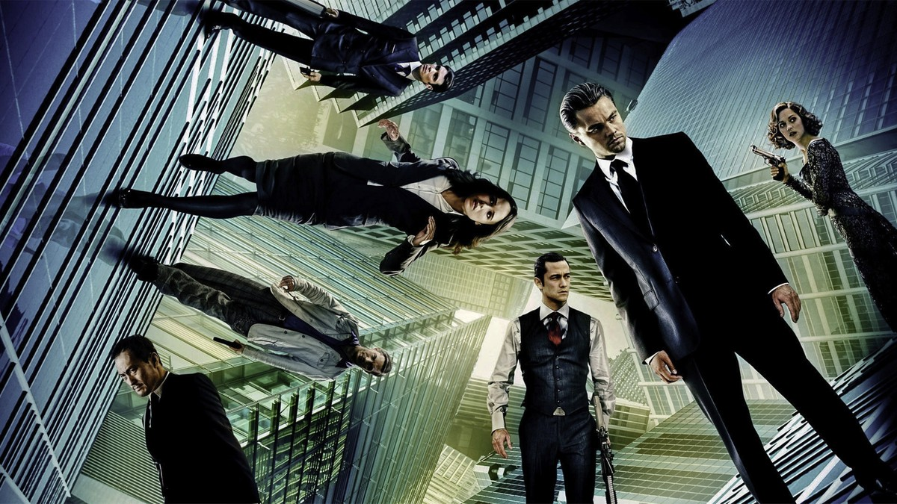
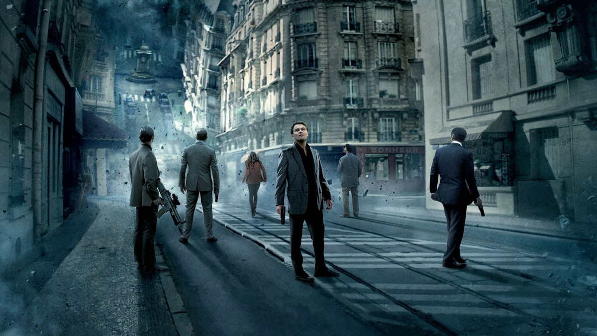
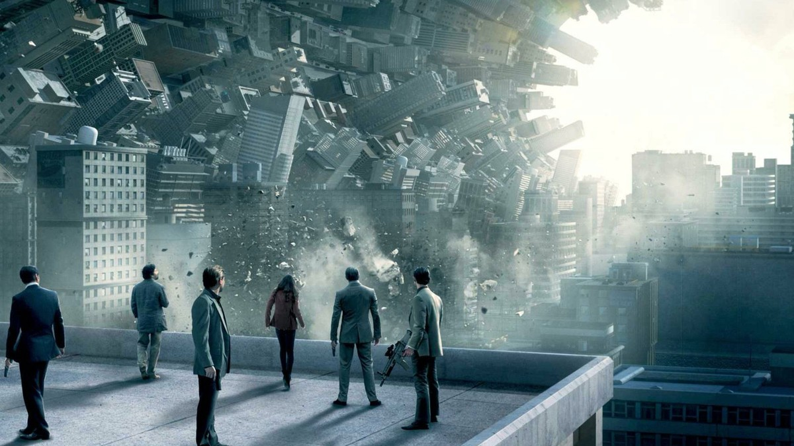
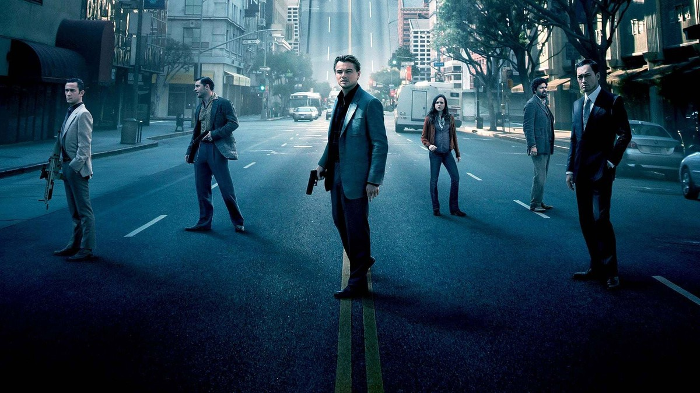
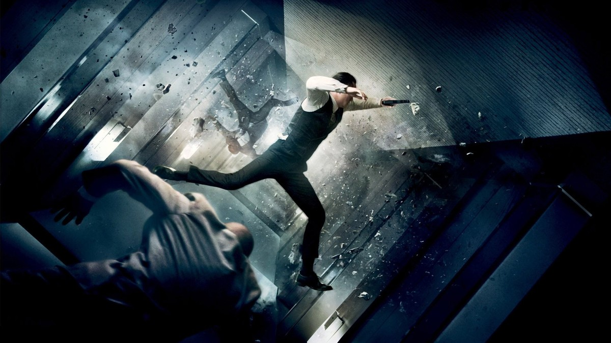
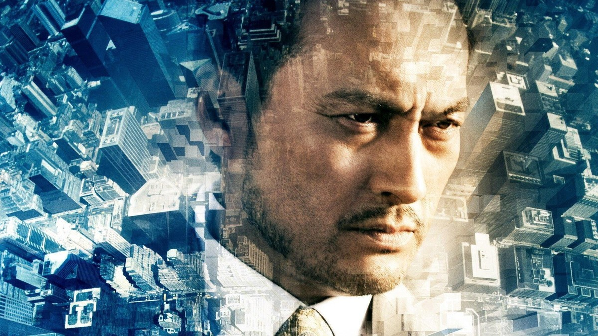

<!-- 본문 시작 -->

If you could enter someone else's dream and plant an idea there, whose idea would it be?
Inception is a 148-minute science-fiction action thriller that starts from that question.
In a world with dream-sharing technology, Cobb makes his living stealing secrets from other people's subconscious minds.

> **To put it in one line, Inception is not a film about fighting inside dreams. It uses the premise of planting an idea in someone's head to push one question all the way: "Is my memory real?" The whole of the film is Cobb putting a team together and entering Fischer's dream.**

How would you know if reality were fake? [Blade Runner 2049's question about whether memory is real](https://aitechnotesen.blogspot.com/2026/11/blade-runner-2049-line-between-human.html) starts from the same question.

| Item | Details |
| --- | --- |
| Title | Inception |
| Released | 2010 (US July 16, 2010, South Korea July 21, 2010) |
| Director | Christopher Nolan |
| Screenplay | Christopher Nolan |
| Main cast | Leonardo DiCaprio (Cobb), Joseph Gordon-Levitt (Arthur), Elliot Page (Ariadne), Tom Hardy (Eames), Ken Watanabe (Saito), Marion Cotillard (Mal), Cillian Murphy (Robert Fischer), Michael Caine (Professor Miles), Dileep Rao (Yusuf) |
| Runtime | 2 hours 28 minutes (148 minutes) |
| Rating | Ages 12 and up (Korea) |
| Score | TMDB 8.373/10 (40,754 votes, checked 2026-11-17), Rotten Tomatoes 87% (363 reviews), IMDb 8.8, 4 Academy Awards at the 83rd Academy Awards (Cinematography, Sound Mixing, Sound Editing, Visual Effects, from 8 nominations) |
| Where to watch | Streaming on Netflix, Wavve, Watcha (JustWatch Korea, checked 2026-11-17), rental on Wavve, purchase on Wavve |

## The story, without spoilers
Cobb is a man who enters other people's dreams and steals secrets from their subconscious. He uses a dream-sharing device called the PASIV to get inside other minds and take information out. Skilled as he is, Cobb cannot go home because of something in his past.

A businessman named Saito offers him a deal. Plant the idea "I will break up the company" in the mind of Fischer, the heir to a rival company, and Saito will help Cobb return home. Planting an idea is far harder than stealing one. The planted idea has to feel like the target's own decision.

Cobb puts a team together: Ariadne the architect, Eames the forger, Yusuf the chemist. The team designs a dream inside a dream inside Fischer's dream. The deeper they go, the more Fischer's defenses threaten the mission, and so does the memory of Cobb's wife Mal, which Cobb has kept hidden. For Cobb, who wants a chance to return to reality, the most uncontrollable intruder is inside his own mind.

## The film in scenes 1 — Paris, a street that folds
Cobb brings Ariadne, an architecture student, onto the team as its designer. The first thing Ariadne learns is how to design the space of a dream. The Paris street she builds starts out as ordinary as a textbook.

Then the whole street begins to fold. Buildings rise into the sky, and the road bends overhead. The premise plays out before your eyes: in a dream, space moves the way the designer imagines it. This scene matters not because of the action. It is the first scene that shows the rules of dreams. Every dream after it in the film moves on these rules.

A Paris street with buildings folding. A scene from the first shared dream Ariadne designed.

But this dream does not last long. Ariadne's subconscious notices the intruder, and the whole street starts to collapse. Cobb wakes her up in a hurry. When the owner of a dream notices the intrusion, the dream itself turns hostile — the first rule of dreams this scene teaches.

Paris collapsing, seen from a rooftop. The moment the dream's design starts to shake.

## The film in scenes 2 — The team, and dreams within dreams
The question of a mind inside a dream continues in [Ex Machina's Turing test](https://aitechnotesen.blogspot.com/2026/11/ex-machina-108-minutes-asking-robot-if.html).

The inception mission targets a single idea in one man, Fischer. To plant it, the team designs dreams in three layers. The first dream is a rainy city, the second a hotel, the third a snow-covered fortress.

The deeper you go, the slower time flows inside the dream. Ten hours outside feels like a week in the first dream. The dreamer of each level stays behind in that level to guard the team, and everyone times the "kick" so they wake at the same moment. A kick is the sensation of falling that wakes you from a dream.

Six people standing on a street. A scene where the dream city folds overhead.

The team has clear roles. Arthur runs the operation, Ariadne designs the dream space. Eames turns into other people to fool Fischer, and Yusuf makes the sedative that keeps the dream stable. Saito is the client, but he enters the dream himself to check the mission with his own eyes.

Each person has a separate job, yet one person's mistake can break the whole mission. So the tension in this film comes not from gunfights but from the timetable. Three layers of dreams, three kicks, one timing — all of them have to line up.

## The film in scenes 3 — The hotel hallway, where gravity disappears
The second dream takes place in a hotel. When the van falls off the bridge in the first dream, gravity shakes in the second dream too. The hallway rotates, and people fight while stuck to the walls.

Arthur's fight in the hallway is the scene from this film people talk about most. It was not made with computer graphics. The crew built a hallway set 30 meters long and turned it with two motors to film it for real. The actor spent weeks learning how to fight inside the rotating set.

In the way it shows the moment dream physics change with a real body, this scene shows the film's attitude. Film it for real wherever possible, and use graphics only as support.

Arthur fighting in the rotating hotel hallway. A scene from the second dream level, where gravity is gone.

Cobb carries a separate burden. The memory of his wife Mal keeps slipping into his dreams. Mal is tied to Cobb's past, and she is the weakest link in the mission.

No matter how precise the team's dream design is, the whole dream shakes when Cobb's mind shakes. The film does not solve this with action. It solves it in scenes where Cobb faces his own memory.

Cobb's face, overlapped with the city. The memory left in his head shakes the mission.

## The AI questions this film asks
First, can dreams be read? In the film, people enter dreams to take ideas out and plant ideas in. Research in reality is at a far earlier stage.

In 2013, Yukiyasu Kamitani's team at ATR in Japan published a study in the journal Science on reading brain activity during sleep to guess the content of dreams. They compared brain signals measured with fMRI against brain signals from viewing images while awake, and guessed the kind of object in the dream. Accuracy was about 60%, and what they guessed was only broad categories such as cars, books, and buildings, with 3 participants. Reading dreams has begun, but entering dreams is still a premise from film.

Second, can an idea be planted? Inception in the film is a mission to plant an idea in someone's head. In reality, there is research showing that memory, rather than ideas, can be shaken.

In 2024, a team at the MIT Media Lab published an experiment showing that a conversation with a generative chatbot can create false memories. After 200 people watched a crime video, a chatbot asked them leading questions, and the group that talked with the chatbot reported more than 3 times as many false memories as the control group. 36.4% of responses were misled by the chatbot conversation, and the memory stayed a week later. There is no machine that plants ideas, but that one question can change a memory is already confirmed.

Third, how do you check what is real? Cobb spins his totem top to check whether he is dreaming. A totem is a personal standard. But now that AI-made images and videos are everywhere, telling real from fake by eye alone has become hard.

The answer in reality is moving away from personal senses and toward records and provenance. Standards that attach provenance information to photos and videos are spreading, and platforms are moving toward requiring labels on generated material. If the totem was one man's standard, the standard in reality is provenance anyone can check.

## Where to watch
As of November 17, 2026:
Streaming on Netflix, Wavve, and Watcha. Rental and purchase are also available on Wavve. There is no free streaming provider. Check rental and purchase prices directly in the Wavve app.
(JustWatch Korea — check each app directly before watching.)

Cobb standing in the rain. A figure on the line between dream and reality.

In Korea it opened in theaters on July 21, 2010. It was made for $160 million and earned about $839 million worldwide, with about 6.01 million admissions in Korea. At the 83rd Academy Awards in 2011 it won four categories: Cinematography, Sound Mixing, Sound Editing, and Visual Effects. Filming ran from June 19 to November 22, 2009, in six countries. The music is by Hans Zimmer.

The team standing inside the folding city. The defining image of Inception.

A checklist before you watch:
Set aside 2 hours 28 minutes to watch it in one sitting. It is rated ages 12 and up, so keep in mind it has gunfire and violence. To follow the dream levels, it helps not to lose the thread in the first 30 minutes.

## Closing thoughts
Even after waking from a dream, reality can feel like a dream for a while. That is why Cobb spins his top. When you cannot be sure, there is nothing to do but check. What Inception leaves behind is not the action but that habit of checking.

## Frequently asked questions
**What is a totem?**
It is a personal object for checking whether you are dreaming. Cobb's totem is a spinning top: it keeps spinning in a dream and stops in reality. Each team member uses a different object. Arthur's totem is a die. How the totem moves is the standard that tells dream from reality.

**How does time flow in each dream level?**
The deeper you go, the slower time flows inside the dream. Ten hours on the plane feels like a week in the first dream, six months in the second, and ten years in the third. That is why matching the kicks across all three levels at the same moment is the key to the mission.

**Is it based on a true story?**
No. Christopher Nolan wrote it as fiction, inspired by lucid dreaming. He worked on the screenplay for nearly ten years and first pitched it to Warner Bros. in 2001. The dream-sharing technology is also a premise from the film.

## Good Reads Together
[Blade Runner 2049 — The Line Between Human and Replicant, in 2 Hours 44 Minutes](https://aitechnotesen.blogspot.com/2026/11/blade-runner-2049-line-between-human.html)
[Ex Machina — 108 Minutes Asking a Robot If It Has a Mind](https://aitechnotesen.blogspot.com/2026/11/ex-machina-108-minutes-asking-robot-if.html)

If you cannot be sure the dream you are dreaming now is a dream, the question this film asks has already begun.

<!-- 본문 끝 -->

## 작업용 출처·이미지 정보 (업로드 제외)

인셉션 (Inception, 2010, TMDB 27205) — TMDB 한국 페이지 2026-11-17 확인 (놀란 감독·각본, 148분, 12세, TMDB 8.373/10·40,754개 평가, 국내 개봉 2010-07-21, 제작비 1억 6,000만 달러·흥행 약 8억 3,900만 달러, 국내 관객 약 601만 명, 아카데미 4관왕) + JustWatch 한국 2026-11-17 기준 시청처 (넷플릭스·웨이브·왓챠 스트리밍, 웨이브 대여·구매, 무료 없음, 대여·구매 가격 미확인) + TMDB 스틸 8장 (결말 장면 제외) + 현실 AI 연구 2건 (2013 가미타니 꿈 해독 Science·약 60%·피험자 3명, 2024 MIT 거짓 기억 연구·3배·36.4%·200명)
