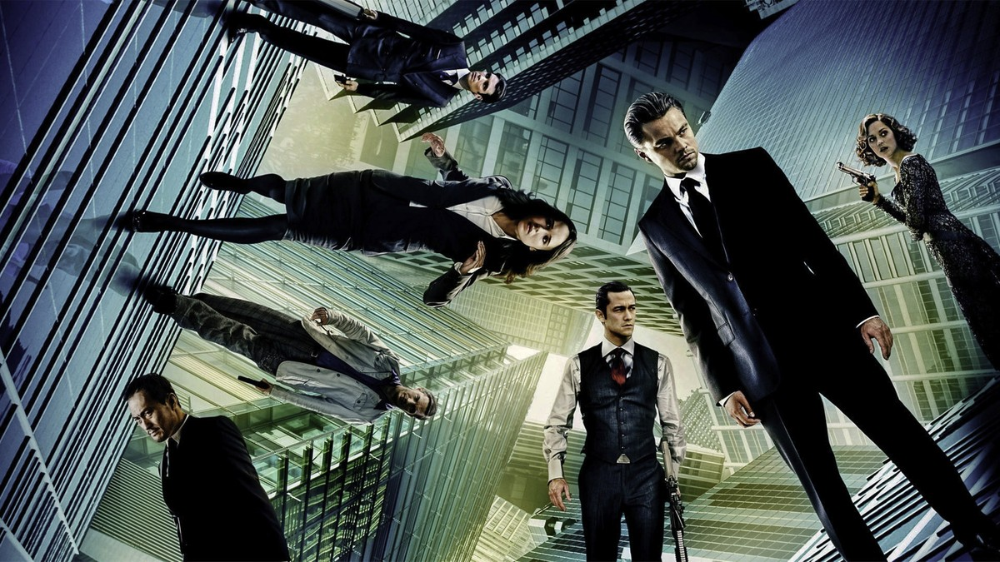
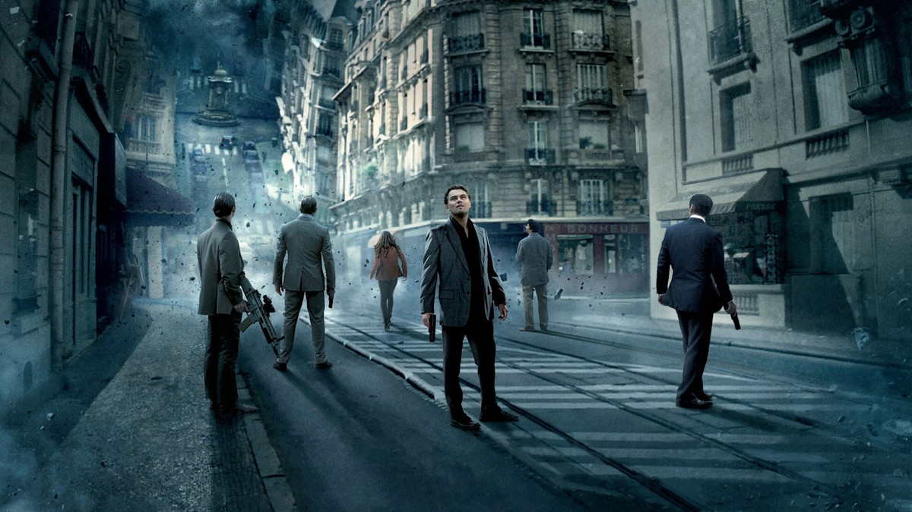
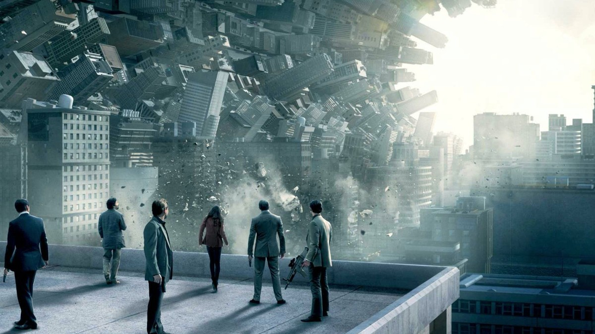
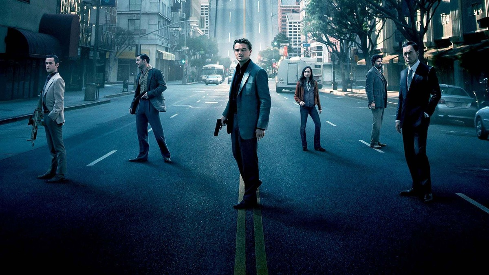
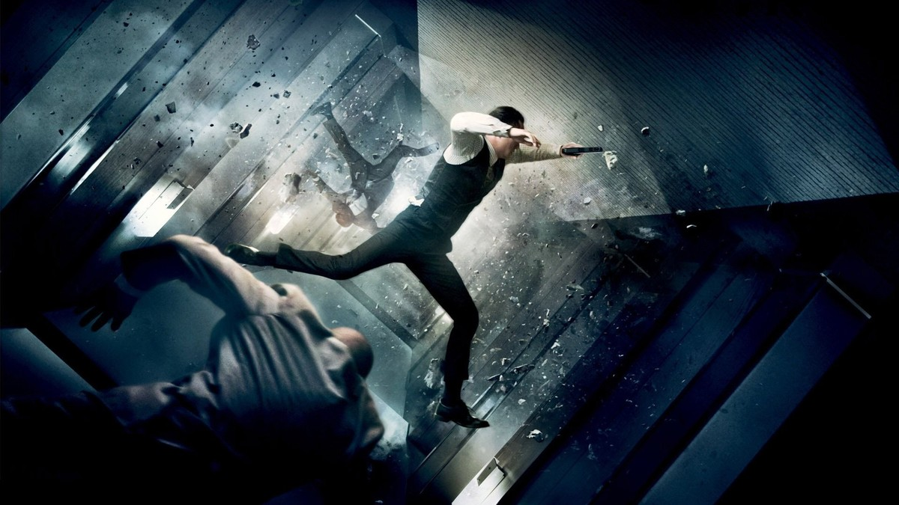
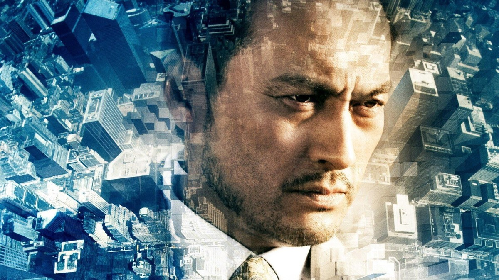
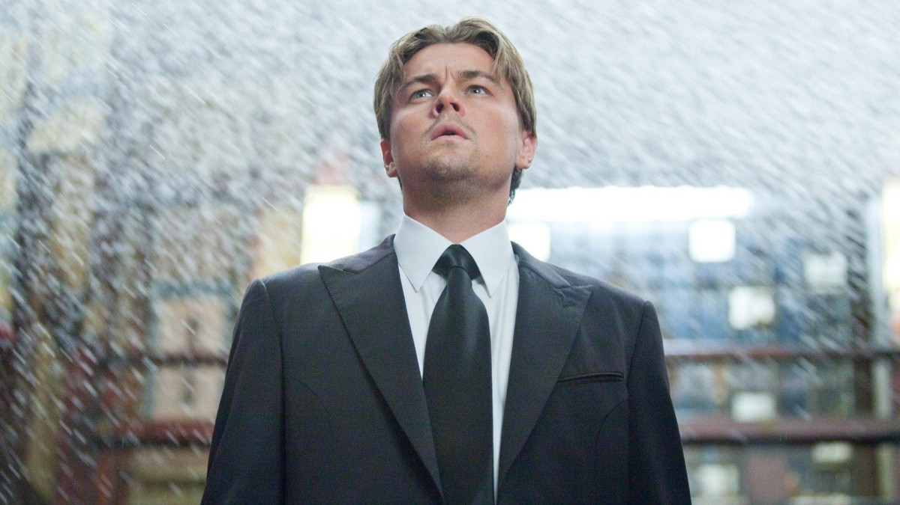
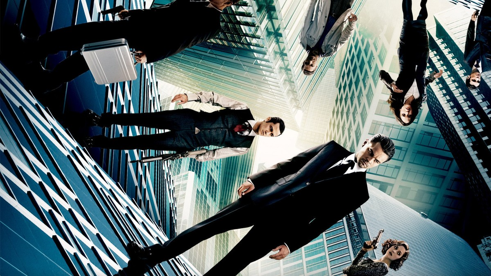

<!-- 본문 시작 -->



남의 꿈에 들어가 생각을 심을 수 있다면, 그 생각은 누구의 것이 될까요.
**인셉션은 꿈속 액션이 아니라 '내 기억은 진짜인가'라는 질문으로 148분을 끌고 가는 영화입니다.**
꿈을 공유하는 기술이 있는 세상에서, 코브는 타인의 잠재의식에서 비밀을 훔치는 도둑으로 삽니다.

> **한 줄로 정리하면, 인셉션은 꿈속에서 싸우는 영화가 아닙니다. 코브가 팀을 꾸려 피셔의 꿈에 들어가는 과정이 이 영화의 전부이고, 그 과정이 '내 기억은 진짜인가'라는 질문을 끝까지 끌고 갑니다.**

현실이 가짜라면 어떻게 알아챌 수 있을까요. [매트릭스의 가상 현실 질문](https://blog.naver.com/3700708/224478573702)도 같은 질문에서 출발합니다.

```blog
type: table
rows:
  - [{text: "항목", header: true, style: {background: "#123456", color: "#FFFFFF"}, width: 18}, {text: "내용", header: true, style: {background: "#123456", color: "#FFFFFF"}, width: 82}]
  - [{text: "제목", width: 18}, {text: "인셉션 (Inception)", width: 82}]
  - [{text: "개봉", width: 18}, {text: "2010년 (미국 2010-07-16, 한국 2010-07-21)", width: 82}]
  - [{text: "감독", width: 18}, {text: "크리스토퍼 놀란", width: 82}]
  - [{text: "각본", width: 18}, {text: "크리스토퍼 놀란", width: 82}]
  - [{text: "주요 출연", width: 18}, {text: "레오나르도 디카프리오(코브), 조지프 고든레빗(아서), 엘리엇 페이지(아리아드네), 톰 하디(임스), 와타나베 켄(사이토), 마리옹 코티야르(맬), 킬리언 머피(로버트 피셔), 마이클 케인(마일스 교수), 딜리프 라오(유서프)", width: 82}]
  - [{text: "러닝타임", width: 18}, {text: "2시간 28분 (148분)", width: 82}]
  - [{text: "등급", width: 18}, {text: "12세 이상 관람가", width: 82}]
  - [{text: "평점", width: 18}, {text: "TMDB 8.373/10 (40,754개 평가, 2026-11-17 확인), 로튼토마토 87% (363개 리뷰), IMDb 8.8, 제83회 아카데미 4관왕(촬영, 음향, 음향편집, 시각효과, 8개 부문 후보)", width: 82}]
  - [{text: "시청처", width: 18}, {text: "스트리밍 넷플릭스, 웨이브, 왓챠 (JustWatch 한국, 2026-11-17 확인), 대여 웨이브, 구매 웨이브", width: 82}]
```

```blog
type: heading
level: 2
runs:
  - text: "스포일러 없는 줄거리"
    style: {bold: true, color: "#007aa6"}
```

**코브는 사이토의 거래를 받고, 피셔의 머릿속에 '회사를 해체하겠다'는 생각을 심으러 들어갑니다.**

코브의 직업은 도둑입니다. 다만 훔치는 게 금고 속 물건이 아니라, 남의 꿈속에 숨은 비밀입니다. 꿈 공유 장치 **'파시브'**로 타인의 잠재의식에 들어가 정보를 빼내는 일을 하죠. 실력은 누구보다 뛰어나지만, 과거에 얽힌 일 때문에 집에는 돌아가지 못하는 몸입니다.

그런 코브에게 사업가 사이토가 거래를 내밉니다. 경쟁사 후계자 피셔의 머릿속에 **'회사를 해체하겠다'**는 생각을 심어 달라는 겁니다. 대가는 코브의 귀국. 그런데 심는 일은 빼내는 일보다 훨씬 어렵습니다. 심은 생각이 피셔 스스로 내린 결정처럼 느껴져야 하니까요.

코브는 설계자 아리아드네, 위장 전문가 임스, 약제사 유서프를 모아 팀을 꾸립니다. 피셔의 꿈속에 꿈을 겹겹이 설계하는 작전입니다. 아래로 내려갈수록 피셔의 방어 본능이 거세지고, 코브가 숨겨 온 **아내 맬의 기억**까지 작전을 흔듭니다. 현실로 돌아갈 기회를 잡으려는 코브에게, 가장 통제하기 어려운 침입자는 자기 마음속에 있습니다.

```blog
type: heading
level: 2
runs:
  - text: "장면으로 보는 작품 1 — 파리, 접히는 거리"
    style: {bold: true, color: "#007aa6"}
```

**꿈의 규칙을 처음 보여주는 장면입니다. 설계자가 상상하는 대로 공간이 움직인다는 설정이 눈앞에서 펼쳐집니다.**

아리아드네는 건축학과 학생입니다. 코브가 설계자로 데려온 그녀는 꿈의 공간을 만드는 법부터 배웁니다. 그녀가 처음 만든 파리의 거리는 **교과서처럼 평범하게** 시작합니다.

그러다 거리 전체가 접히기 시작합니다. 건물이 하늘로 솟아오르고, 길은 머리 위로 휘어집니다. 꿈에서는 설계자가 상상하는 대로 공간이 움직인다는 설정이 눈앞에서 펼쳐지는 겁니다. 액션 때문이 아니라, **꿈의 규칙을 처음 보여주는 장면**이라서 중요합니다. 이후 영화의 모든 꿈은 이 규칙 위에서 움직입니다.


건물이 접히는 파리 거리. 아리아드네가 처음 설계한 공유 꿈의 한 장면이다.

하지만 이 꿈은 오래가지 않습니다. 아리아드네의 잠재의식이 낯선 침입자를 알아채자 거리 전체가 무너지기 시작합니다. 코브는 서둘러 그녀를 깨웁니다. 꿈의 주인이 침입을 알아채면 **꿈 자체가 적으로 돌변한다**는 것, 이 장면이 알려주는 꿈의 첫 번째 규칙입니다.


옥상에서 바라보는 무너지는 파리. 꿈의 설계가 흔들리는 순간이다.

```blog
type: heading
level: 2
runs:
  - text: "장면으로 보는 작품 2 — 팀, 그리고 겹겹의 꿈"
    style: {bold: true, color: "#007aa6"}
```

**목표는 피셔 한 사람의 생각 하나, 방법은 꿈 세 겹입니다.**

꿈속 인물의 마음을 묻는 질문은 [엑스 마키나의 튜링 테스트](https://blog.naver.com/3700708/224474081075)에서도 이어집니다.

작전의 목표는 피셔 한 사람의 생각 하나입니다. 그 생각을 심으려고 팀은 꿈을 세 단계로 겹쳐 설계합니다. **1단계는 비 오는 도시, 2단계는 호텔, 3단계는 눈 덮인 요새**입니다.

아래로 내려갈수록 꿈속 시간은 더 느리게 흐릅니다. 밖에서 보내는 10시간이 첫 번째 꿈에서는 일주일처럼 느껴집니다. 각 단계의 꿈을 꾸는 사람은 그 단계에 남아 팀을 지키고, 모두가 같은 순간에 깨어나도록 **'킥'**을 맞춥니다. 킥은 떨어지는 느낌으로 꿈에서 깨게 만드는 신호입니다.


거리에 선 여섯 사람. 꿈속 도시가 머리 위로 접히는 장면이다.

역할도 분명하게 나뉩니다. 아서는 작전 진행을 이끌고, 아리아드네는 꿈의 공간을 설계합니다. 임스는 다른 사람으로 변신해 피셔를 속이고, 유서프는 꿈을 안정시키는 진정제를 만듭니다. 사이토는 의뢰인이면서 작전을 직접 확인하려고 **꿈속에 함께 들어갑니다**.

맡은 일은 따로따로지만, 한 사람의 실수에도 작전 전체가 무너집니다. 그래서 이 영화의 긴장은 총격전이 아니라 **시간표**에서 옵니다. 세 겹의 꿈, 세 개의 킥, 하나의 타이밍이 맞아야 합니다.

```blog
type: heading
level: 2
runs:
  - text: "장면으로 보는 작품 3 — 호텔 복도, 중력이 사라지는 순간"
    style: {bold: true, color: "#007aa6"}
```

**아서가 중력 없는 복도에서 벌이는 격투, 컴퓨터 그래픽이 아니라 실제로 찍은 장면입니다.**

두 번째 꿈의 무대는 호텔입니다. 첫 번째 꿈에서 밴이 다리에서 떨어지면, 두 번째 꿈의 중력도 함께 흔들립니다. 복도가 회전하고, 사람은 **벽에 붙은 채로** 싸웁니다.

아서가 복도에서 벌이는 격투는 이 영화에서 가장 많이 회자되는 장면입니다. 컴퓨터 그래픽으로 만든 장면이 아닙니다. 제작진은 **길이 30m의 복도 세트를 두 개의 모터로 돌려** 실제로 촬영했습니다. 배우는 회전하는 세트 안에서 싸우는 법을 몇 주 동안 연습했습니다.

꿈의 물리 법칙이 바뀌는 순간을 실제 몸으로 보여준다는 점에서, 이 장면은 영화의 태도를 보여줍니다. 가능한 한 실제로 찍고, **그래픽은 보조로 쓴다**는 태도입니다.


회전하는 호텔 복도에서 싸우는 아서. 중력이 사라진 꿈 2단계의 한 장면이다.

코브에게는 따로 짐이 있습니다. 그의 꿈에는 아내 맬의 기억이 자꾸 끼어듭니다. 맬은 코브의 과거와 연결된 인물로, **작전의 가장 약한 고리**입니다.

팀이 설계한 꿈이 아무리 정교해도, 코브의 마음이 흔들리면 꿈 전체가 흔들립니다. 영화는 이 지점을 액션으로 풀지 않습니다. 코브가 **자기 기억과 마주하는 장면**으로 풀어냅니다.


도시와 겹쳐 보이는 코브의 얼굴. 그의 머릿속에 남은 기억이 작전을 흔든다.

```blog
type: heading
level: 2
runs:
  - text: "이 작품이 던지는 AI 질문"
    style: {bold: true, color: "#007aa6"}
```

**꿈을 읽고, 생각을 심고, 진짜를 확인하는 일. 영화의 설정 세 가지가 현실에서는 어디까지 와 있을까요.**

```blog
type: text
runs:
  - text: "첫째, 꿈을 읽을 수 있는가."
    style: {bold: true, color: "#ff008c"}
  - text: " 영화에서는 꿈에 들어가 생각을 빼내고 심는다. 현실의 연구는 아직 그보다 훨씬 초보적인 단계에 있다."
```

2013년 일본 ATR 가미타니 연구팀은 학술지 사이언스에 수면 중 뇌 활동을 읽어 꿈의 내용을 맞추는 연구를 발표했습니다. fMRI로 잰 뇌 신호를, 깨어 있을 때 본 이미지의 뇌 신호와 대조해 꿈에 나온 물건의 종류를 맞추는 방식입니다. **정확도는 약 60%**, 맞춘 것은 자동차, 책, 건물 같은 넓은 범주뿐이었고, 피험자는 3명이었습니다. 꿈을 읽는 일은 시작됐지만, 꿈에 들어가는 일은 아직 영화 속 설정입니다.

```blog
type: text
runs:
  - text: "둘째, 생각을 심을 수 있는가."
    style: {bold: true, color: "#ff008c"}
  - text: " 영화의 인셉션은 남의 머릿속에 생각을 심는 작전이다. 현실에서는 생각이 아니라 기억이 흔들린다는 연구가 있다."
```

2024년 MIT 미디어랩 연구팀은 생성형 챗봇과의 대화가 거짓 기억을 만든다는 실험 결과를 발표했습니다. 범죄 영상을 본 200명에게 챗봇이 유도 질문을 던졌더니, 챗봇과 대화한 집단이 대조군보다 **3배 넘게 많은 거짓 기억**을 보고했습니다. 응답의 36.4%가 챗봇 대화에 오도됐고, 일주일 뒤에도 그 기억이 유지됐습니다. 생각을 심는 기계는 없지만, 질문 하나가 기억을 바꾸는 일은 이미 확인됐습니다.

```blog
type: text
runs:
  - text: "셋째, 진짜인지 어떻게 확인하는가."
    style: {bold: true, color: "#ff008c"}
  - text: " 코브는 꿈인지 확인하려고 팽이 토템을 돌린다. 토템은 개인의 기준이다. 그런데 AI가 만든 이미지와 영상이 넘치는 지금, 개인의 눈만으로 진짜를 가리는 일은 어려워졌다."
```

현실의 답은 개인의 감각이 아니라 기록과 출처 쪽으로 가고 있습니다. 사진과 영상에 출처 정보를 붙이는 표준이 확산되는 중이고, 플랫폼은 생성물 표시를 의무화하는 방향으로 움직입니다. 토템이 코브 한 사람의 기준이었다면, **현실의 기준은 모두가 확인할 수 있는 출처**입니다.

```blog
type: heading
level: 2
runs:
  - text: "어디서 보는지"
    style: {bold: true, color: "#007aa6"}
```

**2026년 11월 17일 기준, 넷플릭스·웨이브·왓챠에서 스트리밍으로 볼 수 있습니다.**

2026년 11월 17일 기준으로 정리합니다. 넷플릭스, 웨이브, 왓챠에서 스트리밍으로 제공합니다. 웨이브에서 대여와 구매도 가능합니다.

```blog
type: text
runs:
  - text: "무료 스트리밍 제공처는 없습니다."
    style: {bold: true, background: "#FFF3CD"}
  - text: " 대여와 구매 가격은 웨이브 앱에서 직접 확인하는 것이 좋습니다. (JustWatch 한국 확인 기준. 보기 전 앱에서 직접 확인 권장.)"
```


빗속에 선 코브. 꿈과 현실의 경계에 선 인물의 모습이다.

한국에서는 2010년 7월 21일 극장에서 개봉했습니다. 제작비 1억 6,000만 달러를 들여 전 세계에서 약 8억 3,900만 달러를 거뒀고, 국내 관객은 약 601만 명이었습니다. 2011년 제83회 아카데미 시상식에서는 촬영, 음향, 음향편집, 시각효과 **4개 부문을 수상**했습니다. 촬영은 2009년 6월 19일부터 11월 22일까지 6개국에서 진행됐고, 음악은 한스 짐머가 맡았습니다.


접히는 도시 속에 선 팀. 인셉션의 대표 이미지다.

시청 전 체크리스트도 있습니다. 러닝타임 2시간 28분이라 한 번에 볼 시간을 잡으면 됩니다. 등급은 12세 이상 관람가라, 총격과 폭력 장면이 있다는 점을 염두에 두는 게 좋습니다.

```blog
type: text
runs:
  - text: "꿈의 단계를 따라가려면 처음 30분은 흐름을 놓치지 않는 편이 낫습니다."
    style: {bold: true, background: "#FFF3CD"}
```

```blog
type: heading
level: 2
runs:
  - text: "마무리"
    style: {bold: true, color: "#007aa6"}
```

꿈에서 깨어난 뒤에도 한동안 현실이 꿈처럼 느껴집니다. 코브가 팽이를 돌리는 이유도 거기에 있습니다. 확신할 수 없으면 확인하는 수밖에 없고, 인셉션이 남기는 것은 액션이 아니라 그 확인의 습관입니다. 지금 꾸는 꿈이 꿈인지 확신할 수 없다면, 이 영화가 던지는 질문은 이미 시작됐습니다.

## 자주 묻는 질문

**토템은 무엇인가요?**
꿈인지 확인하는 개인 물건입니다. 코브의 토템은 팽이로, 꿈에서는 계속 돌고 현실에서는 멈춥니다. 팀원마다 다른 물건을 쓰는데, 아서의 토템은 주사위입니다. 토템의 움직임이 현실 여부를 가르는 기준이 됩니다.

**꿈의 단계마다 시간은 어떻게 흐르나요?**
아래로 내려갈수록 꿈속 시간은 더 느리게 흐릅니다. 비행기에서 보내는 10시간이 1단계 꿈에서는 일주일, 2단계에서는 6개월, 3단계에서는 10년처럼 느껴진다는 설정입니다. 그래서 세 단계의 킥을 같은 순간에 맞추는 일이 작전의 관건이 됩니다.

**실화를 바탕으로 한 영화인가요?**
아닙니다. 크리스토퍼 놀란 감독이 자각몽에서 영감을 받아 쓴 허구입니다. 각본은 10년 가까이 다듬어졌고, 2001년에 워너 브라더스에 처음 제안됐습니다. 꿈을 공유하는 기술도 영화 속 설정입니다.

## 함께 보면 좋은 글

[매트릭스｜현실이 코드였던 136분, 빨간 알약을 고른 날](https://blog.naver.com/3700708/224478573702)

[블레이드 러너 2049｜인간과 리플리컨트의 경계에 선 163분](https://blog.naver.com/3700708/224474068089)

[엑스 마키나｜로봇에게 마음을 묻는 108분, 튜링 테스트의 진짜 질문](https://blog.naver.com/3700708/224474081075)

<!-- 본문 끝 -->

## 작업용 출처·이미지 정보 (업로드 제외)

인셉션 (Inception, 2010, TMDB 27205) — TMDB 한국 페이지 2026-11-17 확인 (놀란 감독·각본, 148분, 12세, TMDB 8.373/10·40,754개 평가, 국내 개봉 2010-07-21, 제작비 1억 6,000만 달러·흥행 약 8억 3,900만 달러, 국내 관객 약 601만 명, 아카데미 4관왕) + JustWatch 한국 2026-11-17 기준 시청처 (넷플릭스·웨이브·왓챠 스트리밍, 웨이브 대여·구매, 무료 없음, 대여·구매 가격 미확인) + TMDB 스틸 8장 (결말 장면 제외) + 현실 AI 연구 2건 (2013 가미타니 꿈 해독 Science·약 60%·피험자 3명, 2024 MIT 거짓 기억 연구·3배·36.4%·200명)

- rev2 변경 (2026-11-17 처음부터 다시 쓰기): 소제목 7개를 blog heading 블록(#007aa6)으로, AI 질문 3개를 #ff008c 라벨 run으로, 주의 문구 2곳(무료 스트리밍 없음·처음 30분 흐름)을 #FFF3CD 하이라이트로 적용. 정보 표를 blog table 블록(18/82, 머리행 #123456)으로 전환. OG 카드 뒤에 있던 마무리 문장("지금 꾸는 꿈이 꿈인지...")을 마무리 섹션으로 이동해 OG 카드가 글의 마지막이 되게 함. 도입부 첫 문장을 질문형으로 교체하고 핵심 정리 인용구를 "한 줄로 정리하면"으로 다시 씀. 그 외 사실·수치·표·이미지·링크는 rev1과 동일.
- 추천 링크 occurrence: 1 — 세 URL 모두 추천 섹션 독립 링크가 1회차라 occurrence 1로 지정 (매트릭스·엑스 마키나는 본문 중 인라인 링크도 있으나 문장 속 링크라 세지 않음, 2026-11-17 occurrence 규칙).
- 자가검토 1회차 (문맥·이해): 도입부 결론 먼저(148분·'내 기억은 진짜인가'), 소제목 바로 아래 한 줄 답, 문단 2~4문장 분할, 문단당 핵심 구절 1개 굵게. 캡션 8개는 이미지에서 보이는 정보만 적음 (rev1과 동일).
- 자가검토 2회차 (A19 15문항): ① 경험 표현 없음 ② 첫 3문장 안에 독자 질문 답 있음 ③ 금지 표현 없음(출처 표기·일러스트 첨언·'이 글에서만 얻는 것'·구독 CTA·티저 없음) ④ 같은 조언 반복 없음 ⑤ 수치 일치 — 평점·제작비·흥행·관객·연구 수치는 표·본문·FAQ와 충돌 없음 ⑥ 내부 링크 3개 모두 주제 직접 관련 ⑦ 확인 날짜는 표에만 있고 본문 문장마다 검수 표기 없음 ⑧ 한 줄 문장 3줄 연속 없음 ⑨ 영화 템플릿 판단형 한 줄 결론(마무리 4문장 소회) ⑩ AI 이미지 없음, TMDB 스틸만 ⑪ 영상 기반 글 아님 ⑫ 제휴 아님(고지 문구 없음) ⑬ 제목 "[작품명]｜..." 규칙 준수 ⑭ 번역투 S1급 없음 ⑮ 내부 링크 URL은 rev1 확인값 (매트릭스 224478573702·블레이드 러너 224474068089·엑스 마키나 224474081075).
