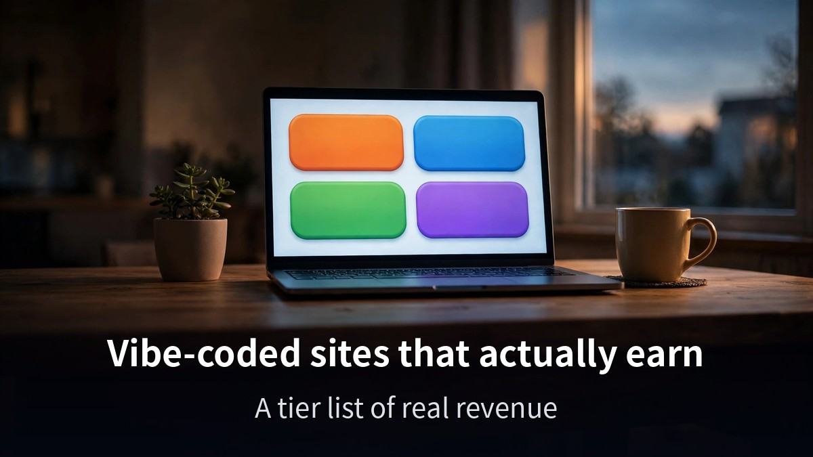
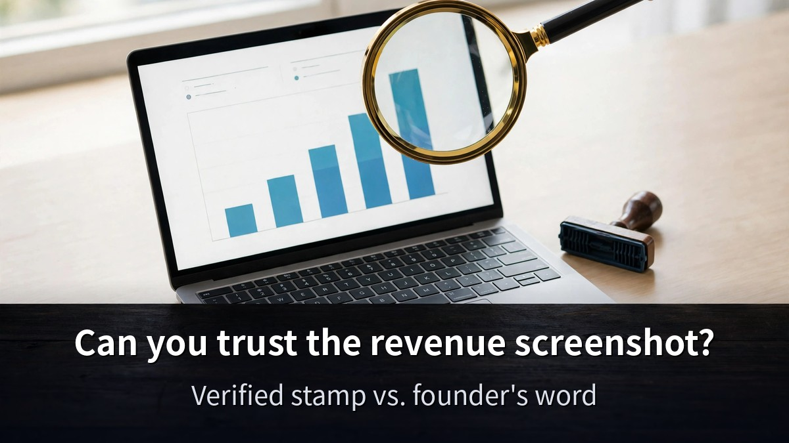
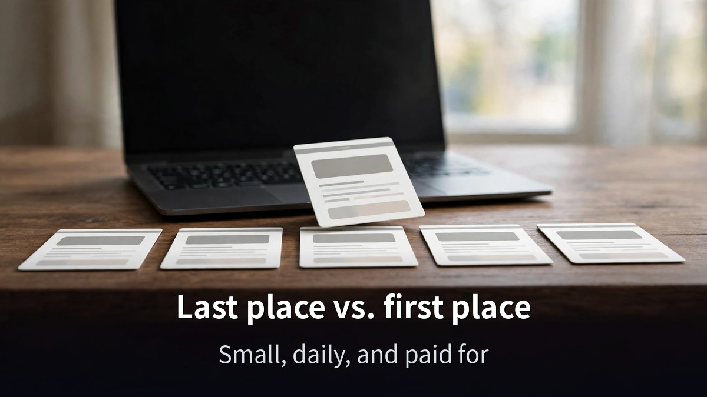

<!-- 본문 시작 -->

A quiz site built in 8 hours earns $40,000 a month, or so the story goes.
That is more than 50 million won in Korean currency.
But can that number be taken at face value?
This post ranks 13 real sites that earn money through vibe coding, building software by telling an AI what to make instead of writing code by hand, from tier 1 to tier 5.
Each number carries a stamp.
**A verified stamp means TrustMRR confirmed the figure against payment records, and a self-reported stamp means the maker stated the figure themselves.**
Telling those two apart is the whole point of this post.

> **In one line: of the 13 vibe coding sites earning money, only the 4 in tier 1 have numbers confirmed by payment records and are still earning now. GeoSports, the biggest earner at about $40,000 a month, is a self-reported figure, while the largest confirmed figure is GetEbook's monthly subscription revenue of $11,599. When you look at a revenue number, check the stamp before the amount.**

If you want to recreate the features yourself, start with the [Vibe Coding Website Tier List](https://aitechnotesen.blogspot.com/2026/11/vibe-coding-website-tier-list5-top-tier.html).

## Verified Stamp vs. Self-Reported Stamp: What Is the Difference

A magnifying glass hovers over a laptop showing a revenue bar chart, with a stamp beside it.

Check whether the stamp next to a number means verified or self-reported before anything else.

TrustMRR connects directly to a payment provider and shows the money that actually came in.
When a site operator connects a Stripe account, the revenue appears as a number straight from the payment record.
So a figure confirmed on TrustMRR is not the maker's word, it is a payment record.
A self-reported stamp, on the other hand, is a number the maker stated in a video or a post.
That does not mean it is false, but it does mean it is unverified.

Subastar shows how big that difference can be.
It gathers Maltese court-auction properties in one place.
A video said it earns 10,000 euros a month, but the TrustMRR figure is about $3,500 a month.
That is roughly a third of the stated number.
The site is real, and the money is real.
But the case shows why every number needs checking.

The tiers were graded on three things.
First, how much the site earns.
Second, how certain that number is.
Third, whether it is still earning now and whether an ordinary person could try something similar.
So this is not a simple ranking by earnings.
It is a ranking by earning big, earning verifiably, and earning for a long time.

One more thing to note.
Sites that earned a lot but were risky were left out of this table.
Sites that look up other people's identities, sell medicine, swap faces, had a security incident, or sell coins and courses were all excluded.
Only the remaining 13 are covered here.

## Why Are the 4 Tier 1 Sites on Top

Five website preview cards lie in a row on a desk, one rising above the rest.

The 4 tier 1 sites all had a clear user from the very beginning.

The first is Yadapon.
It lets you call abroad straight from a web browser, with no app to install.
The maker heard Skype was ending its service and built the first version with Cursor over a weekend.
TrustMRR confirms recent 30-day revenue above $15,000, and more than $270,000 has come in so far.
Most of it is pay-as-you-go billing rather than subscriptions, though, so fixed monthly subscription revenue is only about $1,400.

The second is GeoSports.
A new sports question appears every day, and players tap the location on a map in a free game.
The maker said Claude built it in 8 hours, and that it now earns about $40,000 a month.
Advertising brings in $30,000 to $35,000, and paid members make up the rest.
The advertising figure covers less than a full month, though, so it needs more watching.
Still, one simple structure that makes people come back every day brings money from two places at once, ads and members.
It was the easiest to build and earns the most, which is why it is tier 1.

The third is Voysee.
It turns speech into text, as a Chrome extension and a desktop app.
The maker started by pasting code ChatGPT wrote, then rebuilt it with Cursor.
The verified stamp matters here.
TrustMRR confirms monthly subscription revenue above $12,000, with more than 1,500 subscribers.
More than $210,000 has come in so far.
It started from one person's problem, the maker's father, and earns big on confirmed numbers, so it is tier 1.

The last is the Korean site WeNote.
It is a classroom management program for teachers, used by more than 200 schools.
The maker is a former elementary school teacher.
It started on Replit and is now built entirely with Claude Code.
In an interview in April this year, the maker said revenue was about 20 million won a month.
The payment provider's limit was 10 million won, and the site had already passed it.
The teachers' problem was solved directly, so the users were right there from the start.

If you want to try building with Claude, the free plan is a good place to start. See [Start Claude for Free: What You Get, What You Don't, and 5 Drawbacks to Check First](https://aitechnotesen.blogspot.com/2026/11/start-claude-for-free-what-you-get-what.html) before you pick a tool.

## So, Can I Build One Too and Earn the Same

A person sits at a laptop in a sunlit room, an open checklist notebook in front of them.

Before building anything, write down one person who is struggling with something.

The 4 tier 1 sites share one thing.
Every one of them had a clear user from the start.
People who needed somewhere to call abroad after Skype, people who love sports quizzes, the maker's father, and teachers.
Vibe coding means anyone can build now.
So the difference comes not from what was built, but from who it was built for.

The preparation is smaller than it looks.
One AI coding tool such as Claude, Cursor, Lovable, or Replit, a Stripe account for payments, and one community where you can find users.
The cost is often just the tool subscription.
But GetEbook shows another shape of the business.
Its TrustMRR-confirmed monthly subscription revenue is $11,599, with $169,654 earned so far.
Yet the maker said in a video that monthly ad spending runs $20,000 to $30,000.
The number is big and verified, but it is money earned, not money kept.

Tier 2 TrustMRR has a catch of its own.
The place that verifies the number is itself.
Cumulative revenue confirmed inside TrustMRR is more than $413,986.
But a site verifying its own revenue is not as clean as the other cases.
That is why it is tier 2.
Creator Buddy is similar.
The claim of $100,000 in annual recurring revenue 15 minutes after launch does not mean $100,000 arrived that day. It is the day's subscriptions stretched into a yearly figure.
Two weeks later it had 500 paying subscribers and $300,000 in annual terms.
Impressive, but unverified, and far from what the headline suggests, so it is tier 3.

The most realistic starting point is in tier 4.
Chattrips is an AI trip-planner site built by an electrical technician from Slovenia.
He wrote no code at all, using Lovable.
He said it passed $1,000 in monthly revenue in 14 days.
That is the smallest amount in this table.
Visiting the address now shows an AI company introduction page instead of the trip service.
Still, a non-developer reaching first payment in two weeks is the most realistic start here.
Keep in mind, though, that this case comes from Lovable's official channel, so some promotion is mixed in.

When you look at someone else's revenue number, check once more whether it is a confirmed number.
And think of one person near you who is struggling with something.
Writing down one annoying task of theirs is the first line of a tier 1 site.

| Tier | Site | Monthly Revenue | Verification |
| --- | --- | --- | --- |
| Tier 5 | FlyPeter.com | $87,000 MRR 17 days after launch | Self-reported, sponsor ads |
| Tier 5 | Subastar | About $3,500 a month | TrustMRR verified, video claimed 10,000 euros a month |
| Tier 4 | Creator Hunter | $30,000–$40,000 total, about 9 months | Self-reported, $17,000 in the first 90 days |
| Tier 4 | Chattrips | $1,000 MRR in 14 days | Self-reported, Lovable official video |
| Tier 3 | Creator Buddy | $300,000 ARR, 500 paying users after 2 weeks | Self-reported, launch-day $100,000 ARR is a yearly stretch |
| Tier 3 | Alki | About $9,500 a month | TrustMRR verified, below the claimed 13,000 euros |
| Tier 2 | GetEbook | $11,599 MRR, $32,167 in 30 days | TrustMRR verified, ad spend $20,000–$30,000 a month |
| Tier 2 | TrustMRR | $26,693 in 30 days, $413,986 cumulative | TrustMRR verified, self-verification limit |
| Tier 2 | QuickTables | About 100,000 euros a year | Self-reported, sold to a Dutch company in June 2026 |
| Tier 1 | Yadapon | Over $15,000 in the recent 30 days | TrustMRR verified, subscription MRR about $1,400 |
| Tier 1 | GeoSports | About $40,000 a month | Self-reported, ads $30,000–$35,000 a month |
| Tier 1 | Voysee | Over $12,000 monthly subscription revenue | TrustMRR verified, over 1,500 subscribers |
| Tier 1 | WeNote | About 20 million won a month | Self-reported, April 2026 interview |

Figures verified as of November 16, 2026. MRR is monthly recurring revenue, ARR is annual recurring revenue.

The first thought this table gave me was not "building is easy now" but "having a clear user is the hardest part."
My heart moved first at the story of a game built in 8 hours earning $40,000 a month, but checking the numbers one by one, what stayed in my eyes was the stamp.
A number confirmed by payment records and a maker's word carry different weight.
If I ever build something, I will not start with a feature list. I will start by writing down the name of one person who is struggling with something.

## Frequently Asked Questions

**Can vibe coding alone really earn money?**

Yes, but in the way the 13 sites in this table did: by solving a small, clear problem for a clear user. The technology itself does not earn money. The problem it solves does.

**How are TrustMRR numbers verified?**

The site operator connects a payment account such as Stripe to TrustMRR, and the money that actually came in is shown as it is. Unlike a self-reported claim, the payment record is the evidence, so checking the stamp next to the number first is the smart move.

**If I copy a tier 1 site, will I earn the same?**

Copying it does not bring the same revenue. GeoSports had the reach of a well-known developer with many X followers, and WeNote had teachers as users from the very start. Before copying, look for a problem near you first.

## Good Reads Together

[Vibe Coding Website Tier List｜5 Top-Tier Sites Out of 19, Recreated with Claude](https://aitechnotesen.blogspot.com/2026/11/vibe-coding-website-tier-list5-top-tier.html)

[Start Claude for Free: What You Get, What You Don't, and 5 Drawbacks to Check First](https://aitechnotesen.blogspot.com/2026/11/start-claude-for-free-what-you-get-what.html)

<!-- 본문 끝 -->

## 작업용 출처·이미지 정보 (업로드 제외)

**Sources**
- TrustMRR verification pages (GeoSports, GetEbook, TrustMRR, Alki, Yadapon, Voysee, Subastar): payment-linked figures, as of November 16, 2026
- Full transcript of the 13-site video (RSS date November 17, 2026, 9 minutes 6 seconds): tier structure and self-reported figures
- Creator Buddy maker statements: $235,000 ARR and 400 customers within 3 days of launch
- TrustMRR maker anniversary post, October 30, 2026: $427,610 revenue, 90% margin (self-reported)
