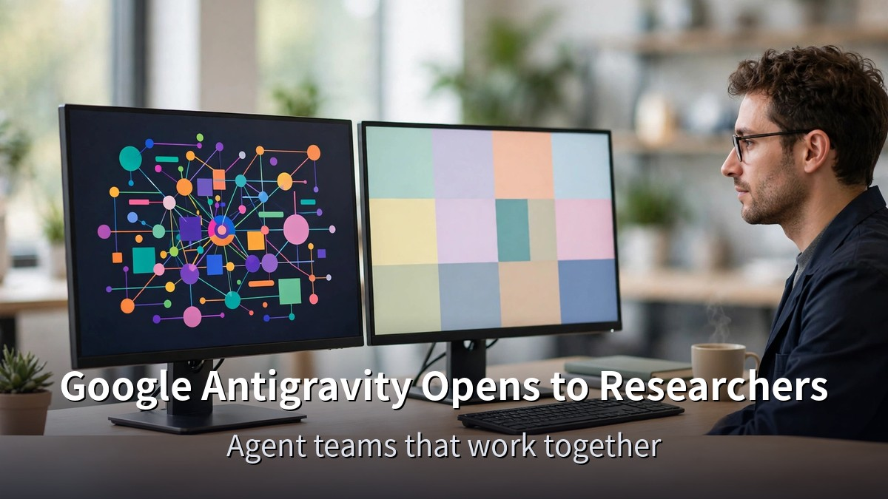
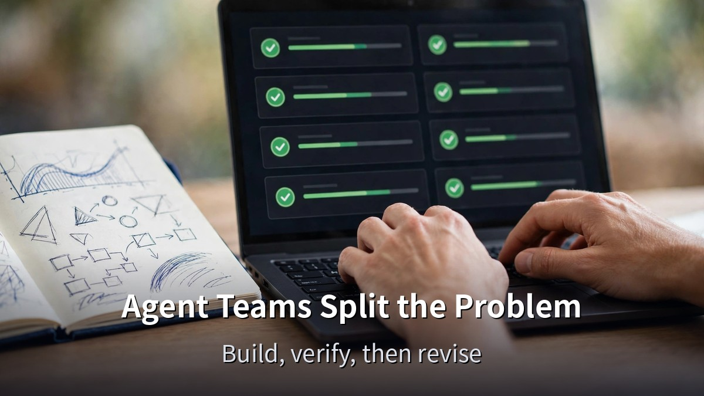
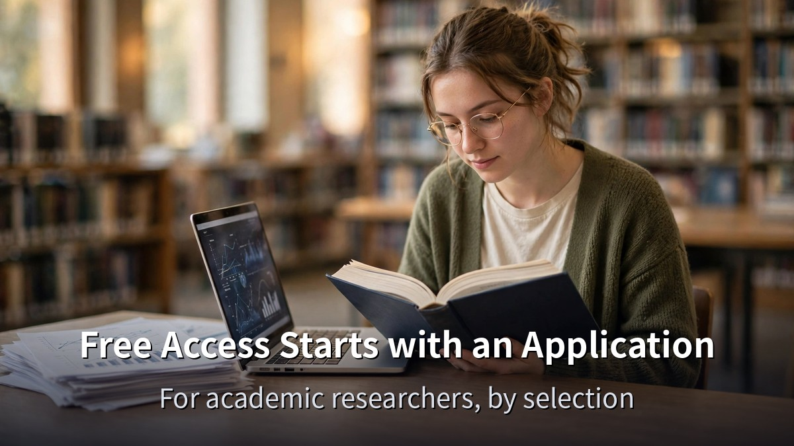
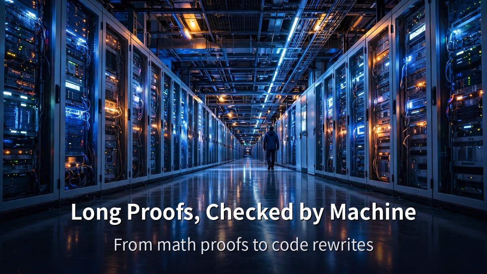

<!-- 본문 시작 -->

Google is giving 10,000 academic researchers six months of free access to Antigravity's highest usage tier.
Applications are open now, and researchers are picked through a selection process.
If you work at a university, read the eligibility conditions first, then the application steps.

> **In one line, Antigravity's /teamwork splits a big job across specialist agents and checks the result with verifiers, and the researcher offer covers 10,000 people for six months on the top tier.**

To see how the other flagship model of the same week is judged, [this comparison of Fable 5.2 and Opus 5.5 across four experiments](https://aitechnotesen.blogspot.com/2026/11/fable-52-vs-opus-55-4-experiments-that.html) shows when the expensive model is worth picking.

## What makes Antigravity /teamwork different?

Antigravity is not a chat window that writes code. It is a development environment where several agents work together.
Its core feature, /teamwork, splits one large problem across specialist agents.
One agent builds, another looks for flaws, and a third verifies the result from a clean context.
Each agent receives only the files and tools its step needs.
That structure keeps long work from losing track of details.
For everyday coding, /boost packages the sequential pattern from /teamwork.
Deep Review, which checks draft papers, belongs to the same family.

The headline cases come from mathematics.
Google and university teams used /teamwork to prove the Courtade-Kumar conjecture, open since 2013.
The full proof was formalized in Lean 4, a language a computer kernel checks line by line, producing 50 million lines of code.
The Weil conjectures formalization spans about 1.8 million lines of Lean, produced across 28,800 subagent invocations.
These numbers come from Google's own announcement.
A proof written in a verification language lets a machine check every logical step, so a human does not have to re-read the whole argument to catch a gap.

Check marks light up one by one on a task board, with equations and a flow chart in a notebook beside it.

Science cases exist too.
To determine a molecule's structure, 30 specialist agents worked with a physics-informed spectral simulator.
On complex benchmark molecules, the system reached 95% top-1 exact match and 100% top-3 accuracy.
That is nearly double single-agent performance, according to Google's announcement.

## Who gets the free researcher offer, and for how long?

The offer comes down to three numbers.
The audience is 10,000 academic researchers, the period is six months, and the price is $0.
What they receive is Antigravity's highest usage tier.
Applications are open, and selection depends on eligibility, capacity, and review.
Applying does not mean automatic acceptance.
With 10,000 places, not every applicant gets in.

The offer includes /teamwork, /boost, and Deep Review.
Deep Review checks draft papers for proof errors.
Users get two free Deep Review calls per week.
Some specialist workflows are not public yet.
Google says the formal proof pattern and more workflows will arrive in the coming weeks.

For everyone else, the options look like this.
The individual plan starts at $0 with a weekly quota.
Paid access comes through Google AI plans, which raise the quota.
There is no Antigravity-only subscription.

| How to use it | Monthly price | What you get |
|---|---|---|
| Researcher offer | $0 for 6 months | Highest tier, /teamwork, /boost, Deep Review |
| Individual free | $0 | Weekly quota, centered on Gemini 3.8 Flash |
| Google AI Pro | $19.99 | Generous quota refilled every five hours, Gemini 4 Argon |
| Google AI Ultra | From $99.99 | Highest quota, Gemini 4 Carbon |

Prices are US list prices checked on November 18, 2026.
Buying tokens through the API is a different price system.
Carbon costs $2 per million input tokens and $10 per million output tokens through November 30, then $4 and $20 from December 1.
Hydrogen, the fast execution model, costs $1.50 input and $7.50 output.
The researcher offer is separate from API token pricing, so decide which route fits your work before applying.

If you want to compare free conditions across tools, [Grok Bot Pricing: Can You Use It for Free?｜November 2026 Guide](https://aitechnotesen.blogspot.com/2026/11/grok-bot-pricing-can-you-use-it-for.html) shows a case where the free plan does not include the tool at all.

## How far can the proof results be trusted?

Start with the Deep Review survey.
More than a third of the 578 submissions to STOC 2027 opted in to receive Deep Review feedback.
Of the 70 authors surveyed, 90% rated the feedback mostly or almost all factual, and 90% said they would use the tool again.
Over 30% said Deep Review caught substantive proof bugs or mathematically significant typos, and 14% said it found technical gaps that took more than an hour to fix.
A survey of 70 people cannot speak for all authors, but the direction is clear: machine checking is starting to ease a long-standing review bottleneck.

The code migration results are concrete too.
A two-week campaign rewrote the remaining C++ of the Zircon microkernel into about 800,000 lines of safe Rust.
It passed all kernel unit tests and booted on arm64 hardware.
The libgav1 AV1 decoder rewrite came to about 170,000 lines of Rust with 100% bit-exact parity.
It started about 4x slower than the original C++ code, then became 20-30% faster after /teamwork got profiling tools and a mandate to maximize speed.
These figures are Google's own measurements of its internal work.

Math books and printed papers pile up on a library desk.

Server racks stretch down a data center corridor.

**What is confirmed, and what is still a claim**
Confirmed: six months of free top-tier access for 10,000 academic researchers, /teamwork, /boost, and Deep Review available to outside researchers and developers now, the Courtade-Kumar proof with a 50-million-line Lean 4 formalization, the Weil conjectures at 1.8 million lines and 28,800 subagent calls, the Deep Review survey numbers, the molecular structure results at 95% and 100%, and the Zircon and libgav1 rewrite figures, all from Google's announcement.
Still a claim: how to read these results.
The Weil formalization has no public repository link, so outsiders cannot check it directly.
Most results come from internal work by Google and its partners, so they should not be read as independently verified.
The video host reads the free offer as a Google ecosystem-expansion strategy (host's view), including the idea that heavier researcher use would raise Google Cloud usage.
The official announcement describes opening the tools so researchers and developers can apply them to their own work.
The host's description of Antigravity as a tool that ties a paper's code, data, and graphs into one is also the host's framing; the official blog describes Antigravity as an environment where specialist agents work.
The announcement gives no date for selection notices, and no official source was found for the "science 10x faster" figure.

Six months sounds long, but it can feel short when one proof has to be carried to the end.
Still, an agent team that also handles verification is worth a careful look for anyone who plans a lab budget.
If you qualify, gather your application materials this week.
If you do not, start one small task on the free individual plan, and move to a paid plan only when the quota runs short.

## Frequently asked questions

**When will applicants hear back?**
The announcement gives no notification date.
According to press coverage, applications stay open and researchers are selected on a weekly rolling basis.
While waiting, you can start small tasks on the individual free plan.

**Can non-researchers use Antigravity for free?**
The individual plan starts at $0 with a weekly quota.
From November 18, 2026, its only agent model is Gemini 3.8 Flash.
Claude 4.6 and GPT-OSS models are removed on that date.

**Where do I apply?**
The application link sits at the end of the Google Research blog post.
It is a program for academic researchers, so have your affiliation and research area ready before you apply.

## Good Reads Together
[Start Claude for Free — What You Get, What You Don't, and 5 Drawbacks to Check First](https://aitechnotesen.blogspot.com/2026/11/start-claude-for-free-what-you-get-what.html)
[Interstellar — One Hour Is Seven Years on a Distant Planet — a 169-minute classic worth your evening on Netflix](https://aitechnotesen.blogspot.com/2026/11/interstellarone-hour-is-seven-years-on.html)

<!-- 본문 끝 -->

## 작업용 출처·이미지 정보 (업로드 제외)

## Sources (not for upload)

- Google Research blog, "Advancing science & engineering with Antigravity's /teamwork" (Nov 13, 2026): 10,000 researchers, six months free, highest tier, /teamwork, /boost, Deep Review, Courtade-Kumar proof and 50M-line Lean 4 formalization, Weil conjectures 1.8M lines and 28,800 subagent calls, Deep Review survey (578 submissions, N=70, 90%, 90%, over 30%, 14%), molecular structure 95% and 100%, Zircon 800K lines, libgav1 170K lines, 20-30% faster
- Google Antigravity pricing page (checked Nov 18, 2026): individual free $0, Pro $19.99, Ultra from $99.99, Claude 4.6 and GPT-OSS removal on Nov 18, 2026
- Google Gemini API pricing page (checked Nov 14-16, 2026, cross-checked with press): Carbon $2/$10 per 1M tokens through Nov 30, $4/$20 from Dec 1, Hydrogen $1.50/$7.50, Carbon GA Nov 10
- ETIH, "Google adds Gemini 4 Carbon to free scientist access program" (Nov 16, 2026): weekly rolling selection, Carbon added to the program
- Video transcript: AI Slash hBqT3H3fyCg (RSS date Nov 17, 2026; 5 min 24 sec; 15,000 views; transcript 0:00-5:02 fully checked, includes repeated passages)
