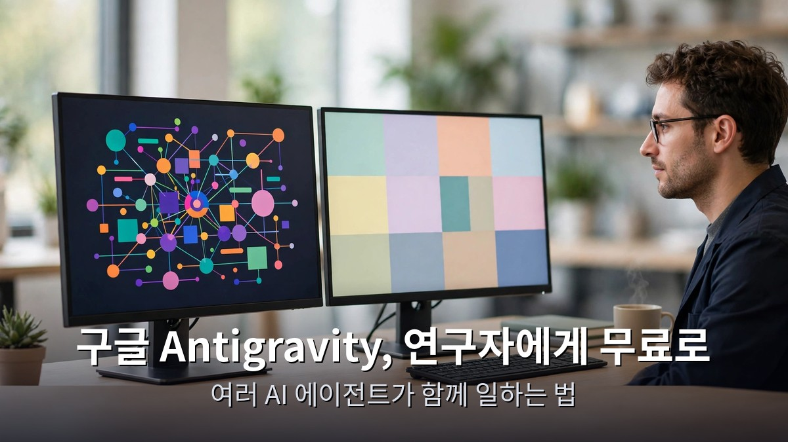
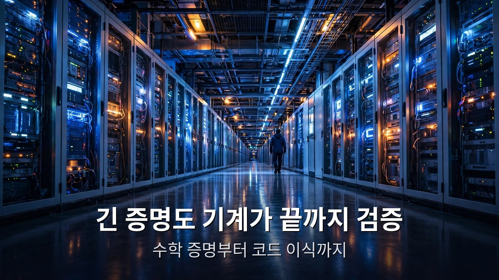

<!-- 본문 시작 -->

구글은 대학 연구자 1만 명에게 Antigravity 최상위 요금제를 6개월 무료로 제공한다.
신청은 지금 열려 있고, 심사를 거쳐 뽑는다.
대학에서 연구하는 사람이라면, 신청 자격부터 확인할 순서로 읽으면 된다.

> **한 줄로 정리하면, Antigravity의 /teamwork는 여러 전문 에이전트가 일을 나눠 맡고 검증 도구가 결과를 확인하는 방식이고, 연구자 무료 혜택은 1만 명에게 6개월간 최상위 요금제를 주는 것이다.**

카본 모델 자체가 궁금하다면 [제미나이 4 카본 정식 출시 내용](https://blog.naver.com/3700708/224474053353)에서 누가 쓸 수 있고 가격은 얼마인지 먼저 보는 게 순서가 맞다.

## Antigravity /teamwork는 뭐가 다른가?

Antigravity는 코드를 짜주는 채팅창이 아니라, 에이전트 여러 개가 함께 일하는 개발 환경이다.
핵심 기능인 /teamwork는 하나의 큰 문제를 여러 전문 에이전트에게 나눠 맡긴다.
만드는 에이전트, 허점을 찾는 에이전트, 처음부터 다시 검증하는 에이전트가 따로 움직인다.
각 에이전트는 자기 단계에 필요한 파일과 도구만 받는다.
긴 작업에서도 맥락이 흩어지지 않게 짜인 구조다.
일상 코딩에는 /teamwork의 순차 패턴을 묶은 /boost를 쓴다.
논문 초안을 검토하는 Deep Review도 같은 계열이다.

결과 사례는 수학에서 나왔다.
구글과 대학 연구팀은 /teamwork로 2013년부터 풀리지 않던 코타드-쿠마르 추측을 증명했다.
증명 전체를 Lean 4라는 검증 언어로 옮긴 분량은 5,000만 줄에 이른다.
바일 추측 형식화는 약 180만 줄, 하위 에이전트 호출은 28,800회에 이른다.
숫자는 구글 발표에 나온 그대로다.
검증 언어로 옮긴 증명은 컴퓨터가 한 줄씩 맞는지 확인한다.
사람이 증명 전체를 다시 읽지 않아도, 논리 구멍을 기계가 걸러내는 구조다.

작업판의 체크 표시가 하나씩 켜지고, 옆 노트에는 수식과 흐름도가 적혀 있다.

과학 쪽 사례도 있다.
분자 구조를 찾는 작업에서는 전문 에이전트 30개가 물리 시뮬레이터와 함께 돌았다.
복잡한 분자에서 정답을 한 번에 맞힌 비율은 95%, 상위 3개 안에 든 비율은 100%였다.
단일 에이전트와 견주면 거의 2배 수준이다.
이 수치는 구글 발표에 나온 벤치마크 결과다.

## 연구자 무료 혜택, 누가 얼마나 받나?

무료 혜택의 조건은 세 가지 숫자로 정리된다.
대상은 대학 연구자 1만 명, 기간은 6개월, 요금은 0원이다.
받는 것은 Antigravity 최상위 요금제다.
신청은 열려 있고, 자격과 수용 규모, 심사를 거쳐 선정한다.
신청한다고 바로 받는 혜택이 아니다.
정원이 1만 명이라, 신청한다고 누구나 받는 혜택은 아니다.

받을 수 있는 것에는 /teamwork와 /boost, Deep Review가 들어간다.
Deep Review는 논문 초안의 증명 오류를 짚어주는 기능이다.
사용자에게는 주 2회 무료 호출이 주어진다.
일부 전문 워크플로는 아직 외부 공개 전이다.
형식 증명 패턴 같은 기능은 앞으로 몇 주 안에 나온다고 구글은 밝혔다.

연구자가 아닐 때의 대안은 아래 표와 같다.
개인 무료 요금제는 0달러로 시작할 수 있고, 주간 한도 안에서 쓴다.
유료는 Google AI 요금제를 통해 한도를 늘리는 방식이다.
Antigravity만의 별도 요금제는 없다.

| 이용 방법 | 월 요금 | 쓸 수 있는 것 |
|---|---|---|
| 연구자 무료 혜택 | 0달러, 6개월 | 최상위 요금제, /teamwork·/boost·Deep Review |
| 개인 무료 | 0달러 | 주간 한도 안, Gemini 3.8 Flash 중심 |
| Google AI Pro | 19.99달러 | 5시간마다 새로 채워지는 넉넉한 한도, Gemini 4 Argon |
| Google AI Ultra | 99.99달러부터 | 가장 높은 한도, Gemini 4 Carbon |

요금은 2026년 11월 18일 확인한 미국 기준 정가다.
API로 직접 토큰을 사서 쓰면 요금 체계가 달라진다.
카본은 11월 30일까지 입력 2달러, 출력 10달러(100만 토큰당)이고, 12월 1일부터 4달러와 20달러로 오른다.
빠른 실행용 하이드로젠은 입력 1.50달러, 출력 7.50달러다.
연구자 무료 혜택은 API 토큰 요금제와 별개다.
신청 전에 어느 쪽으로 쓸지 먼저 정하는 게 좋다.

도서관 책상 위에는 수학책과 논문 인쇄물이 쌓여 있다.

다른 도구의 무료 조건과 견줘보고 싶다면 [클로드 무료로 시작하는 법｜8분 정리, 시작 전 꼭 확인할 5가지 단점](https://blog.naver.com/3700708/224474079288)에서 무료에 들어 있는 것과 빠지는 것을 먼저 확인하면 된다.

## 증명 결과는 어디까지 검증됐나?

Deep Review의 설문 결과부터 보자.
STOC 2027 제출 논문 578건 가운데 3분의 1이 넘는 저자가 Deep Review를 받았다.
설문에 답한 70명 가운데 90%는 피드백이 대부분 또는 거의 전부 사실이라고 답했고, 90%는 다시 쓰겠다고 답했다.
30%가 넘는 저자는 실질적인 증명 오류나 의미 있는 오타를 잡았다고 답했고, 14%는 고치는 데 1시간이 넘는 기술적 공백을 찾았다고 답했다.
설문 규모가 70명이라, 전체 저자의 반응으로 단정하기는 어렵다.
그래도 방향은 분명하다.
증명 검토라는 오래된 병목을 기계가 덜어주는 쪽으로 가고 있다.

코드 이식 쪽 성과도 구체적이다.
지르콘 마이크로커널의 남은 C++ 코드를 Rust로 바꾸는 작업은 2주 캠페인으로 약 80만 줄을 새로 썼다.
커널 단위 테스트를 전부 통과했고, arm64 하드웨어에서 부팅까지 확인했다.
AV1 디코더 libgav1 이식은 약 17만 줄로, 원본과 100% 비트 단위로 같은 결과를 냈다.
처음에는 원본보다 4배 느렸지만, 프로파일링 도구를 준 뒤에는 원본보다 20~30% 빨라졌다.
이 수치들은 구글 내부 작업의 자체 계측 결과다.

데이터센터 복도를 따라 서버 랙이 길게 이어져 있다.

**확인된 사실과 아직 주장인 것**
확인된 것은 대학 연구자 1만 명에게 6개월간 최상위 요금제를 무료로 준다는 점, /teamwork와 /boost, Deep Review를 외부 연구자와 개발자가 지금 쓸 수 있다는 점이다.
코타드-쿠마르 추측 증명과 Lean 4 형식화 5,000만 줄, 바일 추측 180만 줄과 28,800회 호출, Deep Review 설문 수치, 분자 구조 95%와 100%, 지르콘 80만 줄과 libgav1 17만 줄 이식 수치도 구글 발표에 나온 내용이다.
아직 주장으로 남는 것은 성과 해석이다.
바일 추측 형식화는 공개 저장소 링크가 없어 외부에서 직접 대조할 수 없다.
성과 대부분은 구글과 협력 기관이 함께 만든 내부 작업이라, 독립 검증이 끝난 결과로 읽으면 안 된다.
영상 진행자는 무료 제공을 구글 생태계 확장 전략으로 해석한다(진행자 견해).
연구자가 Antigravity를 많이 쓸수록 구글 클라우드 사용량이 늘어난다는 말도 같은 해석이다.
공식 발표는 연구자와 개발자가 자기 일에 도구를 쓰도록 연다고 설명한다.
영상에서 Antigravity를 논문의 코드·데이터·그래프를 하나로 묶는 도구라고 한 설명도 진행자 표현이다.
공식 블로그는 Antigravity를 여러 전문 에이전트가 일하는 환경으로 설명한다.
선정 통보 시점과 '과학을 10배 빠르게'라는 수치의 공식 근거는 확인되지 않아 미확인이다.

6개월이라는 시간은 길어 보이지만, 증명 하나를 끝까지 끌고 가기에는 빠듯할 수도 있다.
그래도 검증까지 맡길 수 있는 에이전트 팀을 무료로 써본다는 건, 연구실 예산을 짜는 사람에게는 한 번쯤 따져볼 만한 제안이다.
신청 자격이 된다면, 이번 주에 서류부터 챙기는 게 먼저다.
자격이 안 된다면 개인 무료 요금제로 작은 과제 하나를 돌려보고, 한도가 모자랄 때만 유료로 넘어가면 된다.

## 자주 묻는 질문

**신청 결과는 언제 알 수 있나요?**
공식 발표에는 통보 시점이 없다.
보도에 따르면 신청은 열려 있고, 연구자를 주 단위로 순차 선정한다.
결과를 기다리는 동안 개인 무료 요금제로 작은 과제부터 돌려볼 수 있다.

**연구자가 아니면 무료로 못 쓰나요?**
개인 무료 요금제는 0달러로 시작할 수 있고, 주간 한도 안에서 쓴다.
다만 2026년 11월 18일부터 무료 요금제의 에이전트 모델은 Gemini 3.8 Flash만 남는다.
Claude 4.6과 GPT-OSS 모델은 이날 제거된다.

**신청은 어디서 하나요?**
신청 링크는 구글 리서치 블로그 글 끝부분에 있다.
대학 연구자 대상 프로그램이라, 신청 전에 소속과 연구 분야를 확인할 준비를 해두는 게 좋다.

## 함께 보면 좋은 글
[제미나이 4 하이드로젠 출시｜1.50달러 고속 모델, 카본·플래시와 뭐가 다를까](https://blog.naver.com/3700708/224476482321)
[월-E｜말 없는 청소 로봇이 묻는 것, 지구를 되돌릴 수 있을까](https://blog.naver.com/3700708/224476483237)

<!-- 본문 끝 -->

## 작업용 출처·이미지 정보 (업로드 제외)

## 출처 목록 (업로드 제외)

- Google Research 블로그 "Advancing science & engineering with Antigravity's /teamwork" (2026-11-13): 연구자 1만 명·6개월 무료·최상위 요금제, /teamwork·/boost·Deep Review 제공, 코타드-쿠마르 증명·Lean 4 형식화 5,000만 줄, 바일 추측 180만 줄·28,800회 호출, Deep Review 설문(578건 중 참여, N=70, 90%·90%·30% 초과·14%), 분자 구조 95%·100%, 지르콘 80만 줄·libgav1 17만 줄·20~30% 속도 개선
- Google Antigravity 요금제 페이지 (2026-11-18 확인): 개인 무료 0달러, Pro 19.99달러, Ultra 99.99달러부터, 11월 18일 Claude 4.6·GPT-OSS 제거 표기
- Google Gemini API 요금제 페이지 (2026-11-14~16 확인, 보도 대조): 카본 입력 2달러·출력 10달러(100만 토큰당, 11월 30일까지), 12월 1일부터 4달러·20달러, 하이드로젠 입력 1.50달러·출력 7.50달러, 카본 11월 10일 GA
- ETIH "Google adds Gemini 4 Carbon to free scientist access program" (2026-11-16): 주 단위 순차 선정, 카본 프로그램 추가
- 영상 자막: AI 슬래시 hBqT3H3fyCg (RSS 기준 2026-11-17, 5분 24초, 조회수 1.5만회, 자막 0:00~5:02 전체 확인, 반복 구간 포함)
