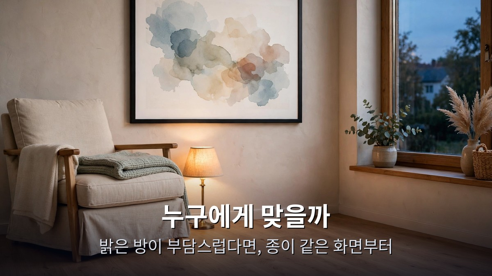

<!-- 본문 시작 -->

전자잉크 액자는 105.58달러부터 시작한다.
2026년 11월 기준, 실제로 살 수 있는 제품 네 가지의 가격은 105.58달러부터 499달러까지다.
작은 사진 한 장이면 싼 쪽으로, 거실 벽의 그림 한 장이면 비싼 쪽으로 고르면 된다.

> **한 줄로 정리하면, 전자잉크 액자의 시작 가격은 105.58달러다. 크기와 용도를 먼저 정하면 네 가지 가운데 고를 제품이 정해진다. 가격은 미국 공식 스토어·판매처 표시가다.**

사진을 액자에 띄우는 대신 손에 쥐고 싶다면 [사진을 종이 사진으로 남기는 프린터](https://blog.naver.com/3700708/224475908088)에서 캐논 셀피 CP1500을 먼저 보는 것도 좋다. 이 글은 액자 가격과 고르는 기준만 정리한다.

## 전자잉크 액자 가격은 얼마인가?

가장 싼 제품은 웨이브쉐어 ESP32-S3 포토페인터 7.3인치다.
가격은 105.58달러, 화면은 7.3인치에 800×480이다.
나무 액자 안에 전자잉크 화면을 넣은 제품으로, 네 가지 가운데 유일하게 100달러대에 들어간다.

그다음은 스위치봇 AI 아트 프레임 2 7.1인치, 169.99달러다.
화면은 7.1인치에 1200×1600으로, 사양표 기준 282ppi라 작은 화면에 사진을 촘촘하게 보여준다.
같은 시리즈에는 13.3인치 399.99달러와 31.5인치 1,399.99달러도 있어, 크기를 키울수록 가격이 크게 뛴다.

아우라 잉크는 10인치가 349달러, 13.3인치가 499달러다.
두 제품 모두 1600×1200 해상도라, 화면이 작은 10인치가 200ppi로 13.3인치의 150ppi보다 촘촘하다.
10인치와 13.3인치의 가격 차이는 150달러다.

네 제품의 가격 차이는 4배가 넘는다.
105.58달러와 499달러 사이에서 고르는 기준은 화면 크기와 용도다.
가격만 보면 웨이브쉐어 제품이 가장 싸지만, 쓰는 방법이 달라서 가격만으로 고르면 안 된다.

스위치봇은 AI로 그림을 만드는 기능이 월 3.99달러 별도 구독이라, 그 기능까지 쓰려면 이 비용이 더 든다.
처음 30일은 무료 체험이다.
아우라 잉크는 구독 없이 앱에서 사진을 무제한으로 공유할 수 있다.

책상 위에 둔 작은 나무 액자, 사진 한 장이 종이처럼 보인다.

## 전자잉크 액자는 어떻게 쓰나?

아우라 잉크는 앱에서 사진을 고르고 와이파이로 보낸다.
하루에 최대 12회까지 사진을 바꿀 수 있고, 한 장을 바꾸는 데 약 30초가 걸린다.
아우라 잉크는 하루에 한 장씩 바꾸는 조건으로 최대 3개월의 배터리 사용을 내세운다(제조사 주장).

스위치봇은 액자 뒤의 버튼을 누르거나 액자를 세 번 두드려 그림을 바꾼다.
16GB microSD 카드가 들어 있어 약 5,000장을 담아둘 수 있다.
스위치봇은 하루에 한 번씩 그림을 바꾸는 조건으로 최대 3년의 배터리 사용을 내세운다(제조사 주장).

웨이브쉐어 제품은 USB-C 전원을 꽂아두고 쓴다.
배터리는 들어 있지 않아 따로 사야 하고, 16GB TF 카드가 함께 들어 있다.
공식 문서에는 전체 화면을 바꾸는 데 약 25초가 걸린다고 적혀 있다.

웨이브쉐어 제품은 앱으로 바로 쓰는 완성품이라기보다, 공식 문서와 함께 설정하는 기기에 가깝다.
처음부터 손쉽게 쓰고 싶다면 스위치봇이나 아우라 잉크 쪽이 맞는다.
아우라 잉크는 빛을 조절하는 전면 조명이 있어 어두운 방에서도 사진이 보이고, 밤에는 조명이 저절로 꺼진다.

소파에 앉아 앱에서 고른 사진을 액자로 보내는 모습.

밤에 불을 끄고 벽에 크게 보고 싶다면 [벽에 크게 띄우는 미니빔](https://blog.naver.com/3700708/224475163501)이 맞는지도 함께 따져볼 만하다. 전자잉크 액자는 천천히 바뀌는 그림에 맞고, 미니빔은 밤에 크게 보는 영상에 맞는다.

## 전자잉크 액자는 누구에게 맞나?

책상 위에 사진 한 장을 두고 싶다면 웨이브쉐어 제품이나 스위치봇 7.1인치가 맞는다.
거실 벽에 그림 한 장을 걸고 싶다면 아우라 잉크 13.3인치가 맞는다.
그 중간이면 아우라 잉크 10인치나 스위치봇 13.3인치가 맞는다.

무게도 따져볼 만하다.
아우라 잉크 10인치는 1.94파운드, 13.3인치는 3.2파운드다.
벽에 걸 때는 고정 방식을 미리 확인하는 것이 좋다.

사진을 수시로 바꾸거나 동영상을 틀고 싶다면 전자잉크 액자는 맞지 않는다.
아우라 잉크는 동영상과 라이브 포토를 보여주지 않고, 사진을 바꾸는 데도 30초쯤 걸린다.
매일 여러 번 바꾸면 배터리 주장과도 달라진다.

아우라 잉크 13.3인치는 2026년 8월에는 미국 공식 페이지에서 품절로 표시됐다는 보도가 있다.
사기 전에 재고를 확인하는 것이 안전하다.
국내 정식 판매 여부와 배송비는 확인되지 않았으니, 주문 전에 판매처에서 직접 확인해야 한다.

저녁 독서 공간의 벽에 건 큰 그림 액자, 빛나지 않는 화면이 방에 녹아든다.

표의 가격은 2026년 11월 기준 미국 공식 스토어·판매처 표시가다.

| 제품 | 가격 | 화면 | 전원 | 사진 넣는 방법 |
| --- | --- | --- | --- | --- |
| 웨이브쉐어 포토페인터 7.3 | $105.58 | 7.3인치·800×480 | USB-C 전원·배터리 별도 | Wi-Fi·블루투스·TF 카드 |
| 스위치봇 AI 아트 프레임 2 7.1 | $169.99 | 7.1인치·1200×1600 | 최대 3년(하루 1회 교체 기준, 제조사 주장) | 앱·16GB microSD |
| 아우라 잉크 10 | $349 | 10인치·1600×1200 | 최대 3개월(하루 1회 교체 기준, 제조사 주장) | Wi-Fi·앱 |
| 아우라 잉크 13.3 | $499 | 13.3인치·1600×1200 | 최대 3개월(하루 1회 교체 기준, 제조사 주장) | Wi-Fi·앱 |

가격표를 보고 나니 전자잉크 액자는 아직 사진 액자보다 벽에 거는 그림에 가깝다는 생각이 든다.
105.58달러부터 시작할 수 있다는 점은 반갑고, 499달러짜리 그림 한 장은 선뜻 고르기 어려운 가격이다.
집에 있는 사진이 얼마나 자주 바뀌는지, 그 답이 정해지면 고를 제품도 정해진다.
거실 벽에 그림 한 장을 오래 두고 보는 집이라면, 바꾸는 속도가 느려도 괜찮다는 쪽으로 마음이 간다.

## 자주 묻는 질문

**전자잉크 액자는 눈이 편한가요?**
빛을 내지 않고 방의 빛을 반사해 보여주니 번쩍임이 적다는 것이 전자잉크 액자의 특징이다.
어두운 방에서는 아우라 잉크의 전면 조명을 켜야 사진이 보인다.
눈이 편한 정도는 사람마다 달라서, 이 글에서는 수치로 단정하지 않는다.

**사진은 얼마나 자주 바꿀 수 있나요?**
아우라 잉크는 하루 최대 12회까지 바꿀 수 있고, 한 장을 바꾸는 데 약 30초가 걸린다.
웨이브쉐어 공식 문서에는 전체 화면을 바꾸는 동안 깜빡임이 정상이라고 적혀 있다.
자주 바꾸는 용도라면 이 기다림과 깜빡임을 먼저 받아들여야 한다.

**국내에서 바로 살 수 있나요?**
이 글의 가격은 미국 공식 스토어·판매처 표시가다.
국내 정식 판매 여부와 배송비는 확인되지 않았다.
주문하기 전에 판매처에서 배송 국가·배송비·관세를 직접 확인하는 것이 안전하다.

## 함께 보면 좋은 글

[클로드 무료로 시작하는 법｜8분 정리, 시작 전 꼭 확인할 5가지 단점](https://blog.naver.com/3700708/224474079288)

[로랜텍 거치대 후기｜리뷰 15,689개가 고른 접이식 태블릿·폰 거치대](https://blog.naver.com/3700708/224478574315)

<!-- 본문 끝 -->

## 작업용 출처·이미지 정보 (업로드 제외)

- SwitchBot 공식 스토어 제품 페이지 (2026-11-18 확인): 7.1인치 169.99달러·13.3인치 399.99달러·31.5인치 1,399.99달러, 명화 500점·16GB microSD 카드 약 5,000장, 배터리 5,000mAh·20,000mAh, AI 기능 월 3.99달러 별도 구독, 최대 3년(하루 1회 교체 기준, 제조사 주장)
- SwitchBot AI Art Frame 2 사양표(매체 보도 기준): 7.1인치 1200×1600·282ppi, 13.3인치 1200×1600·150ppi, 31.5인치 1440×2560·93ppi, 첫 30일 무료 체험
- Aura 보도자료 (2026-10-21): Aura Ink 13.3인치 499달러, 1600×1200, 전면 조명·밤 자동 소등, 최대 3개월(하루 1회 교체 기준, 제조사 주장), 구독 없는 무제한 사진 공유
- Gear Diary (2026-11-10): Aura Ink 10인치 349달러 출시, 1600×1200·200ppi, 최대 3개월, USB-C 충전 최대 6시간, 10.9×9.0×0.8인치·1.94파운드
- RobotShop 판매 페이지 (2026-11-18 확인): 웨이브쉐어 ESP32-S3 포토페인터 7.3인치 105.58달러, 800×480, 배터리 미포함·USB-C 전원, 16GB TF 카드 포함
- Waveshare 공식 문서: 800×480·전체 화면 교체 약 25초·5V·154.0×214.0×32.0mm, 교체 중 깜빡임은 정상
- Aura Ink 리뷰 보도 (2026-09-19): 2026년 8월 18일 기준 미국 공식 페이지 품절 표시, 구매 전 재고 확인 필요
- 블로그 주간 유입 검색어 (2026-11-09~11-15): '전자잉크 액자' 검색 유입 내 1.03%
- 가격은 미국 공식 스토어·판매처 표시가이며 세금·배송비는 별도일 수 있다. 국내 정식 판매 여부는 미확인이다.
