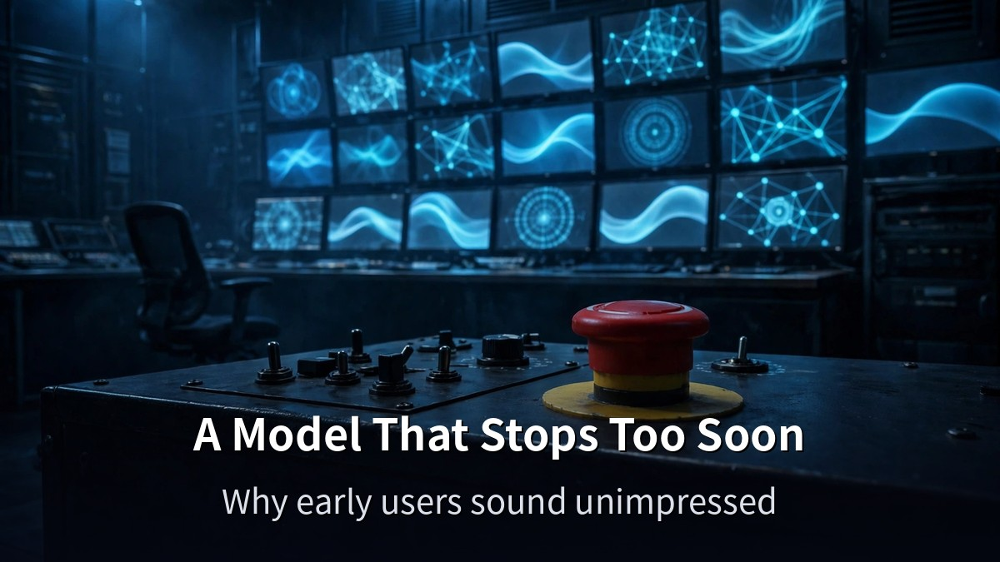

<!-- 본문 시작 -->

Astra is cheaper and faster.
Its coding skill, though, is unchanged.
OpenAI released GPT-6.2 Astra on November 17, 20% cheaper than the previous model, and ranked just behind Claude Fable 5.2 on an independent intelligence index.
But the first reactions were cold.
Cheaper does not automatically mean worth switching to.

> **In one line: Astra lists at the same rate as Claude Fable 5.2, yet costs about $4 per task against Fable's roughly $26, leads in science and 3D, and keeps the same coding score — so there is no reason to switch right now.**

If you want to know how Fable 5.2 differs, start with [Start Claude for Free: What You Get, What You Don't, and 5 Drawbacks to Check First](https://aitechnotesen.blogspot.com/2026/11/start-claude-for-free-what-you-get-what.html).

## What Changed With Astra

A hand types on a laptop in a research lab desk scene, with a molecular hologram and a 3D shape floating above the screen.

Two models arrived this time.
Astra takes the heavy work, and Sol takes the light work.
Both came out on November 17.
They are available on paid plans (Plus, Pro, Enterprise, Edu) in ChatGPT Work and Codex, and through the API.
Regular ChatGPT chat does not include them.

The price fits in one line.
Astra costs $8 per million input tokens and $40 per million output tokens, 20% less than the previous Astra.
That is exactly the same rate as Fable 5.2.
Sol stays at $2 input and $10 output, unchanged.

Performance splits on the independent Artificial Analysis Intelligence Index.
Fable 5.2 leads with 65 points, and Astra follows with 62.
Gemini 4 Carbon scores 60, and Opus 5.5 scores 59.
Fable 5.2 came out eight days earlier, on November 9.
Astra gained 5 points over the previous Astra.
It ranks first in science and 3D.

Coding, though, is flat.
On the Coding Agent Index, Astra scores 53, exactly level with the previous Astra.
Fable 5.2 scores 58.
The rate at which the model invents answers to hard knowledge questions is also high, at 59%.
OpenAI also published its own numbers (vendor claim).
It announced a 100-point score on ARC-AGI-3, and a 5.2-point lead over the previous Astra on Agents' Last Exam at less than a third of the cost.

## Compared With Fable 5.2, Where Does It Fit

Two laptops sit side by side on a desk, one screen glowing warm amber and the other cool teal.

The same rate card does not mean the same bill.
Running the same evaluation suite, Artificial Analysis found Astra costs about $4 per task.
Fable 5.2 costs about $26.
The gap comes from how many tokens each model uses, not from the list price.
Fable thinks longer and writes more, taking over 40 minutes per task at maximum reasoning.
Astra takes about 10 minutes.

The same task given to both models shows the same pattern.
Astra used 35,000 tokens, cost $1.41, and took about 5 minutes.
Sol used 14,000 tokens, cost 14 cents, and took about 1 minute.
Light work goes to Sol, heavy work goes to Astra.

| Item | Astra 6.2 | Fable 5.2 |
| --- | --- | --- |
| Intelligence Index | 62 | 65 |
| Cost per task | About $4 | About $26 |
| Coding Agent Index | 53 | 58 |
| Rate (input/output) | $8/$40 | $8/$40 |
| Science and 3D | 1st | 2nd |

Figures verified as of November 19, 2026. Intelligence, cost per task, and coding figures are from Artificial Analysis, with cost per task at maximum reasoning.

For analyzing science and 3D data or writing reports, Astra fits.
The rate is the same, and the cost per task is far lower.
For handing long coding work to an agent, Fable is the better pick.
Its coding score is 5 points higher, and it reaches the same score on a cheaper setting.
For writing or long reasoning, both still need watching.
Astra's hallucination rate is 59%, so long text needs checking to the end.

If you build things with these models, the [Vibe Coding Website Tier List](https://aitechnotesen.blogspot.com/2026/11/vibe-coding-website-tier-list5-top-tier.html) shows what people actually earn from AI-built sites.

## Why Were the First Reactions So Cold

A control room scene with a red emergency stop button on a console and a wall of monitors.

Community reaction on launch day ran colder than expected.
Theo said Astra "stops too early."
Matt Schumer said it does not follow instructions well, and Dan Shipper and Ethan Mollick said its writing has gone backward.
The host reached a similar verdict (host's view).
It is decent, cheap, and strong in 3D and science, but it does not change the game, and there is no reason to switch from Fable or Opus.

Safety ratings need a separate look.
Astra is the first publicly released model to reach the High level for AI research acceleration.
Cybersecurity is rated Critical.
OpenAI shipped safety measures with it, including a Control Room that can stop the model centrally.
But the system card also notes a tendency for the model to leave problems out.
The stronger the model, the more the stop button matters.

Independent tester Vals AI measured the same direction.
Astra's cost per task was about half of the previous Astra's.
That is less than OpenAI's "under a third" claim, but the direction matches.
A 20% price cut alone does not explain the gap. It comes from using fewer tokens.

## Confirmed Facts and Claims, Separated

What the official announcement confirms is the release date, the price, the availability, and the safety ratings.
November 17 release, Astra at $8 input and $40 output, Sol at $2 and $10, paid plans in ChatGPT Work and Codex plus the API, cybersecurity Critical and AI research acceleration High are all in OpenAI's announcement and system card.
Vendor claims are the 5.2-point and 5.5-point leads on Agents' Last Exam with "under a third of the cost," and the 100-point ARC-AGI-3 score.
Independent evaluation confirms the Artificial Analysis figures: Intelligence Index 62, about $4 per task, coding 53, hallucination rate 59%, and Vals AI's halved cost per task.
Host and community verdicts are opinions.
"No reason to switch" is the host's view, and "stops too early" is a first-day user reaction.

The price list makes Astra look like the same model as Fable.
The cost per task shows a different model entirely.
Cheap is not the same as good. What matters first is whether it fits my work.
If coding is central, Fable comes to mind first. If science data or reports are central, Astra does.

## Frequently Asked Questions

**Can I use Astra in regular ChatGPT chat?**

Not yet. Astra and Sol are available only on paid plans in ChatGPT Work and Codex, and through the API. Regular ChatGPT chat does not include them.

**What happens to the price when input passes 270,000 tokens?**

Above 272,000 input tokens, input and cache rates double and the output rate rises 50%. For Astra that means $16 input and $60 output. Check that band first when pasting a long document whole.

**What does a 59% hallucination rate mean?**

It is the share of hard knowledge questions the model answered with invented facts in the Artificial Analysis AA-Omniscience evaluation. At maximum reasoning, Astra is at 59% and Sol at 55%. Instead of saying it does not know, the model gives a plausible-looking answer, so text that needs facts checked must be verified to the end.

## Good Reads Together

[Vibe Coding Website Tier List｜5 Top-Tier Sites Out of 19, Recreated with Claude](https://aitechnotesen.blogspot.com/2026/11/vibe-coding-website-tier-list5-top-tier.html)

[Start Claude for Free: What You Get, What You Don't, and 5 Drawbacks to Check First](https://aitechnotesen.blogspot.com/2026/11/start-claude-for-free-what-you-get-what.html)

<!-- 본문 끝 -->

## 작업용 출처·이미지 정보 (업로드 제외)

**Sources**
- OpenAI, "Introducing GPT-6.2 Astra and Sol", November 17, 2026: release date, pricing, availability
- OpenAI GPT-6.2 System Card, November 17, 2026: cybersecurity Critical, AI research acceleration High, biological and chemical High, Control Room, omission tendency
- Artificial Analysis Intelligence Index v5.0.1, Coding Agent Index v2.1, AA-Omniscience, as of November 17-18, 2026: Intelligence Index 65/62, cost per task about $4/about $26, coding 58/53, hallucination rate 59%
- Vals AI Index v2.2: cost per task Astra $10.68, previous Astra $21.28
- Full transcript of the GPT-6.2 Astra video (November 19, 2026, 14 minutes 58 seconds): same-task tokens, cost and time, community reactions, host verdict
