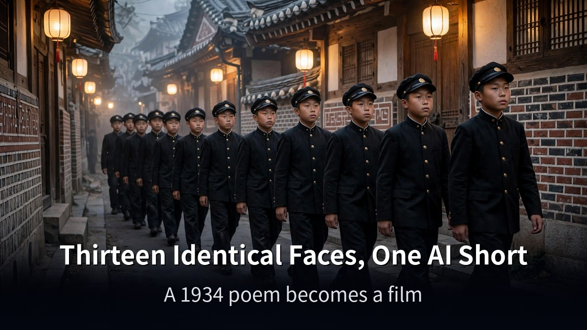
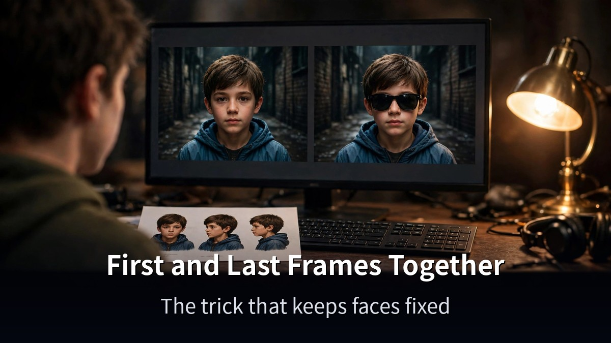
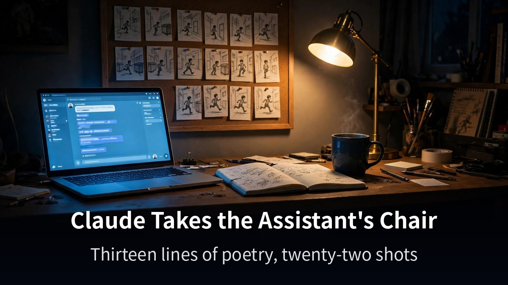
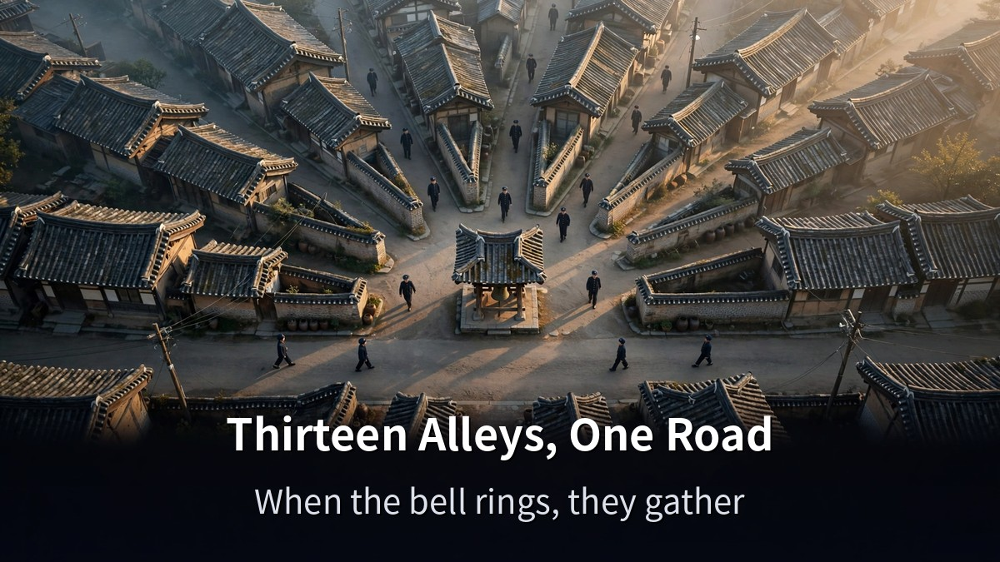

<!-- 본문 시작 -->

A poem from 1934 became a short film with Claude and Higgsfield.
Thirteen lines of poetry turned into 22 shots, and thirteen identical faces gathered on one road.
The film cost about 573 credits, and about 601 with the thumbnail.

> **In short, the trick is not to give the first frame alone. Give the first and last frames together, and keep feeding the model two canonical character images.**

To see why the model behind this workflow is getting attention, [this comparison of Fable 5.2 and Opus 5.5 across four experiments](https://aitechnotesen.blogspot.com/2026/11/fable-52-vs-opus-55-4-experiments-that.html) shows when the expensive model is worth picking.

## How did thirteen identical faces stay identical?

Faces are where AI video breaks most often.
Give the model only the first frame, and it redraws the same face as someone new in the next shot.
This film fixed that with two images at a time.
For each shot, the first-frame image and the last-frame image went in together.
Once the start and the end were fixed, the model filled in the middle.
That left less room for the face to drift.

Two canonical character images went in again and again.
The hero is a Disney-style 3D character drawn by the video's creator.
A startled expression is the character's identity, so that look stayed while one more expression was added for change.
The sunglasses problem got the same treatment.
Opaque sunglasses kept turning transparent, showing the eyes underneath, so the sunglasses image went in at the start and the end of the shot to fix it.
The difference between one reference image and two given together is what kept this film's faces in place.

The poem's structure became the shot plan.
Lee Sang's "Ogamdo, Poem No. 1" was published in 1934.
Claude split its thirteen lines into 22 shots.
Each time the line "it is scary, they say" repeats, a new scene starts.
One more boy joins the alley in each scene, until thirteen stand together at the end.
The setting is Ikseon-dong, an old alley neighborhood in Jongno, Seoul.
From the line "that is all that gathered," the film built a space where a bell rings and thirteen boys in thirteen alleys lift their heads at once and walk onto one road.
No camera and no actors were used, but the bones of the scenes came from the poem's own lines.

A monitor showing the first and last frames of an alley scene side by side, with the canonical character sheet on the desk.

Awkward motion got fixed shot by shot.
Some shots had the hero appearing out of nowhere in an empty alley, or the alley's space lying flat on screen.
The fix was reference images in between, plus clear direction.
Claude wrote a fresh prompt to turn the 3D character photorealistic.
The loop ran on the Higgsfield website: upload a reference, enter the prompt Claude wrote, generate, check, repeat.
Only images that earned a "like" became the standard for the next shot.
This film was not finished in one pass. It was made by picking and refining, over and over.

## How do Claude and Higgsfield connect?

The connection itself is simple.
Open Connectors in Claude's settings, add Higgsfield, sign in to the account, and grant permission.
The link runs on MCP, the standard protocol for connecting AI tools.
Claude can even ask the account directly how many credits are left.
Director in Claude, execution in Higgsfield: that split starts with this connection.

Connecting does not mean generating for free.
Every generation through the Higgsfield connector spends credits.
Unlimited access on a plan applies only on the Higgsfield website, not to generations that come through the connector.
That is why a paid subscription is needed.
The free plan has no monthly credits, puts a watermark on every generation, and does not allow commercial use.
Anyone planning to follow along should know first that the free plan cannot even start this.

The cost by plan looks like this.
Prices are US list prices checked on November 16, 2026.

| Plan | Monthly price | Monthly credits | One film (about 601 credits) |
|---|---|---|---|
| Starter | $19 | 270 | One month is not enough |
| Plus | $59, $47 billed annually | 1,200 | About two films |
| Ultra | $129, $99 billed annually | 3,000 | About five films |

Converted to dollars per credit, one film lands somewhere between about $20 and $42, depending on the plan.
That is about $42 on Starter, about $30 on Plus billed monthly, and about $20 on Ultra billed annually.
Without the thumbnail's 28 credits, the film itself is about 573 credits.
These credit counts come from the video, and the dollar figures are estimates calculated from the plans.
Higgsfield's own examples sit in the same range: a 15-second UGC video costs 270 credits, and a 30-second cinematic take costs 540.
A 22-shot short at about 573 credits fits that scale.
Prices change often, so check the pricing page before starting.

Five things are needed to start.
A Claude account, a paid Higgsfield subscription, two canonical character images, prop images such as the sunglasses, and the text of the source poem.
The source is Lee Sang's "Ogamdo, Poem No. 1," published in 1934, and its copyright has expired.
This video was made with support from Higgsfield.
If you are new to Claude, [how to start Claude for free, and the 5 drawbacks to check first](https://aitechnotesen.blogspot.com/2026/11/start-claude-for-free-what-you-get-what.html) shows which plan you can start on.

## How far can you trust this and follow it?

Start with what can be followed as is.
Giving the first and last frames together kept the faces fixed in this film.
Fixing a face first with a character sheet is a sequence already tested with the same tools in an earlier post.
The connector steps and the plan prices were checked against Higgsfield's own documentation and pricing page.
Those parts are safe to copy.

The limits are just as clear.
Awkward motion had to be fixed shot by shot with references and direction.
The model does not use space on its own.
With 22 shots, the loop of generating and checking takes real hands-on time.
Total production time was not stated in the video, so it stays unconfirmed.
No per-shot credit breakdown was given either, so the dollar figures are plan-based estimates only.
The same technique on another model may give different results.
Read this film's method as a Higgsfield case, not a universal rule.

A home studio at night, a laptop with a chat window and a thirteen-shot storyboard pinned on the wall.

Set beside the earlier work, this film's new part is scale.
The first AI video with Fable drawing and Higgsfield moving focused on making one scene.
This film split thirteen lines of poetry into 22 shots and kept thirteen identical faces to the end.
It moved from the beginner step, one character sheet for a 15-second video, to turning a whole poem into a film.
The picking-and-refining loop grew with the length, and that part stayed the same.

An aerial view of thirteen alleys meeting on one road, a small bell tower at the center, morning light.

**What is confirmed, and what is still a claim**
Confirmed: "Ogamdo, Poem No. 1" by Lee Sang was published in 1934, thirteen lines became 22 shots, the film used about 573 credits and the thumbnail about 28, the Claude connector links through MCP and needs a paid subscription, and the plans are Starter at $19 a month for 270 credits, Plus at $59 for 1,200, and Ultra at $129 for 3,000.
Still a claim: that this technique keeps faces identical on other models.
Total production time and the per-shot credit split were not stated.
The $20 to $42 range is an estimate from the plans, not a real payment amount.
That "the faces stayed identical to the end" follows the host's own account (host's view), with no independent check.
Prices changed several times during 2026, so read this article's prices as of their check date.

Turning one poem into a film took about 601 credits and hands that picked and refined every shot.
Better tools do not make a film by themselves. Keeping a face comes down to how the reference images are given.
Anyone who wants to lock a face down can start with the order this film used.
Then gather the references, and count the credits as they go.

## Frequently asked questions

**Can the Ogamdo original be used without copyright worries?**
Lee Sang died in 1937.
Korean copyright protects a work for 70 years after the author's death, so "Ogamdo" is out of copyright.
A specific translation or commentary may carry its own copyright, so using the original text itself is the safe route.

**Can you start on the free plan?**
Higgsfield's free plan comes with no monthly credits.
Every generation carries a watermark, commercial use is not allowed, and only one job runs at a time.
Making many shots like this film needs a paid subscription.

**Does the Claude free plan allow connectors?**
Claude's free plan allows one custom connector.
Connecting Higgsfield itself works on the free plan.
Higgsfield still needs a paid subscription on its side, so generating requires paying Higgsfield in the end.

## Good Reads Together
[Fable 5.2 vs Opus 5.5 — 4 Experiments That Show the Difference and What It Costs](https://aitechnotesen.blogspot.com/2026/11/fable-52-vs-opus-55-4-experiments-that.html)
[Interstellar — One Hour Is Seven Years on a Distant Planet — a 169-minute classic worth your evening on Netflix](https://aitechnotesen.blogspot.com/2026/11/interstellarone-hour-is-seven-years-on.html)

<!-- 본문 끝 -->

## 작업용 출처·이미지 정보 (업로드 제외)

## Sources (not for upload)

- Video transcript: Ohu Daseot-ssi Tv-ZHA0N9_0 (RSS date Nov 17, 2026; 11 min 19 sec; transcript 0:00-11:08 fully checked): 13 lines split into 22 shots, "it is scary, they say" repeats start a new scene, one boy added per scene to a final group of 13, Ikseon-dong, Jongno, Seoul as setting, "that is all that gathered" as the basis for the bell ringing and 13 boys in 13 alleys lifting their heads at once onto one road, first-frame + last-frame images given together, two canonical character images supplied throughout, opaque sunglasses image at start and end points, startled expression kept as character identity with one expression added, fresh photorealistic prompt for the 3D character requested from Claude, awkward motion fixed with reference images and clear direction, Higgsfield web loop of upload reference → Claude-written prompt → generate and check, "like" filtering, about 573 credits for the film and about 28 for the thumbnail, Higgsfield-supported video disclosure
- Higgsfield pricing page (checked Nov 16, 2026, cross-checked against secondary sources): Starter $19/mo, 270 credits/mo; Plus $59/mo ($47 annual), 1,200 credits/mo; Ultra $129/mo ($99 annual), 3,000 credits/mo; free plan with no monthly credits, watermark, no commercial use, one job at a time (official page fetch returned no readable content — cross-checked with ClipCost verified Nov 16, 2026 and professionalstoolkit Nov 2026)
- Higgsfield MCP connection docs (cross-checked against secondary sources, Nov 2026): MCP server https://mcp.higgsfield.ai/mcp, Claude Settings → Connectors → add custom connector, OAuth sign-in, paid subscription required, MCP generations deduct credits separately from web Unlimited, free plan allows one custom connector (Anthropic help center)
- Higgsfield's own examples (novoads.ai, citing Higgsfield walkthrough): Seedance 2.5 1080p 15-second UGC video 270 credits, 30-second cinematic take 540 credits, character sheet 0.5 credits
- Lee Sang, "Ogamdo, Poem No. 1," published 1934; Lee Sang died 1937, copyright expired after life + 70 years (FAQ basis)
