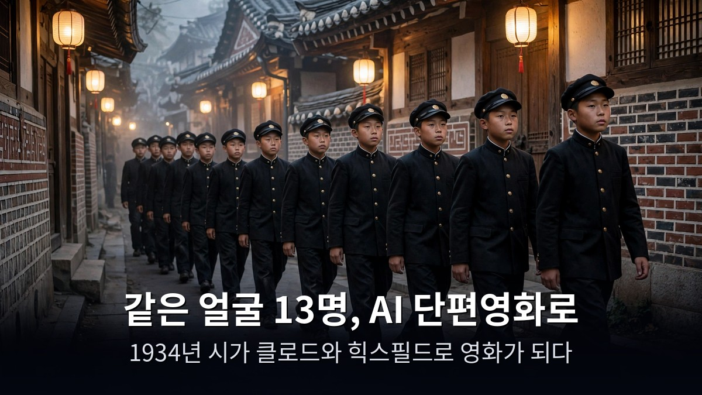
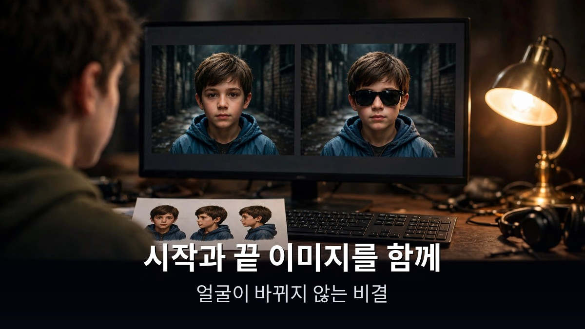
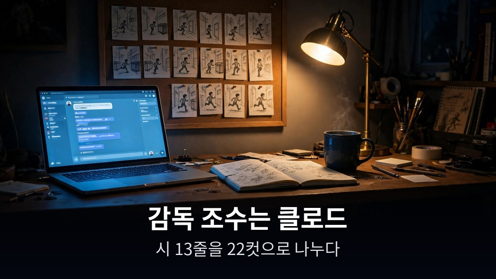
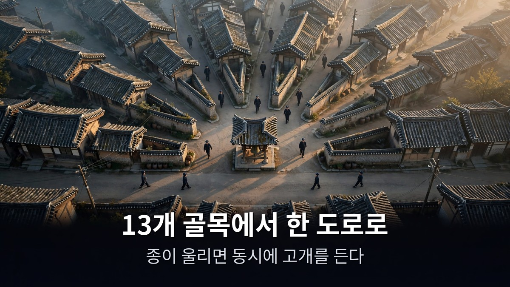

<!-- 본문 시작 -->

1934년 시 한 편이 클로드와 힉스필드로 단편영화가 됐다.
시 13줄을 22컷으로 나누고, 같은 얼굴의 주인공 13명을 한 도로에 모았다.
영화 제작에 쓴 크레딧은 약 573개, 썸네일까지 합하면 약 601개다.

> **핵심만 먼저 말하면, 같은 얼굴을 유지하는 비결은 첫 장면만 주는 게 아니라 첫 장면과 끝 장면을 함께 주고, 정본 캐릭터 이미지 2장을 계속 제공하는 것이다.**

캐릭터를 한 장으로 고정하는 기본기가 궁금하다면 [캐릭터 시트로 말하는 영상 만드는 법](https://blog.naver.com/3700708/224476482529)에서 캐릭터 시트를 만드는 순서부터 확인하면 된다.

## 같은 얼굴 13명은 어떻게 유지했나?

AI 영상에서 가장 자주 무너지는 건 얼굴이다.
첫 장면만 주고 다음 장면을 만들면, AI는 같은 얼굴을 새로 그려낸다.
이 영화는 그 문제를 이미지 두 장으로 풀었다.
각 컷을 만들 때 첫 장면 이미지와 끝 장면 이미지를 함께 제공한 것이다.
시작과 끝이 정해지면, AI는 그 사이를 채우는 식으로 움직인다.
얼굴이 마음대로 바뀌는 여지가 줄어든다.

정본 캐릭터 이미지도 2장을 계속 제공했다.
주인공은 진행자의 디즈니 스타일 3D 캐릭터다.
놀란 표정이 캐릭터의 아이덴티티라, 그 표정은 유지하면서 표정 하나를 추가해 변화를 줬다.
선글라스 문제도 같은 방식으로 잡았다.
불투명 선글라스가 자꾸 투명해져 눈이 보이는 문제가 생기자, 선글라스 이미지를 시작과 종료 시점에 함께 제공해 고쳤다.
참고 이미지를 한 장만 주는 것과 두 장을 함께 주는 것의 차이가, 이 영화의 얼굴을 지켰다.

시의 구조가 장면 설계로 이어졌다.
이상 시인의 「오감도 시제1호」는 1934년에 발표된 시다.
클로드는 시 13줄을 22컷으로 나눴다.
"무섭다고 그리오"라는 구절이 반복될 때마다 새 장면이 시작된다.
장면마다 골목에 주인공이 한 명씩 추가돼, 마지막에는 13명이 한 그룹이 된다.
배경은 서울 종로 익선동 골목이다.
"그렇게뿐이 모였소"라는 대사를 근거로, 종이 울리면 13개 골목에서 13명이 동시에 고개를 들고 한 도로로 모이는 공간을 설계했다.
카메라도 배우도 없이 만든 영화지만, 장면의 뼈대는 시의 문장에서 나왔다.

골목 장면의 첫 이미지와 끝 이미지를 나란히 둔 모니터, 책상 위 정본 캐릭터 시트.

움직임이 어색한 컷은 따로 손봤다.
빈 골목에 주인공이 갑자기 등장하거나, 골목의 공간 정보가 화면에 안 살아나는 컷이 있었다.
이럴 때는 중간중간 레퍼런스 이미지를 주고 명확한 디렉션을 덧붙였다.
3D 캐릭터를 실사처럼 바꾸는 프롬프트도 클로드에게 새로 작성해 달라고 했다.
힉스필드 웹에서 레퍼런스를 올리고 클로드가 쓴 프롬프트를 넣어 생성하고, 결과를 확인하는 과정을 반복했다.
마음에 드는 이미지에만 '좋아요'를 눌러 다음 컷의 기준을 골랐다.
한 번에 완성하는 방식이 아니라, 고르고 다듬는 반복이 영화를 만들었다.

## 클로드와 힉스필드는 어떻게 연결하나?

연결 자체는 간단하다.
클로드 설정에서 커넥터를 열고 힉스필드를 추가한 뒤, 계정에 로그인해 권한을 부여하면 된다.
연결 방식은 MCP라는 표준 연결 규격이다.
클로드는 힉스필드 계정의 남은 크레딧을 직접 물어 확인할 수도 있다.
감독은 클로드, 실행은 힉스필드라는 역할 분담이 이 연결에서 시작된다.

다만 연결했다고 무료로 쓸 수 있는 건 아니다.
힉스필드 커넥터로 만드는 모든 생성은 크레딧이 차감된다.
웹에서 쓰는 무제한 혜택은 힉스필드 웹사이트에서만 적용되고, 커넥터 경유 생성에는 적용되지 않는다.
유료 구독이 필요한 이유다.
무료 요금제는 월 크레딧이 없고, 생성마다 워터마크가 붙고, 상업적 이용도 안 된다.
따라해 볼 생각이라면, 무료 요금제로는 시작조차 안 된다는 점을 먼저 알아야 한다.

비용을 요금제별로 따져보면 아래 표와 같다.
요금은 2026년 11월 16일 확인한 미국 기준 정가다.

| 요금제 | 월 요금 | 월 크레딧 | 영화 한 편(약 601크레딧) |
|---|---|---|---|
| Starter | 19달러 | 270 | 한 달치로 부족하다 |
| Plus | 59달러, 연간 47달러 | 1,200 | 약 2편 분량 |
| Ultra | 129달러, 연간 99달러 | 3,000 | 약 5편 분량 |

크레딧 단가로 환산하면, 영화 한 편은 요금제에 따라 약 20달러에서 42달러 사이가 된다.
Starter 기준으로는 약 42달러, Plus 월간 기준 약 30달러, Ultra 연간 기준 약 20달러 수준이다.
썸네일 약 28크레딧을 빼면 영화 본편만 약 573크레딧이다.
이 수치는 영상에서 밝힌 크레딧 사용량이고, 달러 환산은 요금제에서 계산한 추정치다.
힉스필드 자체 사례와 견줘보면, 15초 UGC 영상 한 편이 270크레딧, 30초 시네마틱 영상이 540크레딧이 든다고 한다.
22컷짜리 단편에 약 573크레딧이 든 건 같은 자릿수의 이야기다.
요금은 수시로 바뀌니, 시작 전에 요금제 페이지를 직접 확인하는 게 좋다.

준비물은 다섯 가지다.
클로드 계정, 힉스필드 유료 구독, 정본 캐릭터 이미지 2장, 선글라스 같은 소품 이미지, 그리고 원작 시의 텍스트다.
원작은 이상의 「오감도 시제1호」로, 1934년 발표작이라 저작권이 만료됐다.
이 영상은 힉스필드 지원을 받아 만든 영상이다.
같은 도구로 처음 AI 영상을 만든 시도는 [페이블 5.2로 AI 영상 만들기](https://blog.naver.com/3700708/224475162359)에서 볼 수 있다.

## 어디까지 믿고 따라 하면 되나?

먼저 따라 할 수 있는 부분부터 보자.
첫 장면과 끝 장면을 함께 주는 방식은 이 영화에서 실제로 얼굴을 고정했다.
캐릭터 시트로 얼굴을 먼저 잡는 방법도 앞선 글에서 같은 도구로 검증된 순서다.
커넥터 연결 단계와 요금제 가격은 힉스필드 공식 문서와 요금제 페이지에서 직접 확인했다.
이 부분은 그대로 따라 해도 된다.

한계도 분명하다.
움직임이 어색한 컷은 레퍼런스와 디렉션으로 일일이 손봐야 했다.
AI가 공간 정보를 스스로 살려 쓰지는 못한다는 뜻이다.
컷이 22개나 되다 보니, 생성과 확인을 반복하는 손이 많이 든다.
총 제작 시간은 영상에서 밝히지 않아 미확인이다.
모델별 크레딧 단가도 영상에 없어, 요금제 기준 추정치로만 밝혔다.
다른 모델로 같은 기법을 쓰면 결과가 달라질 수 있다.
이 영화의 방법은 힉스필드에서의 사례로 읽는 게 맞다.

밤의 홈 스튜디오, 노트북 화면의 채팅창과 벽에 붙은 13컷 스토리보드.

비슷한 작업을 한 앞선 글과 견주면, 이 영화의 새로움은 규모에 있다.
페이블로 그림을 그리고 힉스필드로 움직인 첫 AI 영상은 한 장면을 만드는 데 집중했다.
이 영화는 시 13줄을 22컷으로 나눠, 13명의 같은 얼굴을 끝까지 유지하는 데 도전했다.
캐릭터 시트 한 장으로 15초 영상을 만드는 입문 단계에서, 시 한 편을 영화로 바꾸는 단계로 넘어간 셈이다.
다만 분량이 늘어난 만큼, 손으로 고르는 반복도 함께 늘었다는 점은 같다.

13개 골목이 한 도로로 모이는 마을 전경, 가운데 종탑과 새벽 빛.

**확인된 사실과 아직 주장인 것**
확인된 것은 이상의 「오감도 시제1호」가 1934년 발표작이라는 점, 시 13줄을 22컷으로 나눴다는 점, 영화 약 573크레딧과 썸네일 약 28크레딧이라는 영상 속 사용량, 클로드 커넥터가 MCP 방식으로 연결되고 유료 구독이 필요하다는 점, Starter 월 19달러에 270크레딧, Plus 월 59달러에 1,200크레딧, Ultra 월 129달러에 3,000크레딧이라는 요금제다.
아직 주장으로 남는 것은 이 기법이 다른 모델에서도 같은 얼굴을 유지한다는 판단이다.
총 제작 시간과 컷별 크레딧 내역은 영상에서 밝히지 않았다.
달러 환산 약 20달러에서 42달러는 요금제에서 계산한 추정치이지, 실제 결제 금액이 아니다.
"같은 얼굴을 끝까지 유지했다"는 평가는 진행자의 설명에 따른 것이고(진행자 견해), 독립적인 검증은 없다.
요금제는 2026년 안에 여러 번 바뀌었으니, 이 글의 가격은 확인 날짜 기준으로 읽어야 한다.

시 한 편을 영화로 바꾸는 데 든 건 크레딧 약 601개와, 컷마다 고르고 다듬는 손이었다.
도구가 좋아졌다고 영화가 저절로 만들어지는 건 아니고, 얼굴을 지키는 건 결국 참고 이미지를 어떻게 주느냐에 달려 있었다.
얼굴을 고정하고 싶은 사람이라면, 이 영화가 쓴 순서부터 따라 해보면 된다.
그 다음에는 레퍼런스를 모으고, 크레딧이 얼마나 드는지 직접 세어보는 순서다.

## 자주 묻는 질문

**오감도 원작은 저작권 걱정 없이 쓸 수 있나요?**
이상 시인은 1937년에 세상을 떠났다.
한국 저작권법은 저작자 사후 70년까지 권리를 보호하므로, 「오감도」는 저작권이 만료된 작품이다.
다만 시의 특정 번역본이나 해설서는 별도 저작권이 있을 수 있으니, 원문 자체를 쓰는 게 안전하다.

**무료 요금제로도 시작할 수 있나요?**
힉스필드 무료 요금제는 월 크레딧이 없다.
생성마다 워터마크가 붙고 상업적 이용도 안 되며, 한 번에 한 개씩만 만들 수 있다.
이 영화처럼 여러 컷을 만들려면 유료 구독이 필요하다.

**클로드 무료 요금제에서도 커넥터를 쓸 수 있나요?**
클로드 무료 요금제는 사용자 지정 커넥터를 1개까지 쓸 수 있다.
힉스필드를 연결하는 것 자체는 무료 요금제에서도 된다.
다만 힉스필드 쪽에서 유료 구독이 필요하므로, 생성하려면 결국 힉스필드 결제가 필요하다.

## 함께 보면 좋은 글
[페이블 5.2로 AI 영상 만들기｜클로드가 그림 그리고 힉스필드가 움직이는 법](https://blog.naver.com/3700708/224475162359)
[월-E｜말 없는 청소 로봇이 묻는 것, 지구를 되돌릴 수 있을까](https://blog.naver.com/3700708/224476483237)

<!-- 본문 끝 -->

## 작업용 출처·이미지 정보 (업로드 제외)

## 출처 목록 (업로드 제외)

- 영상 자막: 오후다섯씨 Tv-ZHA0N9_0 (RSS 기준 2026-11-17 업로드, 11분 19초, 자막 0:00~11:08 전체 확인): 시 13줄을 22컷으로 나눔, "무섭다고 그리오" 반복마다 새 장면, 장면마다 1명씩 추가해 최종 13명, 배경 서울 종로 익선동 골목, "그렇게뿐이 모였소"에서 종이 울리면 13개 골목에서 동시에 고개를 들고 한 도로로 모이는 공간 설계, 첫 장면+끝 장면 동시 제공, 정본 캐릭터 이미지 2장 계속 제공, 불투명 선글라스 이미지 시작·종료 시점 제공, 놀란 표정 아이덴티티 유지+표정 1개 추가, 3D 캐릭터 실사화 프롬프트 클로드에 새로 작성 요청, 움직임 어색함은 레퍼런스·디렉션으로 보완, 힉스필드 웹에서 레퍼런스 업로드→클로드 프롬프트 입력→생성·확인 반복, '좋아요' 이미지 필터링, 영화 약 573크레딧·썸네일 약 28크레딧, 힉스필드 지원 영상 표기
- Higgsfield 요금제 페이지 (2026-11-16 확인, 2차 출처 대조): Starter 월 19달러·월 270크레딧, Plus 월 59달러(연간 47달러)·월 1,200크레딧, Ultra 월 129달러(연간 99달러)·월 3,000크레딧, 무료 요금제 월 크레딧 없음·워터마크·상업적 이용 불가·동시 1개 작업 (공식 페이지 직접 접속 시 콘텐츠 미렌더링 — ClipCost 2026-11-16 검증·professionalstoolkit 2026-11월 확인분으로 대조)
- Higgsfield MCP 연결 문서 (2차 출처 대조, 2026-11월): MCP 서버 https://mcp.higgsfield.ai/mcp, 클로드 설정→커넥터→사용자 지정 커넥터 추가, OAuth 로그인, 유료 구독 필요, MCP 경유 생성은 웹 무제한 혜택과 별개로 크레딧 차감, 무료 요금제 커넥터 1개까지 (Anthropic 도움말)
- Higgsfield 자체 사례 (novoads.ai, Higgsfield 워크스루 인용): Seedance 2.5 1080p 15초 UGC 영상 270크레딧, 30초 시네마틱 540크레딧, 캐릭터 시트 0.5크레딧
- 이상 「오감도 시제1호」 1934년 발표, 이상 1937년 사망·사후 70년 저작권 만료 (FAQ 근거)
