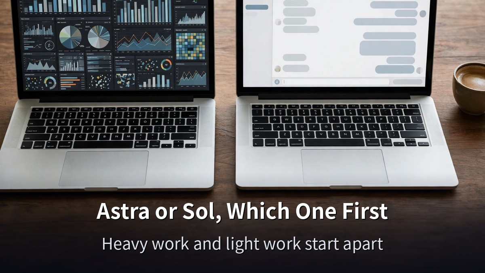

<!-- 본문 시작 -->

GPT-6.2 Astra costs $8 per million input tokens and $40 per million output tokens.
As of November 2026, that is the list price OpenAI published on November 17.
In ChatGPT it starts with Plus at $20 a month, and no free-plan access was announced.

> **In short, GPT-6.2 Astra lists at $8 in and $40 out per million tokens. The same price as Claude Fable 5.2, so light work starts with Sol.**

The price to beat is Claude's. [This comparison of Fable 5.2 and Opus 5.5 across four experiments](https://aitechnotesen.blogspot.com/2026/11/fable-52-vs-opus-55-4-experiments-that.html) shows when the expensive model is worth picking. This post covers Astra's price and how to use it.

## How much does GPT-6.2 Astra cost?

The standard API price for Astra is $8 per million input tokens and $40 per million output tokens.
Cached input, for prompts the provider has already stored, costs $0.40 per million tokens.
That is 20% below GPT-6 Astra at $10 and $50, and cached input is 60% cheaper.

GPT-6.2 Sol, released alongside it, costs $2 in and $10 out, the same as the previous Sol.
Cached input is $0.10.
Sol costs a quarter of Astra.

One job with 250,000 fresh input tokens and 25,000 output tokens costs $3.00 on Astra.
That is $2.00 for input plus $1.00 for output.
The same job costs $3.00 on Claude Fable 5.2, $1.50 on Opus 5.5, and $0.75 on Sol.

The claim that it is 20 times cheaper than Claude does not hold on list price.
Astra and Claude Fable 5.2 charge exactly the same for input and output.
The 20-times figure seems to come from OpenAI's own evaluation claim: 5.5 points above Fable 5.2 on a multistep professional-work test, at about 5% of the cost per task. No independent test has confirmed it yet.

**Confirmed facts** are the November 17 release date, the $8 and $40 list prices, and the rollout to Plus, Pro, Enterprise, and Edu users in ChatGPT Work, Codex, and the API.
**Claims** include OpenAI's statement that cost per task is less than a third of GPT-6 Astra. Two independent testers measured a 36% and 50% drop, a smaller cut than the announcement implies.
**Unconfirmed** are free-plan access and any official price in Korean won. Neither was announced.

Two laptops side by side, one for heavy work and one for light work.

## How do you use GPT-6.2 Astra?

In ChatGPT, Astra lives in Work and Codex, not in regular Chat.
It is available to Plus, Pro, Enterprise, and Edu subscribers, and this rollout does not add it to regular Chat.
Plus costs $20 a month, and Pro comes in three tiers at $100, $200, and $500 a month.

Developers call it `gpt-6.2-astra` through the API.
The context window reaches 1,050,000 tokens, with up to 922,000 input tokens and 128,000 output tokens per request.
It takes text and images in and returns text.

Requests over 272,000 input tokens move to higher rates.
Input rises to $16 and output to $60.
Cutting a long document down to the part you need is the way to keep the bill down.

Work that is not urgent can go through the Batch API at half the standard rate, according to reports.
For speed there is Ultrafast, reported at $40 input and $200 output for Astra through the API.
Ultrafast covers both models on the Pro 500 plan, and on the Pro 200 plan it starts with Sol.

No announcement covers free-plan access to Astra.
If the model does not appear in the picker after updating the app, the plan, workspace permissions, or the staged rollout may be the reason.
OpenAI's Help Center pages on Work and Codex are the place to check first.

Seen over the shoulder, a coding screen in Work and Codex.

For how the other flagship model of the same week is judged, [what actually changed in Claude Fable 5.2](https://aitechnotesen.blogspot.com/2026/11/claude-fable-52-what-actually-changed.html) is worth reading alongside this post.

## Who is GPT-6.2 Astra for?

Long, heavy professional work in science, law, and finance, and polishing slides, tables, and documents, point to Astra.
OpenAI presents Astra as the model for the hardest projects (maker claim).
Its performance scores come from OpenAI's own measurements, so treat them as a reference until independent tests weigh in.

Everyday writing, coding, and multistep agent work point to Sol.
Sol costs a quarter of Astra, and OpenAI's announcement says it nearly matches Astra on a coding test (maker claim).
Running light work on Astra means paying four times as much for the same answer.

If you already use Claude Opus 5.5, ordinary work is cheaper there.
Opus 5.5 lists at $4 in and $20 out, half of Astra.
Step up to Astra or Fable 5.2 only when top-tier performance is needed, and pick between Opus 5.5 and Sol for everyday work.

An evening home desk with a laptop and notes, weighing the choice.

Prices in the table are standard API rates as of November 2026. Batch is half the standard rate, as reported.

| Model | Input (per 1M tokens) | Cached input (per 1M tokens) | Output (per 1M tokens) | Batch |
| --- | --- | --- | --- | --- |
| GPT-6.2 Astra | $8.00 | $0.40 | $40.00 | $4.00 / $20.00 |
| GPT-6.2 Sol | $2.00 | $0.10 | $10.00 | $1.00 / $5.00 |
| Claude Fable 5.2 | $8.00 | $0.20 | $40.00 | $4.00 / $20.00 |
| Claude Opus 5.5 | $4.00 | $0.20 | $20.00 | $2.00 / $10.00 |

After looking at the price list, Astra's value depends less on the list price than on where it is used.
If the 20-times claim is what brought you here, the list price is the place to start over.
With two models at the same price, the work itself decides, not the price tag.
Heavy work goes to Astra, and light work starts with Sol.

## Frequently asked questions

**Can you use GPT-6.2 Astra for free?**
No free access was announced, and it is not in regular Chat.
Free use needs a further announcement from OpenAI.
If a claim says the free plan covers it, check whether the source is an OpenAI announcement first.

**Does a ChatGPT subscription cover API use too?**
No. The subscription and the API are billed separately.
The subscription covers use inside the ChatGPT app, and the API bills by tokens used.

**How much is it in Korean won?**
OpenAI lists its prices in US dollars.
The won amount moves with the exchange rate and taxes at payment time, so there is no official won price.
Check the amount shown at checkout.

## Good Reads Together

[Fable 5.2 vs Opus 5.5 — 4 Experiments That Show the Difference and What It Costs](https://aitechnotesen.blogspot.com/2026/11/fable-52-vs-opus-55-4-experiments-that.html)

[Claude Fable 5.2: What Actually Changed — An OS in 8 Days, Fermat in 30 Hours](https://aitechnotesen.blogspot.com/2026/11/claude-fable-52-what-actually-changed.html)

<!-- 본문 끝 -->

## 작업용 출처·이미지 정보 (업로드 제외)

- OpenAI announcement (community.openai.com, November 17, 2026): release date November 17; ChatGPT Work and Codex for Plus, Pro, Enterprise, and Edu; API list prices Astra $8 in / $40 out and Sol $2 in / $10 out per million tokens; Ultrafast on Pro 500 for both models and on Pro 200 starting with Sol; not added to regular Chat (staff reply); cost per task under a third of GPT-6 Astra and Sol at a fifth of the cost on FrontierCode 2.0 (OpenAI claims)
- OpenAI API pricing and model pages (as reported, checked November 18, 2026): cached input Astra $0.40 and Sol $0.10; over 272,000 input tokens, $16 in and $60 out; context 1,050,000 tokens, max input 922,000, max output 128,000; text and image in, text out; Batch at half the standard rate (as reported); Ultrafast API Astra $40 / $200 and Sol $10 / $50 (as reported)
- Anthropic pricing page (as reported, checked November 9–12, 2026): Fable 5.2 $8 in / $40 out, cache read $0.20, Batch $4 / $20; Opus 5.5 $4 in / $20 out, cache read $0.20, Batch $2 / $10; Sonnet 5.5 $2 in / $10 out
- ChatGPT plans (OpenAI pricing page and Help Center, as reported, checked November 4, 2026): Plus $20 a month, Pro $100 / $200 / $500 a month, Go $8 a month; API use billed separately from the subscription
- TechTimes (November 18, 2026): independent tests put the cost-per-task cut at 36% (Artificial Analysis, $4.00 vs $6.24) and 50% (Vals AI, $10.68 vs $21.28), smaller than OpenAI's claim
- Qz report (November 18, 2026): 5.5 points above Fable 5.2 at about 5% of the cost per task, citing OpenAI's announcement; no independent verification
- Blog search traffic (routine check): 'gpt 6.2' and 'astra 6.2' among the top search terms
- Prices are in US dollars; taxes and exchange rates may apply. Free-plan access and a won price are unconfirmed.
