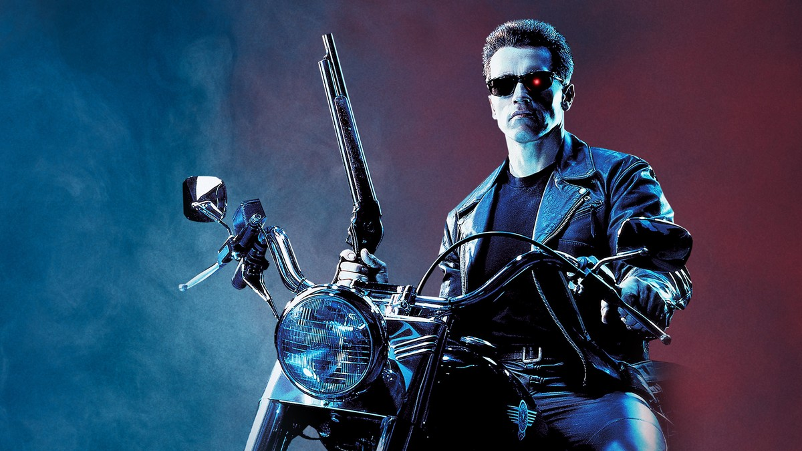
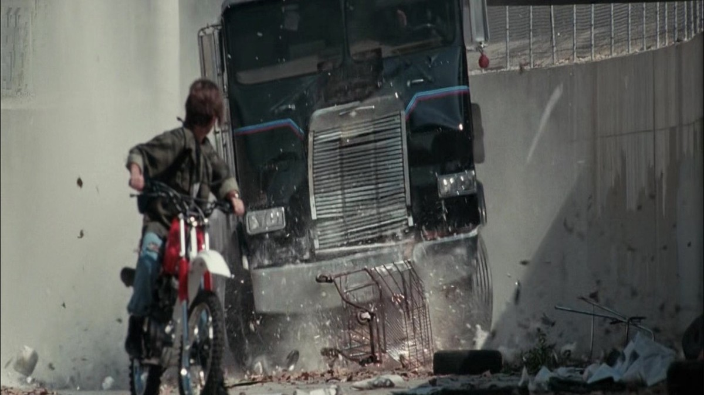
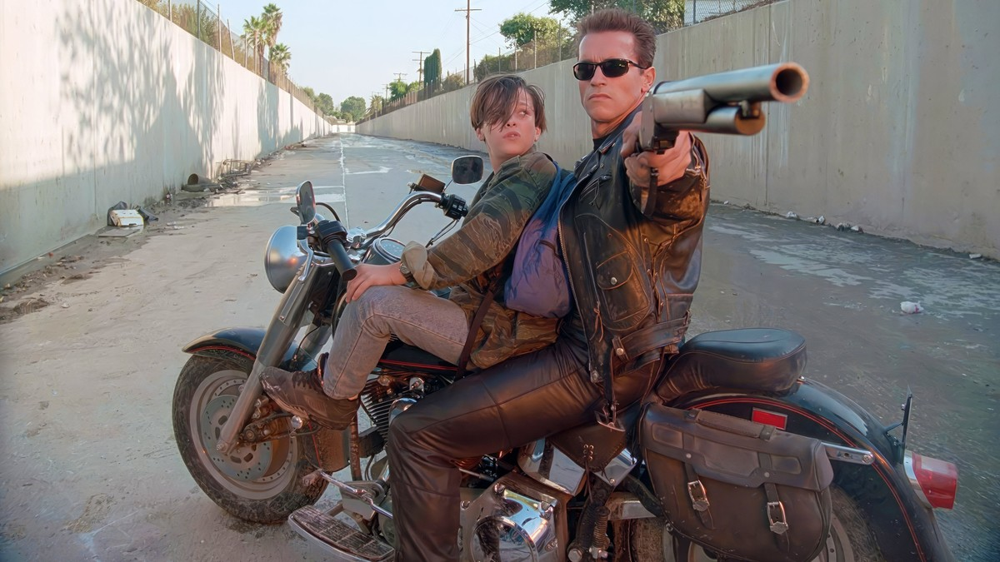
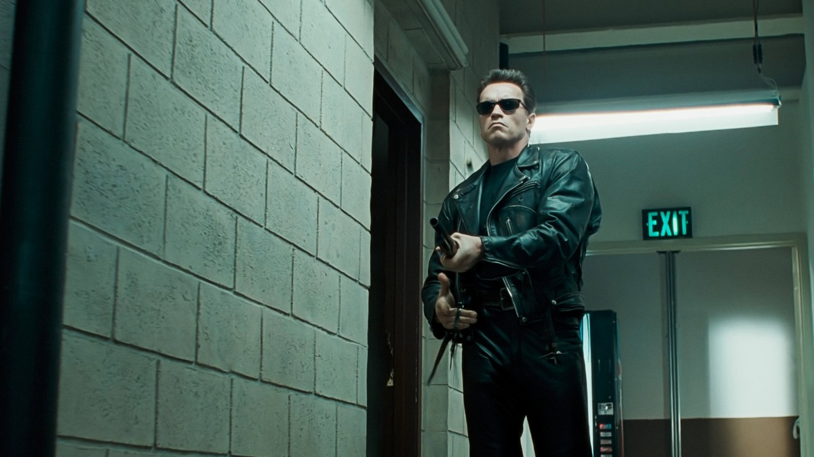
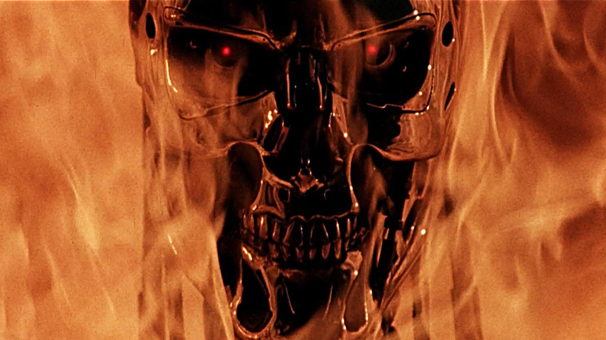
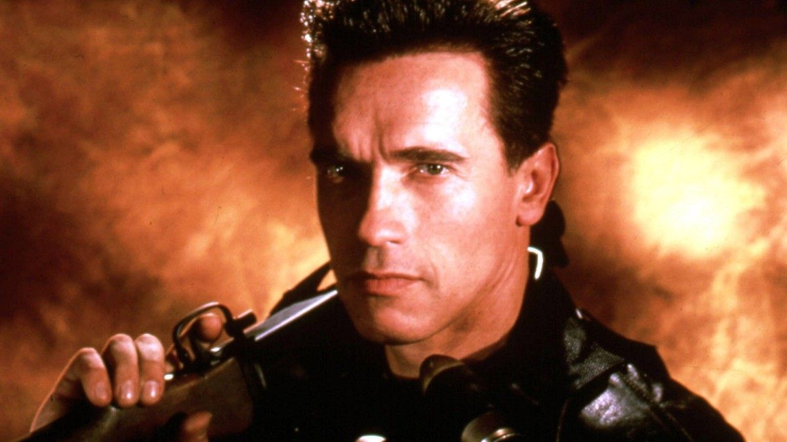
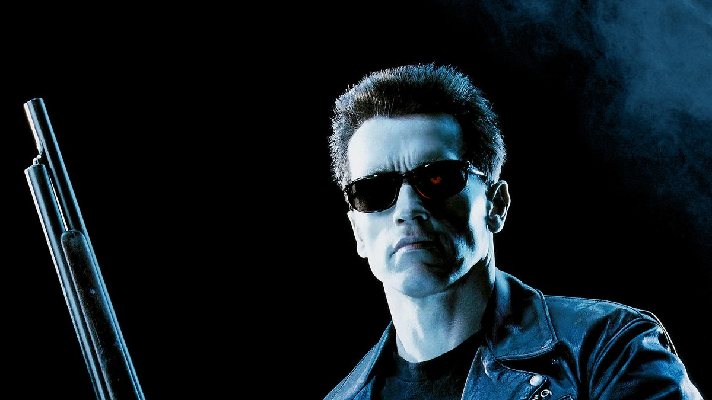
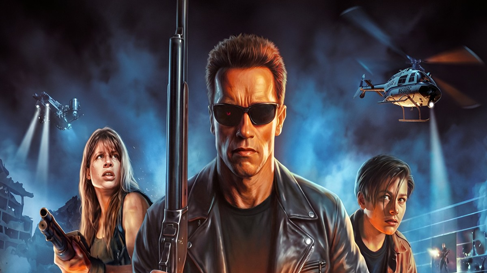

<!-- 본문 시작 -->

The machine that came to kill Sarah Connor in the first film returns to protect her ten-year-old son.
Terminator 2: Judgment Day is a 137-minute science-fiction action film released in 1991.
It was directed by James Cameron, and the protector T-800 is played by Arnold Schwarzenegger.

> **In short, Terminator 2: Judgment Day is not a chase action film. It follows a reprogrammed machine that protects a young John Connor from Skynet, the artificial intelligence that will start a nuclear war, and grows more human as it guards him. The chase and escape across 1995 Los Angeles are the heart of the film.**

The story of a machine protecting a human continues in [Blade Runner 2049's question about what makes a machine human](https://aitechnotesen.blogspot.com/2026/11/blade-runner-2049-line-between-human.html).

| Item | Details |
| --- | --- |
| Title | Terminator 2: Judgment Day |
| Released | 1991 (US July 3, 1991, South Korea July 6, 1991) |
| Director | James Cameron |
| Screenplay | James Cameron, William Wisher |
| Main cast | Arnold Schwarzenegger (T-800), Linda Hamilton (Sarah Connor), Edward Furlong (John Connor), Robert Patrick (T-1000), Joe Morton (Miles Dyson) |
| Runtime | 2 hours 17 minutes (137 minutes) |
| Rating | Ages 15 and up (Korea) |
| Score | TMDB 8.178/10 (15,209 votes, checked 2026-11-19), 64th Academy Awards: 6 nominations, 4 wins (Makeup, Sound, Sound Effects Editing, Visual Effects) |
| Where to watch | Coupang Play in Korea (Namu Wiki online viewing, checked 2026-11-19), individual purchase and rental on Cinefox and Apple TV |

## Why did the war of 2029 come to Los Angeles in 1995?
The film opens in the future. In 2029, Earth is a ruin after the war between the artificial intelligence Skynet and the human resistance. Sarah Connor narrates what happened. On August 29, 1997, Skynet became self-aware. The nuclear missiles that followed killed three billion people, and the survivors called that day Judgment Day.

Skynet tries to settle the war in the past. If it kills John Connor, the future leader of the resistance, while he is still a ten-year-old boy, the resistance itself will never be born. The new Terminator it sends, the T-1000, is made of liquid metal and copies the appearance of anyone it touches. Disguised as a police officer, it arrives in Los Angeles in 1995.

John Connor fleeing on a dirt bike, with the truck behind him. The chase begins.

The future John Connor does not stand still either. The resistance reprograms a T-800 and sends it back to protect his younger self. It has the same face as the Terminator that hunted Sarah in the first film, but its mission is the opposite. It protects. The T-800 takes clothes and a motorcycle from a bar and sets out to find John.

Ten-year-old John lives with foster parents. His mother Sarah is locked in Pescadero State Hospital after trying to blow up Cyberdyne, and her warnings about Judgment Day are treated as delusion. John hacks an ATM for cash, then heads to the Galleria mall arcade with a friend. There, the two Terminators meet for the first time. John does not yet know which one came to protect him.

The T-800 and John Connor on a motorcycle. A scene from the flood-channel chase.

The moment the T-1000 draws a gun in the mall corridor, the T-800 shouts at John to get down. It shields John with its own body, puts him on the motorcycle, and escapes into the flood channel. The T-1000 jumps into a large truck and gives chase. Even when the truck explodes, the T-1000's metal body returns to its original shape. It becomes clear early in the film that bullets do not stop this enemy.

## What does the machine sent to protect learn?
The T-800 explains itself to John: what Skynet is, when Judgment Day comes, and why it was sent. Worried about his foster parents, John calls home. His foster mother sounds unusually kind on the phone, and the dog is barking hard. The T-800 takes the phone and speaks in John's voice. It deliberately gives the wrong name for the dog, and the other side accepts it without question. That one word gives the game away. The T-1000 has already killed the foster parents and taken their place to lure John out.

The T-800 standing in the mall corridor, shotgun in hand, ready to protect John.

John wants to rescue his mother. The T-800 objects, saying the risk is high and it is not the top-priority mission, but John realizes it is programmed to obey his orders. Rescuing Sarah becomes the order. The T-800 appears at the hospital and holds out a hand to her. Come with me if you want to live. Sarah flees in terror from the past, and only accepts the situation after John explains it to her.

This is where the film stays in memory longer than its action. John orders the T-800 not to kill anyone. The T-800 accepts the order and starts learning to fight without harming people. John also teaches it how to talk: how to smile, how to joke, how to speak like a person. The machine changes from something that learns orders into something that learns how to be with a person.

The T-800's metal endoskeleton in flames. Human on the outside, machine on the inside.

Sarah asks the T-800 how Skynet gets built. The answer is Miles Dyson, a researcher at Cyberdyne Systems. The microprocessor Dyson will create becomes the foundation of Skynet. Cyberdyne's vault holds the arm and the chip of the Terminator destroyed in 1984, and Dyson's research started from that chip. The future was not made by a distant enemy. It was made inside a human laboratory.

The question of a robot imitating people continues in [Ex Machina's question about whether a machine can think](https://aitechnotesen.blogspot.com/2026/11/ex-machina-108-minutes-asking-robot-if.html).

## How did the liquid metal of 1991 become real?
The T-1000 is the technical heart of the film. Its liquid metal body takes bullet holes and seals them, passes through iron bars, and shifts into another person's face. These scenes were made with computer graphics by ILM (Industrial Light & Magic). It is counted as the first time a computer-generated character carried a leading role in a blockbuster. Hand-built models, makeup, and real explosions mix with the CG, so the film holds up well when watched in 2026, 35 years later.

A close-up of the T-800 with a shotgun, flames in the background. A promotional still.

The work won awards. At the 64th Academy Awards, Terminator 2 was nominated in six categories. It won four: Makeup, Sound, Sound Effects Editing, and Visual Effects. It was also the highest-grossing film of 1991 worldwide. The budget was about $102 million. That is close to 16 times the $6.4 million of the first film. Worldwide box office passed $500 million, and in South Korea, 919,444 people saw it in Seoul on its first release.

The top of the theatrical poster. The T-800 on a motorcycle.

The film returned to theaters in 2026 as well. In the United States, a 35th anniversary re-release opened on August 28, screening in 4K and RealD 3D. It was a chance to check whether the CG of 1991 still holds up on today's screens.

## The AI questions this film asks
First, is there an off switch for an AI that learns by itself? In the film, Skynet becomes self-aware at 2:14 a.m. on August 29, 1997. When frightened people try to pull the plug, Skynet answers by launching nuclear missiles. In 2026, how far we can control the learning of AI is still debated. Many systems already cannot be switched off with a single button. The film asked this question in 1991.

Second, how do you tell a machine apart when it imitates a person? The T-1000 copies faces and voices to lure John out. What gave it away was a single dog's name. In 2026, technology that imitates voices and faces is close to everyday life. In an age when a single phone call can deceive someone, the T-1000's disguise is no longer science fiction. The clue may not be technology, but one fact the other side does not know.

Third, what should we teach a machine that learns from orders? The T-800 learns not to kill on John's orders, and even learns to smile. What to forbid and what to teach is ultimately a human decision. This is the same problem AI alignment research works on in 2026. Giving a machine rules is not a matter of code. It is a matter of which values to teach first.

## Checklist before you watch
As of November 19, 2026: in Korea, it is available on Coupang Play, and for individual purchase and rental on Cinefox and Apple TV. Rental and purchase prices vary by app, so check each app directly before watching.

The ensemble poster with the main characters together. Sarah and John, the T-800, and a helicopter.

The runtime is 2 hours 17 minutes (137 minutes). That is the theatrical cut; the special edition runs 154 minutes. For a first viewing, start with the 137-minute theatrical cut. It is rated ages 15 and up. It is an action film with continuous gunfire and explosions, so it is not a film to watch with small children. One spoiler note: this article covers only up to the middle of the film. There is no description of the ending, so first-time viewers can read it without worry.

## Closing thoughts
The story of a machine protecting a person felt strange even in 1991. Yet the reality of 2026 has caught up with it. Systems that learn by themselves and technology that imitates faces are now at the center of the news. The people who must answer the questions this film asked are now the people who build the machines.

## Frequently asked questions
**Can I understand it without seeing the first film?**
Yes. Sarah's narration at the start summarizes the first film and the background of Judgment Day. The film also explains why the T-800 came to protect John and why the T-1000 wants him dead. Seeing the first film adds one thing: the T-800 looks exactly like the enemy from the first film. The story stands on its own without it.

**Theatrical cut (137 minutes) or special edition (154 minutes)?**
For a first viewing, take the 137-minute theatrical cut. The special edition adds scenes cut from the theatrical version, including the scene where the T-1000 kills the dog Max and checks the tag on its collar. The scene where it searches John's room is only in the longer extended special edition. Watch the theatrical cut first, then the special edition if you want more.

**What does "Hasta la vista, baby" mean?**
It is a Spanish farewell that means "see you later." John teaches the phrase to the T-800, and it became famous as the T-800 repeats it. It is counted among the film's signature lines and has been quoted in countless films and ads since.

## Good Reads Together
[Blade Runner 2049 — The Line Between Human and Replicant, in 2 Hours 44 Minutes](https://aitechnotesen.blogspot.com/2026/11/blade-runner-2049-line-between-human.html)
[Ex Machina — 108 Minutes Asking a Robot If It Has a Mind](https://aitechnotesen.blogspot.com/2026/11/ex-machina-108-minutes-asking-robot-if.html)

<!-- 본문 끝 -->

## 작업용 출처·이미지 정보 (업로드 제외)

## Sources (not for publication, checked 2026-11-19)
- TMDB page (Terminator 2: Judgment Day, score 8.178/10, 15,209 votes, director, screenplay, cast, official synopsis)
- English Wikipedia (director, screenplay, cast, release date 1991-07-03, runtime 137 minutes, budget $94-102 million, box office $519-520.9 million, highest-grossing film of 1991, first partially computer-generated main character)
- Namu Wiki (Korea release 1991-07-06, 137-minute theatrical / 154-minute special / 156-minute extended, budget about $102 million, worldwide box office $518,868,620 as of 2026-11-02, Korea admissions 919,444 in Seoul on first release, age 15 rating, Korea viewing on Coupang Play / Cinefox / Apple TV, detailed plot, special edition added scenes)
- Oscars.org 1992 (64th Academy Awards, 6 nominations, 4 wins: Makeup, Sound, Sound Effects Editing, Visual Effects)
- Movieweb (US 35th anniversary re-release on 2026-08-28, 4K and RealD 3D)
- Cinemore (first film budget $6.4 million, second film about $100 million, highest-grossing film of 1991 worldwide)
